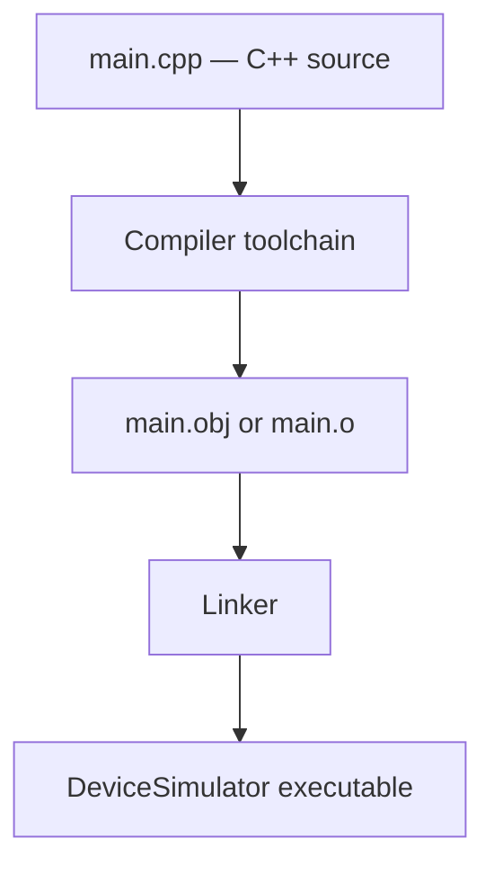
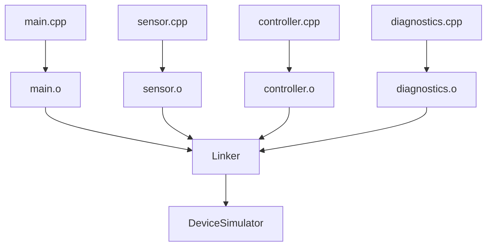
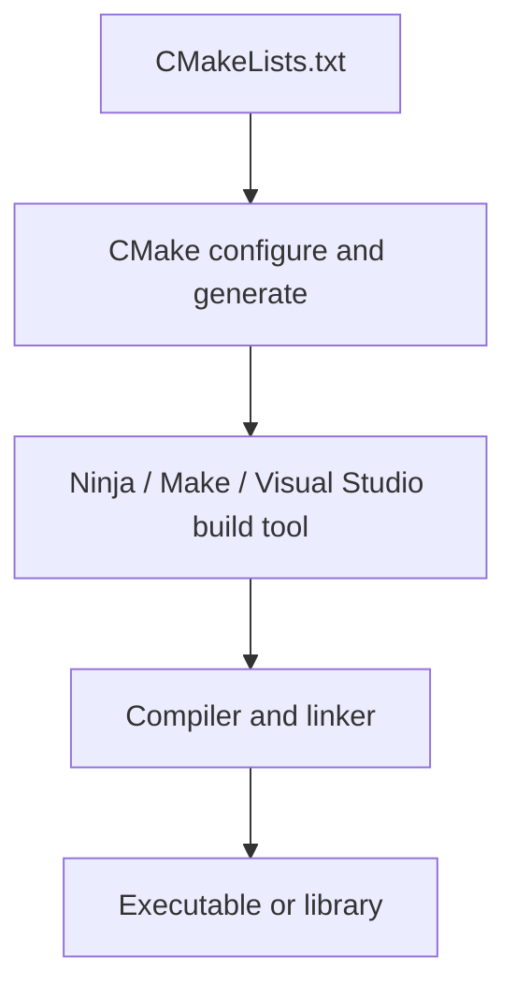

# Chapter 01 — How C++ Source Becomes an Executable: Building DeviceSimulator

> **Modern CMake: From First Principles to Production CI/CD**  
> **Module I — Build Systems Foundations** · Chapter 1 of 16 · Beginner  
> **Course project:** EmbeddedCore (future reusable library) and DeviceSimulator (sample application)  
> **Estimated study time:** 3–4 hours, including exercises

[← Course home](../../README.md) · [Chapter 1 lab](../../labs/01-source-to-executable/README.md) · [Syllabus](../../COURSE-SYLLABUS.md)

## Learning objectives

By the end of this chapter, you should be able to:

1. Describe the difference between C++ source code, object files, executables, and machine code.
2. Explain the principal jobs of a compiler and linker.
3. Compile and run a small C++ program on Windows (MSVC) or Linux (GCC).
4. Produce an object file separately from linking.
5. Recognize the difference between compilation errors, linking errors, and logical/runtime defects.
6. Explain why larger C++ projects need build systems—and why CMake appears later in this course.

**Prerequisites:** A text editor, basic terminal navigation, and a C++ compiler. No CMake knowledge is assumed. The primary lab uses **Visual Studio 2019 x64 Native Tools Command Prompt**; Linux instructions are also provided. Examples target a *hosted* OS, not bare-metal microcontroller firmware.

## 1. Why source code cannot run directly on a processor

Consider an embedded monitoring device. It may need to read sensor values, decide whether measurements are within allowed limits, and display a health status. A programmer describes that behavior in source code:

```cpp
double temperature = 25.5;
```

A processor does not directly execute C++ syntax. It executes machine instructions for its instruction-set architecture, such as x86-64 or ARM64. A compilation toolchain translates our source into code that the chosen target can execute.

A simplified overview:



The internal compilation pipeline has additional steps (preprocessing, compilation, and assembly) that Chapter 2 will examine closely. For now, remember:

- **Compiler:** translates a source file into object code and reports language errors.
- **Object file:** compiled machine code plus symbols and metadata; usually cannot be executed by itself.
- **Linker:** resolves references across object files and libraries and creates a linked binary.
- **Executable:** a program in a format supported by its target operating environment.

A compiler *driver* such as `cl` or `g++` may invoke the compiler and linker in one command, so the stages can be easy to overlook.

### 1.1 Key file extensions

| Extension | Typical purpose |
| --- | --- |
| `.cpp` | C++ source implementation |
| `.h`, `.hpp` | Header containing declarations or definitions |
| `.obj` | Object file on Windows |
| `.o` | Object file on Linux |
| `.exe` | Windows executable |
| `.a` | Static library on Linux or Android |
| `.lib` | Windows static library **or** import library |
| `.dll` | Windows dynamic-link library |
| `.so` | Linux/Android shared library |

The platform determines the binary format: for example, Windows executables usually use PE/COFF, whereas Linux executables usually use ELF. Two binaries built from the same source are not necessarily interchangeable.

## 2. The course project: EmbeddedCore

Across the course we will develop a fictional device-monitoring system. **DeviceSimulator** will be its runnable demonstration application. **EmbeddedCore** will become a reusable library in later chapters.

Planned components include SensorManager, DeviceController, Diagnostics, Communication, and a platform abstraction layer. These are educational examples; no real sensor or network hardware is required for Chapter 1.

In this chapter we build just one console application that evaluates a simulated temperature reading. The threshold is arbitrary for teaching; it is **not** a hardware safety guideline.

## 3. Write your first DeviceSimulator program

Create a directory called `chapter-01` and create `main.cpp` inside it. You can copy the complete source from [`labs/01-source-to-executable/starter/main.cpp`](../../labs/01-source-to-executable/starter/main.cpp).

```cpp
#include <iostream>

int main() {
    double temperature = 25.5;

    std::cout << "Embedded Device Simulator\n";
    std::cout << "-------------------------\n";
    std::cout << "Temperature: " << temperature << " C\n";

    if (temperature > 40.0) {
        std::cout << "Device status: WARNING\n";
    } else {
        std::cout << "Device status: HEALTHY\n";
    }

    return 0;
}
```

### 3.1 Understand the syntax

**`#include <iostream>`** makes standard stream declarations available, including `std::cout` for writing text to standard output.

**`int main()`** defines the program's entry-point function in a hosted C++ environment. The host startup code calls it when the program runs.

**`double temperature = 25.5;`** declares a floating-point variable and initializes it with our simulated reading.

**`std::cout << ...`** prints characters to the terminal. The `\n` character starts a new line.

**`if (temperature > 40.0)`** selects between two branches based on the comparison result. At exactly 40.0, the program reports **HEALTHY** because the condition uses `>` rather than `>=`.

**`return 0;`** signals successful program completion under normal hosted conventions.

### 3.2 Predict the output

Before compiling, write down the result you expect. With a reading of 25.5, it should be:

```text
Embedded Device Simulator
-------------------------
Temperature: 25.5 C
Device status: HEALTHY
```

Why? The comparison `25.5 > 40.0` is false, so the `else` branch executes.

## 4. Compile and run on Windows with MSVC

**Prerequisite:** Visual Studio 2019 or its Build Tools, with **Desktop development with C++** installed.

1. Open **x64 Native Tools Command Prompt for VS 2019**. It configures the paths and libraries needed by the Microsoft compiler toolchain.
2. Create and enter a working directory:

```bat
mkdir C:\CMakeUniversity
mkdir C:\CMakeUniversity\chapter-01
cd /d C:\CMakeUniversity\chapter-01
```

3. Save the source as `main.cpp` in that directory.
4. Check that the compiler driver is available:

```bat
cl
```

It may print a 'no source files specified' diagnostic; that still establishes that the command was found.

5. Compile and link:

```bat
cl /EHsc main.cpp /Fe:DeviceSimulator.exe
```

| Argument | Meaning |
| --- | --- |
| `cl` | MSVC compiler driver |
| `/EHsc` | Standard C++ exception handling mode |
| `main.cpp` | Input source file |
| `/Fe:DeviceSimulator.exe` | Select output executable name |

Typically the directory now contains `main.cpp`, `main.obj`, and `DeviceSimulator.exe`.

6. Run the program:

```bat
DeviceSimulator.exe
```

Verify that its terminal output matches your prediction.

### 4.1 Compile without linking

Use `/c` to generate an object file only:

```bat
cl /c /EHsc main.cpp
```

Inspect `main.obj`. It is not a standalone executable.

**Optional:** MSVC's separate `link` driver can turn object files into an executable, but invoking it directly requires appropriate C++ runtime-link settings. Using `cl` for the final link is the most convenient approach in this introductory lab.

## 5. Compile and run on Linux with GCC

With GCC's C++ driver installed, run:

```bash
g++ --version
g++ main.cpp -o DeviceSimulator
./DeviceSimulator
```

To separate compilation and linking:

```bash
g++ -c main.cpp -o main.o
g++ main.o -o DeviceSimulator
./DeviceSimulator
```

The `-c` flag requests object generation without a final link. The second `g++` command supplies the typical C++ runtime-link settings and invokes the linker.

### 5.1 Same code, different binaries

| Host target | Compiler driver | Typical binary |
| --- | --- | --- |
| Windows x64 | MSVC (`cl`) | `DeviceSimulator.exe` |
| Linux x86-64 | GCC (`g++`) | `DeviceSimulator` |

Identical source code does not imply binary compatibility across operating systems or processor architectures. We'll return to this distinction during the cross-compilation lessons.

## 6. What changes when the project grows?

Today's entire program is in one source file. A more realistic program might contain:

```text
DeviceSimulator/
├── main.cpp
├── sensor.cpp
├── controller.cpp
└── diagnostics.cpp
```

A toolchain can compile each source separately, then link them:



On Linux, an oversimplified manual one-shot command could be:

```bash
g++ main.cpp sensor.cpp controller.cpp diagnostics.cpp -o DeviceSimulator
```

As the codebase expands, manual commands become difficult to manage. We may need to recompile only changed files, build static and shared libraries, maintain Debug and Release variants, add tests and dependencies, and support multiple compilers and targets.

**Build tools** automate this coordination. CMake describes targets and their build requirements, then generates or drives a build system such as Ninja, Make, or Visual Studio. **CMake is not itself a C++ compiler.**



Chapters 2–4 will teach those layers one at a time. We deliberately do not introduce a CMakeLists.txt in today's lab.

## 7. Common errors and how to reason about them

| Symptom | Stage | Likely cause | Suggested action |
| --- | --- | --- | --- |
| `cl` not recognized | Environment | MSVC tools not initialized | Use x64 Native Tools Command Prompt |
| `g++: command not found` | Environment | GCC C++ compiler unavailable | Install or configure GCC |
| `main.cpp` not found | Input | Incorrect working directory or filename | Check `cd` and directory contents |
| Syntax error near `=` | Compile | Malformed C++ expression | Inspect line and preceding tokens |
| Unresolved external / undefined reference | Link | Missing implementation or required library | Check definitions and link inputs |
| Wrong device status | Program logic | Unexpected value or condition | Review the threshold and comparison |

### 7.1 Demonstrate a compilation error

This code is invalid:

```cpp
int main() {
    double temperature = ;
    return 0;
}
```

The initializer is missing, so the compiler rejects the source before linking.

### 7.2 Demonstrate a linking error

```cpp
void initialize_sensor();

int main() {
    initialize_sensor();
    return 0;
}
```

The function is *declared* but not *defined*. Compilation of this source may succeed; the final link fails unless another linked object or library provides a matching definition. In Chapter 2, we'll learn how the linker uses symbols to resolve these references.

### 7.3 Demonstrate a logical defect

Set `temperature = 45.0` but accidentally compare against `50.0`. The program may compile, link and run successfully, yet report a status inconsistent with the intended 40°C threshold. A successful build cannot establish that application logic is correct.

## 8. Guided laboratory

**Goal:** Trace the journey from `main.cpp` to a running DeviceSimulator.

- [ ] Create `chapter-01/main.cpp` using the starter code.
- [ ] Verify that `cl` or `g++` is available.
- [ ] Compile and run DeviceSimulator.
- [ ] Confirm the initial output reports `HEALTHY`.
- [ ] Change `temperature` to `45.0`, rebuild and verify `WARNING`.
- [ ] Compile to an object file without linking.
- [ ] Identify both the object file and the final executable.
- [ ] Explain why editing source code without rebuilding does not change the old executable.

**Reflection prompt:** Which command performs compilation? Which tool performs linking? Why was only one shell command required in your first build?

The complete lab instructions are in [labs/01-source-to-executable/README.md](../../labs/01-source-to-executable/README.md).

## 9. Independent exercises

### Exercise 1 — Add a pressure sensor (beginner)

Declare a `pressure` variable initialized to 101.3 kPa and print it alongside temperature.

**Success criterion:** The output contains both readings with labels and units.

### Exercise 2 — Print device metadata (beginner)

Add a device identifier and firmware version and print them during startup.

**Success criterion:** The application displays readable startup metadata before the temperature reading.

### Exercise 3 — Three device states (intermediate)

Implement the following exact requirements:

| Temperature | State |
| --- | --- |
| 35°C or below | NORMAL |
| Above 35°C, up to and including 45°C | WARNING |
| Above 45°C | CRITICAL |

Test 25°C, 36°C, 45°C, and 46°C. Pay particular attention to boundary values.

### Exercise 4 — Separate object generation and linking (intermediate)

Compile `main.cpp` to an object file, inspect the output directory, and then complete a working link using your compiler driver.

### Challenge — Investigate optimization (optional)

On Linux, compile two variants:

```bash
g++ -O0 main.cpp -o DeviceSimulator-O0
g++ -O2 main.cpp -o DeviceSimulator-O2
```

Compare file sizes and observed output. Do not assume a smaller binary is automatically faster, and note that optimization can change generated instructions even when program behavior is unchanged.

## 10. Knowledge check

Record your answers before viewing the separate solution file.

1. What is the main purpose of a C++ compiler?  
   A. Run the source code directly  
   B. Translate source into object code  
   C. Download libraries  
   D. Execute unit tests
2. Which tool resolves references across object files and produces a linked binary?  
   A. Editor  
   B. Preprocessor only  
   C. Linker  
   D. Formatter
3. Which MSVC option requests compilation without a final link?  
   A. `/c`  
   B. `/Fe`  
   C. `/W4`  
   D. `/Zi`
4. You modify `main.cpp` but run the previously generated executable without rebuilding. What happens?  
   A. New code is executed automatically  
   B. Old compiled code is executed  
   C. The OS recompiles the program  
   D. The executable becomes a source file
5. What best describes CMake?  
   A. A processor architecture  
   B. A C++ source debugger  
   C. A C++ compiler  
   D. A tool for configuring and generating/driving builds

**Answer key and explanations:** [solutions/01-source-to-executable/quiz-answers.md](../../solutions/01-source-to-executable/quiz-answers.md). Try the questions first.

## 11. Key takeaways

- A C++ source file must be translated into target-compatible code before execution.
- Compiling and linking are distinct steps, even when a compiler driver performs both.
- An object file is a link input, not normally a standalone executable.
- Windows and Linux may compile the same source into non-interchangeable binaries.
- A build can succeed even though program behavior is wrong.
- CMake helps describe and coordinate builds as projects grow; we begin using it in later chapters.

## 12. Further reading

- [Official CMake Tutorial](https://cmake.org/cmake/help/latest/guide/tutorial/index.html)
- [MSVC: Build on the command line](https://learn.microsoft.com/en-us/cpp/build/building-on-the-command-line)
- [GCC documentation](https://gcc.gnu.org/onlinedocs/gcc/)
- [Standard C++ Foundation](https://isocpp.org/)

## Next chapter

**Chapter 02 — Compilers, Linkers, Object Files and Libraries** examines preprocessing, assembly, linking, symbols, static libraries and shared libraries in more depth. We will split the device simulation into multiple source files and intentionally diagnose linker failures.
