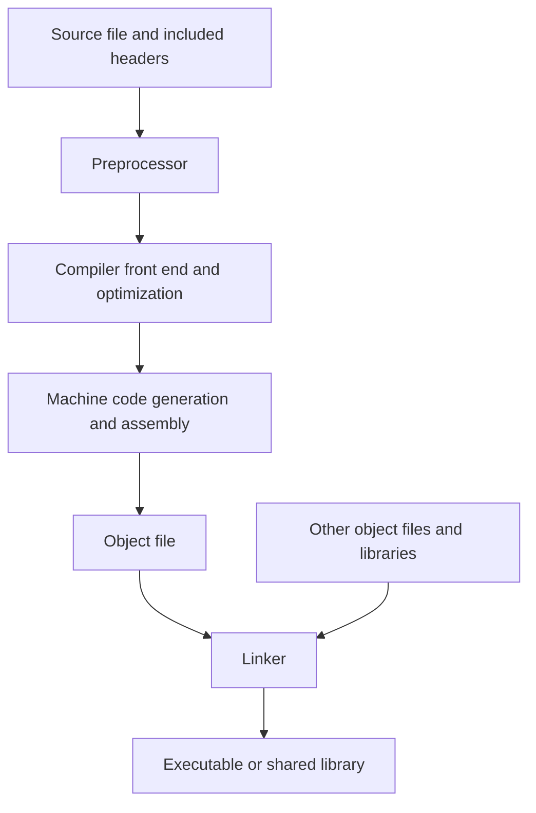

**Course navigation:** [Course home](../../README.md) · [← Chapter 01](../01-source-to-executable/README.md) · [Chapter 03 →](../03-make-ninja-and-cmake/README.md)

# Chapter 02 — Compilers, Linkers, Object Files, and Libraries

> **Modern CMake University — Module I: Build Systems Foundations**  
> **Project:** EmbeddedCore + DeviceSimulator  
> **Level:** Beginner → intermediate | **Estimated time:** 4–6 hours  
> **Prerequisite:** [Chapter 01 — How C++ Becomes an Executable](../01-source-to-executable/README.md)

## The central question

In Chapter 1 we compiled `main.cpp` directly into DeviceSimulator. Real programs contain multiple source files. **How does a function defined in `sensor.cpp` become callable from `main.cpp`, even though the files compile separately?**

Chapter 2 answers this through the stages of the C++ build pipeline, the distinction between declarations and definitions, symbol resolution, and static/shared libraries. We will build the EmbeddedCore library **manually**; using CMake comes later.

### Learning objectives

By the end, you should be able to:

1. Distinguish preprocessing, compilation, assembly and linking.
2. Explain a translation unit, header declaration, symbol and object file.
3. Compile multiple `.cpp` files separately with MSVC or GCC.
4. Identify compilation failures versus linker failures.
5. Create and consume a static library (`.lib` on MSVC, `.a` on Linux).
6. Describe static versus shared linking and their deployment implications.
7. Recognize why build tools such as Ninja and CMake are needed as projects grow.

---

## 1. Why split source code into multiple files?

An embedded device might contain sensor acquisition, diagnostics, communication and control functions. If every function lived inside `main.cpp`, it would become difficult to navigate, test and reuse.

Our example separates responsibilities:

```text
DeviceSimulator application
    main.cpp
       |
       v
EmbeddedCore static library
    sensor.cpp       diagnostics.cpp
       ^                  ^
       |                  |
    sensor.hpp       diagnostics.hpp
```

**Header files** declare interfaces. **Source files** provide implementations. This is a common organization, not a language requirement: implementations can also occur in headers (for example templates and inline functions).

The build needs to resolve the relationships between files. Let's examine how.

## 2. The compilation pipeline

A useful simplified model is:



A compiler driver such as `cl` or `g++` can coordinate these stages. The precise internal phases differ across toolchains.

### 2.1 Preprocessing

The preprocessor handles directives such as `#include`, `#define`, `#if`, and `#ifdef`. An `#include` typically inserts the referenced header's contents into the preprocessing stream.

Example:

```cpp
#define MAX_TEMPERATURE 40.0

#if defined(ENABLE_LOGGING)
    // Include logging behavior in this build.
#endif
```

**Experiment:** On Linux, `g++ -E -Iinclude src/sensor.cpp -o build/sensor.i` creates preprocessed output. On Windows, MSVC supports `/P` to preprocess to a file and `/EP` to write preprocessed output to standard output. Expect a large file because standard headers may be expanded.

Preprocessor macros are textual/compiler-time features, not runtime variables.

### 2.2 Compilation and code generation

The compiler parses the preprocessed C++ and checks its syntax and semantics. It then generates machine code for a particular target architecture. A syntax error such as `double value = ;` prevents a valid object file from being produced.

### 2.3 Assembly and object files

An **object file** contains compiled machine code plus information that the linker needs: symbols, relocations, sections, and often debugging metadata.

Typical names:

| Toolchain | Object file | Static archive | Executable |
|---|---|---|---|
| MSVC / Windows | `.obj` | `.lib` | `.exe` |
| GCC / Linux | `.o` | `.a` | Usually no extension |

An `.obj` or `.o` is **not** normally a stand-alone executable.

### 2.4 Linking

The linker combines compiled inputs and resolves references between them. It also arranges the final binary's code and data and handles link-time relocations and other platform-specific tasks.

Suppose `main.cpp` calls `embeddedcore::read_temperature()`, but the function is defined in `sensor.cpp`. The compiler can compile `main.cpp` because it sees a declaration. The linker must later find the matching definition in `sensor.o`, `sensor.obj`, or a library containing that object.

This is why a project can **compile successfully but fail to link**.

---

## 3. Declarations, definitions, and symbols

Consider this declaration in `sensor.hpp`:

```cpp
namespace embeddedcore {
    double read_temperature();
}
```

It says such a function exists. It does not provide its body.

In `sensor.cpp`, a definition supplies the body:

```cpp
namespace embeddedcore {
    double read_temperature() {
        return 25.5;
    }
}
```

An object file can contain a **defined symbol** (the compiled function body) or an **undefined reference** to a symbol (a function another object must provide).

C++ symbol names may be *mangled* to encode namespaces, parameter types and other information. The exact mangling conventions differ by toolchain and ABI.

### One Definition Rule (ODR)

For ordinary non-inline functions with external linkage, a program must not provide multiple conflicting definitions. Defining the same such function in two `.cpp` files typically produces a duplicate-symbol linker error.

Headers should therefore usually contain declarations, not ordinary non-inline function definitions.

**Check your understanding:** Why does `#include "embeddedcore/sensor.hpp"` not automatically include `sensor.cpp` in the link? Because preprocessing inserts declarations from the header, while compilation and linking of source implementations remain separate build operations.

---

## 4. Our EmbeddedCore lab source

The completed lab files are in [`labs/02-compilers-linkers-and-libraries/solution/`](../../labs/02-compilers-linkers-and-libraries/solution/).

### Project layout

```text
solution/
├── include/
│   └── embeddedcore/
│       ├── sensor.hpp
│       └── diagnostics.hpp
├── src/
│   ├── sensor.cpp
│   └── diagnostics.cpp
└── app/
    └── main.cpp
```

### Public header: sensor.hpp

```cpp
#pragma once

namespace embeddedcore {
    double read_temperature();
}
```

### Implementation: sensor.cpp

```cpp
#include "embeddedcore/sensor.hpp"

namespace embeddedcore {
    double read_temperature() {
        return 25.5; // Simulated sensor reading
    }
}
```

### Public header: diagnostics.hpp

```cpp
#pragma once

namespace embeddedcore {
    bool is_temperature_healthy(double temperature);
}
```

### Implementation: diagnostics.cpp

```cpp
#include "embeddedcore/diagnostics.hpp"

namespace embeddedcore {
    bool is_temperature_healthy(double temperature) {
        return temperature <= 40.0;
    }
}
```

### Application: main.cpp

```cpp
#include <iostream>
#include "embeddedcore/sensor.hpp"
#include "embeddedcore/diagnostics.hpp"

int main() {
    const double temperature = embeddedcore::read_temperature();

    std::cout << "Embedded Device Simulator\n";
    std::cout << "Temperature: " << temperature << " C\n";
    std::cout << "Device status: "
              << (embeddedcore::is_temperature_healthy(temperature)
                      ? "HEALTHY" : "WARNING")
              << '\n';
    return 0;
}
```

Expected output:

```text
Embedded Device Simulator
Temperature: 25.5 C
Device status: HEALTHY
```

---

## 5. Windows lab — MSVC 2019, without CMake

**Prerequisite:** Visual Studio 2019 Desktop development with C++, and an **x64 Native Tools Command Prompt**. Change to the `solution` directory before running commands.

### 5.1 Make an output directory

```bat
mkdir build
```

### 5.2 Compile implementations separately

```bat
cl /nologo /EHsc /std:c++17 /Iinclude /c src\sensor.cpp /Fo:build\sensor.obj
cl /nologo /EHsc /std:c++17 /Iinclude /c src\diagnostics.cpp /Fo:build\diagnostics.obj
```

Explanation:

| Option | Meaning |
|---|---|
| `/c` | Compile only, without final linking |
| `/Iinclude` | Search the project's `include` directory for headers |
| `/Fo:...` | Name the resulting object file |
| `/EHsc` | Use standard synchronous C++ exception-handling model |
| `/std:c++17` | Select the C++17 language mode |
| `/nologo` | Omit compiler startup banner |

### 5.3 Create a static library

```bat
lib /nologo /OUT:build\embeddedcore.lib build\sensor.obj build\diagnostics.obj
```

`lib.exe` **archives the object files**. It does not turn them into a stand-alone executable or necessarily resolve all outside references. The resulting `.lib` is a static library for this lab; on Windows, `.lib` can also refer to a DLL import library in other situations.

### 5.4 Compile and link the application against it

```bat
cl /nologo /EHsc /std:c++17 /Iinclude app\main.cpp build\embeddedcore.lib /Fe:build\DeviceSimulator.exe
```

The compiler driver compiles `main.cpp`, then invokes the linker with `embeddedcore.lib` and the usual runtime requirements.

### 5.5 Run

```bat
build\DeviceSimulator.exe
```

### 5.6 Inspect symbols and library members (optional)

```bat
dumpbin /symbols build\sensor.obj
lib /nologo /LIST build\embeddedcore.lib
```

You should find evidence that the sensor object provides a compiled function and that the library archive contains the two object modules. Exact symbol spellings vary due to C++ name mangling.

---

## 6. Linux lab — GCC and ar, without CMake

Run these commands from the same `solution` directory on a Linux machine with `g++` and `ar` available.

### 6.1 Compile separately

```bash
mkdir -p build

g++ -std=c++17 -Wall -Wextra -Iinclude -c src/sensor.cpp -o build/sensor.o
g++ -std=c++17 -Wall -Wextra -Iinclude -c src/diagnostics.cpp -o build/diagnostics.o
```

### 6.2 Create a static archive

```bash
ar rcs build/libembeddedcore.a build/sensor.o build/diagnostics.o
```

`ar` creates an archive containing the compiled object files. `rcs` is a common combination of archive operations; exact behavior is documented by the archive tool.

### 6.3 Link application

```bash
g++ -std=c++17 -Wall -Wextra -Iinclude app/main.cpp build/libembeddedcore.a -o build/DeviceSimulator
```

The order matters on many traditional GNU linkers when resolving static archives: place the object or source requiring symbols **before** the static library that provides them.

### 6.4 Run and inspect

```bash
./build/DeviceSimulator
ar t build/libembeddedcore.a
nm -C build/libembeddedcore.a
```

`ar t` lists archive members; `nm -C` displays symbol information with C++ names demangled where possible. You should see definitions for the two EmbeddedCore functions.

---

## 7. Debugging the difference between compile and link failures

### Experiment A — Compile error

Change `return 25.5;` to `return ;` in `sensor.cpp`, then compile that source file again. The compiler rejects the invalid C++ expression. Restore the code afterwards.

### Experiment B — Linker error

Try linking the application **without the EmbeddedCore library**.

Windows:

```bat
cl /nologo /EHsc /std:c++17 /Iinclude app\main.cpp /Fe:build\BrokenSimulator.exe
```

Linux:

```bash
g++ -std=c++17 -Iinclude app/main.cpp -o build/BrokenSimulator
```

Both may compile the application source, but the final link should fail with unresolved references to `embeddedcore::read_temperature()` and `embeddedcore::is_temperature_healthy(double)`.

**Diagnosis:** Header declarations were present, but the linker was never given the object code implementing the functions.

### Experiment C — Duplicate definition

Add a second ordinary non-inline definition of `embeddedcore::read_temperature()` in another linked `.cpp` file and try the link. You should encounter a duplicate/multiple-definition failure. Remove the extra definition when finished.

### Troubleshooting table

| Symptom | Stage | Likely cause | First diagnostic step |
|---|---|---|---|
| `cannot open include file` / `No such file` | Compilation | Header search path missing | Check `/Iinclude` or `-Iinclude` |
| Syntax error | Compilation | Invalid C++ | Read first relevant diagnostic |
| `LNK2019` / `undefined reference` | Linking | Required definition/library missing or mismatched | Check all object files and libraries |
| `LNK2005` / `multiple definition` | Linking | Duplicate definition of a symbol | Search `.cpp` files and header definitions |
| Wrong machine architecture | Linking/loading | Architecture or ABI mismatch | Verify toolchain and package platform |
| DLL / shared library cannot be loaded | Runtime loading | Required dynamic dependency unavailable | Inspect runtime search paths |

---

## 8. Static libraries vs shared libraries

Our lab uses a **static library**. What does that mean?

### Static library

A static archive (`.a` or `.lib`) generally collects relocatable object files. When an executable links, its linker takes needed object code from the archive and integrates it into the output. A static archive by itself normally has no runtime loading behavior.

**Important:** Creating `libembeddedcore.a` does **not** automatically merge any libraries on which EmbeddedCore depends. Consumers may still need to supply additional link dependencies.

### Shared library

A shared library (`.so` on Linux, `.dll` on Windows) is separately built and typically loaded by the runtime loader. Applications may need the shared library available at execution time. On Windows a DLL is commonly linked using an associated import `.lib`, although explicit dynamic loading is also possible.

| Property | Static library | Shared library |
|---|---|---|
| Common Linux output | `.a` | `.so` |
| Common Windows output | `.lib` | `.dll` plus often import `.lib` |
| Final application | Selected code integrated at link | External binary loaded at runtime |
| Deployment | No separate copy of that archive needed at runtime | Usually deploy runtime shared binary |
| Tradeoffs | Potentially larger final binaries; simple distribution | Shared code/updates; runtime dependency handling |

These are simplified comparisons. Platform, linker and compiler options can change details.

### Optional Linux shared-library exercise

If you have Linux GCC, build position-independent object code and a shared library:

```bash
mkdir -p build/shared

g++ -std=c++17 -fPIC -Iinclude -c src/sensor.cpp -o build/shared/sensor.o
g++ -std=c++17 -fPIC -Iinclude -c src/diagnostics.cpp -o build/shared/diagnostics.o

g++ -shared build/shared/sensor.o build/shared/diagnostics.o -o build/shared/libembeddedcore.so

g++ -std=c++17 -Iinclude app/main.cpp -Lbuild/shared -lembeddedcore \
  -Wl,-rpath,'$ORIGIN/shared' -o build/DeviceSimulatorShared

./build/DeviceSimulatorShared
```

`$ORIGIN` above is interpreted by the Linux dynamic loader as the directory containing the executable; quoting prevents the shell from expanding it. This is a controlled educational example, not a universal deployment strategy.

Windows DLL exports, import libraries, and runtime deployment are covered in Chapter 9.

---

## 9. Why CMake will matter

For just three `.cpp` files, compiling manually is manageable. As soon as EmbeddedCore grows, builds need to track:

- Changed source and header dependencies.
- Debug vs Release settings.
- MSVC vs GCC/Clang compiler flags.
- Static vs shared library variants.
- Tests, installation, cross-compilation and third-party dependencies.

Build tools automate dependency-aware rebuilds and tool invocations. **Ninja/Make execute build commands; CMake describes targets and generates a build system that knows what needs to be built.** We'll make this distinction precise in Chapter 3.

---

## 10. Guided lab checklist

- [ ] Explain what preprocessing does.
- [ ] Compile `sensor.cpp` and `diagnostics.cpp` separately.
- [ ] Locate both object files and compare their file sizes.
- [ ] Create `embeddedcore.lib` (Windows) or `libembeddedcore.a` (Linux).
- [ ] Link and run DeviceSimulator using the static library.
- [ ] Intentionally omit the library and observe an unresolved-symbol error.
- [ ] Explain why the header alone cannot satisfy the linker.
- [ ] Inspect library members using `lib /LIST` or `ar t`.
- [ ] (Optional) Try the Linux shared-library lab.

## 11. Assignments

**A1 — One more module (beginner).** Add `controller.hpp` and `controller.cpp` defining `bool can_start_device(double temperature)`. Call it from `main.cpp`. Rebuild the static library and executable.

**A2 — Incremental rebuild experiment (beginner).** Change only the message printed in `main.cpp`. Identify which files actually need recompilation and which do not. (You will perform the commands manually.)

**A3 — Symbol diagnosis (intermediate).** Remove the `diagnostics.cpp` object from the archive. Predict and observe the link error. Restore the missing object.

**A4 — Static vs shared comparison (intermediate).** On Linux, build both variants and inspect them using `file`, `nm`, and `ldd` as appropriate. Explain which artifacts are required at build time versus runtime.

**A5 — Architecture thought experiment (challenge).** Explain why an Android ARM64 `.a` cannot be assumed compatible with Windows x64, even if the public headers are identical.

## 12. Knowledge check

1. What does the preprocessor do with `#include`?
2. Why can `main.cpp` compile successfully when its referenced function body is located in another translation unit?
3. What is the difference between an object file and a static library archive?
4. Which stage typically reports an unresolved external symbol?
5. What does MSVC's `/c` option do?
6. Why should the referenced object appear before a static archive on many GNU linker command lines?
7. Why is linking a static library into another static archive not necessarily equivalent to merging their contents?
8. Which runtime delivery problem can arise with shared libraries?
9. How does an imported header differ from a linked implementation?
10. Why does having more source files make a build system useful?

See [`solutions/02-compilers-linkers-and-libraries/quiz-answers.md`](../../solutions/02-compilers-linkers-and-libraries/quiz-answers.md) after attempting the questions.

## 13. Chapter summary

The key idea is that **separate source files can be compiled independently, but their references must be reconciled during linking**. Headers help compilers understand declarations. Object files contain compiled definitions and references. Static libraries group object files for later linking; shared libraries add runtime deployment considerations.

In Chapter 3, we'll replace our manual MSVC and GCC commands with a build system, and explain why Ninja and CMake have distinct roles.

## Further reading

- [MSVC `/c`: compile without linking](https://learn.microsoft.com/en-us/cpp/build/reference/c-compile-without-linking)
- [Microsoft: creating and using a static library](https://learn.microsoft.com/en-us/cpp/build/walkthrough-creating-and-using-a-static-library-cpp)
- [Microsoft LIB tool reference](https://learn.microsoft.com/en-us/cpp/build/reference/lib-reference)
- [GCC: Options for linking](https://gcc.gnu.org/onlinedocs/gcc/Link-Options.html)
- [GNU binutils: `ar`](https://sourceware.org/binutils/docs/binutils/ar.html)

---

**Previous:** [Chapter 1 — From C++ Source to Executable](../01-source-to-executable/README.md)  
**Next:** Chapter 3 — Make, Ninja, and CMake: Understanding Build Systems

---

**Course navigation:** [Course home](../../README.md) · [← Chapter 01](../01-source-to-executable/README.md) · [Chapter 03 →](../03-make-ninja-and-cmake/README.md)

