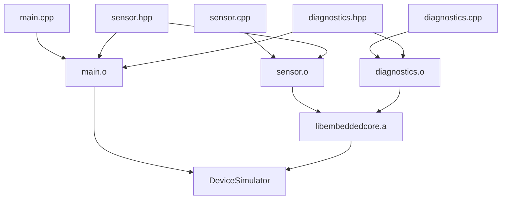
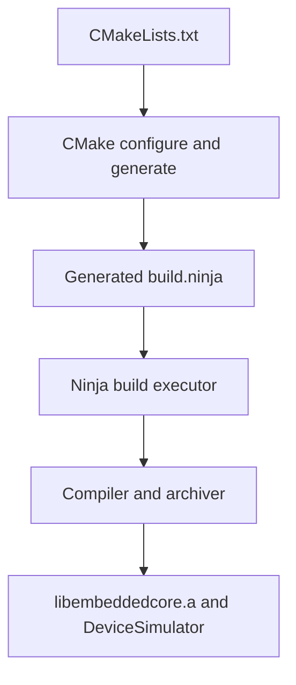

# Chapter 03 — Make, Ninja, and CMake: Understanding Build Systems

> **Modern CMake University — Module I: Build Systems Foundations**  
> **Project:** EmbeddedCore + DeviceSimulator  
> **Level:** Beginner → intermediate | **Estimated time:** 4–6 hours  
> **Prerequisite:** [Chapter 02 — Compilers, Linkers, Object Files, and Libraries](../02-compilers-linkers-and-libraries/README.md)

## The central question

In Chapter 2, you manually compiled `sensor.cpp`, `diagnostics.cpp`, and `main.cpp`; created `libembeddedcore.a` or `embeddedcore.lib`; and linked DeviceSimulator. **What happens when a source or header changes? How can we avoid rerunning all the commands ourselves?**

This chapter compares a handwritten Makefile, a handwritten Ninja build description, and a concise CMake project using *the exact same C++ sources*. It demonstrates **dependency graphs, incremental builds, parallel execution, and out-of-source builds**. CMake will become our primary project-description tool from Chapter 4 onward.

### Learning objectives

By the end, students should be able to:

1. Explain a build graph in terms of targets, inputs, prerequisites, and actions.
2. Distinguish build executors (Make/Ninja) from a meta-build system (CMake).
3. Create and run a simple GNU Makefile with a static library and an executable.
4. Read a basic `build.ninja` file and understand how Ninja determines work.
5. Use CMake to generate Ninja build files from portable target descriptions.
6. Demonstrate a no-op rebuild and a correct incremental rebuild after editing source or a header.
7. Explain why independent out-of-source build directories matter.
8. Recognize the limits of manually maintaining Makefiles and Ninja files across platforms.

---

## 1. Why are manual compiler commands insufficient?

Recall the core Chapter 2 commands on Linux:

```bash
g++ -std=c++17 -Iinclude -c src/sensor.cpp -o sensor.o
g++ -std=c++17 -Iinclude -c src/diagnostics.cpp -o diagnostics.o
ar rcs libembeddedcore.a sensor.o diagnostics.o
g++ -std=c++17 -Iinclude app/main.cpp libembeddedcore.a -o DeviceSimulator
```

They work, but a real project grows to tens or hundreds of source files. Manually maintaining commands produces several problems:

- **Ordering:** an archive must be produced after its object files; the executable must link after its prerequisites.
- **Correctness:** changing a header may require recompiling multiple `.cpp` files.
- **Efficiency:** recompiling everything after every edit wastes time.
- **Reproducibility:** build options often diverge between developer machines and CI agents.
- **Portability:** Windows MSVC, Linux GCC, and Android Clang have different commands and output conventions.

A build system automates the relationship between *what you want* and *what must be done to produce it*.

### Build systems are not compilers

A build system usually **invokes** a compiler, archiver, or linker. It does not translate C++ to machine code itself.

Compare the roles:

| Tool | Main job | Typical input | Typical output |
|---|---|---|---|
| `g++` / `cl` | Compile C++ and drive linking | `.cpp`, `.o` / `.obj` | object files and binaries |
| `ar` / `lib.exe` | Assemble static libraries | object files | `.a` / `.lib` |
| GNU Make | Decide which commands to execute | `Makefile` | files generated by recipes |
| Ninja | Execute a dependency graph efficiently | `build.ninja` | files generated by rules |
| CMake | Configure and generate a build description | `CMakeLists.txt` | `build.ninja`, Makefiles, or IDE project files |

CMake can also drive the build via `cmake --build`, but the selected underlying build tool is still doing the scheduling and executing its compiler/linker commands.

## 2. The dependency graph: the core concept

A **target** is a desired output or named task. A **prerequisite** is something it depends on. A **recipe** or **rule** describes how to create the output.

For our project:



The important edges are *dependencies*, not necessarily steps performed sequentially. For example, `sensor.cpp` and `diagnostics.cpp` can usually compile independently.

### Why do header files matter?

A source file with `#include "embeddedcore/sensor.hpp"` relies on the content of that header. If a function declaration changes, the corresponding source must be recompiled. **Header dependency tracking** is therefore important for correctness.

GNU Make examples commonly use compiler-generated `.d` files; Ninja can read similar depfiles. CMake normally configures dependency tracking for its supported generators so you don't have to manually list every included header.

### The incremental-build promise

An incremental build tries to rebuild **only what is stale** relative to its dependencies and configuration.

| Change | Likely necessary actions |
|---|---|
| Nothing changed | No compilation or linking |
| `src/sensor.cpp` changed | Recompile sensor, recreate archive, relink executable |
| `app/main.cpp` changed | Recompile main, relink executable |
| `sensor.hpp` changed | Recompile affected source files, then dependent archive and executable |

These are expected results for the lab's build graph, not universal rules for every custom command or build system.

## 3. GNU Make from first principles

GNU Make reads a file usually named `Makefile` and executes rules when a target is missing or older than relevant prerequisites.

An introductory rule looks like:

```make
output.txt: input.txt
	cp input.txt output.txt
```

Read this as: "To produce `output.txt`, first ensure `input.txt` exists; if `output.txt` is missing or stale, run the command."

**Syntax detail:** the recipe line begins with a literal tab character in a standard Makefile, not spaces.

### Automatic variables in Make

| Variable | Meaning in a recipe |
|---|---|
| `$@` | Target name |
| `$<` | First prerequisite |
| `$^` | All prerequisites, with duplicates removed |

For example:

```make
build/sensor.o: src/sensor.cpp
	g++ -Iinclude -c $< -o $@
```

### A complete Makefile for our lab

The downloadable solution has a full Makefile with dependency tracking. Its key parts are:

```make
CXX ?= g++
AR ?= ar
CXXFLAGS ?= -std=c++17 -O0 -g -Wall -Wextra -Wpedantic
CPPFLAGS ?= -Iinclude

OBJDIR := build/make
LIB := $(OBJDIR)/libembeddedcore.a
APP := $(OBJDIR)/DeviceSimulator
LIB_OBJS := $(OBJDIR)/sensor.o $(OBJDIR)/diagnostics.o
APP_OBJ := $(OBJDIR)/main.o
DEPS := $(LIB_OBJS:.o=.d) $(APP_OBJ:.o=.d)

.PHONY: all clean run
all: $(APP)

$(OBJDIR):
	mkdir -p $@

$(OBJDIR)/sensor.o: src/sensor.cpp | $(OBJDIR)
	$(CXX) $(CPPFLAGS) $(CXXFLAGS) -MMD -MP -c $< -o $@

$(OBJDIR)/diagnostics.o: src/diagnostics.cpp | $(OBJDIR)
	$(CXX) $(CPPFLAGS) $(CXXFLAGS) -MMD -MP -c $< -o $@

$(OBJDIR)/main.o: app/main.cpp | $(OBJDIR)
	$(CXX) $(CPPFLAGS) $(CXXFLAGS) -MMD -MP -c $< -o $@

$(LIB): $(LIB_OBJS)
	$(AR) rcs $@ $^

$(APP): $(APP_OBJ) $(LIB)
	$(CXX) $(APP_OBJ) $(LIB) -o $@

run: $(APP)
	./$(APP)

clean:
	rm -rf $(OBJDIR)

-include $(DEPS)
```

`-MMD` asks GCC to emit dependency information for user headers, `-MP` emits phony targets for discovered headers, and `-include $(DEPS)` reads those files on later builds. The `| $(OBJDIR)` syntax is an **order-only prerequisite**: Make ensures the directory exists but a directory timestamp change won't by itself invalidate the object.

This file is written for Linux/WSL or a GNU-like tool environment with `g++`, `ar`, and Unix shell commands. Windows native MSVC requires different command choices; our CMake lab will handle Windows without writing a second manual Makefile.

### Running Make

In the solution directory:

```bash
make -j2
./build/make/DeviceSimulator
make -n
```

The `-j2` option allows up to two eligible jobs to run concurrently. `make -n` prints proposed commands without executing them (with some special cases for recursive make commands, not relevant here). A second unchanged `make` normally prints **Nothing to be done for 'all'.**

### Make has trade-offs

GNU Make is mature and flexible, and it's useful to understand existing projects. But handwritten portable Makefiles can accumulate compiler-specific flags, dependency-file logic, conditional rules, and platform-specific paths. CMake is designed to describe these concerns at a higher level.

---

## 4. Ninja: a small, fast build executor

Ninja has a different design philosophy: keep the input language simple and let a higher-level tool generate the build graph. Ninja's standard input is `build.ninja`.

The example below is written by hand **to teach the format**. In production CMake projects, CMake commonly generates `build.ninja` for you.

A Ninja **rule** defines a command template:

```ninja
rule compile
  command = g++ -std=c++17 -Iinclude -c $in -o $out
  description = CXX $out
```

A **build edge** applies that rule to concrete input and output paths:

```ninja
build build/ninja/sensor.o: compile src/sensor.cpp
```

Here `$in` is the input and `$out` is the output. Ninja uses the graph to schedule work and evaluate whether outputs need rebuilding.

### Complete Ninja example

```ninja
cxx = g++
ar = ar
cxxflags = -std=c++17 -O0 -g -Wall -Wextra -Wpedantic -Iinclude

rule compile
  command = mkdir -p build/ninja && $cxx $cxxflags -MMD -MF $out.d -MT $out -c $in -o $out
  depfile = $out.d
  deps = gcc
  description = CXX $out

rule archive
  command = $ar rcs $out $in
  description = AR $out

rule link
  command = $cxx $in -o $out
  description = LINK $out

build build/ninja/sensor.o: compile src/sensor.cpp
build build/ninja/diagnostics.o: compile src/diagnostics.cpp
build build/ninja/main.o: compile app/main.cpp
build build/ninja/libembeddedcore.a: archive build/ninja/sensor.o build/ninja/diagnostics.o
build build/ninja/DeviceSimulator: link build/ninja/main.o build/ninja/libembeddedcore.a

default build/ninja/DeviceSimulator
```

The compile rule asks GCC to write header dependencies (`-MMD -MF ...`); `depfile` and `deps = gcc` tell Ninja to record those dependencies for future builds. Ninja also tracks command changes so changing a compile command can trigger rebuilding.

### Run the Ninja build

```bash
ninja -f build.ninja
./build/ninja/DeviceSimulator
ninja -f build.ninja -n
ninja -f build.ninja -t targets
```

`-n` is a dry run. The `-t targets` tool lists known targets. Run `ninja -f build.ninja` a second time with no edits: you should see **ninja: no work to do.**

The direct Ninja example is portable to GNU-like environments, not to unconfigured native MSVC environments. Normally, CMake writes compiler-appropriate Ninja rules automatically.

---

## 5. CMake: describe the *project*, not every command

A handwritten Makefile or Ninja file explicitly mentions object filenames and archiver commands. CMake allows us to work with higher-level concepts such as **libraries, executables, and dependencies**.

The foundational file is `CMakeLists.txt`. This is our first preview; Chapter 4 covers CMake configuration in much greater depth.

```cmake
cmake_minimum_required(VERSION 3.20)
project(EmbeddedCoreChapter03 LANGUAGES CXX)

add_library(embeddedcore STATIC
    src/sensor.cpp
    src/diagnostics.cpp
)

target_compile_features(embeddedcore PUBLIC cxx_std_17)
target_include_directories(embeddedcore PUBLIC "${CMAKE_CURRENT_SOURCE_DIR}/include")

add_executable(DeviceSimulator app/main.cpp)
target_link_libraries(DeviceSimulator PRIVATE embeddedcore)
```

### Interpret the lines

- `cmake_minimum_required(...)` declares the project's minimum supported CMake version.
- `project(... LANGUAGES CXX)` enables C++ and initializes the project.
- `add_library(... STATIC ...)` defines a static-library target.
- `target_compile_features(... cxx_std_17)` requests a compiler mode supporting at least C++17.
- `target_include_directories(...)` gives the library the required header search path. `PUBLIC` lets consumers inherit that usage requirement.
- `add_executable(...)` defines an executable target.
- `target_link_libraries(... PRIVATE embeddedcore)` expresses that DeviceSimulator links EmbeddedCore.

There is no `g++`, `cl`, `ar`, `.obj`, or `.a` hardcoded in the project. This is the key benefit of target-oriented CMake.

### Configure vs build

Run:

```bash
cmake -S . -B build/cmake -G Ninja
```

This is **configure and generate**. CMake identifies a suitable compiler, creates a cache, processes the target definitions, and generates a Ninja build description in `build/cmake`.

Then run:

```bash
cmake --build build/cmake
```

This is the **build**. CMake invokes the generated build tool, which runs compilation, archiving, and linking operations.

Finally:

```bash
./build/cmake/DeviceSimulator
```

You can optionally inspect the generated Ninja file at `build/cmake/build.ninja`, but do not edit it; it belongs to the generated build tree.

### CMake is a build-system generator, not a replacement for Ninja



CMake can generate other backends, including Unix Makefiles and Visual Studio project files. Consequently, the **same target descriptions** can be reused with different generators and native toolchains.

---

## 6. Build directories and out-of-source builds

A **source tree** contains files you maintain in Git: `.cpp`, `.hpp`, `CMakeLists.txt`, and build scripts. A **build tree** contains generated content: cache files, compiler-generated objects, static libraries, executables, and build-tool files.

CMake recommends separating those trees:

```text
solution/
  CMakeLists.txt
  app/main.cpp
  src/sensor.cpp
  src/diagnostics.cpp
  include/embeddedcore/*.hpp
  build/
    make/
    ninja/
    cmake/
```

You can configure the same source with different build directories:

```bash
cmake -S . -B build/cmake-ninja -G Ninja
cmake -S . -B build/cmake-make -G "Unix Makefiles"
```

Each build directory has its own CMake cache and generated build system. **Do not reuse the same directory for different generators.** Start a fresh directory when changing generators, toolchains, or target ABIs.

For Windows MSVC, run the following from a VS 2019 x64 Native Tools Command Prompt:

```bat
cmake -S . -B build\windows -G Ninja
cmake --build build\windows
build\windows\DeviceSimulator.exe
```

Because the compiler environment was initialized, CMake can use MSVC and produce Windows-compatible output. If Ninja is unavailable but Visual Studio 2019 is installed, you can use:

```bat
cmake -S . -B build\vs2019 -G "Visual Studio 16 2019" -A x64
cmake --build build\vs2019 --config Release
build\vs2019\Release\DeviceSimulator.exe
```

These are separate directories because the generators and output conventions differ.

### Why target directories matter later

By Chapter 13, you'll need different build trees for Android `armeabi-v7a`, `arm64-v8a`, `x86_64`, Linux x86-64, and Windows x64. You will **not** need five copies of the C++ source project.

---

## 7. Comparing the three approaches

| Concern | Handwritten GNU Make | Handwritten Ninja | CMake + Ninja |
|---|---|---|---|
| Main source description | `Makefile` | `build.ninja` | `CMakeLists.txt` |
| Build graph | Explicit Make rules | Explicit Ninja build edges | Generated from CMake targets |
| Incremental builds | Yes, with correct rules/deps | Yes, with correct rules/deps | Yes, through generated backend |
| Parallel compilation | `make -jN` | Default concurrent scheduling | Depends on generated backend |
| Header tracking | Must arrange dependency tracking | Must arrange dependency tracking | Normally generated for supported toolchains |
| Windows/Linux compatibility | Requires toolchain-aware Makefile | Requires toolchain-aware Ninja file | One project description, configure per toolchain |
| Best learning benefit | Understand recipes and prerequisites | Understand explicit build graphs | Understand reusable project/target definitions |

**CMake does not automatically guarantee that every C++ project builds on every operating system.** Source code, dependencies, platform APIs, compilers, and toolchains must still be compatible. CMake reduces duplicated build-system logic.

---

## 8. Lab: discover incremental builds experimentally

The GitHub-ready package includes runnable versions of all three build descriptions under:

`labs/03-make-ninja-and-cmake/solution/`

### Prerequisites

- Linux, WSL, or another GNU-like environment with GCC, GNU Make, Ninja, and CMake 3.20+.
- Optional: VS 2019 x64 Native Tools Command Prompt and CMake/Ninja on Windows.
- Lab C++ source uses C++17 and the same interfaces as Chapter 2.

### Experiment A — First Make build

```bash
cd labs/03-make-ninja-and-cmake/solution
make -j2
./build/make/DeviceSimulator
```

Expected application output:

```text
Embedded Device Simulator
Temperature: 25.5 C
Device status: HEALTHY
```

Confirm that `build/make/` has object files, generated `.d` files, a static archive, and the executable.

### Experiment B — No-op rebuild

```bash
make
make -n
```

After a successful unchanged build, Make should have no compilation or link commands to run. Why? The output timestamps and recorded dependencies indicate that outputs are up to date.

### Experiment C — Change one implementation

Edit `src/sensor.cpp` and change the simulated reading from `25.5` to `45.0`. Run:

```bash
make -j2
./build/make/DeviceSimulator
```

Expected status: `WARNING`. Make should recompile `sensor.cpp`, rebuild `libembeddedcore.a`, and relink DeviceSimulator. It should not need to recompile `diagnostics.cpp` or `main.cpp` merely because `sensor.cpp` changed.

Restore `25.5` before the next experiment.

### Experiment D — Compare Ninja

```bash
ninja -f build.ninja
ninja -f build.ninja -n
```

The first Ninja build creates `build/ninja/` outputs. The second dry run should report no compilation commands after a successful unchanged build.

### Experiment E — Change a header

Touch the sensor header and rebuild both systems:

```bash
touch include/embeddedcore/sensor.hpp
make -j2
ninja -f build.ninja
```

A correctly tracked header dependency should cause source files that include the header to recompile. You can inspect the Make-generated `.d` files or Ninja's dependency database:

```bash
cat build/make/main.d
ninja -f build.ninja -t deps build/ninja/main.o
```

### Experiment F — Generate a Ninja build using CMake

```bash
cmake -S . -B build/cmake -G Ninja
cmake --build build/cmake
./build/cmake/DeviceSimulator
```

Inspect generated artifacts such as `build/cmake/CMakeCache.txt` and `build/cmake/build.ninja`. CMake created the graph from a short target-oriented definition instead of requiring you to write all object rules yourself.

### Experiment G — Compare CMake generators

On Linux:

```bash
cmake -S . -B build/cmake-make -G "Unix Makefiles"
cmake --build build/cmake-make -j2
./build/cmake-make/DeviceSimulator
```

The same `CMakeLists.txt` creates a working project with a different backend. Keep a separate build directory for each generator.

### Experiment H — Windows MSVC

From the Visual Studio 2019 x64 Native Tools Command Prompt in the solution directory:

```bat
cmake -S . -B build\windows -G Ninja
cmake --build build\windows
build\windows\DeviceSimulator.exe
```

This avoids translating GNU `ar`/`g++` commands into MSVC-specific equivalents by hand. The Windows output is an `.exe` and a `.lib`.

---

## 9. Troubleshooting

| Symptom | Typical cause | Check |
|---|---|---|
| `make: *** No targets specified` | Missing Makefile or wrong working directory | Run commands from the solution directory |
| `missing separator` | Make recipe line used spaces instead of a tab | Inspect recipe indentation |
| `ninja: error: loading 'build.ninja'` | Wrong directory or file name | Use `-f build.ninja`, verify file exists |
| CMake can't find a compiler | Development toolchain not installed/initialized | Check `g++ --version` or VS Native Tools prompt |
| CMake complains about generator mismatch | Reused a directory already configured for another generator | Use a new build directory |
| Header changed but nothing rebuilds in handwritten rules | Dependency tracking missing or broken | Inspect `.d` files / Ninja `deps` |
| `undefined reference` or `LNK2019` | Executable didn't link a needed implementation/library | Check library target dependency and linking order |
| `ar` not recognized on Windows | GNU archiver isn't part of MSVC environment | Use CMake with MSVC generator/toolchain |
| Unexpected old output | Edited the source but ran an old executable from another build directory | Check executable path and rerun correct build |

### Diagnostic habits

For Make, try `make -n` or `make --debug=b` to understand its decision. For Ninja, try `ninja -f build.ninja -d explain` or `ninja -f build.ninja -t targets`. For CMake, inspect the configure output and `CMakeCache.txt` *read-only* to see compiler and generator choices.

---

## 10. Assignments

### Assignment 1 — Describe the graph (beginner)

Draw the prerequisites for `DeviceSimulator`, including `main.cpp`, `sensor.cpp`, `diagnostics.cpp`, headers, the static library, and the final link. Identify two actions that may run in parallel.

### Assignment 2 — Enhance the Makefile (intermediate)

Add a `print-config` phony target that displays `CXX`, `CXXFLAGS`, `CPPFLAGS`, `OBJDIR`, and `APP`. Prove that `make print-config` doesn't recompile the project.

### Assignment 3 — Add a third source file (intermediate)

Create `src/communication.cpp` with a function returning a fixed connection status. Declare it in `include/embeddedcore/communication.hpp`. Update each build approach to include the new source, then use the function in `app/main.cpp`.

### Assignment 4 — Predict incremental work (intermediate)

Predict the actions taken after changing only `src/diagnostics.cpp`. Verify your prediction with Make, Ninja, and CMake-generated Ninja rules.

### Challenge — Debug the missing-header problem (advanced)

Deliberately remove GCC dependency generation from a copied Makefile (remove `-MMD -MP` and dependency inclusion). Change a header without touching `.cpp` files. Explain why Make might incorrectly consider the build current, then restore robust dependency tracking.

Keep assignments separate from your production sources; experiments should be confined to this chapter's lab directory.

---

## 11. Knowledge check — 10 questions

1. Which tool is primarily a *build-system generator*, rather than a C++ compiler or a build executor? A) GCC B) CMake C) Ninja D) GNU Make
2. What best describes a build graph? A) Outputs and their prerequisites B) A chart of CPU utilization C) A source formatting tool D) A list of Git commits
3. Why can a second unchanged Make build finish without recompiling? A) Make removes all source files B) Make only runs once per session C) Outputs are up to date relative to prerequisites D) GCC stores every result in Nexus
4. In `make -j4`, what does `-j4` request? A) Four compiler versions B) Up to four concurrent jobs C) Four source directories D) Four separate executables
5. Which command configures a CMake source tree in the current directory and generates Ninja files into `build`? A) `cmake -S . -B build -G Ninja` B) `ninja -S . -B build` C) `g++ --generate Ninja` D) `make -G Ninja`
6. True or false: CMake compiles C++ source into machine code without invoking another compiler.
7. True or false: Ninja reads a build description such as `build.ninja` to schedule work.
8. Which CMake command declares that DeviceSimulator links EmbeddedCore? A) `add_library(DeviceSimulator embeddedcore)` B) `target_link_libraries(DeviceSimulator PRIVATE embeddedcore)` C) `project(embeddedcore)` D) `include_directories(DeviceSimulator)`
9. What could go wrong if a handwritten build rule omits dependencies on included headers? A) Debug symbols are always stripped B) GNU Make silently becomes Ninja C) An object file may remain stale after a header changes D) The operating system changes
10. Why use an out-of-source build directory? A) Keep generated outputs separate and enable independent configurations B) Automatically convert all C++ code to portable code C) Eliminate the linker D) Remove the need to install a compiler

See the separate [answer key](../../solutions/03-make-ninja-and-cmake/quiz-answers.md) after you finish.

---

## 12. Chapter summary

- A build **graph** defines what depends on what.
- **Incremental builds** use that graph and dependency information to avoid unnecessary work.
- GNU Make and Ninja are **build executors** with different input languages and design goals.
- CMake offers **target-based project definitions** and generates backend build files.
- `cmake -S ... -B ...` configures and generates; `cmake --build ...` performs the build using the selected backend.
- Separate **source and build trees** keep projects clean and support multiple configurations and toolchains.
- The same EmbeddedCore sources can be built by Make, Ninja, or CMake—without changing the C++ implementation.

### Chapter 4 preview

Next: **Installing CMake and Building Your First Real CMake Project**. We will move beyond the brief CMake preview to examine `project()`, targets, the configure/generate/build lifecycle, command-line generators, the CMake cache, and the difference between single- and multi-configuration generators.

## 13. Authoritative references

- [CMake Tutorial](https://cmake.org/cmake/help/latest/guide/tutorial/index.html)
- [CMake `cmake(1)` CLI](https://cmake.org/cmake/help/latest/manual/cmake.1.html)
- [CMake `add_library()`](https://cmake.org/cmake/help/latest/command/add_library.html)
- [CMake `target_link_libraries()`](https://cmake.org/cmake/help/latest/command/target_link_libraries.html)
- [GNU Make Manual](https://www.gnu.org/software/make/manual/make.html)
- [Ninja Manual](https://ninja-build.org/manual.html)

---

**Navigation:** [← Chapter 02](../02-compilers-linkers-and-libraries/README.md) · [Lab and runnable code](../../labs/03-make-ninja-and-cmake/README.md) · [Chapter 04 →](../04-first-cmake-project/README.md)
