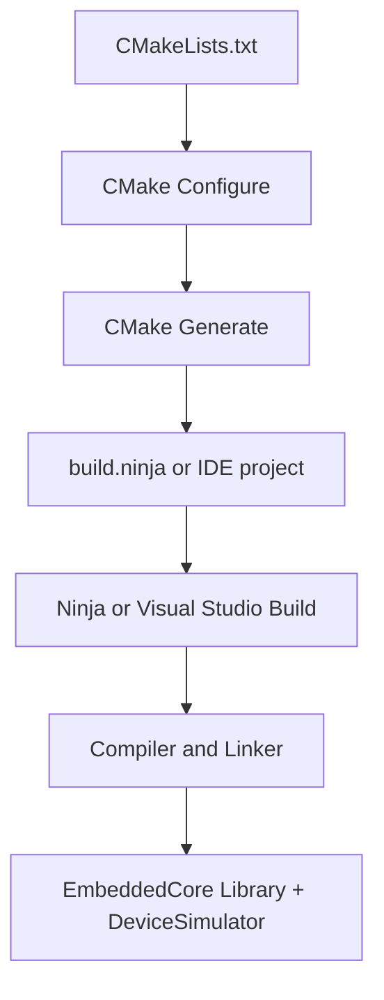
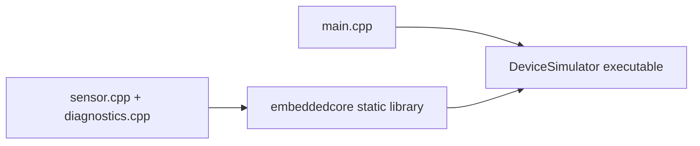

**Course navigation:** [Course home](../../README.md) · [← Chapter 03](../03-make-ninja-and-cmake/README.md) · [Chapter 05 →](../05-cmake-targets-properties-dependencies/README.md)

# Chapter 04 — Your First Real CMake Project: Configuring and Building EmbeddedCore

> **Modern CMake University — Module I: Build Systems Foundations**  
> **Project:** EmbeddedCore + DeviceSimulator  
> **Level:** Beginner → intermediate | **Study time:** 4–6 hours  
> **Prerequisite:** [Chapter 03 — Make, Ninja, and CMake](../03-make-ninja-and-cmake/README.md)

## The central question

In Chapter 3, you compared handwritten Make and Ninja build files with a basic CMake build. We will now treat CMake as our **primary build-system description language**. Exactly what happens between writing `CMakeLists.txt`, running CMake, and getting an executable? Where do CMake's cache and generated files go? And how do we keep builds reproducible on both Windows and Linux?

This chapter uses the same Chapter 3 C++ sources; only the build configuration is studied in depth. **No OpenSSL, Android NDK, Nexus, or CI credentials are needed.**

### Learning outcomes

After completing this chapter, you can:

1. Explain CMake's **configure → generate → build** stages.
2. Read `cmake_minimum_required()`, `project()`, `add_library()`, and `add_executable()`.
3. Explain CMake targets and the relationship between EmbeddedCore and DeviceSimulator.
4. Understand `target_include_directories()`, `target_compile_features()`, and `target_link_libraries()` at a beginner level.
5. Configure, build and run the same project using Ninja on Linux and MSVC on Windows.
6. Explain `-S`, `-B`, `-G`, and the roles of `CMakeCache.txt` and out-of-source builds.
7. Distinguish single-config Ninja from multi-config generators.
8. Diagnose common configuration and compilation errors without deleting source files.

---

## 1. Why Chapter 4 starts with CMakeLists.txt

Our Chapter 2 manual build had several commands: compile `sensor.cpp`, compile `diagnostics.cpp`, archive the objects, then link the application. In Chapter 3, Make and Ninja expressed the same process as rules and dependencies. CMake lets us describe **software targets**: a library and an executable, with a dependency between them.

Rather than manually writing compiler options and archive commands for every operating system, we tell CMake **what** we want to build and how targets relate.

| Tool | Author normally writes | Executes actual compiler commands? |
|---|---|---|
| GNU Make | `Makefile` | Yes, through its recipes |
| Ninja | `build.ninja` (often generated) | Yes, through its rules |
| CMake | `CMakeLists.txt` | CMake generates build files; the selected executor then invokes compilers |

> **Common misconception:** CMake does not replace MSVC, GCC, Clang, Ninja, or Make. It coordinates the configuration and generation of a build system.

### Architecture



The separation between the CMake **configuration/generation** commands and the **build** command is essential throughout the course.

---

## 2. The EmbeddedCore lab project

We reuse the exact conceptual design from Chapter 3:

```text
solution/
├── CMakeLists.txt
├── app/
│   └── main.cpp
├── include/
│   └── embeddedcore/
│       ├── diagnostics.hpp
│       └── sensor.hpp
└── src/
    ├── diagnostics.cpp
    └── sensor.cpp
```

The **EmbeddedCore** library contains the simulated sensor and device-health logic. **DeviceSimulator** is a console application that calls the library.

#### `include/embeddedcore/sensor.hpp`

```cpp
#pragma once
namespace embeddedcore {
    double read_temperature();
}
```

#### `src/sensor.cpp`

```cpp
#include "embeddedcore/sensor.hpp"
namespace embeddedcore {
    double read_temperature() {
        return 25.5;
    }
}
```

#### `include/embeddedcore/diagnostics.hpp`

```cpp
#pragma once
namespace embeddedcore {
    bool is_temperature_healthy(double temperature);
}
```

#### `src/diagnostics.cpp`

```cpp
#include "embeddedcore/diagnostics.hpp"
namespace embeddedcore {
    bool is_temperature_healthy(double temperature) {
        return temperature <= 40.0;
    }
}
```

#### `app/main.cpp`

```cpp
#include <iostream>
#include "embeddedcore/sensor.hpp"
#include "embeddedcore/diagnostics.hpp"

int main() {
    const double temperature = embeddedcore::read_temperature();
    std::cout << "Embedded Device Simulator\n";
    std::cout << "Temperature: " << temperature << " C\n";
    std::cout << "Device status: "
              << (embeddedcore::is_temperature_healthy(temperature)
                      ? "HEALTHY" : "WARNING")
              << '\n';
    return 0;
}
```

The program intentionally has no real device hardware dependency. We want to isolate the build-system concepts.

---

## 3. CMakeLists.txt: the complete solution

Here is the working `labs/04-first-real-cmake-project/solution/CMakeLists.txt`:

```cmake
cmake_minimum_required(VERSION 3.20)

project(EmbeddedCoreChapter04 VERSION 0.1.0 LANGUAGES CXX)

message(STATUS "Project: ${PROJECT_NAME}")
message(STATUS "Version: ${PROJECT_VERSION}")
message(STATUS "Source directory: ${PROJECT_SOURCE_DIR}")
message(STATUS "Build directory: ${PROJECT_BINARY_DIR}")
message(STATUS "Compiler: ${CMAKE_CXX_COMPILER_ID}")
message(STATUS "Generator: ${CMAKE_GENERATOR}")

add_library(embeddedcore STATIC
    src/sensor.cpp
    src/diagnostics.cpp
)

target_compile_features(embeddedcore PUBLIC cxx_std_17)

target_include_directories(embeddedcore PUBLIC
    "${CMAKE_CURRENT_SOURCE_DIR}/include"
)

add_executable(DeviceSimulator app/main.cpp)

target_link_libraries(DeviceSimulator PRIVATE embeddedcore)
```

Let's unpack it carefully rather than treating it as magic.

### 3.1 `cmake_minimum_required(VERSION 3.20)`

This states the minimum CMake version supported by the sample and establishes associated policy behavior. It does **not** install CMake or choose which compiler to use. A newer CMake version can also configure the project.

### 3.2 `project(... LANGUAGES CXX)`

`project()` names the project and enables selected languages. `CXX` is CMake's identifier for C++. CMake detects an appropriate C++ compiler when configuring the project. `VERSION 0.1.0` also initializes project version variables.

The name `EmbeddedCoreChapter04` identifies the project; it does not force our executable or library to have that name. **Project name and target name are different concepts.**

### 3.3 `add_library(embeddedcore STATIC ...)`

A **target** is an item in CMake's build model. `add_library()` creates a target named `embeddedcore` and identifies the C++ sources used to build it. `STATIC` requests a static library archive:

- On Linux, the normal artifact is `libembeddedcore.a`.
- On Windows with MSVC, the normal artifact is `embeddedcore.lib`.

The `include/` headers are not compiled as standalone translation units. Source files include these headers during compilation.

### 3.4 `target_compile_features(... cxx_std_17)`

This expresses a minimum C++17 language-mode requirement for the library. `PUBLIC` also communicates the requirement to consumers. Later chapters will explore usage requirements and `PRIVATE`/`PUBLIC`/`INTERFACE` in detail.

### 3.5 `target_include_directories()`

The source files include headers with syntax such as `#include "embeddedcore/sensor.hpp"`. The compiler must therefore search the parent `include/` folder. `target_include_directories()` attaches that directory to the `embeddedcore` target. Because the setting is `PUBLIC`, its consumer `DeviceSimulator` also receives the include path.

The variable `CMAKE_CURRENT_SOURCE_DIR` refers to the directory of the currently processed CMakeLists.txt. We use an absolute path derived from it so the project works regardless of the shell's working directory.

### 3.6 `add_executable(DeviceSimulator ...)`

This declares a separate executable target whose `main()` is found in `app/main.cpp`. A project can have many targets. The project itself is not synonymous with the executable.

### 3.7 `target_link_libraries()`

This tells CMake that `DeviceSimulator` depends on `embeddedcore`. The build graph now knows that the library must be ready when the executable is linked. The executable also receives `embeddedcore`'s public usage requirements.



> **Takeaway:** Prefer describing targets and their relationships over writing platform-specific compiler and linker commands inside CMakeLists.txt.

---

## 4. The three phases: configure, generate, build

### Configure

CMake reads the project, evaluates CMake commands, selects the generator, detects the compiler, and establishes the build configuration. Configuration can fail if the compiler is missing or the project has an invalid command.

### Generate

CMake writes the files used by the chosen build system, such as `build.ninja`. A configuration may succeed but generation may fail if a target or generator expression is invalid. In normal use, a single `cmake -S ... -B ...` invocation runs both configure and generate.

### Build

Ninja, Make, or an IDE build tool runs compiler, archiver, and linker commands. `cmake --build` is a cross-generator frontend for that step.

| Command | What it does |
|---|---|
| `cmake -S . -B build -G Ninja` | Configure **and generate** Ninja build instructions |
| `cmake --build build` | Execute the generated build |
| `cmake --build build --verbose` | Execute the build and show underlying commands |
| `cmake --build build --clean-first` | Clean, then rebuild; useful for observing compilation |

**Important:** Calling `cmake -S ... -B ...` alone does **not** mean the finished executable has been compiled.

---

## 5. Understanding `-S`, `-B`, and `-G`

`-S` is the **source** directory: where CMake looks for the top-level `CMakeLists.txt`.

`-B` is the **binary/build** directory: where CMake creates cache files, generated rules, object files, archives, and executables.

`-G` is the generator, for example `Ninja`, `Unix Makefiles`, or `Visual Studio 16 2019` (on a compatible Windows machine).

### Why prefer out-of-source builds?

Compare:

```text
source/
├── CMakeLists.txt
├── app/
├── src/
├── include/
└── build/
    ├── CMakeCache.txt
    ├── build.ninja
    ├── CMakeFiles/
    ├── libembeddedcore.a  (Linux example)
    └── DeviceSimulator   (Linux example)
```

Keeping generated files within `build/` avoids cluttering source directories, allows easy cleanup, and supports multiple independent build configurations. Your Git repository should ignore build outputs and CMake caches.

For Windows with Visual Studio and Ninja, we use the **x64 Native Tools Command Prompt for VS 2019** so the MSVC compiler is configured in the environment.

---

## 6. Windows lab: VS 2019 + MSVC + Ninja

### Prerequisites

- Visual Studio 2019 or its Build Tools with the C++ workload and Windows SDK.
- CMake 3.20+ and Ninja installed.
- An initialized **x64 Native Tools Command Prompt for VS 2019**.

Check the environment:

```bat
cmake --version
ninja --version
cl
```

The bare `cl` command may print a missing-source warning; what matters is that the compiler is found.

From the extracted repo, move to the solution directory:

```bat
cd /d C:\path\to\modern-cmake-university\labs\04-first-real-cmake-project\solution
```

Configure:

```bat
cmake -S . -B build -G Ninja -DCMAKE_BUILD_TYPE=Debug
```

Build:

```bat
cmake --build build
```

Run:

```bat
build\DeviceSimulator.exe
```

Expected output:

```text
Embedded Device Simulator
Temperature: 25.5 C
Device status: HEALTHY
```

Observe the compiler and linker commands by running:

```bat
cmake --build build --clean-first --verbose
```

A typical build also produces `embeddedcore.lib` in the build tree, with the exact location determined by the generator and target properties.

### Optional: Windows Visual Studio generator

If the Visual Studio 2019 generator is available on your machine, experiment with a **new build directory**:

```bat
cmake -S . -B build-vs2019 -G "Visual Studio 16 2019" -A x64
cmake --build build-vs2019 --config Debug
build-vs2019\Debug\DeviceSimulator.exe
```

The explicit `--config Debug` is important for a multi-config generator. A normal single-config Ninja build uses `CMAKE_BUILD_TYPE` instead. We'll explore this thoroughly in Chapter 7.

---

## 7. Linux lab: GCC + Ninja

Install GCC, CMake, and Ninja using your Linux distribution's supported package mechanism. Verify:

```bash
g++ --version
cmake --version
ninja --version
```

From `labs/04-first-real-cmake-project/solution`, run:

```bash
cmake -S . -B build -G Ninja -DCMAKE_BUILD_TYPE=Debug
cmake --build build
./build/DeviceSimulator
```

Expected output matches the Windows experiment.

To compare the other single-configuration build type without modifying the first build:

```bash
cmake -S . -B build-release -G Ninja -DCMAKE_BUILD_TYPE=Release
cmake --build build-release
./build-release/DeviceSimulator
```

A Debug and Release compilation may produce different binaries because of optimization and debugging settings, but their program output should be the same for this example.

---

## 8. What is CMakeCache.txt?

CMake writes `CMakeCache.txt` inside the build directory. The cache records persistent configuration decisions: selected generator, compiler, search paths, build options, and values passed with `-D`.

Inspect the cache:

```bash
cmake -LAH -N build
```

Or view specific values on Linux:

```bash
grep -E '^(CMAKE_BUILD_TYPE|CMAKE_CXX_COMPILER|CMAKE_GENERATOR):' build/CMakeCache.txt
```

On Windows, open `build\CMakeCache.txt` in a text editor; **do not edit it casually**. It is mostly a CMake-managed file. Change configuration through the `cmake -D...` command and allow CMake to update the cache.

### Why the cache sometimes surprises beginners

If you first configure a build tree with one compiler or generator, CMake records those choices. Reconfiguring that *same* build tree with a different generator will usually fail. The clean approach is a separate directory for each generator and major toolchain selection.

For example:

```text
build-ninja-debug/
build-ninja-release/
build-vs2019/
```

In later lessons, you'll use distinct directories for Android ARMv7, ARM64, Android x86-64, Linux x86-64, and Windows x64. The principle is the same.

---

## 9. Single-config versus multi-config generators

A single-config generator such as ordinary Ninja typically chooses a configuration when you **configure** the build tree:

```bash
cmake -S . -B build-debug -G Ninja -DCMAKE_BUILD_TYPE=Debug
cmake --build build-debug
```

A multi-config generator such as Visual Studio or Ninja Multi-Config can contain multiple configurations in one build tree. The configuration is chosen when you build:

```bash
cmake -S . -B build-multi -G "Ninja Multi-Config"
cmake --build build-multi --config Debug
cmake --build build-multi --config Release
```

**Do not confuse `--config Release` with `-DCMAKE_BUILD_TYPE=Release`.** The former selects a configuration for multi-config builds; the latter sets the single-config build type in the cache.

---

## 10. Build output and build-graph experiments

### Experiment A: No-op rebuild

Run the same build command twice without changing the files. Ninja should report no work to do on the second run:

```bash
cmake --build build
cmake --build build
```

### Experiment B: Edit a C++ implementation

Change the simulated temperature from `25.5` to `42.0` in `src/sensor.cpp`. Run:

```bash
cmake --build build --verbose
./build/DeviceSimulator
```

The program now reports `WARNING`. Observe that CMake/Ninja compiles the changed source, updates the library, and relinks the executable, without necessarily recompiling unchanged translation units.

### Experiment C: Edit CMakeLists.txt

Add a message near the top:

```cmake
message(STATUS "Reconfiguring Chapter 04")
```

Run `cmake --build build`. With Ninja and supported CMake generators, changes to CMakeLists.txt trigger regeneration automatically before compilation as needed. You can also run `cmake -S . -B build` explicitly.

### Experiment D: Force a compiler error

Temporarily remove the semicolon after a C++ statement in `src/sensor.cpp`. Rebuild and observe that CMake configuration may still succeed while compilation fails. Restore the semicolon afterward.

### Experiment E: Force a CMake configuration error

Temporarily rename the source file reference in `CMakeLists.txt` from `src/sensor.cpp` to `src/missing_sensor.cpp`. Run the CMake configure command. CMake should report that it cannot locate a requested source file. Restore the correct path afterward.

### Experiment F: Use multiple build directories

Configure Debug and Release into independent Ninja build trees. Explain why they can coexist without overriding each other's cache values.

---

## 11. Troubleshooting and diagnostics

| Symptom | Likely cause | Corrective action |
|---|---|---|
| `cmake` not found | CMake isn't installed or isn't on PATH | Install CMake; check terminal PATH |
| `ninja` not found | Ninja missing | Install Ninja or choose another available generator |
| `cl` not found | Uninitialized MSVC environment | Use VS 2019 x64 Native Tools Command Prompt |
| CMake cannot detect compiler | Missing toolchain or compiler environment | Check `cl`, `g++`, `CMAKE_CXX_COMPILER` diagnostics |
| Source file missing | Wrong path in `CMakeLists.txt` | Check spelling and source root |
| Header not found | Target missing include directory | Verify `target_include_directories()` and `#include` path |
| Undefined reference / LNK2019 | Missing implementation or link dependency | Check target sources and `target_link_libraries()` |
| Generator mismatch | Build directory already configured with another generator | Use fresh build directory |
| Executable not found | Different generator/layout | Inspect build directory; multi-config outputs often live in `Debug/` or `Release/` |
| No rebuild after changing file | Wrong edited file or stale dependency information | Check source path and run verbose build; reconfigure if necessary |

### Finding out what CMake knows

Useful diagnostic commands:

```bash
cmake --version
cmake --help
cmake -LAH -N build
cmake --build build --verbose
```

`message(STATUS "...")` prints useful information during configuration. For example, showing `CMAKE_CXX_COMPILER_ID` helps you discover whether CMake selected MSVC, GNU, or Clang.

---

## 12. Independent exercises

### Exercise 1 — Target identification (beginner)

Change the `project()` name to `DevicePlatform` without changing the target names. Confirm that the executable is still called `DeviceSimulator`. Explain the distinction between project and target.

### Exercise 2 — Another source file (beginner)

Add `src/device_id.cpp` containing a function that returns a device identifier. Add it to `embeddedcore` and call it from `main.cpp`. Reconfigure and rebuild.

### Exercise 3 — Incorrect header path (intermediate)

Temporarily remove `target_include_directories()` and build. Describe the compiler error and explain why linking alone cannot solve it. Restore the command.

### Exercise 4 — Reproducible build directories (intermediate)

Use two build trees for Debug and Release with ordinary Ninja. Inspect their cache entries and compare their outputs. Explain why `CMAKE_BUILD_TYPE` is not the appropriate control for Visual Studio multi-config builds.

### Exercise 5 — Build portability (challenge)

Without changing any C++ source code, build the same sample using MSVC/Ninja on Windows and GCC/Ninja on Linux. Explain why the compiled artifacts have different native formats despite using the same `CMakeLists.txt`.

Keep your written answers in a separate exercise log. Compare with the suggested solutions only after attempting the lab.

---

## 13. Knowledge check (10 questions)

1. What does `cmake -S . -B build -G Ninja` do?  
   A. Runs the finished executable  
   B. Configures and generates Ninja build files  
   C. Installs a static library  
   D. Only checks C++ syntax

2. Which file normally serves as CMake's main project description?  
   A. `build.ninja`  
   B. `CMakeCache.txt`  
   C. `CMakeLists.txt`  
   D. `Makefile`

3. What does `project(EmbeddedCoreChapter04 LANGUAGES CXX)` do?  
   A. Names the project and enables C++  
   B. Builds `embeddedcore.lib`  
   C. Starts running DeviceSimulator  
   D. Downloads the compiler

4. What belongs in an out-of-source `build/` directory?  
   A. The version-controlled original source headers only  
   B. Generated build files, cache, object files and binaries  
   C. Only Git commit history  
   D. Only the project's README

5. Which command declares a static library target?  
   A. `add_test(embeddedcore ...)`  
   B. `add_executable(embeddedcore ...)`  
   C. `project(embeddedcore STATIC)`  
   D. `add_library(embeddedcore STATIC ...)`

6. Which command declares that DeviceSimulator depends on EmbeddedCore?  
   A. `target_link_libraries(DeviceSimulator PRIVATE embeddedcore)`  
   B. `message(STATUS "embeddedcore")`  
   C. `cmake_minimum_required(VERSION 3.20)`  
   D. `set(PROJECT_NAME embeddedcore)`

7. Which option selects Ninja when a build directory is initially configured?  
   A. `-S Ninja`  
   B. `-B Ninja`  
   C. `-G Ninja`  
   D. `--build Ninja`

8. With ordinary single-config Ninja, which variable selects Debug or Release during configuration?  
   A. `CMAKE_GENERATOR`  
   B. `CMAKE_BUILD_TYPE`  
   C. `PROJECT_NAME`  
   D. `CMAKE_HOME_DIRECTORY`

9. Which statement about `CMakeCache.txt` is most accurate?  
   A. It is C++ source compiled into the binary  
   B. It is always regenerated from scratch on every build  
   C. It is safe to share between different host operating systems  
   D. It preserves configuration choices across reconfigurations

10. What is the best approach when changing from Ninja to Visual Studio for the same sources?  
    A. Configure in a fresh build directory  
    B. Rename `build.ninja` to a Visual Studio project  
    C. Replace the C++ source filenames  
    D. Set `CMAKE_BUILD_TYPE=VisualStudio`

The answer key is maintained in `solutions/04-first-real-cmake-project/quiz-answers.md`.

---

## 14. Chapter summary

| Concept | Meaning |
|---|---|
| `CMakeLists.txt` | Source-controlled project description |
| `project()` | Declares project name, version and languages |
| `add_library()` | Declares a library target |
| `add_executable()` | Declares an executable target |
| `target_include_directories()` | Defines header search paths and usage requirements |
| `target_link_libraries()` | Expresses dependency relationships between targets |
| `-S`, `-B`, `-G` | Source directory, build directory, generator |
| `CMakeCache.txt` | Stores persistent configuration choices for a build tree |
| `cmake --build` | Uses the configured generator to compile and link |
| Single vs multi config | Determines when Debug/Release is selected |

**The essential takeaway:** CMake describes targets and relationships, while a generator-specific executor runs the actual build. The same CMake project can use different generators and toolchains through separate build directories.

---

## 15. Further reading

- [Official CMake tutorial](https://cmake.org/cmake/help/latest/guide/tutorial/index.html)
- [CMake command-line reference](https://cmake.org/cmake/help/latest/manual/cmake.1.html)
- [CMake `project()`](https://cmake.org/cmake/help/latest/command/project.html)
- [CMake `add_library()`](https://cmake.org/cmake/help/latest/command/add_library.html)
- [CMake `target_link_libraries()`](https://cmake.org/cmake/help/latest/command/target_link_libraries.html)
- [CMake generators](https://cmake.org/cmake/help/latest/manual/cmake-generators.7.html)
- [Ninja Multi-Config](https://cmake.org/cmake/help/latest/generator/Ninja%20Multi-Config.html)

---

## Next: Chapter 05 — CMake Targets and Their Properties

In the next chapter we'll investigate how CMake targets work and why modern target-oriented commands are preferable to global compiler and linker settings. We will continue evolving `embeddedcore` and `DeviceSimulator` rather than introducing an unrelated project.

[← Chapter 03](../03-make-ninja-and-cmake/README.md) · [Course syllabus](../../COURSE-SYLLABUS.md) · **Chapter 05 →** (forthcoming)

---

**Course navigation:** [Course home](../../README.md) · [← Chapter 03](../03-make-ninja-and-cmake/README.md) · [Chapter 05 →](../05-cmake-targets-properties-dependencies/README.md)

