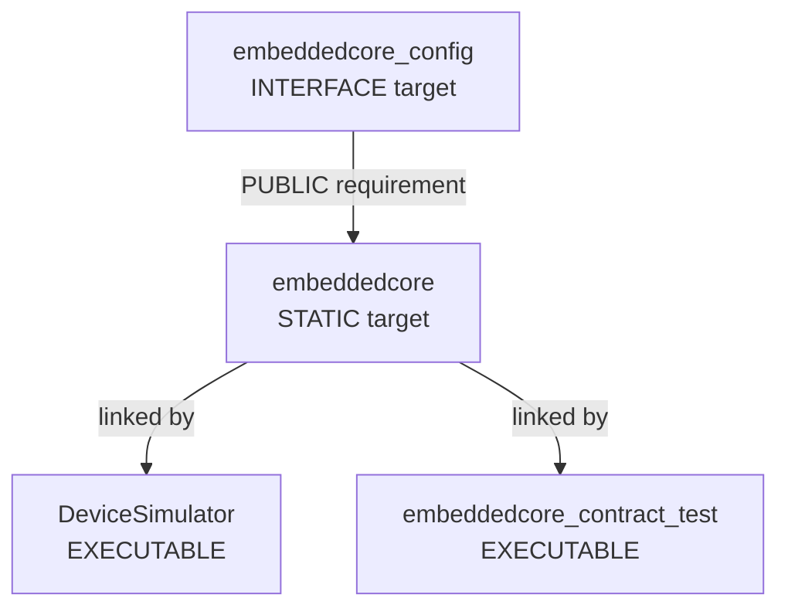
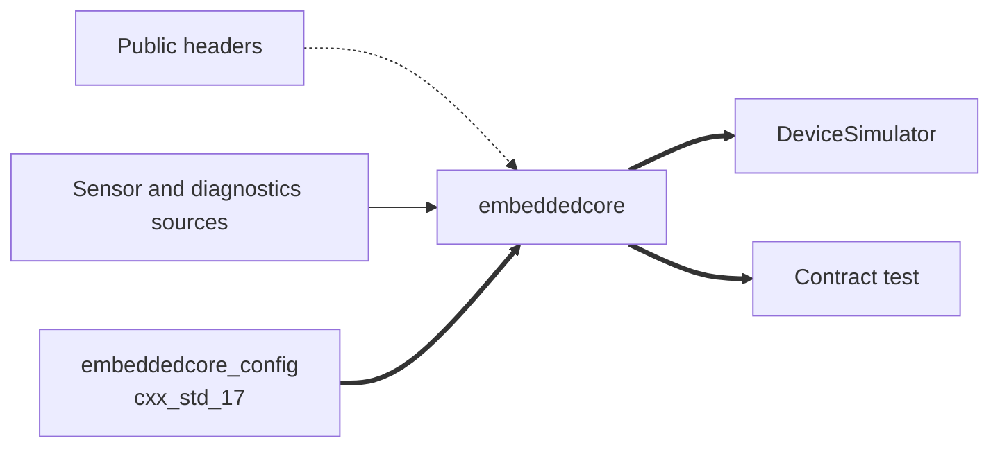

# Chapter 05 — Understanding CMake Targets, Properties, and Dependencies

> **Modern CMake University — Module II: Core CMake**  
> **Project:** EmbeddedCore + DeviceSimulator  
> **Level:** Beginner → intermediate | **Study time:** 5–7 hours  
> **Prerequisite:** [Chapter 04 — Your First Real CMake Project](../04-first-real-cmake-project/README.md)

## The central question

In Chapter 4, we told CMake to build a static library named `embeddedcore` and an executable named `DeviceSimulator`. But **how does CMake know which headers, language standard, compiler flags and dependencies each one needs?** More importantly, when an application depends on a library, how does it inherit exactly the correct requirements?

This chapter introduces the design principle at the heart of **modern target-based CMake**: configure *targets*, not the entire directory, and declare dependencies between them. We will use the same tiny simulated sensor and diagnostics project throughout. No OpenSSL, Android NDK, or Nexus access is needed.

### Learning outcomes

By the end, you can:

1. Define a CMake **target** and distinguish executable, static, shared and interface targets.
2. Explain **target properties** and **usage requirements** with concrete examples.
3. Apply `target_include_directories()`, `target_compile_features()`, `target_compile_definitions()`, and `target_compile_options()`.
4. Explain **PRIVATE, PUBLIC and INTERFACE** without memorizing them as disconnected keywords.
5. Understand `target_link_libraries()` and transitive requirements.
6. Read properties using `get_target_property()` and inspect compiler commands.
7. Use a namespaced `ALIAS` target, and recognize what it does *not* provide.
8. Diagnose errors caused by missing include propagation, missing link dependencies and incorrect macro scope.
9. Build and test the completed example using MSVC or GCC with Ninja.

---

## 1. From global build commands to targets

Imagine that our embedded-device simulation grows into a dozen libraries. Some source files require an extra include directory. Others use particular compiler definitions. One component needs C++17, but another may work with an earlier standard.

A tempting approach is to apply settings to the entire directory:

```cmake
include_directories(include)
add_definitions(-DEMBEDDEDCORE_STRICT_LIMIT)
```

These directory-scoped commands can affect multiple targets created within the directory or below it. This makes a configuration harder to reason about as the project grows.

Modern CMake instead says: **identify the software component and specify only its requirements.**

```cmake
target_include_directories(embeddedcore PUBLIC include)
target_compile_definitions(embeddedcore PRIVATE EMBEDDEDCORE_STRICT_LIMIT)
```

Here, `embeddedcore` is a target. The include path and macro definition belong to that target, with carefully chosen visibility. They are *not* simply global instructions applying indiscriminately to the whole project.

### What is a target?

A **target** is CMake's model of something it builds or makes available to a build. A target may represent a compiled library, executable, imported library, or a collection of usage requirements.

| Target category | Typical declaration | Typical result |
|---|---|---|
| Executable | `add_executable(DeviceSimulator app/main.cpp)` | `.exe` on Windows; executable on Linux |
| Static library | `add_library(embeddedcore STATIC src/sensor.cpp)` | `.lib` on Windows; `.a` on Linux |
| Shared library | `add_library(embeddedcore SHARED src/sensor.cpp)` | `.dll` (+ import library) on Windows; `.so` on Linux |
| Interface library | `add_library(device_settings INTERFACE)` | No ordinary compiled archive; carries usage requirements |
| Alias | `add_library(EmbeddedCore::Core ALIAS embeddedcore)` | Another name for an existing target; no separate binary |

We'll focus on static, executable, interface and alias targets today. Shared-library deployment is covered in Chapter 9.

### Our target graph



CMake builds and links according to these declared relationships, while carrying eligible *usage requirements* along dependency edges.

---

## 2. Target properties: CMake's data model

A **property** is a named piece of information associated with a CMake target. CMake uses properties to construct compile and link commands.

Some examples:

| Property | What it describes |
|---|---|
| `INCLUDE_DIRECTORIES` | Include directories used to compile this target |
| `INTERFACE_INCLUDE_DIRECTORIES` | Include directories required by consumers |
| `COMPILE_DEFINITIONS` | Macros used to compile this target |
| `INTERFACE_COMPILE_DEFINITIONS` | Macros required by consumers |
| `COMPILE_OPTIONS` | Compiler options for this target |
| `INTERFACE_COMPILE_OPTIONS` | Compiler options passed to consumers |
| `LINK_LIBRARIES` | Direct link dependencies of this target |
| `INTERFACE_LINK_LIBRARIES` | Link dependencies passed to consumers |

The target commands in this chapter set these properties for you. You normally use those commands instead of setting the underlying properties manually.

For example:

```cmake
target_include_directories(embeddedcore PUBLIC
    "${CMAKE_CURRENT_SOURCE_DIR}/include"
)
```

`PUBLIC` causes the path to be used for compiling `embeddedcore` and to appear in its interface requirements. That is why a consumer linking `embeddedcore` can include its public header without a separate `-Iinclude` argument.

The compiler itself has no knowledge of CMake properties. CMake translates the final collected properties into appropriate compiler arguments: `/I` for MSVC or `-I` for GCC/Clang, for example.

### Inspect a property

After the target and its properties have been defined, run:

```cmake
get_target_property(_includes embeddedcore INTERFACE_INCLUDE_DIRECTORIES)
message(STATUS "Published include directories: ${_includes}")
```

You will see an entry such as `$<BUILD_INTERFACE:/path/to/project/include>` in the completed lab. The generator expression is not expanded just because it is printed with `message()` at configure time; it is evaluated later in the appropriate build-system context.

> **Important distinction:** A property's own value and its fully evaluated, transitive effect are not always the same. A consumer may receive additional requirements through other linked targets.

---

## 3. Usage requirements — what consumers inherit

Suppose the public header `embeddedcore/sensor.hpp` lives under the project's `include/` directory. A consumer must find that header to compile:

```cpp
#include "embeddedcore/sensor.hpp"
```

A library's **usage requirements** are settings that other targets must use when consuming it. Typical requirements include public include directories, a minimum language standard and publicly required preprocessor definitions.

CMake captures those requirements through target properties beginning with `INTERFACE_`.

This is the main reason to link **targets**, rather than only filenames. A raw path to `libembeddedcore.a` identifies the binary, but it does not, by itself, publish the library's header directories or other CMake requirements.

### The PRIVATE / PUBLIC / INTERFACE model

| Keyword | Used to build the target itself? | Available to linked consumers? |
|---|---:|---:|
| `PRIVATE` | Yes | No, for compile usage requirements |
| `PUBLIC` | Yes | Yes |
| `INTERFACE` | No | Yes |

Think about **who needs the setting**:

- **PRIVATE**: implementation detail; only this target needs it.
- **PUBLIC**: both the library and its consumers need it.
- **INTERFACE**: only consuming targets need it, or the target represents requirements without compiled source.

The matrix describes ordinary compile usage requirements. **Link dependencies have an additional subtlety:** private dependencies of static libraries may still be carried as *link-only* requirements so the final executable can resolve symbols. Chapter 15 will revisit this when exporting static libraries.

### Worked example: internal debugging macro

Our lab's `diagnostics.cpp` implements a strict temperature limit when a macro is defined:

```cpp
#include "embeddedcore/diagnostics.hpp"

namespace embeddedcore {
bool is_temperature_healthy(double temperature) {
#ifdef EMBEDDEDCORE_STRICT_LIMIT
    return temperature <= 35.0;
#else
    return temperature <= 40.0;
#endif
}
}
```

The macro changes the **implementation** of EmbeddedCore, not its public API. So configure it as `PRIVATE`:

```cmake
target_compile_definitions(embeddedcore PRIVATE
    EMBEDDEDCORE_STRICT_LIMIT
)
```

`DeviceSimulator` can call `is_temperature_healthy()`, but it does not need that macro when compiling `main.cpp`. Publishing the macro as `PUBLIC` would unnecessarily couple the consumer to an implementation detail.

### Worked example: a public include directory

Our public headers belong under `include/embeddedcore/`. Both the library and its consumers include them, so the directory is `PUBLIC`:

```cmake
target_include_directories(embeddedcore PUBLIC
    "${CMAKE_CURRENT_SOURCE_DIR}/include"
)
```

Now a consumer only needs to link the target:

```cmake
target_link_libraries(DeviceSimulator PRIVATE embeddedcore)
```

The consumer inherits the include path without adding its own `target_include_directories()` call.

### Predict the outcome

| Change | EmbeddedCore build | DeviceSimulator build | Why |
|---|---|---|---|
| Include path is `PUBLIC` | Works | Works | Both target and consumer see the path |
| Include path is `PRIVATE` | Works | Often fails compiling its public `#include` | Consumer does not inherit include path |
| Strict macro is `PRIVATE` | Uses strict threshold | Macro not defined in consumer | Implementation setting stays local |
| Strict macro is `PUBLIC` | Uses strict threshold | Consumer also gets macro | Might leak a non-API setting |

Run these experiments in the lab; inspect actual compiler commands rather than assuming what happened.

---

## 4. `target_link_libraries()` — expressing a graph, not filenames

Recall Chapter 2, when we manually linked the static library into the executable. We had to specify the archive on the link command.

In target-based CMake, we instead express the relationship:

```cmake
add_library(embeddedcore STATIC
    src/sensor.cpp
    src/diagnostics.cpp
)

add_executable(DeviceSimulator app/main.cpp)

target_link_libraries(DeviceSimulator PRIVATE embeddedcore)
```

This tells CMake that DeviceSimulator needs the `embeddedcore` target. CMake can then:

1. Build the library before the final executable link when needed.
2. Pass the correct library location to the linker.
3. Propagate library usage requirements such as include paths.
4. Rebuild/relink dependents when their required inputs change.

The exact compile and link commands depend on the generator and compiler.

### Why `PRIVATE` for an executable?

`DeviceSimulator` links EmbeddedCore because it calls EmbeddedCore functions. Since the executable is not meant to publish a library API to other consumer targets, `PRIVATE` is the normal choice here.

### Transitive requirements

Suppose A depends publicly on B, and C links A. If B publishes an include-directory requirement, C may receive it through A.


This is *transitivity*: usage requirements can flow through target relationships. We will use the concept with real third-party dependencies in Chapter 11.

---

## 5. Interface libraries: targets without compiled archives

An interface library is especially useful for shared build requirements. It doesn't compile ordinary object files of its own, but it can publish compile features, include paths, definitions or links.

Our lab defines one:

```cmake
add_library(embeddedcore_config INTERFACE)

target_compile_features(embeddedcore_config INTERFACE cxx_std_17)
```

This says: any target that consumes `embeddedcore_config` requires at least C++17.

We then attach it to our compiled library:

```cmake
target_link_libraries(embeddedcore PUBLIC embeddedcore_config)
```

Because that relationship is `PUBLIC`, EmbeddedCore receives the language-standard requirement and its consumers do too.

This might seem more complicated than directly using:

```cmake
target_compile_features(embeddedcore PUBLIC cxx_std_17)
```

For a single small library, the direct form is usually simpler. The interface target is an **educational example** showing how larger repositories can organize shared, reusable requirements.

> **Practical recommendation:** Avoid building elaborate interface-target layers unless they clarify real repeated requirements. A simple target-specific command is often best.

---

## 6. ALIAS targets and namespaced names

CMake allows us to give a local target another name:

```cmake
add_library(EmbeddedCore::Core ALIAS embeddedcore)
```

We can now write:

```cmake
target_link_libraries(DeviceSimulator PRIVATE EmbeddedCore::Core)
```

An alias does **not** compile another library and does **not** create an installed package. It is another name referring to the existing target.

The `::` style is valuable because a misspelled target name with `::` is diagnosed by CMake rather than silently treated as a bare linker item:

```cmake
target_link_libraries(DeviceSimulator PRIVATE EmbeddedCore::Croe)
```

CMake will report that the referenced target cannot be found.

Much later, in Chapter 15, you'll see `EmbeddedCore::Core` used as the name of an **imported target** in an installed package. Both styles give consumers a consistent name, but the mechanisms differ: `ALIAS` refers to a local target, while an imported target describes an external prebuilt target.

---

## 7. Target-level compiler options and C++ standards

### Compiler standard

Instead of passing `-std=c++17` manually or setting `/std:c++17`, let CMake express the language requirement:

```cmake
target_compile_features(embeddedcore PUBLIC cxx_std_17)
```

This asks CMake for a compiler mode supporting **at least** C++17. It may not emit a standard flag when the compiler default already meets the requirement.

In the lab, the requirement is carried through `embeddedcore_config` instead, to demonstrate an `INTERFACE` target.

### Warning flags

MSVC and GCC use different warning options, so the lab branches by compiler:

```cmake
if(MSVC)
    target_compile_options(embeddedcore PRIVATE /W4)
else()
    target_compile_options(embeddedcore PRIVATE -Wall -Wextra -Wpedantic)
endif()
```

These are `PRIVATE` because they control compilation of our library's implementation. We don't want to force every consumer to use the same warning policy.

### What does this generate?

On Linux, the compile command for `src/diagnostics.cpp` should contain pieces similar to:

```text
-I.../include -DEMBEDDEDCORE_STRICT_LIMIT -Wall -Wextra -Wpedantic
```

On Windows, the equivalent MSVC command may contain:

```text
/I...\include /DEMBEDDEDCORE_STRICT_LIMIT /W4
```

These are illustrative fragments, not complete commands. The actual options may vary by compiler version and CMake configuration.

The **consumer's** compile command will contain the public include directory but should not contain `EMBEDDEDCORE_STRICT_LIMIT` in the solution project.

---

## 8. Build-tree paths and generator expressions

Our completed project uses:

```cmake
target_include_directories(embeddedcore PUBLIC
    "$<BUILD_INTERFACE:${CMAKE_CURRENT_SOURCE_DIR}/include>"
)
```

You met generator expressions briefly in Chapter 4. Here, `$<BUILD_INTERFACE:...>` tells CMake that the directory applies when a target is consumed from its build tree.

This is a useful bridge to installed packages. In Chapter 15, we'll complement it with an installation interface:

```cmake
target_include_directories(embeddedcore PUBLIC
    "$<BUILD_INTERFACE:${CMAKE_CURRENT_SOURCE_DIR}/include>"
    "$<INSTALL_INTERFACE:include>"
)
```

The install-interface form is **illustrative at this stage**: the Chapter 5 lab does not yet install headers or export targets. Those steps come in Chapter 15.

Why not put an absolute Jenkins workspace path in `INSTALL_INTERFACE`? Because doing so would make the package depend on the filesystem layout of the machine that built it rather than the location where users install it.

---

## 9. Hands-on lab: build the graph yourself

### Project structure

The included package contains both a `starter` project with TODOs and a working `solution` project:

```text
labs/05-cmake-targets-properties-dependencies/
├── README.md
├── starter/
│   ├── CMakeLists.txt
│   ├── app/main.cpp
│   ├── include/embeddedcore/{sensor,diagnostics}.hpp
│   ├── src/{sensor,diagnostics}.cpp
│   └── tests/contract_test.cpp
└── solution/
    ├── CMakeLists.txt
    ├── app/main.cpp
    ├── include/embeddedcore/{sensor,diagnostics}.hpp
    ├── src/{sensor,diagnostics}.cpp
    └── tests/contract_test.cpp
```

### Step A — Read the starter TODOs

Open `labs/05-cmake-targets-properties-dependencies/starter/CMakeLists.txt`. It creates a library and executable but intentionally omits target usage settings and links. Your goal is to complete the nine TODOs before comparing against the solution.

### Step B — Understand the complete solution

The most important sections of `solution/CMakeLists.txt` are:

```cmake
add_library(embeddedcore_config INTERFACE)
target_compile_features(embeddedcore_config INTERFACE cxx_std_17)

add_library(embeddedcore STATIC
    src/sensor.cpp
    src/diagnostics.cpp
)

add_library(EmbeddedCore::Core ALIAS embeddedcore)

target_include_directories(embeddedcore PUBLIC
    "$<BUILD_INTERFACE:${CMAKE_CURRENT_SOURCE_DIR}/include>"
)

target_link_libraries(embeddedcore PUBLIC embeddedcore_config)
target_compile_definitions(embeddedcore PRIVATE EMBEDDEDCORE_STRICT_LIMIT)

add_executable(DeviceSimulator app/main.cpp)
target_link_libraries(DeviceSimulator PRIVATE EmbeddedCore::Core)
```

The full file also sets compiler-specific warnings, defines a contract test, and prints selected target properties.

### Step C — Configure, build and test on Linux

From the repository root:

```bash
cd labs/05-cmake-targets-properties-dependencies/solution
cmake -S . -B build -G Ninja -DCMAKE_BUILD_TYPE=Debug -DCMAKE_EXPORT_COMPILE_COMMANDS=ON
cmake --build build --verbose
ctest --test-dir build --output-on-failure
./build/DeviceSimulator
```

Expected runtime output:

```text
Embedded Device Simulator
Temperature: 25.5 C
Device status: HEALTHY
```

The simulation reports `HEALTHY` because 25.5°C is below the strict 35°C limit. The test also checks that 45°C is unhealthy.

### Step D — Build on Windows with MSVC

Open **x64 Native Tools Command Prompt for VS 2019** and navigate to the solution directory:

```bat
cmake -S . -B build -G Ninja -DCMAKE_BUILD_TYPE=Debug
cmake --build build --verbose
ctest --test-dir build --output-on-failure
build\DeviceSimulator.exe
```

If you use the Visual Studio 2019 generator instead of Ninja, configure an empty build directory with:

```bat
cmake -S . -B build-vs2019 -G "Visual Studio 16 2019" -A x64
cmake --build build-vs2019 --config Debug
ctest --test-dir build-vs2019 -C Debug --output-on-failure
build-vs2019\Debug\DeviceSimulator.exe
```

Build directory names are deliberately different because different generators should not reuse the same cached build directory.

### Step E — Inspect what the compiler actually received

On Linux, the generated `build/compile_commands.json` contains command lines for each C++ translation unit. Find the entry for `diagnostics.cpp` and compare it with the one for `main.cpp`.

On either platform, `cmake --build build --verbose` shows commands used for compilation and linking. If no sources are out of date, you may need to touch an input file or use a clean build to see compilation lines again.

Check your predictions:

| Setting | `diagnostics.cpp` | `main.cpp` |
|---|---|---|
| Public include directory | Yes | Yes |
| `EMBEDDEDCORE_STRICT_LIMIT` | Yes | No |
| EmbeddedCore-specific warning flags | Yes | No |
| Standard requirement from interface target | Yes | Yes |

This experiment is the point where abstract `PUBLIC`/`PRIVATE` rules become visible in real compiler commands.

### Step F — Deliberately break include propagation

Replace `PUBLIC` with `PRIVATE` in:

```cmake
target_include_directories(embeddedcore PRIVATE
    "$<BUILD_INTERFACE:${CMAKE_CURRENT_SOURCE_DIR}/include>"
)
```

Reconfigure and rebuild. `embeddedcore` can still see its headers, but `DeviceSimulator` no longer inherits the include path. Its `#include "embeddedcore/sensor.hpp"` will typically fail.

Restore `PUBLIC` before proceeding.

### Step G — Deliberately break linking

Temporarily remove:

```cmake
target_link_libraries(DeviceSimulator PRIVATE EmbeddedCore::Core)
```

The application compiler may still find headers only if you separately provide an include path; otherwise an include error occurs first. For an **isolated linker experiment**, explicitly supply the header directory to DeviceSimulator while temporarily omitting the library link. Then `main.cpp` compiles but the final executable link fails due to missing implementations.

Restore the link command afterward.

### Step H — Verify the contract test

Run:

```bash
ctest --test-dir build --output-on-failure
```

Expected test: `EmbeddedCoreContract`. If no tests are found, confirm `include(CTest)`, the `BUILD_TESTING` cache option and `add_test()` are present. **No tests found is not equivalent to tests passing.**

---

## 10. Understanding CMake's target graph in detail

A build graph is more than compile order. It also expresses *configuration dependencies*.



**Solid arrows** depict conceptual build or link relationships; the dotted header line represents header use. These diagrams are pedagogical and should not be read as exact Ninja graph syntax.

When CMake configures this graph:

1. It records which source files compile into `embeddedcore`.
2. It computes the compile settings for `embeddedcore`, including those inherited from `embeddedcore_config`.
3. It records that `DeviceSimulator` links to `embeddedcore`.
4. It propagates `embeddedcore` public requirements to `DeviceSimulator`.
5. It generates concrete instructions for Ninja or Visual Studio.

The build executor then runs the compiler, archiver and linker as needed.

---

## 11. Common mistakes and troubleshooting

| Symptom | Likely cause | Investigation |
|---|---|---|
| Consumer reports public header missing | Include directory was marked `PRIVATE` or not set | Inspect `INTERFACE_INCLUDE_DIRECTORIES` and verbose compile command |
| Undefined reference to `read_temperature()` | Consumer not linked to `embeddedcore` | Inspect `target_link_libraries()` and verbose link command |
| Macro unexpectedly appears in app build | Implementation macro marked `PUBLIC` | Inspect `INTERFACE_COMPILE_DEFINITIONS` |
| CMake says target `EmbeddedCore::Core` not found | Misspelled or missing alias/imported target | Check `add_library(... ALIAS ...)` |
| `INTERFACE` library produces no `.a` file | This is expected | Interface targets carry usage requirements; they do not produce normal compiled archives |
| `get_target_property()` prints a generator expression | Generator expressions haven't been evaluated in that context | Inspect generated compile commands or use a generator-time diagnostic |
| Changing CMake files appears to have no effect | Reusing a stale build, editing wrong source, or failing to configure | Check source path, build directory and verbose commands |
| Windows C++ compiler isn't found | MSVC environment not initialized | Use the Visual Studio x64 Native Tools Command Prompt |

### Common misconception: `PUBLIC` means publicly visible C++ symbols

No. CMake's `PUBLIC` keyword means the **usage requirement applies to the target and its consumers**. It is not the same thing as C++ access modifiers (`public`/`private`) or symbol visibility controls in a compiled binary.

### Common misconception: linking a static library merges its dependencies

Not usually. If `embeddedcore` is a static archive with a dependency on another static library, CMake can carry link requirements forward, but it does not ordinarily merge the dependent library's object files into `libembeddedcore.a`. Final symbol resolution happens when an executable or shared library is linked.

---

## 12. Independent exercises

**Exercise 1 — Scope prediction (beginner).** Predict whether `DeviceSimulator` inherits a header directory when `target_include_directories(embeddedcore INTERFACE include)` is used. Does EmbeddedCore itself inherit it? Test and explain the outcome.

**Exercise 2 — Internal macro (beginner).** Change the strict health limit to 30°C and define it using a private compile definition. Verify the behavior by adjusting the simulation temperature and rebuilding.

**Exercise 3 — Build graph (intermediate).** Create a second executable named `DiagnosticTool` that links `EmbeddedCore::Core`. It should print whether a simulated reading of 41°C is healthy. Avoid manually repeating the include directory.

**Exercise 4 — Interface target (intermediate).** Add a new interface target called `embeddedcore_warnings`, with compiler-specific warning flags. Attach it privately to EmbeddedCore. Confirm whether `DeviceSimulator` receives those flags and explain your observation.

**Exercise 5 — Clean-room consumer (advanced).** In a separate subdirectory, create a CMake target that links EmbeddedCore. Explain what works in the same build tree and what additional packaging features will be required when that consumer is in a separate repository (preview of Chapter 15).

### Challenge assignment — Usage requirement audit

Create a table for all EmbeddedCore target settings. For each setting, justify whether it should be `PRIVATE`, `PUBLIC` or `INTERFACE`. Back up each choice with an inspection of a compiler or linker command.

**Suggested submission:** a short Markdown report (`lab-notes.md`) containing your table, commands, observed results and explanations.

---

## 13. Knowledge check (10 questions)

Attempt these before opening `solutions/05-cmake-targets-properties-dependencies/quiz-answers.md`.

1. Which CMake concept carries properties and usage requirements for a build component?  
   A. A source file · B. A target · C. A shell environment · D. A linker script

2. A static library and its consumers both include headers under `include/`. Which scope normally fits the library's include-directory requirement?  
   A. PRIVATE · B. INTERFACE · C. PUBLIC · D. No scope needed

3. A macro only controls the internal implementation of a library. Which scope should usually be used on `target_compile_definitions()`?  
   A. PRIVATE · B. PUBLIC · C. INTERFACE · D. GLOBAL

4. Which scope keyword is used when defining requirements on a target that should be provided to consumers, without applying those requirements to compiled sources of that target?  
   A. PRIVATE · B. PUBLIC · C. SHARED · D. INTERFACE

5. Which command connects a consuming executable to a library target and gives CMake access to its transitive usage requirements?  
   A. `add_definitions()` · B. `target_link_libraries()` · C. `file(GLOB)` · D. `message()`

6. **True or false:** A target's `PRIVATE` include directories are automatically added to every consumer that links it.

7. **True or false:** An `ALIAS` target provides an alternative name for an existing target without generating a separate compiled library.

8. Which command retrieves a CMake target property at configure time?  
   A. `set_property()` · B. `get_target_property()` · C. `project()` · D. `find_package()`

9. When the app can still compile its headers but no longer links a required static library, which stage is the likely point of failure?  
   A. Final linking · B. Preprocessing · C. Parsing the CMake minimum version · D. Executing CTest

10. Which generator expression identifies a path that should apply to consumers in the source/build tree?  
    A. `$<INSTALL_INTERFACE:...>` · B. `$<CONFIG:Debug>` · C. `$<BUILD_INTERFACE:...>` · D. `$<TARGET_FILE:...>`

---

## 14. Chapter summary

| Concept | Remember this |
|---|---|
| Target | CMake's model of a build component and its properties |
| `target_include_directories()` | Specify header search directories on a target |
| `target_compile_features()` | Declare a minimum language-feature requirement |
| `target_compile_definitions()` | Define preprocessor macros on a target |
| `target_compile_options()` | Supply target-specific compiler options |
| `target_link_libraries()` | Declare dependencies and enable transitive usage requirements |
| `PRIVATE` | This target requires it |
| `PUBLIC` | This target and consumers require it |
| `INTERFACE` | Consumers require it |
| Interface target | Reusable requirements, usually without compiled output |
| Alias target | A second name for an existing target |

**The major idea:** modern CMake is a model of **targets connected by dependencies**. The values attached to those targets determine how the build is performed and which requirements are passed along to consumers.

## 15. Further reading

- [Official CMake build-system manual](https://cmake.org/cmake/help/latest/manual/cmake-buildsystem.7.html)
- [target_include_directories()](https://cmake.org/cmake/help/latest/command/target_include_directories.html)
- [target_link_libraries()](https://cmake.org/cmake/help/latest/command/target_link_libraries.html)
- [target_compile_features()](https://cmake.org/cmake/help/latest/command/target_compile_features.html)
- [add_library(): normal, interface and alias targets](https://cmake.org/cmake/help/latest/command/add_library.html)
- [get_target_property()](https://cmake.org/cmake/help/latest/command/get_target_property.html)

---

## Next chapter

**[Chapter 06 — Variables, Scopes, Headers and Include Directories](../06-variables-and-headers/README.md)**

We'll explore normal variables, cache variables, function and directory scopes, path handling, include search rules and why target-level configuration remains preferable to global directory state.

**Lab deliverables:** `labs/05-cmake-targets-properties-dependencies/`  
**Answer key:** `solutions/05-cmake-targets-properties-dependencies/quiz-answers.md`
