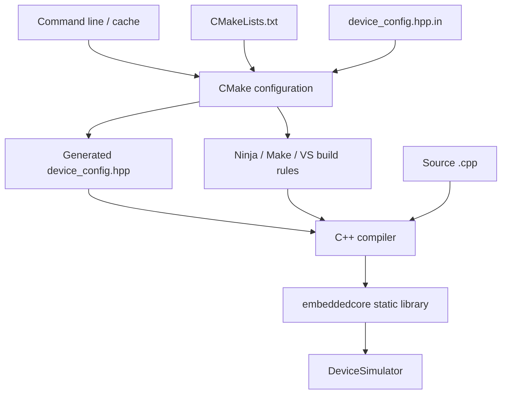

**Course navigation:** [Course home](../../README.md) · [← Chapter 05](../05-cmake-targets-properties-dependencies/README.md) · [Chapter 07 →](../07-debug-release-build-configurations/README.md)

# Chapter 06 — CMake Variables, Scopes, Paths, and Include Directories

> **Modern CMake University — Module II: Core CMake**  
> **Project:** EmbeddedCore + DeviceSimulator  
> **Level:** Beginner → intermediate | **Study time:** 5–7 hours  
> **Prerequisite:** [Chapter 05 — Understanding CMake Targets, Properties, and Dependencies](../05-cmake-targets-properties-dependencies/README.md)  
> **Minimum CMake for the lab:** 3.20 | **C++ standard:** C++17

## The central question

In Chapter 5, we attached headers, compiler options and dependencies to the `embeddedcore` target. But where do CMake *values* come from? Why does a command-line `-D` option remain in effect after the next configuration? Why does a variable changed inside a function appear unchanged outside it? And why can `#include "embeddedcore/sensor.hpp"` work on one developer's machine but fail on another?

**This chapter explains CMake's configuration data model and header-search rules.** Instead of adding a new library dependency, we will turn our existing simulated embedded device into a configurable product: developers can choose its ID and temperature warning threshold when configuring CMake, without modifying the source code.

### Learning outcomes

By the end of this chapter, you should be able to:

1. Distinguish normal, cache and environment variables.
2. Read `set()`, `option()`, `message()` and `${NAME}` correctly, including quoting and list conventions.
3. Predict variable visibility across `include()`, `function()` and `add_subdirectory()`.
4. Explain `PARENT_SCOPE` and why it should be used judiciously.
5. Distinguish `CMAKE_SOURCE_DIR`, `CMAKE_CURRENT_SOURCE_DIR`, `CMAKE_BINARY_DIR`, `CMAKE_CURRENT_BINARY_DIR`, and `CMAKE_CURRENT_LIST_DIR`.
6. Explain how `#include` relates to `target_include_directories()` and why `PUBLIC` versus `PRIVATE` matters.
7. Generate a build-specific C++ configuration header using `configure_file(... @ONLY)`.
8. Inspect and override CMake cache entries from the command line.
9. Diagnose incorrect include paths, stale caches, variable shadowing and configuration leaks.
10. Build and test the solution on Windows with MSVC or on Linux with GCC/Clang.

---

## 1. Two languages, two different jobs

A CMake project contains at least two kinds of instructions:

- **CMake code** in `CMakeLists.txt` and optional `.cmake` modules, which describes the build.
- **C++ code** in `.cpp` and `.hpp` files, which becomes the program.

CMake's variable `${DEVICE_LABEL}` is *not* automatically a C++ variable. During **configuration**, CMake can use it to generate a header or control a compiler definition. Later, during **compilation**, the compiler reads the resulting C++ source and headers.



**Architecture principle:** configure a target before building it, and keep the source tree independent of machine-specific settings.

### Concepts to distinguish

| Concept | Example | Lives where? |
|---|---|---|
| Normal CMake variable | `set(WARNING_THRESHOLD_C 35.0)` | Current CMake configuration execution scope |
| Cache variable | `-DDEVICE_LABEL=SensorNode-B` | `CMakeCache.txt` in the build tree |
| Environment variable | `$ENV{MY_SDK_ROOT}` | Environment inherited by the CMake process |
| C++ constant | `configuration::warning_threshold_c` | Compiled into the C++ program |
| Target property | `INTERFACE_INCLUDE_DIRECTORIES` | CMake's model of a target |

**Do not confuse variables with target properties.** A CMake variable can be used to *set* a target property, but targets retain properties as part of the generated build model.

---

## 2. Normal CMake variables

The fundamental normal-variable syntax is:

```cmake
set(DEVICE_LABEL "SensorNode-A")
message(STATUS "Device label: ${DEVICE_LABEL}")
```

The output at configuration time is similar to:

```text
-- Device label: SensorNode-A
```

`${DEVICE_LABEL}` expands the current CMake value. `message(STATUS ...)` writes a status message in configure output; it does *not* print when DeviceSimulator executes.

### Why quotes matter

CMake has a list convention: list values are usually represented by strings containing semicolons.

```cmake
set(SUPPORTED_SENSORS "temperature;pressure;humidity")
foreach(sensor IN LISTS SUPPORTED_SENSORS)
    message(STATUS "Sensor: ${sensor}")
endforeach()
```

This iterates over three list elements. Many CMake commands parse unquoted arguments as separate arguments after expansion. When a variable denotes a single filesystem path (which might contain spaces), quote it:

```cmake
set(MY_INCLUDE_DIR "${CMAKE_CURRENT_SOURCE_DIR}/include")
target_include_directories(embeddedcore PUBLIC "${MY_INCLUDE_DIR}")
```

There are contexts where CMake syntax intentionally uses unquoted lists or generator expressions. Avoid the oversimplification that **everything** must always be quoted; for now, quote paths and ordinary scalar strings, and use explicit list-aware commands where appropriate.

### Useful messages for learning

```cmake
message(STATUS "Source dir: ${CMAKE_CURRENT_SOURCE_DIR}")
message(WARNING "This is a non-fatal warning")
message(FATAL_ERROR "Stop configuration now")
```

Use `FATAL_ERROR` for missing mandatory build inputs, and `STATUS` for helpful diagnostics. Do not print passwords, access tokens or sensitive paths in verbose logs.

---

## 3. Cache variables: configuration that survives

A normal variable exists only while CMake is processing a configuration. A **cache variable** persists in the build directory's `CMakeCache.txt` between reconfiguration runs.

Create a cache setting:

```cmake
set(DEVICE_LABEL "SensorNode-A" CACHE STRING "Simulated device identifier")
```

Or create a Boolean cache option:

```cmake
option(EMBEDDEDCORE_STRICT_LIMIT "Warn above 35C" ON)
```

At the command line, override the defaults:

```bash
cmake -S . -B build/debug -G Ninja \
  -DDEVICE_LABEL=SensorNode-B \
  -DEMBEDDEDCORE_STRICT_LIMIT=OFF
```

The `-D` arguments write or update cache entries. On the next configure in the *same* build tree, those choices generally remain even when you omit them.

### Important cache behavior

```cmake
set(DEVICE_LABEL "SensorNode-A" CACHE STRING "Simulated device identifier")
```

If the cache already contains `DEVICE_LABEL=SensorNode-B`, the normal default declaration does **not** ordinarily overwrite the user's prior choice. That is useful: projects can supply defaults without fighting users' options.

To inspect visible cache entries and their descriptions:

```bash
cmake -LAH -N build/debug
```

To change one setting:

```bash
cmake -S . -B build/debug -DDEVICE_LABEL=SensorNode-C
```

To remove one cache entry explicitly, you can use `-U` when configuring:

```bash
cmake -S . -B build/debug -UDEVICE_LABEL
```

In that case the project default may be restored when it declares the cache entry again. Use a fresh build directory when changing fundamental compiler, generator or ABI settings, because merely changing the cache entry may not be safe.

### Normal variables can shadow cache variables

This example is *illustrative*, and does not belong in the production lab:

```cmake
set(DEVICE_LABEL "Saved-Device" CACHE STRING "Device label")
set(DEVICE_LABEL "Temporary-Override")
message(STATUS "Visible value: ${DEVICE_LABEL}")
```

For ordinary variable evaluation, a normal variable of the same name takes precedence over a cache entry. Therefore this prints `Temporary-Override`, despite the cache containing `Saved-Device`. To remove the local normal variable and expose the cache value again:

```cmake
unset(DEVICE_LABEL)
message(STATUS "Now visible: ${DEVICE_LABEL}")
```

A common production bug is unintentionally overriding a user-supplied cache setting with `set()` in some included module. <https://cmake.org/cmake/help/v3.31/command/set.html>

---

## 4. Environment variables are a third category

CMake can read the environment in which it was launched:

```cmake
if(DEFINED ENV{ANDROID_NDK_HOME})
    message(STATUS "Android NDK environment variable is present")
endif()
```

These are not the same as CMake cache entries. `$ENV{ANDROID_NDK_HOME}` reads an environment variable; `${ANDROID_NDK_HOME}` expands a CMake variable of that name, if any.

For an SDK root supplied by a CI system, a good pattern is to read an environment variable at the orchestration boundary and turn it into an explicit configuration input. Avoid using many hidden environment variables to select security-sensitive dependencies.

```cmake
if(NOT DEFINED OPENSSL_ROOT_DIR AND DEFINED ENV{OPENSSL_ROOT_DIR})
    set(OPENSSL_ROOT_DIR "$ENV{OPENSSL_ROOT_DIR}")
endif()
```

This pattern illustrates an explicit fallback; it does *not* prove the dependency's version, checksum, or ABI. Those validations belong to later chapters.

### Different operating systems

| Environment | Typical command to set a process environment variable |
|---|---|
| Linux Bash | `export DEVICE_MODE=development` |
| Windows CMD | `set DEVICE_MODE=development` |
| Windows PowerShell | `$env:DEVICE_MODE = 'development'` |

Set it before launching CMake. Setting an environment variable inside a CMake process does not update the parent terminal.

---

## 5. Variable scope: who can see a value?

A **scope** determines where a variable assignment is visible. Three especially useful CMake mechanisms behave differently.

### A. include() operates in the caller's variable scope

Parent `CMakeLists.txt`:

```cmake
set(SCOPE_MESSAGE "parent")
include(cmake/ScopeExamples.cmake)
message(STATUS "Included note: ${INCLUDED_NOTE}")
```

Included `cmake/ScopeExamples.cmake`:

```cmake
set(INCLUDED_NOTE "set inside included module")
```

The included file executes in the caller's variable scope, so the newly assigned value is visible after `include()`.

`include()` is suited to small reusable configuration modules. **It does not create a new CMake target or add a new source directory by itself.**

### B. function() introduces a variable scope

```cmake
set(SCOPE_MESSAGE "parent")

function(demonstrate_function_scope)
    set(SCOPE_MESSAGE "inside function")
    message(STATUS "Inside: ${SCOPE_MESSAGE}")
endfunction()

demonstrate_function_scope()
message(STATUS "Outside: ${SCOPE_MESSAGE}")
```

Expected:

```text
-- Inside: inside function
-- Outside: parent
```

The function's normal-variable assignment stays local. Functions can still affect global resources such as targets and cache entries; “function scope” is specifically about ordinary variable bindings, not a sandbox.

### C. PARENT_SCOPE explicitly sends a result outward

```cmake
function(compute_device_mode output_variable)
    set(${output_variable} "simulation" PARENT_SCOPE)
endfunction()

compute_device_mode(DEVICE_MODE)
message(STATUS "Device mode: ${DEVICE_MODE}")
```

The result is written into the parent scope. The `PARENT_SCOPE` form does not also update the function's own local variable.

A scalable alternative is to return structured information through carefully designed function parameters or target properties; pervasive `PARENT_SCOPE` use makes a build harder to follow.

### D. add_subdirectory() introduces a child directory scope

Parent:

```cmake
set(DEVICE_LABEL "Parent-Node")
add_subdirectory(scope_child)
message(STATUS "Parent still sees: ${DEVICE_LABEL}")
```

Child `scope_child/CMakeLists.txt`:

```cmake
message(STATUS "Child inherited: ${DEVICE_LABEL}")
set(DEVICE_LABEL "Child-Node")
message(STATUS "Child now sees: ${DEVICE_LABEL}")
```

The child starts with access to variables from its parent directory scope. Changing a normal variable in the child does not ordinarily change the parent's value.

### Scope comparison

| Mechanism | Creates a new variable scope? | Typical purpose |
|---|---|---|
| `include(file.cmake)` | No | Reuse configuration commands in caller scope |
| `function(name)` | Yes | Encapsulate reusable logic and local variables |
| `macro(name)` | No function-like variable scope | Text-like reusable command expansion; use cautiously |
| `add_subdirectory(path)` | Yes, child directory scope | Organize nested CMake projects and targets |
| `set(... PARENT_SCOPE)` | Writes into parent scope | Explicitly return a variable value |

**Interview question:** When should a `.cmake` helper be an `include()` module versus a `function()`? Think about whether you want side effects in the caller's variable scope.

---

## 6. Understand CMake's source, binary, and list directories

CMake deliberately distinguishes where source lives from where generated files and build products go.

Consider this repository:

```text
embeddedcore/
├── CMakeLists.txt
├── cmake/
│   └── ScopeExamples.cmake
├── include/
│   └── embeddedcore/
│       └── sensor.hpp
├── src/
│   └── sensor.cpp
└── build/
    └── debug/
```

When configured with `cmake -S . -B build/debug`, the key variables mean:

| Variable | Meaning |
|---|---|
| `CMAKE_SOURCE_DIR` | Topmost source directory of this CMake invocation |
| `CMAKE_BINARY_DIR` | Topmost build directory |
| `CMAKE_CURRENT_SOURCE_DIR` | Source directory currently being processed |
| `CMAKE_CURRENT_BINARY_DIR` | Corresponding current build directory |
| `CMAKE_CURRENT_LIST_DIR` | Directory containing the list file currently executing |
| `PROJECT_SOURCE_DIR` | Source directory of the most recent relevant `project()` call |

At the root, `CMAKE_SOURCE_DIR` and `CMAKE_CURRENT_SOURCE_DIR` commonly match. In a child `add_subdirectory()`, `CMAKE_CURRENT_SOURCE_DIR` changes. Inside an included module, `CMAKE_CURRENT_LIST_DIR` identifies that module's location while it executes.

### Why list-file location matters

Suppose the module lives in `cmake/ConfigureDevice.cmake` and needs a sibling template called `defaults.json`:

```cmake
set(DEFAULTS_FILE "${CMAKE_CURRENT_LIST_DIR}/defaults.json")
```

This is more robust than assuming the project root is the location of the module. Inside a function defined in one file but invoked later from another, consider `CMAKE_CURRENT_FUNCTION_LIST_DIR` when the function needs files located beside its definition (available in newer CMake versions, including 3.20).

### Why out-of-source builds matter

The same source tree can be configured multiple times without mixing outputs:

```text
embeddedcore/
├── include/
├── src/
├── CMakeLists.txt
└── build/
    ├── windows-debug/
    ├── linux-release/
    └── android-arm64/
```

Do not reuse the same build directory for different generators or incompatible toolchains. Every build tree contains a cache and generated rules tied to its configuration.

---

## 7. Header lookup: #include versus include directories

Consider this C++ statement:

```cpp
#include "embeddedcore/sensor.hpp"
```

It tells the C++ preprocessor which header name to locate. It does **not** tell the compiler where your repository is installed. For our project, the file exists at:

```text
include/embeddedcore/sensor.hpp
```

Therefore the compiler should receive the **parent `include/` directory** as a header search path. CMake declares that requirement on the library target:

```cmake
target_include_directories(embeddedcore PUBLIC
    "${CMAKE_CURRENT_SOURCE_DIR}/include"
)
```

If `embeddedcore` exposes public headers needed by DeviceSimulator, `PUBLIC` is appropriate: consumers inherit the include directory when they link `embeddedcore`.

### PUBLIC versus PRIVATE revisited

| Include directory | Should EmbeddedCore see it? | Should a consumer see it? | Usually |
|---|---|---|---|
| `include/` containing public API headers | Yes | Yes | `PUBLIC` |
| Build-generated header used only by `.cpp` implementation | Yes | No | `PRIVATE` |
| Header directory needed only by consumers | No | Yes | `INTERFACE` |

**Architectural case 1 — Internal generated header:** If `device_config.hpp` is included only by library source files, mark its generated directory `PRIVATE`.

**Architectural case 2 — Public generated header:** If public API headers themselves include generated configuration, consumers also need that header; it must be properly published and installed. We'll address relocatable public package paths in Chapter 15.

**Architectural case 3 — Third-party headers:** If a library dependency is represented as an imported CMake target, prefer linking that target over manually injecting its machine-specific include directories.

CMake stores public include usage requirements in `INTERFACE_INCLUDE_DIRECTORIES`. <https://cmake.org/cmake/help/v3.31/command/target_include_directories.html>

---

## 8. Generate a C++ configuration header

Now we will connect a CMake cache option to actual C++ behavior.

**Requirement:** The same EmbeddedCore sources should support two simulated device policies:

- Strict: warning above **35°C**.
- Standard: warning above **40°C**.

We also want a configurable device label.

### A. Declare options in CMakeLists.txt

```cmake
set(DEVICE_LABEL "SensorNode-A" CACHE STRING "Simulated device identifier")
option(EMBEDDEDCORE_STRICT_LIMIT "Warn above 35C rather than 40C" ON)

if(EMBEDDEDCORE_STRICT_LIMIT)
    set(WARNING_THRESHOLD_C 35.0)
else()
    set(WARNING_THRESHOLD_C 40.0)
endif()
```

`DEVICE_LABEL` and `EMBEDDEDCORE_STRICT_LIMIT` are cache settings. `WARNING_THRESHOLD_C` is a derived normal variable. This avoids creating unnecessary persistent cache state for a value entirely determined by another option.

### B. Create a header template

File: `config/device_config.hpp.in`:

```cpp
#pragma once
namespace embeddedcore::configuration {
    inline constexpr char label[] = "@DEVICE_LABEL@";
    inline constexpr double warning_threshold_c = @WARNING_THRESHOLD_C@;
}
```

The `@NAME@` sequences are placeholders, **not valid final C++**. CMake replaces them during configuration.

### C. Generate the header

```cmake
configure_file(
    "${CMAKE_CURRENT_SOURCE_DIR}/config/device_config.hpp.in"
    "${CMAKE_CURRENT_BINARY_DIR}/generated/embeddedcore/device_config.hpp"
    @ONLY
)
```

`configure_file()` reads the template and writes a generated file. `@ONLY` limits substitutions to `@VARIABLE@` syntax, avoiding accidental replacement of `${...}` content in the template. CMake normally changes the generated output only when its content changes, which helps incremental builds. <https://cmake.org/cmake/help/v3.31/command/configure_file.html>

For `DEVICE_LABEL=SensorNode-B` with strict mode ON, the result resembles:

```cpp
#pragma once
namespace embeddedcore::configuration {
    inline constexpr char label[] = "SensorNode-B";
    inline constexpr double warning_threshold_c = 35.0;
}
```

### D. Expose the generated header only to our library

```cmake
target_include_directories(embeddedcore
    PUBLIC "${CMAKE_CURRENT_SOURCE_DIR}/include"
    PRIVATE "${CMAKE_CURRENT_BINARY_DIR}/generated"
)
```

`src/diagnostics.cpp` can now include `embeddedcore/device_config.hpp` without requiring consumers to see the generated directory.

### E. Use the configured threshold in C++

```cpp
#include "embeddedcore/diagnostics.hpp"
#include "embeddedcore/device_config.hpp"

namespace embeddedcore {
    bool is_temperature_healthy(double temperature) {
        return temperature <= configuration::warning_threshold_c;
    }
}
```

A CMake configure-time value has now become a compiled C++ constant.

### Security and robustness note

Our lab validates that `DEVICE_LABEL` contains only letters, digits, underscores or hyphens before inserting it into a C++ string literal. In general, **never directly inject arbitrary untrusted strings into generated source code** without escaping or validation. Later courses can explore `string(CONFIGURE)`, custom code generation and embedded resource formats.

---

## 9. Lab architecture and exact files

The Chapter 6 solution is delivered under:

```text
labs/06-variables-scopes-and-include-directories/solution/
├── CMakeLists.txt
├── app/
│   └── main.cpp
├── cmake/
│   └── ScopeExamples.cmake
├── config/
│   └── device_config.hpp.in
├── include/
│   └── embeddedcore/
│       ├── sensor.hpp
│       ├── diagnostics.hpp
│       └── device_info.hpp
├── scope_child/
│   └── CMakeLists.txt
├── src/
│   ├── sensor.cpp
│   ├── diagnostics.cpp
│   └── device_info.cpp
└── tests/
    └── contract_test.cpp
```

It extends the project from Chapter 5 by adding device identity, configuration generation and scope demonstrations. The **starter** contains unfinished CMake TODOs for the student to complete; it is expected to fail before those TODOs are resolved.

### Lab 1 — Windows MSVC + Ninja

Open **x64 Native Tools Command Prompt for VS 2019**, navigate to the solution directory, and run:

```bat
cmake -S . -B build\debug -G Ninja -DCMAKE_BUILD_TYPE=Debug -DDEVICE_LABEL=SensorNode-B -DEMBEDDEDCORE_STRICT_LIMIT=ON
cmake --build build\debug --verbose
ctest --test-dir build\debug --output-on-failure
build\debug\DeviceSimulator.exe
```

Expected application output:

```text
Embedded Device Simulator
Device: SensorNode-B
Temperature: 25.5 C
Device status: HEALTHY
```

The configuration output should also demonstrate the effects of `include`, function-local variables and child directory scopes.

### Lab 2 — Linux GCC / Clang + Ninja

From the same solution directory:

```bash
cmake -S . -B build/debug -G Ninja \
  -DCMAKE_BUILD_TYPE=Debug \
  -DDEVICE_LABEL=SensorNode-B \
  -DEMBEDDEDCORE_STRICT_LIMIT=ON

cmake --build build/debug --verbose
ctest --test-dir build/debug --output-on-failure
./build/debug/DeviceSimulator
```

Use `g++` (or Clang with `CXX=clang++` on a new build tree) and a working Ninja installation. On Windows, use the initialized MSVC environment instead of relying on a compiler discovered accidentally from PATH.

### Lab 3 — Inspect the generated header

On Linux:

```bash
cat build/debug/generated/embeddedcore/device_config.hpp
```

On Windows:

```bat
type build\debug\generated\embeddedcore\device_config.hpp
```

Identify the values of `label` and `warning_threshold_c`. Compare them with your cache settings.

### Lab 4 — Reconfigure without touching C++

Change the device label and turn off strict mode:

```bash
cmake -S . -B build/debug -DDEVICE_LABEL=SensorNode-C -DEMBEDDEDCORE_STRICT_LIMIT=OFF
cmake --build build/debug
```

Windows uses the same command syntax with `build\debug` as the path. Open the generated header again. It should now contain the updated label and `40.0` threshold.

The source files have not changed, but the **generated header** has changed. The build system will normally recompile any translation units that depend on it.

### Lab 5 — Test the exact boundary

The diagnostic function treats 35°C as healthy in strict mode and marks temperatures above 35°C as warnings. In standard mode, 40°C is still healthy. Write an additional test asserting the boundary behavior for each mode.

You can supply the threshold to a test program through a configured header or create separate build trees for the two configurations. Avoid making one test incorrectly assume strict mode is always enabled.

### Lab 6 — Scope observation

When `EMBEDDEDCORE_SHOW_SCOPE_DEMO=ON`, the solution prints values before and after an included `.cmake` module, a function call and a child directory. Predict the printed values before running the configure command; then explain why the function's normal-variable edit and child directory's edit do not leak back into their callers.

### Lab 7 — Explore the cache

```bash
cmake -LAH -N build/debug
```

Find `DEVICE_LABEL`, `EMBEDDEDCORE_STRICT_LIMIT`, `BUILD_TESTING`, and `CMAKE_BUILD_TYPE`. Which are project-defined? Which are provided by CMake or CTest?

### Lab 8 — Inspect compiler include arguments

Use `cmake --build build/debug --verbose`. On GCC/Clang, find compiler `-I` entries; on MSVC find `/I` entries. Confirm that the public API include directory and the generated-header directory are passed when compiling EmbeddedCore.

---

## 10. Architecture cases and engineering tradeoffs

### Case A — One machine, Debug and Release

A single-configuration generator such as `Ninja` uses `CMAKE_BUILD_TYPE`, so separate build trees are the simplest way to keep Debug and Release artifacts independent:

```bash
cmake -S . -B build/debug -G Ninja -DCMAKE_BUILD_TYPE=Debug
cmake -S . -B build/release -G Ninja -DCMAKE_BUILD_TYPE=Release
```

For **Ninja Multi-Config**, one build tree can hold multiple configurations; `CMAKE_BUILD_TYPE` is not the selection mechanism. We study this fully in Chapter 7.

### Case B — Windows and Linux with the same source

Do not hardcode an absolute Windows header path into a public target property. Build from each platform's source checkout and let CMake derive its own `${CMAKE_CURRENT_SOURCE_DIR}` and `${CMAKE_CURRENT_BINARY_DIR}`.

### Case C — Android ARMv7 versus ARM64

The Android NDK toolchain and ABI identify the target. Use a separate CMake build directory per ABI and avoid carrying over a cache from another ABI. For example, the `ANDROID_ABI` choice and compiler selection are fundamental configuration settings, not ordinary switchable application options.

### Case D — Generated header used by public library clients

If the public API includes a generated header, `PRIVATE` is insufficient. Consumers must find the generated header in a build-tree context and in the installed package. This is why Chapter 15 introduces `$<BUILD_INTERFACE:...>`, `$<INSTALL_INTERFACE:...>` and installed-header rules.

### Case E — Enterprise dependencies such as OpenSSL

Cache and environment variables can communicate the location of an approved dependency, but they are not an approval mechanism. The build must still validate the exact dependency identity, architecture, version and approved variant. We'll revisit this in Chapter 14.

---

## 11. Troubleshooting clinic

| Symptom | Likely cause | Diagnosis and correction |
|---|---|---|
| `fatal error: embeddedcore/sensor.hpp: No such file or directory` | Wrong include directory | Pass the parent `include/` path, not `include/embeddedcore/`, for `#include "embeddedcore/sensor.hpp"` |
| `device_config.hpp` not found | Generated directory not added to library target | Check `configure_file()` destination and the target's private include path |
| `@DEVICE_LABEL@` appears in compiled header | Template wasn't processed or wrong file included | Inspect generated header and CMake `configure_file()` call |
| Changing `-DDEVICE_LABEL=...` has no effect | Normal variable shadows cache value; wrong build tree | Check cache, search for later `set(DEVICE_LABEL ...)`, inspect the build path |
| `CMAKE_BUILD_TYPE` seems ignored | Multi-config generator | Use `cmake --build ... --config Debug/Release` |
| Function edits don't appear outside | Function variable scope | Return via argument/`PARENT_SCOPE` where appropriate |
| Child directory edit doesn't appear in parent | Child directory variable scope | Treat parent configuration as an explicit input or design a return channel |
| Old compiler/toolchain remains selected | Reusing incompatible build cache | Reconfigure in a fresh build directory |
| Paths with spaces break commands | Missing quoting or incorrect list expansion | Quote scalar paths and inspect verbose compile output |
| Generated config file changes source checkout | Generated file placed in source tree | Write outputs under `${CMAKE_CURRENT_BINARY_DIR}` |

### Investigate a reported problem systematically

1. Identify whether failure happened during configure, generate, compile, link or execution.
2. Verify the actual source and binary directories printed by CMake.
3. Inspect the cache values rather than assuming shell `-D` inputs were applied as intended.
4. Inspect the generated header and verbose compiler commands.
5. Reproduce from a fresh build directory when a cache/toolchain mismatch is suspected.

---

## 12. Student assignments

**Assignment 1 — Device labels (beginner).** Configure three different device labels using the *same source tree* and three separate build directories. Show the generated configuration header for each. Explain why this is superior to editing a header manually.

**Assignment 2 — Toggle policy (beginner).** Configure strict mode ON and OFF and verify that a reading of 38°C produces different health classifications. Add a test to cover this behavior.

**Assignment 3 — Header visibility (intermediate).** Temporarily remove the private generated include directory from `embeddedcore`. Predict the failure and identify exactly which compiler command is missing which `-I` or `/I` argument. Restore the line afterward.

**Assignment 4 — Variables and scope (intermediate).** Create a function that calculates a device description and returns it through `PARENT_SCOPE`. Then reimplement the same logic using a namespaced configuration target property or a generated header, and compare coupling and clarity.

**Assignment 5 — Configuration design (intermediate).** Add a second cache option called `EMBEDDEDCORE_ENABLE_DIAGNOSTICS`. Make DeviceSimulator print a diagnostics line only when the option is enabled. Clearly describe whether you choose a generated header or a compile definition and why.

**Challenge — Portable build layouts (advanced).** Design a directory strategy for Windows Debug, Linux Release, and Android ARM64 Release that keeps caches, generated headers and binary outputs separate. Explain why the target OS/ABI should not be inferred from the host build directory.

### What to submit

A small pull request containing the modified `CMakeLists.txt`, changed C++ sources, successful CTest output, and a short `lab-report.md` explaining configuration commands and observed scope behavior. Do not commit your local `build/` directories.

---

## 13. Chapter 06 quiz

Answer without running CMake first. Full answers are provided separately in `solutions/06-variables-scopes-and-include-directories/quiz-answers.md`.

1. What is the difference between a normal variable and a cache variable? Give one example of each.
2. If a cache variable and a normal variable have the same name, which does `${NAME}` normally read?
3. How do variable scopes differ between `include()`, `function()`, and `add_subdirectory()`?
4. What does `set(RESULT "value" PARENT_SCOPE)` change, and what does it not change?
5. Contrast `CMAKE_CURRENT_SOURCE_DIR` with `CMAKE_CURRENT_BINARY_DIR`.
6. Why does `#include "embeddedcore/sensor.hpp"` need the search directory to be `include/` rather than necessarily `include/embeddedcore/`?
7. What does `configure_file(... @ONLY)` do, and why is a generated build-tree header useful?
8. Why can `-DDEVICE_LABEL=SensorNode-B` still affect the build on the next configuration run when the option is omitted?
9. When should a generated-header directory be `PRIVATE` versus `PUBLIC`?
10. Name three ways to prevent build configuration from leaking between platforms or machines.

### Self-assessment

You are ready for Chapter 7 when you can **predict variable scope**, **trace include paths**, **explain cache persistence**, and **reconfigure a program by changing an option without editing C++**.

---

## 14. Chapter summary

| Concept | Key takeaway |
|---|---|
| Normal variable | Configuration-time value with an ordinary CMake scope |
| Cache variable | User-facing setting persisted per build tree |
| Environment variable | Process-provided value, distinct from CMake variables |
| `include()` | Executes another list file in the caller's variable scope |
| `function()` | Uses a local variable scope |
| `add_subdirectory()` | Processes another CMake directory with a child variable scope |
| Source directory | Location of version-controlled inputs |
| Binary directory | Location of generated files and build outputs |
| `target_include_directories()` | Declares compiler header-search paths and their visibility |
| `configure_file()` | Turns configuration inputs into generated source/configuration files |

**The main architectural lesson:** CMake variables provide configuration inputs, but target properties describe what each compiled component needs. Keep configuration explicit, generate derived files in the build tree, and let usage requirements travel through target dependencies.

---

## 15. Further reading

- [CMake — set()](https://cmake.org/cmake/help/v3.31/command/set.html)
- [CMake — option()](https://cmake.org/cmake/help/v3.31/command/option.html)
- [CMake — configure_file()](https://cmake.org/cmake/help/v3.31/command/configure_file.html)
- [CMake — target_include_directories()](https://cmake.org/cmake/help/v3.31/command/target_include_directories.html)
- [CMake — include()](https://cmake.org/cmake/help/v3.31/command/include.html)
- [CMake — function()](https://cmake.org/cmake/help/v3.31/command/function.html)
- [CMake — add_subdirectory()](https://cmake.org/cmake/help/v3.31/command/add_subdirectory.html)
- [CMake — CMake Cache](https://cmake.org/cmake/help/book/mastering-cmake/chapter/CMake%20Cache.html)

---

## Next: Chapter 07 — Debug, Release, Build Configurations, and Generators

In Chapter 7, we'll compare Debug versus Release compiler behavior, `CMAKE_BUILD_TYPE`, single-config and multi-config generators, and how Ninja Multi-Config can produce both kinds of output from one target-specific build tree. Our DeviceSimulator will gain configuration-dependent diagnostics, and you'll learn to read the actual compiler options applied to each build.

[← Chapter 05](../05-cmake-targets-properties-dependencies/README.md) · [Course home](../../README.md) · [Chapter 07 →](../07-debug-release-build-configurations/README.md) *(coming next)*

---

**Course navigation:** [Course home](../../README.md) · [← Chapter 05](../05-cmake-targets-properties-dependencies/README.md) · [Chapter 07 →](../07-debug-release-build-configurations/README.md)

