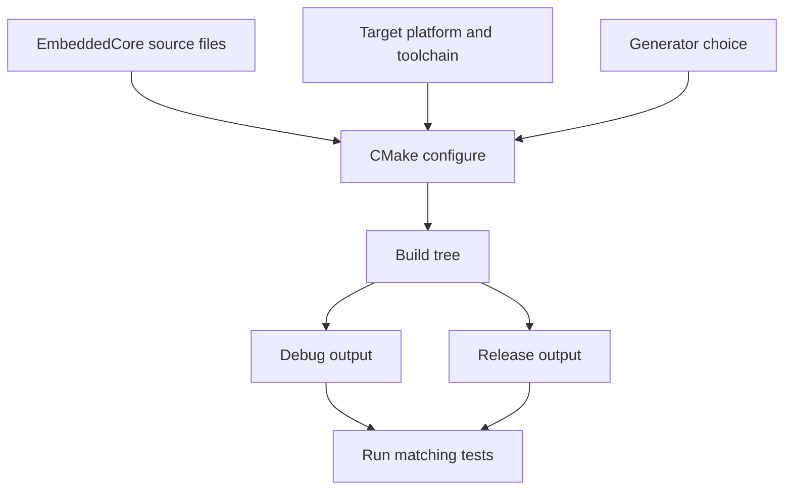

# Chapter 07 — Debug, Release, Build Configurations, and Generators

> **Modern CMake University — Module II: Core CMake**  
> **Project:** EmbeddedCore + DeviceSimulator  
> **Level:** Beginner → intermediate | **Study time:** 5–7 hours  
> **Prerequisite:** [Chapter 06 — Variables, Scopes, Paths, and Include Directories](../06-variables-scopes-and-include-directories/README.md)  
> **Minimum CMake:** 3.20 for source, 3.21 for supplied presets | **C++:** C++17

## The central question

Your embedded device simulator works, and your `embeddedcore` target has headers, compiler features, and tests. Now an engineer reports a failure that only happens in **Release**, not **Debug**. What exactly changes between the two builds? How do you reproduce both without mixing object files? And why does `CMAKE_BUILD_TYPE=Debug` work with ordinary Ninja but **not** select the configuration with Ninja Multi-Config?

This chapter answers these questions from first principles. The lab uses the same EmbeddedCore and DeviceSimulator program and verifies **Debug**, **Release**, **RelWithDebInfo**, and **MinSizeRel** concepts without treating compiler implementation details as universal guarantees.

### Learning outcomes

After completing this chapter, you should be able to:

1. Distinguish *configuration* from *target architecture*, *compiler*, and *generator*.
2. Explain typical Debug, Release, RelWithDebInfo, and MinSizeRel defaults and why their actual flags vary.
3. Identify single-configuration versus multi-configuration generators.
4. Use `CMAKE_BUILD_TYPE` correctly with Ninja and Unix Makefiles.
5. Use `--config` correctly with Ninja Multi-Config and Visual Studio generators.
6. Build Debug and Release safely in distinct build trees, or in one multi-config tree.
7. Use `$<CONFIG:Debug>` and other generator expressions to attach configuration-specific requirements to targets.
8. Inspect actual compile/link commands rather than guessing about optimization flags.
9. Run CTest for the intended configuration.
10. Explain why target ABI and toolchain changes require a separate build tree.

---

## 1. Four questions that are easy to confuse

A CMake build is shaped by several independent decisions:

| Decision | Example | Controls |
|---|---|---|
| **Target platform** | Windows x64, Linux x86-64, Android ARM64 | Binary format, ABI, system headers/libraries |
| **Toolchain** | MSVC, GCC, Clang, Android NDK Clang | Compiler and linker implementations |
| **Generator** | Ninja, Ninja Multi-Config, Visual Studio | Shape of generated build system |
| **Build configuration** | Debug, Release | Typical optimization, debugging, and preprocessor flags |

The distinction matters because **Release is not a processor architecture**. You may build both Debug and Release for Android ARM64, but cannot reuse the Android ARM64 CMake cache as a Linux x86-64 build cache.



For a *single-config* generator, use separate trees for Debug and Release; the diagram's shared build tree is the **multi-config** case.

---

## 2. What does Debug actually mean?

Debug is a named collection of build settings, not a switch that changes the C++ language itself. A typical Debug build favors debuggability and usually includes symbolic debug information with little or no optimization. However, specific defaults depend on the compiler and CMake toolchain configuration.

Typical examples:

| Compiler | Typical Debug flags | Purpose |
|---|---|---|
| GCC | `-g`, `-O0` | Debug symbols; minimal optimization |
| Clang | `-g`, `-O0` | Debug symbols; minimal optimization |
| MSVC | `/Zi` or `/Z7`, `/Od` | Debug information; disable optimization |

**These are examples, not a portable contract.** Some compiler/toolchain versions add extra flags for runtime checking, runtime-library selection, or other configuration behavior. On MSVC, linking can produce `.pdb` debug symbol files. You should inspect the *effective* command line instead of inferring it from a configuration's name.

### Debugging versus logs

`Debug` does not automatically enable your application logging. If you want debug-only diagnostic behavior, you must implement it—for example, by setting a target-specific compile definition.

Our example uses:

```cmake
target_compile_definitions(embeddedcore PUBLIC
    "$<$<CONFIG:Debug>:EMBEDDEDCORE_DEBUG_BUILD=1>"
)
```

`$<CONFIG:Debug>` is true for the Debug configuration. `PUBLIC` ensures the definition reaches `embeddedcore` and targets linking it. In the lab this lets a test and the library agree on the chosen configuration.

> **Caution:** In production, a debug-only macro that changes the layout of public C++ structures can create ABI incompatibility. Configuration flags should not silently change your public binary interface.

---

## 3. What does Release actually mean?

Release typically prioritizes optimized code, and commonly disables some debug-friendly settings. Depending on your toolchain, Release can also define `NDEBUG`, which causes the standard C/C++ `assert()` macro to be disabled. This is a major behavioral difference, not merely a performance difference.

Representative flags include GCC/Clang `-O3` or `-O2`, and MSVC `/O2`. The exact flags come from CMake's platform/compiler initialization and any project overrides. **Do not manually add a second, competing optimization flag unless the project truly requires it.**

### Why bugs may appear only in Release

Optimization can make existing undefined behavior more visible. Examples include reading uninitialized variables, lifetime errors, data races, and relying on evaluation order where the language doesn't guarantee one.

Another common cause is code that accidentally depends on `assert()` for side effects. Never write production logic like:

```cpp
#include <cassert>
int read_sensor();
void bad_example() {
    assert(read_sensor() > 0);
}
```

When `NDEBUG` is defined, the call in `assert(...)` may not execute. Keep side effects outside assertions.

### Debug vs Release: not an excuse to change the API

A well-designed library should preserve its public contract across configurations. Debug and Release may differ in performance and diagnostics, but consumers should not need to use different header declarations unless that difference is deliberately designed and documented.

---

## 4. The other two common configurations

CMake has four conventional configuration names (custom configurations are also possible):

| Configuration | Typical purpose | Notes |
|---|---|---|
| **Debug** | Local diagnosis and stepping through code | Usually symbols and low optimization |
| **Release** | Optimized delivery | Typically optimized; often `NDEBUG` |
| **RelWithDebInfo** | Optimized code with debug information | Useful for diagnosing production-like behavior |
| **MinSizeRel** | Favor smaller code size | Often uses size-oriented optimization |

**RelWithDebInfo is not the same as Debug**: it can retain optimization while producing symbol information, making debugging less straightforward. Likewise, **MinSizeRel doesn't guarantee the smallest binary**—actual size depends on toolchain, linker options, symbols, and code.

### What about `CMAKE_CXX_FLAGS_RELEASE`?

CMake initializes per-configuration flag variables such as `CMAKE_CXX_FLAGS_DEBUG` and `CMAKE_CXX_FLAGS_RELEASE`. These variables can be influenced by platform toolchains and cache overrides.

You can inspect their effective values:

```cmake
message(STATUS "Debug flags: ${CMAKE_CXX_FLAGS_DEBUG}")
message(STATUS "Release flags: ${CMAKE_CXX_FLAGS_RELEASE}")
```

But treat them as only part of the story: target-level options, directory properties, and toolchain options may contribute additional flags. **The verbose build command is the final authority.**

---

## 5. What is a CMake generator?

A generator defines which kind of build system CMake emits.

| Generator | Build execution tool | Configuration behavior |
|---|---|---|
| Ninja | Ninja | Single-config |
| Unix Makefiles | GNU Make | Single-config |
| Ninja Multi-Config | Ninja | Multi-config |
| Visual Studio 16 2019 | MSBuild / Visual Studio | Multi-config |

A **single-config** generator configures a build tree for one configuration at a time. A **multi-config** generator generates build rules for multiple configurations in one tree.

### Misconception: Ninja is always multi-config

`-G Ninja` and `-G "Ninja Multi-Config"` are different generators. Using ordinary Ninja does *not* create a multi-config build just because Ninja itself can parallelize work.

### Which one should you use?

For learning, use **ordinary Ninja with separate Debug/Release trees** to visualize the configuration difference, then **Ninja Multi-Config** to compare.

For your eventual five-platform capstone, Ninja Multi-Config is a reasonable choice per target ABI, but each ABI/toolchain still needs its own build tree.

---

## 6. Single-config generators and CMAKE_BUILD_TYPE

With ordinary Ninja, a Debug configuration looks like:

```bash
cmake -S . -B build/debug -G Ninja -DCMAKE_BUILD_TYPE=Debug
cmake --build build/debug
```

Release requires a *different tree*:

```bash
cmake -S . -B build/release -G Ninja -DCMAKE_BUILD_TYPE=Release
cmake --build build/release
```

Why? `CMakeCache.txt` stores configuration information for that tree; mixing configurations or compilers in one folder can create confusing stale outputs.

### Is the default build type always Debug?

**No.** With a single-config generator, leaving `CMAKE_BUILD_TYPE` empty often means no named configuration was selected. Do not assume it means Debug or Release. Set the value explicitly in CI and teaching labs.

### What does `--config Release` do with ordinary Ninja?

It does **not** switch an ordinary Ninja tree configured with `CMAKE_BUILD_TYPE=Debug` into Release. The configuration comes from the configure step.

---

## 7. Multi-config generators and --config

With Ninja Multi-Config, configure once:

```bash
cmake -S . -B build/multi -G "Ninja Multi-Config"
```

Build Debug and Release independently:

```bash
cmake --build build/multi --config Debug
cmake --build build/multi --config Release
```

CTest also needs to know which configuration to execute:

```bash
ctest --test-dir build/multi -C Debug --output-on-failure
ctest --test-dir build/multi -C Release --output-on-failure
```

**Important:** Setting `-DCMAKE_BUILD_TYPE=Release` is not how you select Release for Ninja Multi-Config. Use `--config Release` on the build command. `CMAKE_CONFIGURATION_TYPES` describes the configurations available in multi-config generators.

### Common build-tree layouts

| Generator | Example output path | What is fixed? |
|---|---|---|
| Ninja + Debug | `build/debug/DeviceSimulator` | Debug at configure time |
| Ninja + Release | `build/release/DeviceSimulator` | Release at configure time |
| Ninja Multi-Config | `build/multi/Debug/DeviceSimulator` | Debug at build time |
| Ninja Multi-Config | `build/multi/Release/DeviceSimulator` | Release at build time |
| Visual Studio | Typically `build/vs/Debug/DeviceSimulator.exe` | Chosen configuration at build time |

Actual layout can be influenced by output-directory properties, generator, platform, and project configuration.

---

## 8. Generator expressions: configuration-dependent properties

In Chapter 5 you learned that target properties carry requirements to consumers. Generator expressions add a conditional dimension to those requirements.

```cmake
target_compile_definitions(embeddedcore PUBLIC
    "$<$<CONFIG:Debug>:EMBEDDEDCORE_DEBUG_BUILD=1>"
    "$<$<CONFIG:Release>:EMBEDDEDCORE_RELEASE_BUILD=1>"
)
```

The outer `$<condition:value>` form means: include `value` only when the condition is true.

For a Release build, the first expression is empty and the second contributes `EMBEDDEDCORE_RELEASE_BUILD=1`.

### Why not `if(CMAKE_BUILD_TYPE STREQUAL "Debug")`?

That condition runs **at CMake configuration time**. It works for many single-config cases but is not a reliable replacement for per-configuration target properties with multi-config generators.

Generator expressions are evaluated when CMake generates the relevant build rules and can depend on the configuration chosen for each build.

### PUBLIC versus PRIVATE in this lab

In our sample, the `embeddedcore` library defines `build_configuration()`, while the test uses the same compile definitions to decide the expected return value. We deliberately use `PUBLIC` so both the library and the test receive the configuration macro.

For a purely internal diagnostic flag, `PRIVATE` would be more appropriate. Remember: **scope is part of your library API contract**.

---

## 9. Step-by-step EmbeddedCore lab

Our program still uses simulated temperatures. The new observable behavior is a line reporting the build configuration.

### Project structure

```text
solution/
├── CMakeLists.txt
├── CMakePresets.json
├── include/embeddedcore/
│   ├── sensor.hpp
│   └── diagnostics.hpp
├── src/
│   ├── sensor.cpp
│   └── diagnostics.cpp
├── app/
│   └── main.cpp
└── tests/
    ├── contract_test.cpp
    └── configuration_test.cpp
```

### The CMake target definitions

```cmake
add_library(embeddedcore STATIC
    src/sensor.cpp
    src/diagnostics.cpp
)
add_library(EmbeddedCore::Core ALIAS embeddedcore)
target_compile_features(embeddedcore PUBLIC cxx_std_17)
target_include_directories(embeddedcore PUBLIC
    "${CMAKE_CURRENT_SOURCE_DIR}/include"
)

target_compile_definitions(embeddedcore PUBLIC
    "$<$<CONFIG:Debug>:EMBEDDEDCORE_DEBUG_BUILD=1>"
    "$<$<CONFIG:Release>:EMBEDDEDCORE_RELEASE_BUILD=1>"
)

add_executable(DeviceSimulator app/main.cpp)
target_link_libraries(DeviceSimulator PRIVATE EmbeddedCore::Core)
```

`add_library()` defines our reusable static library. `add_executable()` defines the application. `target_link_libraries()` connects the executable to its library dependency; the `PUBLIC` configuration definition propagates from the library to the executable.

### The configuration-reporting function

```cpp
const char* build_configuration() {
#if defined(EMBEDDEDCORE_DEBUG_BUILD)
    return "Debug";
#elif defined(EMBEDDEDCORE_RELEASE_BUILD)
    return "Release";
#else
    return "Other configuration";
#endif
}
```

The function lives in `src/diagnostics.cpp`. The lab deliberately reports `Other configuration` for RelWithDebInfo and MinSizeRel until you extend the experiment. This is intentional—not proof those configurations failed.

### Windows/MSVC lab — VS 2019 x64 Native Tools Command Prompt

From the solution directory:

```bat
cmake -S . -B build\debug -G Ninja -DCMAKE_BUILD_TYPE=Debug -DBUILD_TESTING=ON
cmake --build build\debug
ctest --test-dir build\debug --output-on-failure
build\debug\DeviceSimulator.exe
```

Repeat in a different directory:

```bat
cmake -S . -B build\release -G Ninja -DCMAKE_BUILD_TYPE=Release -DBUILD_TESTING=ON
cmake --build build\release
ctest --test-dir build\release --output-on-failure
build\release\DeviceSimulator.exe
```

**Expected lines:** `Build configuration: Debug` and `Build configuration: Release` respectively. Both should report `Device status: HEALTHY`.

### Linux/GCC or Clang lab

```bash
cmake -S . -B build/debug -G Ninja -DCMAKE_BUILD_TYPE=Debug -DBUILD_TESTING=ON
cmake --build build/debug
ctest --test-dir build/debug --output-on-failure
./build/debug/DeviceSimulator
```

```bash
cmake -S . -B build/release -G Ninja -DCMAKE_BUILD_TYPE=Release -DBUILD_TESTING=ON
cmake --build build/release
ctest --test-dir build/release --output-on-failure
./build/release/DeviceSimulator
```

To select Clang, start a **fresh** build tree and configure with `-DCMAKE_CXX_COMPILER=clang++`, or set the appropriate `CXX` environment variable before first configuration. Changing the compiler inside an existing cache is discouraged.

---

## 10. Inspect the actual compiler flags

A key experimental skill: **verify, don't guess**.

With ordinary Ninja:

```bash
cmake --build build/debug --clean-first --verbose
cmake --build build/release --clean-first --verbose
```

Look for C++ compile commands involving `src/sensor.cpp` or `src/diagnostics.cpp`. On GCC/Clang you may see `-g`, `-O0`, `-O3`, `-DNDEBUG`, or equivalent options. On MSVC you might see `/Od`, `/O2`, `/Zi`, and `/D`-style macro definitions.

Record the effective options in your laboratory notebook. Do not assume every platform emits precisely the same command line.

### Optional: Inspect a symbol/debug-information file

With MSVC and an appropriate Debug setup, inspect generated `.pdb` files. With GCC/Clang, inspect whether the object files include debug sections using available tools such as `readelf -S` (Linux). **Presence of debug symbols is not the same as absence of optimization.**

---

## 11. Use the supplied CMakePresets.json

The lab also contains reusable presets:

```bash
cmake --preset ninja-debug
cmake --build --preset debug
ctest --preset debug

cmake --preset ninja-release
cmake --build --preset release
ctest --preset release
```

And Ninja Multi-Config presets:

```bash
cmake --preset ninja-multi
cmake --build --preset multi-debug
cmake --build --preset multi-release
ctest --preset multi-debug
ctest --preset multi-release
```

Presets need CMake **3.21 or newer for the schema used here**. The main source CMakeLists.txt uses only older CMake functionality and declares 3.20.

### Why presets matter later

Our course's final capstone builds different Android ABIs, Linux, and Windows. Stable platform choices belong in presets or equivalent configuration files; your approved dependency resolver supplies target-matched third-party libraries separately.

---

## 12. Your first architecture matrix

Do not confuse **configuration combinations** with **platform combinations**. Each supported target can have both Debug and Release, so five target IDs imply up to ten platform/configuration outputs.

| Target | Toolchain example | Debug | Release | Build-tree rule |
|---|---|---|---|---|
| Windows x64 | MSVC x64 | Yes | Yes | Own Windows x64 tree |
| Linux x86-64 | GCC/Clang | Yes | Yes | Own Linux x86-64 tree |
| Android ARMv7 | NDK Clang `armeabi-v7a` | Yes | Yes | Own ARMv7 tree |
| Android ARM64 | NDK Clang `arm64-v8a` | Yes | Yes | Own ARM64 tree |
| Android x86-64 | NDK Clang `x86_64` | Yes | Yes | Own Android x86-64 tree |

You do **not** need a separate source repository or a separate main CMakeLists.txt for every row. A target-specific toolchain configuration and a separate build tree are enough to reuse the same source code.

For Android, you could configure a Ninja Multi-Config tree with:

```bash
cmake -S . -B build/android-arm64-v8a -G "Ninja Multi-Config" \
  -DCMAKE_TOOLCHAIN_FILE="$ANDROID_NDK_HOME/build/cmake/android.toolchain.cmake" \
  -DANDROID_ABI=arm64-v8a -DANDROID_PLATFORM=android-24
```

Then build two configurations:

```bash
cmake --build build/android-arm64-v8a --config Debug
cmake --build build/android-arm64-v8a --config Release
```

This code is a **forward-looking illustration**, not a claim that the Chapter 7 lab supplies or tests all Android dependencies. Cross-compilation and dependency selection get dedicated treatment in Chapters 13 and 14.

An Android target executable must run on an appropriate device/emulator. A successful cross-compiled *link* is not the same as a successful Android *runtime test*.

---

## 13. Troubleshooting configuration mistakes

| Symptom | Possible cause | Recommended action |
|---|---|---|
| Debug binary reports Release | Wrong executable path or stale build output | Confirm build tree, config and executable path |
| `CMAKE_BUILD_TYPE` appears ignored | Multi-config generator | Build with `--config Debug` or `Release` |
| Debug and Release collide | Single-config builds share output tree | Give each configuration its own `-B` directory |
| CTest cannot find executable | Missing configuration selection on multi-config generator | Use `ctest -C Debug` / `ctest -C Release` |
| CTest reports zero tests | `BUILD_TESTING=OFF`, no `add_test`, or wrong test directory | Configure with tests enabled and verify `ctest -N` |
| Build retains previous compiler | Old `CMakeCache.txt` | Configure a fresh build tree for new toolchain |
| Windows Ninja cannot find MSVC | Environment not initialized | Use x64 Native Tools Command Prompt |
| Optimization changes behavior | Undefined behavior, `NDEBUG`, or differing compile definitions | Inspect verbose commands, assertions, and source assumptions |
| Debug/Release linkage incompatibility | Mixed runtime libraries or ABI-incompatible third-party binaries | Align toolchain, runtime and dependency configurations |

### A methodical debugging workflow

1. Verify the target OS and architecture.
2. Print the generator and configuration information.
3. Inspect `CMakeCache.txt` and paths.
4. Rebuild with verbose output.
5. Confirm the binary you're running comes from the intended tree.
6. Run `ctest -N` to verify test registration; then run CTest with the correct configuration.
7. If changing toolchains/ABI, configure from a fresh build directory.

---

## 14. Eight guided laboratory investigations

**Lab 1 — Establish Debug.** Configure ordinary Ninja with `-DCMAKE_BUILD_TYPE=Debug`, build, run, and capture the `Debug` output.

**Lab 2 — Establish Release.** Repeat in a different build directory. Confirm `Release` output and the same functional temperature checks.

**Lab 3 — Observe incremental builds.** Rebuild without changing any source. Inspect whether the build tool performs unnecessary compilation.

**Lab 4 — Compare effective flags.** Use `--verbose --clean-first`; record the actual options for at least one source file in each configuration.

**Lab 5 — Use Ninja Multi-Config.** Configure once and build two configurations. Locate both executables and run both tests.

**Lab 6 — Prove the configuration macros.** Remove or change one generator expression; inspect the resulting application output and test results. Restore the original behavior.

**Lab 7 — RelWithDebInfo.** Configure a new single-config tree with `-DCMAKE_BUILD_TYPE=RelWithDebInfo`. Inspect optimization and debug-information settings. Explain why the application reports `Other configuration`.

**Lab 8 — Fail a test on purpose.** Modify the threshold assertion in `contract_test.cpp` so it becomes incorrect; rebuild and run CTest. Restore the test and demonstrate a passing run.

Keep a short experimental log documenting the command, effective generator, configuration, output path, and observed result for each investigation.

---

## 15. Independent assignments

1. **Basic (10 points):** Create a Debug and Release Ninja build from fresh trees. Submit the exact commands and a screenshot or transcript of both program outputs.
2. **Intermediate (15 points):** Explain why `-DCMAKE_BUILD_TYPE=Debug` is unreliable as a configuration selector with Ninja Multi-Config. Demonstrate the correct command sequence.
3. **Intermediate (15 points):** Compare effective compiler optimization and debug-information options for GCC versus MSVC. Identify at least two differences and explain why you shouldn't hardcode compiler flags into a portable CMakeLists.txt.
4. **Intermediate (20 points):** Extend `build_configuration()` and the matching configuration test to distinguish `RelWithDebInfo` and `MinSizeRel` using configuration-specific definitions.
5. **Advanced (40 points):** Design a build-directory naming convention for all five final-course platform targets and Debug/Release combinations. Explain how you would avoid cross-ABI cache reuse and how runtime testing differs between native Windows/Linux and Android cross-compilation.

**Submission requirements:** Include the command transcript, your changed CMake/C++ files, a description of expected versus observed behavior, and an explanation of each issue you encountered. The solutions folder contains the quiz key, while exercises are designed to require independent reasoning.

---

## 16. Knowledge check (10 questions)

Choose the best answer unless multiple options are explicitly requested. The answer key is provided separately in `solutions/07-debug-release-build-configurations/quiz-answers.md`.

1. Which variable usually selects a build configuration for ordinary Ninja?  
   A. `CMAKE_GENERATOR` · B. `CMAKE_BUILD_TYPE` · C. `CMAKE_SYSTEM_NAME` · D. `CMAKE_CXX_COMPILER`
2. Which command selects Release when using Ninja Multi-Config?  
   A. `cmake --preset ninja-debug` · B. `cmake -DCMAKE_BUILD_TYPE=Release` alone · C. `cmake --build build/multi --config Release` · D. `ninja -DRelease`
3. Which expression is true for a Debug configuration?  
   A. `$<CONFIG:Debug>` · B. `$<PLATFORM_ID:Debug>` · C. `$<CXX_COMPILER_ID:Debug>` · D. `${CMAKE_SYSTEM_NAME:Debug}`
4. Why use separate `build/debug` and `build/release` directories with ordinary Ninja?  
   A. Different source repositories are required · B. To isolate configuration caches and outputs · C. C++ forbids sharing headers · D. Different operating systems are mandatory
5. Which option selects a CTest configuration for a multi-config generator?  
   A. `--generator` · B. `--target` · C. `--prefix` · D. `-C Debug`
6. True/False: Ninja Multi-Config can build Debug and Release in one build tree for a given configured toolchain and ABI.
7. True/False: Setting `CMAKE_BUILD_TYPE=Release` is sufficient to select Release when building with Ninja Multi-Config.
8. What is the most dependable way to find effective compiler options?  
   A. Assume all Clang versions use identical flags · B. Inspect the verbose build command · C. Rely on executable size only · D. Read only `project()`
9. Select all correct answers:  
   A. PUBLIC compile definitions may propagate to consumers · B. `CMAKE_BUILD_TYPE` changes target CPU architecture · C. `CMakeCache.txt` stores build-tree configuration state · D. A Release build always includes every Debug-only macro
10. If changing from Android ARM64 to Android ARMv7, what is the safest CMake-build-tree strategy?  
    A. Rename `libembeddedcore.a` only · B. Reuse the ARM64 cache unchanged · C. Set only `CMAKE_BUILD_TYPE` · D. Use a fresh ABI-specific build tree

---

## 17. Chapter recap

**You now know:**

- The difference between target platform, toolchain, generator, and build configuration.
- What Debug, Release, RelWithDebInfo, and MinSizeRel typically mean.
- When to use `CMAKE_BUILD_TYPE` and when to use `--config`.
- How generator expressions apply configuration-specific target settings.
- How CTest and output paths interact with multi-config generators.
- Why separate build trees prevent configuration, compiler, and architecture contamination.

**The production principle:** Build configuration is a first-class input to a reproducible build, but it must be considered alongside the target ABI, toolchain, and approved dependency set.

### Next chapter

**Chapter 08 — Static and Shared Libraries: Target Scopes, Linking and Binary Compatibility.** We will move beyond one static library and understand library formats, Windows DLL import libraries, Linux shared libraries, transitive link dependencies, and component boundaries.

### Further reading

- [CMake: `CMAKE_BUILD_TYPE`](https://cmake.org/cmake/help/latest/variable/CMAKE_BUILD_TYPE.html)
- [CMake: `CMAKE_CONFIGURATION_TYPES`](https://cmake.org/cmake/help/latest/variable/CMAKE_CONFIGURATION_TYPES.html)
- [CMake: Ninja Multi-Config](https://cmake.org/cmake/help/latest/generator/Ninja%20Multi-Config.html)
- [CMake: Generator Expressions](https://cmake.org/cmake/help/latest/manual/cmake-generator-expressions.7.html)
- [CMake: `target_compile_definitions`](https://cmake.org/cmake/help/latest/command/target_compile_definitions.html)
- [CMake: `ctest`](https://cmake.org/cmake/help/latest/manual/ctest.1.html)
- [CMake: Presets](https://cmake.org/cmake/help/latest/manual/cmake-presets.7.html)

---

**Course navigation:** [← Chapter 06](../06-variables-scopes-and-include-directories/README.md) · [Course syllabus](../../COURSE-SYLLABUS.md) · Chapter 08 → (forthcoming)
