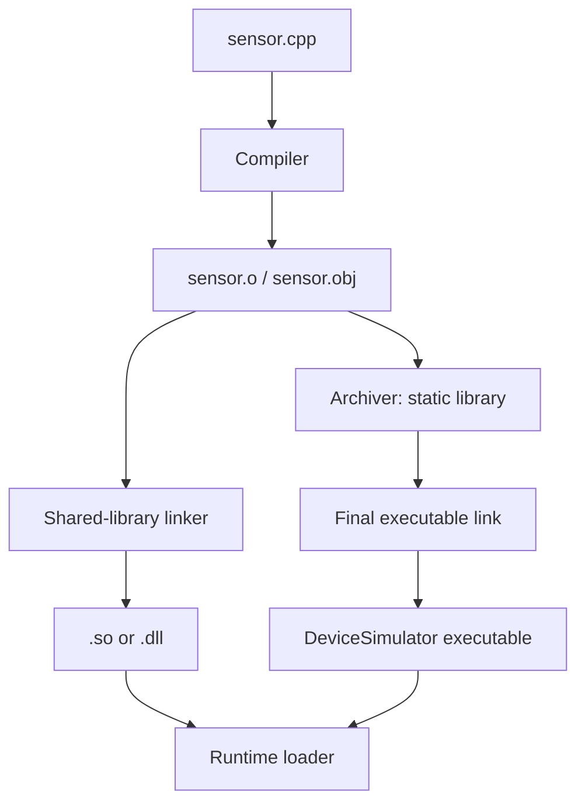
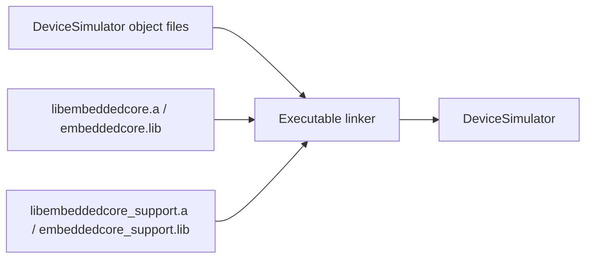
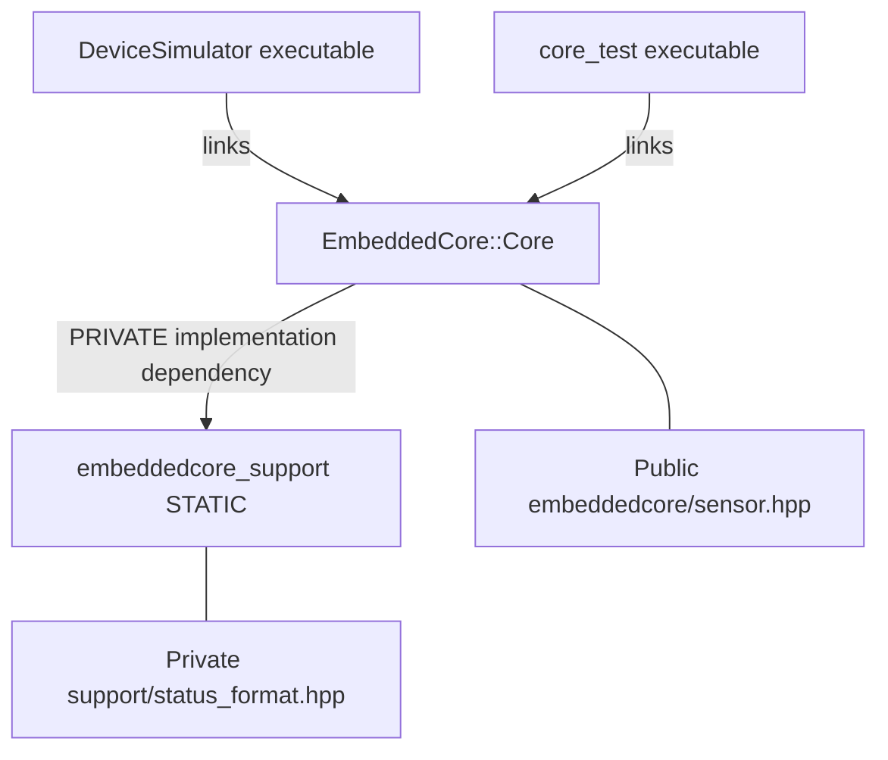

# Chapter 08 — Static and Shared Libraries: Linking, DLLs, and Binary Compatibility

> **Modern CMake University — From First Principles to Production CI/CD**  
> Module II: Core CMake · Chapter 8 of 16 · Intermediate · Approximate study time: 5–7 hours  
> Project: **EmbeddedCore** library + **DeviceSimulator** executable  
> Primary host: Windows x64 / MSVC 2019; alternate host: Linux x86-64 / GCC; architectural extensions: Android ARMv7, ARM64, x86-64

[← Chapter 7](../07-debug-release-build-configurations/README.md) · [Course home](../../README.md) · [Chapter 9 →](../09-dll-runtime-dependencies-deployment/README.md)

## Chapter purpose

In Chapter 7 you learned to build the same targets in Debug and Release. But an important question remains: **What actually changes when a CMake target is `STATIC` instead of `SHARED`?**

Many production problems come from confusing the *build-time link step* with *runtime loading*, or assuming that a static library embeds its own dependencies. This chapter studies these questions from the operating system and linker upward, and then applies them to an actual cross-platform CMake project.

### Learning outcomes

After finishing this chapter, you should be able to:

1. Explain static archives, shared libraries, Windows import libraries, and executables.
2. Distinguish compiling, archiving, final linking, and runtime dynamic loading.
3. Build EmbeddedCore as `STATIC` or `SHARED` without changing application source.
4. Understand which symbols must be exported from Windows DLLs and when Linux visibility matters.
5. Explain why position-independent code (PIC) is relevant when static code enters a shared object.
6. Diagnose missing DLLs, missing `.so` files, undefined references, and architecture mismatches.
7. Reason about ABI compatibility, compiler runtimes, CRT settings, and C++ interfaces.
8. Analyze the propagation of dependencies across CMake static-library boundaries.
9. Compare native Windows, Linux, Android, and optional bare-metal concerns accurately.
10. Inspect compiled artifacts rather than guessing what CMake produced.

### Prerequisites

You should have completed Chapters 1–7, or know basic C++ compilation, CMake targets, `PRIVATE`/`PUBLIC`/`INTERFACE`, Ninja, and Debug/Release configurations. The lab requires **CMake 3.20+**, **Ninja**, and a C++17 toolchain; the Windows instructions assume the **x64 Native Tools Command Prompt for VS 2019**.

---

## 1. The four stages that matter

A source file does not become a library in one magical step. Think in terms of independent operations:



The **compiler** emits object files. An **archiver** packages objects inside a static-library archive; it typically does not resolve all external references. A **linker** produces a shared-library binary or links the application using object files and libraries. The **runtime loader** makes shared-library code available to a running process, subject to platform-specific rules.

A compiler driver (such as `cl` or `g++`) may invoke multiple stages automatically. Do not confuse an easy command-line interface with a single underlying operation.

### Key vocabulary

| Term | Meaning |
|---|---|
| Object file | Compiled machine code plus symbols, relocations and metadata; commonly `.obj` or `.o` |
| Static library | An archive of compiled object files; commonly `.lib` on MSVC, `.a` on Linux/Android |
| Shared library | A linked binary loaded into a process at runtime; typically `.dll` on Windows, `.so` on Linux/Android |
| Import library | A Windows `.lib` that allows consumers to link against exports from a DLL; generally not the DLL's implementation |
| Symbol | A name recorded by a compiler/linker for code or data, such as a function definition or an unresolved reference |
| ABI | Application Binary Interface: machine-level rules for code and binary interoperability |
| PIC | Position-independent code, commonly required for code embedded in shared objects on ELF platforms |
| SONAME | An ELF shared-library identity used by the dynamic linker, distinct from the full build filename |

---

## 2. Static libraries: what an archive really contains

A static library is usually a collection of object files and an index that helps a linker find definitions. On Linux, GCC and GNU binutils can produce one as follows:

```bash
g++ -std=c++17 -Iinclude -c src/sensor.cpp -o sensor.o
ar rcs libembeddedcore.a sensor.o
ar t libembeddedcore.a
```

This simplified command is for illustration; the full lab's sensor object also depends on the support component, so linking a complete application requires that component as well.

On Windows, MSVC uses an `.obj` and the `lib` archiver:

```bat
cl /nologo /EHsc /std:c++17 /Iinclude /c src\sensor.cpp /Fo:sensor.obj
lib /nologo /OUT:embeddedcore.lib sensor.obj
```

**Critical:** archiving `sensor.obj` into a `.lib` or `.a` does not automatically copy all the implementations that `sensor.obj` references. The library may contain unresolved external references intentionally. Those references can be satisfied when a final executable or shared library is linked.

### Static link graph



The linker commonly extracts only needed archive members. Exactly how dead-code elimination, COMDAT folding, and whole-archive options behave depends on compiler and linker settings. A static library is **not** inherently one executable-ready block of code.

### Static-library advantages and tradeoffs

Static linking can reduce the number of standalone binary dependencies to deploy and can make a deployment layout simpler. However, it may enlarge binaries, duplicate code across executables, or make security updates harder because the application needs relinking. Whether it is actually more portable or smaller depends on the complete dependency graph, target platform, runtime, and linker settings.

**An important distinction:** using a static archive does **not** necessarily produce a fully static executable. A program can link EmbeddedCore statically while still depending on the OS C runtime or shared versions of other libraries.

---

## 3. Shared libraries: link time is not runtime

A shared library is a linked module that the operating system can map into a process. Its code can be reused by multiple applications or components, but runtime discovery and compatibility must be managed.

### Windows artifact set

For a DLL target, MSVC commonly produces:

```text
embeddedcore.dll        Runtime implementation
embeddedcore.lib        Import library used by the link step
embeddedcore.exp        Export metadata created during linking
```

At build time, `DeviceSimulator.exe` links against the **import library**. At runtime, Windows needs to locate the **DLL** (unless the code is loaded via an alternative mechanism). The `.lib` does not normally replace the DLL. Notice that **both a static MSVC library and an import library can have the `.lib` extension**. The filename alone is insufficient to tell which it is.

### Linux artifact set

An ELF shared library often appears as versioned filenames and symlinks:

```text
libembeddedcore.so.1.0
libembeddedcore.so.1 -> libembeddedcore.so.1.0
libembeddedcore.so -> libembeddedcore.so.1
```

In this course, `VERSION 1.0` and `SOVERSION 1` instruct CMake to express library versioning where the platform supports it. Actual paths and symlinks depend on OS and generator. The loader generally uses the ELF `DT_NEEDED` entry, which commonly names the library's SONAME, to find its dependency.

### Runtime-location rules differ

- **Windows:** A DLL must be available through supported DLL search mechanisms. For our lab we copy it beside the application; production software should use deliberate, secure deployment paths.
- **Linux:** The ELF loader searches configured locations and runtime paths, which can include `RPATH`/`RUNPATH` and system library paths. CMake often sets build-tree paths automatically so local tests work.
- **Android:** Applications normally package native `.so` files per ABI and load them through Android's native loader, subject to the app's packaging and namespace rules. Running an Android native library like a normal Linux desktop application is not the right mental model.

CMake's `target_link_libraries()` sets up build-time linkage. **It does not, by itself, guarantee that the loader can find a DLL or `.so` on the destination device.** Chapter 9 explores deployment in greater depth.

---

## 4. A public library API and symbol visibility

Consider this public header:

```cpp
#pragma once
#include "embeddedcore/export.hpp"

namespace embeddedcore {
EMBEDDEDCORE_API double read_temperature();
EMBEDDEDCORE_API bool is_healthy(double temperature);
EMBEDDEDCORE_API const char* status_label(bool healthy);
}
```

On Windows, exported DLL functions usually need appropriate import/export declarations. Our lab provides an educational `export.hpp`:

```cpp
#pragma once
#if defined(_WIN32) && defined(EMBEDDEDCORE_SHARED)
  #if defined(EMBEDDEDCORE_BUILDING_LIBRARY)
    #define EMBEDDEDCORE_API __declspec(dllexport)
  #else
    #define EMBEDDEDCORE_API __declspec(dllimport)
  #endif
#elif defined(__GNUC__) && defined(EMBEDDEDCORE_SHARED)
  #define EMBEDDEDCORE_API __attribute__((visibility("default")))
#else
  #define EMBEDDEDCORE_API
#endif
```

The `EMBEDDEDCORE_SHARED` definition means *this specific target is built/consumed as a shared library*, not merely that any dependency is shared. CMake marks it `PUBLIC` so consumers compile headers with the correct DLL-import behavior. `EMBEDDEDCORE_BUILDING_LIBRARY` is `PRIVATE` because only the library implementation exports symbols.

In this course, we manually show how export annotations work. For a larger production codebase, CMake's [`GenerateExportHeader`](https://cmake.org/cmake/help/latest/module/GenerateExportHeader.html) module can generate robust export macros. Also consider symbol-versioning and a carefully designed C ABI for stable plugin boundaries.

### Linux visibility

ELF platforms can expose too many symbols by default. We set:

```cmake
set_target_properties(embeddedcore PROPERTIES
    CXX_VISIBILITY_PRESET hidden
    VISIBILITY_INLINES_HIDDEN YES
)
```

Our API macros mark intended functions with default visibility in a shared build. Hidden default visibility can reduce accidental public ABI exposure, but it does not replace ABI review or guarantee binary compatibility.

---

## 5. CMake controls static vs shared libraries

CMake has several valid approaches. Explicit types are most obvious:

```cmake
add_library(embeddedcore_static STATIC src/sensor.cpp)
add_library(embeddedcore_shared SHARED src/sensor.cpp)
```

Another design allows the creator to choose through `BUILD_SHARED_LIBS`:

```cmake
option(BUILD_SHARED_LIBS "Build EmbeddedCore as a shared library" OFF)
add_library(embeddedcore src/sensor.cpp)
```

When the type is omitted, the `BUILD_SHARED_LIBS` variable influences the library kind. The choice is made **at configuration time**, so use separate build trees:

```text
build/ninja-static/
build/ninja-shared/
```

Do not toggle between these kinds repeatedly in the same build directory as a production practice. Separate trees are easier to reproduce and inspect.

### Why we set a library ALIAS

```cmake
add_library(EmbeddedCore::Core ALIAS embeddedcore)
```

The alias improves readability and helps detect typos in target names during configuration. It is a build-tree alias, **not an installed exported package**; installed package targets are taught in Chapter 15.

---

## 6. Transitive dependencies: a subtle static-library trap

Our lab's `embeddedcore` calls a function from an internal support library called `embeddedcore_support`:

```cmake
target_link_libraries(embeddedcore PRIVATE embeddedcore_support)
```

When `embeddedcore` is a **shared library**, its linker normally resolves needed support-library code while creating the `.so` or DLL. When it is a **static archive**, it cannot fully link the support dependency while simply archiving its own object files.

CMake knows this. For a static library, CMake may preserve a `PRIVATE` link dependency as a *link-only transitive requirement*, allowing the final executable link to include the needed support archive without treating support headers or compile definitions as consumer-facing usage requirements.

This is why the following simplistic rule is wrong:

> "PRIVATE dependencies can never affect consumers."

A better rule is:

- `PRIVATE` compile requirements apply only to the target.
- `PUBLIC` compile requirements apply to the target and its consumers.
- `INTERFACE` compile requirements apply to consumers, not to the target's own compilation.
- **Link requirements have additional behavior for static libraries**, because unresolved implementation references may need to be satisfied at a later final link step.

### Practical example: OpenSSL

Suppose EmbeddedCore uses `OpenSSL::Crypto`:

```cmake
find_package(OpenSSL REQUIRED COMPONENTS Crypto)

target_link_libraries(embeddedcore PRIVATE OpenSSL::Crypto)
```

**This does not mean `libcrypto` becomes part of the EmbeddedCore `.a` archive.** The OpenSSL archive may be pulled into the final DLL or executable during a later link, but an ordinary static EmbeddedCore archive does not embed the dependency automatically.

For public API types that expose an external library, dependency visibility and package configuration need additional attention. We will revisit this with `find_package()`, installed package exports, and dependency resolution in Chapters 11, 14, and 15.

---

## 7. Position-independent code and the Linux shared-library case

Shared ELF objects commonly require position-independent machine code. Compilers often enable this using `-fPIC`, and CMake can request it for a target:

```cmake
set_target_properties(embeddedcore_support PROPERTIES
    POSITION_INDEPENDENT_CODE ON
)
```

Our support library is static, but it is linked into the EmbeddedCore shared library. Making it PIC-capable avoids common relocation failures on Linux x86-64. CMake enables `POSITION_INDEPENDENT_CODE` automatically for `SHARED` and `MODULE` library targets; it is not automatically required for all `STATIC` libraries.

For comparison, you may see ELF linker messages referring to relocation types or advising recompilation with `-fPIC`. That can indicate non-PIC objects are being included in a shared library. Precise restrictions vary by architecture and linker.

On Windows, compilation and relocation conventions differ; applying GCC's `-fPIC` flag to MSVC is not a meaningful cross-platform solution. Use CMake target properties instead of hardcoding compiler flags whenever possible.

---

## 8. C++ ABI compatibility: source compatibility is not binary compatibility

Suppose a public header is unchanged. Does that guarantee that a new DLL can replace an older DLL? **No.** A compiled C++ interface depends on more than header text.

Potential ABI-sensitive factors include:

| Factor | Why it matters |
|---|---|
| CPU architecture and bitness | x86-64 instructions and ARM64 instructions aren't interchangeable |
| Calling convention | Controls argument passing and return values |
| Name mangling | Compilers encode C++ symbols differently |
| Data layout | Structure alignment, padding, enum sizes, packing |
| C++ standard library ABI | STL types may have implementation-specific binary layouts |
| Exception and RTTI model | Runtime support and cross-boundary behavior differ |
| MSVC runtime linkage | `/MD` versus `/MT`, and Debug variants, can affect runtime assumptions |
| Compiler/toolchain version | ABI promises vary by platform and toolchain |
| Visibility / exported symbols | Hidden or renamed symbols cannot satisfy old consumers |
| SONAME/version policy | Dynamic loader compatibility assumptions must be honored |

### A deliberately stable-looking API

Our public sample functions use primitive scalar types and a `const char*` string literal rather than passing `std::string` across the boundary. This reduces some ABI exposure, but it does **not** create a universally compatible binary interface.

For plugin-style interfaces, a documented C ABI with explicit versioning and ownership rules is often easier to stabilize than an arbitrary C++ API.

### MSVC runtime flags

On Windows, `/MD` typically means the DLL flavor of the MSVC C runtime; `/MT` selects the static CRT flavor. Debug variants use `/MDd` or `/MTd`. Avoid mixing incompatible allocation/ownership conventions across module boundaries, and do not assume that the MSVC runtime setting controls whether **your own** EmbeddedCore library is static or shared. These are distinct decisions.

CMake can control this through the `MSVC_RUNTIME_LIBRARY` target property, which we'll revisit when handling packaging policies.

---

## 9. Cross-platform architecture matrix

| Target | Static archive | Shared-library form | Typical compiler/toolchain | Key concern |
|---|---|---|---|---|
| Windows x64 | `embeddedcore.lib` | `embeddedcore.dll` + import `.lib` | MSVC x64 | Export/import annotations, DLL discovery, CRT selection |
| Linux x86-64 | `libembeddedcore.a` | `libembeddedcore.so` | GCC or Clang | ELF loader, SONAME, `RPATH`, PIC |
| Android ARMv7 (`armeabi-v7a`) | `.a` for ARMv7 | `.so` for ARMv7 | Android NDK Clang | ABI-specific `.so`, packaging, API level |
| Android ARM64 (`arm64-v8a`) | `.a` for ARM64 | `.so` for ARM64 | Android NDK Clang | ABI-compatible dependencies and loader namespace |
| Android x86-64 (`x86_64`) | `.a` for x86-64 | `.so` for x86-64 | Android NDK Clang | Correct emulator/device ABI and shared dependencies |
| Optional bare-metal Cortex-M | Commonly `.a` | Platform-dependent; generally not ELF-style OS dynamic loading | ARM embedded toolchain | Linker script, startup code, memory layout, no desktop dynamic loader |

**Important:** An Android library for `arm64-v8a` is not a Linux x86-64 library, and an Android ARM64 library is not interchangeable with a generic desktop ARM64 Linux library simply because the CPU architecture is the same. Operating-system ABI and runtime expectations also matter.

### Build-tree policy for future chapters

```text
build/
├── windows-x64-static-debug/
├── windows-x64-shared-debug/
├── linux-x64-static-debug/
├── linux-x64-shared-debug/
├── android-armeabi-v7a/
├── android-arm64-v8a/
└── android-x86_64/
```

One build tree represents one toolchain/target architecture, and normally one fundamental static/shared selection. With **Ninja Multi-Config**, Debug and Release can coexist *within* a single ABI-specific and library-kind-specific build tree. Never treat Debug/Release as a substitute for ABI separation.

---

## 10. Project architecture for this lab

The exercise has three targets:



The internal `embeddedcore_support` library stays static in both variants. The **EmbeddedCore** library changes kind according to `BUILD_SHARED_LIBS`. This is deliberate: it demonstrates linking a static dependency into a shared library, including the PIC requirement on ELF.

### Files included

```text
solution/
├── CMakeLists.txt
├── CMakePresets.json
├── include/embeddedcore/
│   ├── export.hpp
│   └── sensor.hpp
├── src/sensor.cpp
├── support/
│   ├── include/support/status_format.hpp
│   └── src/status_format.cpp
├── app/main.cpp
└── tests/core_test.cpp
```

Open the files in `labs/08-static-shared-libraries-binary-compatibility/solution/` to follow the real implementation. The examples below reference that directory.

---

## 11. CMakeLists.txt explained in stages

### Step 1: Define the project and its tests

```cmake
cmake_minimum_required(VERSION 3.20)
project(EmbeddedCoreChapter08 VERSION 1.0 LANGUAGES CXX)
include(CTest)
option(BUILD_SHARED_LIBS "Build EmbeddedCore as a shared library" OFF)
```

`include(CTest)` enables standard testing configuration, including `BUILD_TESTING`; tests are added only when that option is enabled.

### Step 2: Define a private implementation library

```cmake
add_library(embeddedcore_support STATIC
    support/src/status_format.cpp
)
target_include_directories(embeddedcore_support PRIVATE
    "${CMAKE_CURRENT_SOURCE_DIR}/support/include"
)
set_target_properties(embeddedcore_support PROPERTIES
    POSITION_INDEPENDENT_CODE ON
)
```

The support library uses only its own private header. We intentionally avoid exposing its header directory to application consumers.

### Step 3: Define the public EmbeddedCore target

```cmake
add_library(embeddedcore src/sensor.cpp)
add_library(EmbeddedCore::Core ALIAS embeddedcore)

target_compile_features(embeddedcore PUBLIC cxx_std_17)
target_include_directories(embeddedcore
    PUBLIC "${CMAKE_CURRENT_SOURCE_DIR}/include"
    PRIVATE "${CMAKE_CURRENT_SOURCE_DIR}/support/include"
)
target_link_libraries(embeddedcore PRIVATE embeddedcore_support)
```

`PUBLIC` makes the EmbeddedCore public include directory available to applications. The support include directory remains private to the library implementation.

### Step 4: Define DLL export and visibility behavior

```cmake
if(BUILD_SHARED_LIBS)
    target_compile_definitions(embeddedcore PUBLIC EMBEDDEDCORE_SHARED)
    target_compile_definitions(embeddedcore PRIVATE EMBEDDEDCORE_BUILDING_LIBRARY)
endif()

set_target_properties(embeddedcore PROPERTIES
    CXX_VISIBILITY_PRESET hidden
    VISIBILITY_INLINES_HIDDEN YES
    OUTPUT_NAME embeddedcore
    VERSION "${PROJECT_VERSION}"
    SOVERSION 1
)
```

On Windows, the macros control import/export annotations. On Linux, default symbol hiding plus explicit exports helps define the supported API surface. An installable package needs more robust build/install include-interface handling, which is Chapter 15's focus.

### Step 5: Define executable and test consumers

```cmake
add_executable(DeviceSimulator app/main.cpp)
target_link_libraries(DeviceSimulator PRIVATE EmbeddedCore::Core)

if(BUILD_TESTING)
    add_executable(core_test tests/core_test.cpp)
    target_link_libraries(core_test PRIVATE EmbeddedCore::Core)
    add_test(NAME EmbeddedCoreContract COMMAND core_test)
    add_test(NAME DeviceSimulatorSmoke COMMAND DeviceSimulator)
endif()
```

See the packaged `CMakeLists.txt` for the complete version, including the Windows post-build DLL copy for both the app and tests.

---

## 12. Lab A — Windows MSVC x64: static library

**Open:** x64 Native Tools Command Prompt for VS 2019. Navigate to the solution directory.

```bat
cd labs\08-static-shared-libraries-binary-compatibility\solution
cmake -S . -B build\win-static -G Ninja -DBUILD_SHARED_LIBS=OFF -DCMAKE_BUILD_TYPE=Debug
cmake --build build\win-static --verbose
ctest --test-dir build\win-static --output-on-failure
build\win-static\DeviceSimulator.exe
```

Inspect what is produced:

```bat
dir build\win-static\*.lib
where dumpbin
dumpbin /headers build\win-static\embeddedcore.lib
```

You should find an EmbeddedCore static archive. There should not be an EmbeddedCore DLL in this build tree.

### What to observe

- Both the EmbeddedCore and support libraries are static archives.
- The app's final link must satisfy the EmbeddedCore references to the support component.
- A static library does not require a separate EmbeddedCore DLL at runtime.
- **Do not assume** this means the application has no other runtime dependencies.

---

## 13. Lab B — Windows MSVC x64: shared library

Configure into a **different** build directory:

```bat
cmake -S . -B build\win-shared -G Ninja -DBUILD_SHARED_LIBS=ON -DCMAKE_BUILD_TYPE=Debug
cmake --build build\win-shared --verbose
ctest --test-dir build\win-shared --output-on-failure
build\win-shared\DeviceSimulator.exe
```

Inspect outputs:

```bat
dir build\win-shared\*.dll
dir build\win-shared\*.lib
dumpbin /exports build\win-shared\embeddedcore.dll
```

In this lab, the full CMakeLists includes a Windows-only `POST_BUILD` copy operation. That places `embeddedcore.dll` beside `DeviceSimulator.exe` and `core_test.exe`, so running the binaries from their output locations works without editing global `PATH`.

**Experiment:** Temporarily disable the copy command, delete the *copied* DLL from the executable directory, and try running the executable. The loader may report that the DLL cannot be found. Restore the copy rule; **do not delete the original target DLL**.

**Why it matters:** Building a DLL and deploying it are separate responsibilities. Chapter 9 will handle runtime dependency staging and installation more systematically.

---

## 14. Lab C — Linux GCC: static and shared

From the Chapter 8 solution directory:

```bash
cmake --preset ninja-static
cmake --build --preset static
ctest --preset static
./build/ninja-static/DeviceSimulator
```

Now create a shared-library build:

```bash
cmake --preset ninja-shared
cmake --build --preset shared
ctest --preset shared
./build/ninja-shared/DeviceSimulator
```

Inspect files and symbols:

```bash
find build/ninja-static -maxdepth 1 -type f -name '*.a' -print
find build/ninja-shared -maxdepth 1 -name 'libembeddedcore.so*' -print
nm -C build/ninja-static/libembeddedcore.a | grep 'embeddedcore::'
readelf -d build/ninja-shared/libembeddedcore.so | grep SONAME
ldd build/ninja-shared/DeviceSimulator
```

**Interpret results carefully:** `ldd` is useful for inspecting trusted binaries but is not a safe general-purpose tool for untrusted binaries. Tools like `readelf -d` inspect ELF metadata without executing the binary. The exact set of system libraries depends on your distribution and compiler runtime.

### Experiment: Change a single implementation

Change the hard-coded temperature value in `src/sensor.cpp` from `25.5` to `43.0`, rebuild, and run. The program should now report `WARNING`. Revert after the experiment.

### Experiment: Non-PIC static dependency

Temporarily remove `POSITION_INDEPENDENT_CODE ON` from `embeddedcore_support`, remove the shared build tree, and rebuild the shared variant. On common Linux x86-64 toolchains, this may produce a relocation error because non-PIC support objects are being linked into an ELF shared object. Exact behavior depends on the emitted relocations and toolchain.

---

## 15. Lab D — Ninja Multi-Config with shared libraries

Ninja Multi-Config supports Debug and Release in one configured tree while retaining the static/shared selection.

```bash
cmake --preset multi-shared
cmake --build --preset multi-shared-debug
cmake --build --preset multi-shared-release
ctest --preset multi-shared-debug
ctest --preset multi-shared-release
```

Compare the output paths, configurations, binary sizes, and link commands. **Do not assume** smaller means faster, and do not infer optimization settings merely from a configuration name—inspect actual compiler flags.

For MSVC multi-config builds, use a compatible generator and configure from the initialized compiler environment. `--config Debug` / `--config Release` chooses the configuration for a multi-config generator; `CMAKE_BUILD_TYPE` does not.

---

## 16. Lab E — Android cross-compilation architecture case studies

This is an **optional architectural extension**, not part of the native CI smoke-test. It requires a correctly installed Android NDK and suitable API level. Adjust the path and API level for your environment:

```bash
cmake -S . -B build/android-arm64-shared -G Ninja \
  -DCMAKE_TOOLCHAIN_FILE="$ANDROID_NDK_HOME/build/cmake/android.toolchain.cmake" \
  -DANDROID_ABI=arm64-v8a \
  -DANDROID_PLATFORM=android-24 \
  -DBUILD_SHARED_LIBS=ON \
  -DCMAKE_BUILD_TYPE=Release
cmake --build build/android-arm64-shared
```

For the remaining target architectures, use independent build trees and set `ANDROID_ABI` to `armeabi-v7a` or `x86_64` (ABI spelling must match NDK conventions). Build dependencies for each target ABI. Do not run Android binaries directly on an unrelated Linux host. Run tests on a compatible device/emulator or use a supported test harness.

**What happens when you reuse an ARM64 output as an x86-64 dependency?** A linker or loader can reject the file because its machine architecture does not match. Even if filenames and public headers look identical, binary compatibility is not established.

---

## 17. Artifact inspection cheat sheet

| Investigation | Windows/MSVC | Linux/GCC or Clang |
|---|---|---|
| Object or library symbols | `dumpbin /symbols file.obj` | `nm -C file.o` |
| DLL / shared exports | `dumpbin /exports file.dll` | `nm -D -C libfile.so` |
| Binary dependencies | `dumpbin /dependents app.exe` | `readelf -d app` |
| Architecture / headers | `dumpbin /headers file.lib` | `readelf -h file.so` |
| Link command | `cmake --build build --verbose` | `cmake --build build --verbose` |
| Runtime dependency troubleshooting | DLL location and secure search rules | `RPATH`/`RUNPATH`, SONAME, loader paths |

`dumpbin` is provided by Visual Studio developer tools. `readelf`, `nm`, and `ar` generally come from GNU binutils. Output differs by toolchain.

---

## 18. Troubleshooting guide

| Symptom | Likely cause | Recommended investigation |
|---|---|---|
| `LNK2019 unresolved external symbol` | Missing symbol definition / missing static or import library | Inspect link command, `dumpbin /symbols`, target links |
| `LNK2001` for an exported API | Incorrect export macro or binary mismatch | Inspect DLL exports and consuming definitions |
| Windows DLL not found | Import library existed during link, DLL missing at runtime | Inspect executable folder and secure DLL search path |
| Linux `error while loading shared libraries` | Missing `.so`, SONAME mismatch, loader path | `readelf -d` and loader configuration |
| Linux `undefined reference` | Missing library, symbol mismatch, wrong order in manual commands | Examine `nm -C` and final link command |
| Error mentions `recompile with -fPIC` | Non-PIC object in shared ELF link | Enable PIC on contributing static library target |
| `wrong ELF class` / architecture mismatch | Wrong bitness or ABI | Check `readelf -h`, target and dependency directories |
| Duplicate symbol errors | Same non-inline definition linked more than once | Inspect object membership and ODR violations |
| App crashes across DLL boundary | ABI, ownership, allocator or exception mismatch | Audit API types, CRT, toolchains and version guarantees |
| Works in build directory but fails after copying executable | Build-tree loader paths not present in deployment | Investigate actual installation and runtime dependencies |

### A disciplined diagnostic sequence

1. Record the **host** OS/architecture and **target** OS/ABI; they may differ.
2. Identify whether the failure happened during **compile, archive, link, process load, or runtime**.
3. Inspect verbose commands and the binary artifacts.
4. Confirm public headers, symbol exports, ABI-compatible dependency binaries, and runtime paths.
5. Fix target-level CMake settings; avoid global flags or copying random files to make a local run succeed.

---

## 19. Guided experiments and expected observations

| Experiment | Change | What you should observe |
|---|---|---|
| 1. Static build | `BUILD_SHARED_LIBS=OFF` | EmbeddedCore archive; no EmbeddedCore DLL or `.so` |
| 2. Shared build | `BUILD_SHARED_LIBS=ON` | DLL/import-lib on Windows or `.so` on Linux |
| 3. Symbol export | Remove shared API export annotation on Windows | Potential missing export/import symbol errors |
| 4. Hidden visibility | Remove public visibility annotation on Linux | Public API may become unavailable to dynamically linked consumers |
| 5. PIC | Disable PIC for support archive, shared Linux build | Potential relocation error |
| 6. Runtime placement | Move copied DLL away from Windows app | Potential loader failure |
| 7. Transitive static link | Inspect `DeviceSimulator` final link command | Support archive participates when static EmbeddedCore needs it |
| 8. Config selection | Build Debug and Release with Ninja Multi-Config | Both configurations coexist for the same target architecture |
| 9. ABI mismatch | Compare x86-64 vs ARM64 libraries | Different object architecture and incompatible linking |

**Restore your working source and cleanly reconfigure after experiments that intentionally break the build.**

---

## 20. Assignments

### Assignment 1 — Compare actual deliverables (beginner)

Build both variants. Submit the output filenames, sizes, and a short explanation of which files must accompany DeviceSimulator at runtime. Be careful to distinguish Windows DLL import libraries from static libraries.

### Assignment 2 — Explain link-only propagation (intermediate)

Inspect the verbose final link command for the **static** EmbeddedCore build. Identify where `embeddedcore_support` appears and explain why the `PRIVATE` dependency can still be needed at the application link step.

### Assignment 3 — Diagnose a missing export (intermediate)

In the shared Windows variant, remove the export annotation from one public API declaration and rebuild. Record the actual diagnostic and explain what happened. Restore the code afterward.

### Assignment 4 — ABI compatibility brief (intermediate)

Write a one-page design review for a plugin host that must load modules from multiple third parties. Address a versioned C API, object ownership, compiler runtime, exception boundaries, architecture, and binary compatibility testing.

### Assignment 5 — Release engineering comparison (advanced)

Design a matrix covering Windows x64, Linux x86-64, Android ARMv7, ARM64, and x86-64. Include static/shared type, Debug/Release configurations, compiler/toolchain identity, dependency ABI, runtime staging, and validation method. Explain how CI artifact naming prevents cross-architecture mixups.

### Assignment 6 — Bonus: Create both targets in one tree (advanced)

Modify the lab so it exposes `EmbeddedCore::Static` and `EmbeddedCore::Shared` simultaneously, with correct output-name separation, compile definitions, and Windows symbol export behavior. Explain when this is better or worse than separate build trees.

---

## 21. Knowledge check — 12 questions

1. What is the difference between an archiver and a linker?
2. What does a Windows import library provide, and why isn't it sufficient at runtime?
3. Why might two Windows `.lib` files represent fundamentally different things?
4. Does linking `embeddedcore` statically guarantee a completely static executable? Explain.
5. What happens to the kind of `add_library(embeddedcore ...)` when `BUILD_SHARED_LIBS` is changed before configuration?
6. Why should static and shared build variants use separate build directories?
7. Explain `__declspec(dllexport)` versus `__declspec(dllimport)`.
8. Why does a static support library need PIC in some ELF shared-library builds?
9. How can `PRIVATE` link dependencies still matter to consumers of a static archive?
10. What do SONAME and ELF `DT_NEEDED` contribute to dynamic linking?
11. Is an Android ARM64 `.so` interchangeable with a desktop Linux ARM64 `.so`? Why or why not?
12. Why can an unchanged C++ header still have ABI compatibility risks across DLL releases?

Answers are in `solutions/08-static-shared-libraries-binary-compatibility/quiz-answers.md`.

---

## 22. Chapter summary

A **static archive** packages object files and generally relies on a later final link to satisfy unresolved dependencies. A **shared library** is linked as a loadable module and introduces runtime discovery, exported-symbol, versioning, and ABI concerns. Windows DLL import libraries and Linux `.so` files have different usage conventions; Android adds further ABI-specific packaging constraints.

Modern CMake models these choices with targets and usage requirements. The correct abstraction is the **target dependency graph**, not a loose collection of global compiler and linker flags.

**Capstone connection:** In later chapters, an `EmbeddedCore` static archive may depend on OpenSSL without containing OpenSSL's binary implementation. You will explicitly resolve and validate target-specific crypto libraries for Windows, Linux, and Android, then package the result with correct transitive dependency metadata.

### What comes next

**Chapter 09 — DLLs, Runtime Dependencies, and Deployment** will explore DLL search paths, `RPATH`/`RUNPATH`, CMake runtime-dependency discovery, deployment staging, and why a binary that passes tests in its build tree might fail on another computer.

### Further reading

- [CMake `add_library`](https://cmake.org/cmake/help/latest/command/add_library.html)
- [CMake `BUILD_SHARED_LIBS`](https://cmake.org/cmake/help/latest/variable/BUILD_SHARED_LIBS.html)
- [CMake `target_link_libraries`](https://cmake.org/cmake/help/latest/command/target_link_libraries.html)
- [CMake `POSITION_INDEPENDENT_CODE`](https://cmake.org/cmake/help/latest/prop_tgt/POSITION_INDEPENDENT_CODE.html)
- [CMake `GenerateExportHeader`](https://cmake.org/cmake/help/latest/module/GenerateExportHeader.html)
- [Microsoft: Exporting from a DLL](https://learn.microsoft.com/en-us/cpp/build/exporting-from-a-dll)
- [Android NDK ABI Guide](https://developer.android.com/ndk/guides/abis)
