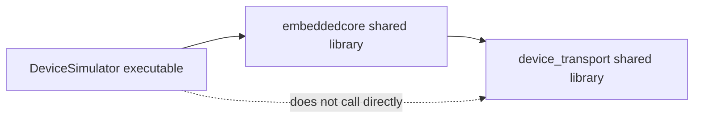
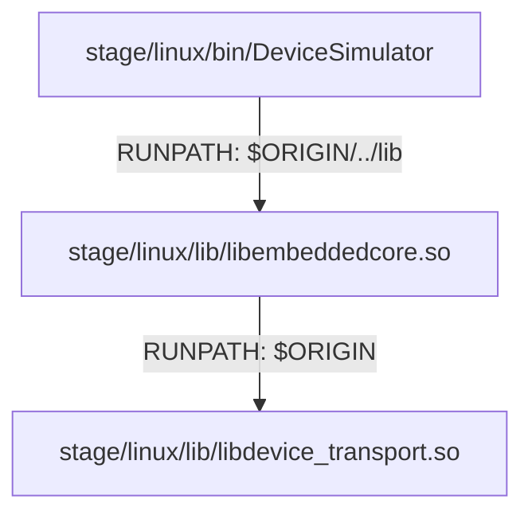
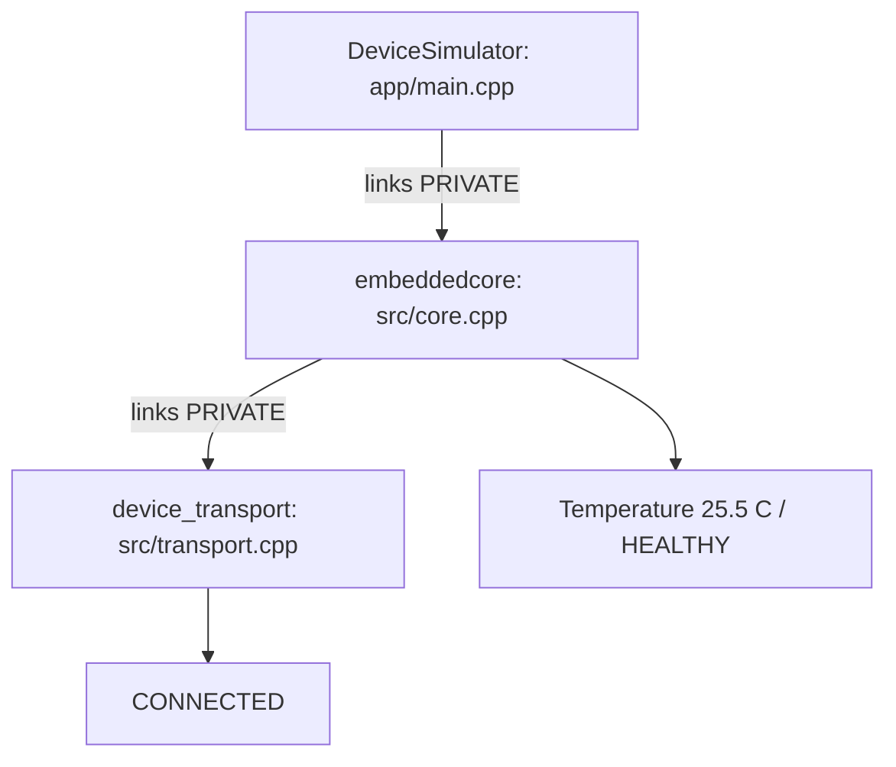
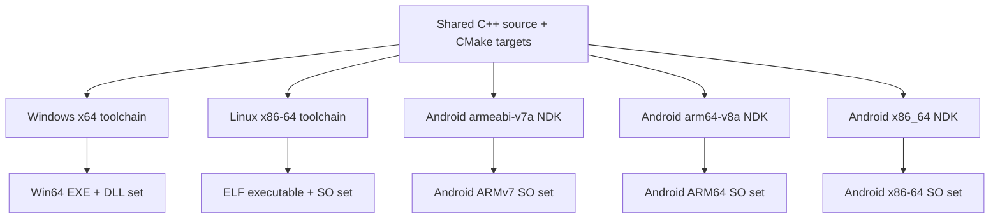
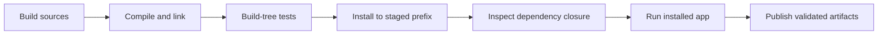

**Course navigation:** [Course home](../../README.md) · [← Chapter 08](../08-static-shared-libraries-binary-compatibility/README.md) · [Chapter 10 →](../10-modular-projects-and-add-subdirectory/README.md)

# Chapter 09 — DLLs, Runtime Dependencies, RPATH, and Deployment

> **Modern CMake University · Module III: Deployable C++ Systems · Chapter 9 of 16**  
> **Lab application:** DeviceSimulator · **Library:** EmbeddedCore · **Level:** Intermediate/Advanced  
> **Time:** 5–7 hours including experiments · **Primary environments:** Windows/MSVC and Linux/GCC · **Architecture extensions:** Android ARMv7, ARM64, x86-64

**Course navigation:** [Chapter 08](../08-static-shared-libraries-binary-compatibility/README.md) · Chapter 09 · [Chapter 10](../10-modular-projects-and-add-subdirectory/README.md) *(coming next)*

## 1. The problem: “It builds on my computer!”

Last chapter, you built static and shared libraries and learned the difference between link-time symbols and runtime shared objects. This chapter begins with a deceptively common incident:

- `DeviceSimulator` **compiles** successfully.
- The **linker** produces an executable.
- The program **runs** from the developer's build tree.
- A release engineer copies only `DeviceSimulator.exe` (or `DeviceSimulator`) to a different machine.
- The program fails **before `main()` starts**, because a required shared library isn't available where the operating system loader expects it.

A successful link is not proof of a successful deployment.

### Learning objectives

By the end of this chapter, you should be able to:

1. Distinguish **compile-time**, **link-time**, **load-time**, and **runtime** failures.
2. Explain the difference between a Windows DLL and its import `.lib`, and between an ELF `.so` and its dynamic-link metadata.
3. Diagnose missing shared libraries with `dumpbin`, `readelf`, `ldd` (with security cautions), and other tools.
4. Explain Windows DLL search behavior and why application-local DLL placement is often useful.
5. Explain ELF `DT_NEEDED`, `RPATH`, `RUNPATH`, and `$ORIGIN`, including transitive-library behavior.
6. Use `install(TARGETS)` to produce a deliberate deployment tree instead of copying random build outputs.
7. Use CMake `$<TARGET_RUNTIME_DLLS:...>` to stage applicable build-tree DLLs on Windows.
8. Understand the limits of dependency discovery: CMake doesn't magically bundle every plugin, system runtime, or license-sensitive library.
9. Avoid mixing architectures, toolchains, operating systems, and incompatible runtime libraries.
10. Build and smoke-test a staged distribution on Linux or Windows.

**Prerequisites:** Complete Chapters 4–8; know `add_library`, `target_link_libraries`, `PRIVATE` vs `PUBLIC`, and Debug/Release generators.

---

## 2. First principles: four different failure stages

```mermaid
flowchart TD
    A["C++ source"] --> B["Compiler"]
    B --> C["Object files"]
    C --> D["Linker"]
    D --> E["Executable + shared library dependencies"]
    E --> F["OS loader / dynamic linker"]
    F --> G["main() executes"]
    B -. syntax/type problem .-> H["Compile-time failure"]
    D -. unresolved symbol .-> I["Link-time failure"]
    F -. missing DLL or .so .-> J["Load-time failure"]
    G -. bad configuration or crash .-> K["Runtime failure"]
```

| Failure stage | Typical symptom | Responsible component | Common response |
|---|---|---|---|
| Compile | `fatal error: cannot open include file`, syntax error | C++ compiler | Fix include paths, source, flags |
| Link | `LNK2019` or `undefined reference` | Linker | Fix target dependency, symbol exports, architecture |
| Load | DLL not found / `error while loading shared libraries` | OS loader | Fix deployed libraries and search paths |
| Runtime | Crash or incorrect telemetry after startup | Your program, dependency, or OS | Debug code and environment |

A **shared library** is not necessarily bundled into the executable at link time. Instead, the executable and its libraries contain references that the loader resolves when the process starts or when code explicitly loads a module.

### Runtime dependency closure

Our example includes three targets:



Even though the executable doesn't directly call `device_transport`, it must be available for the process to load `embeddedcore`. This is the **transitive runtime dependency** problem.

> **Terminology:** A *direct dependency* is recorded by the requesting module; a *transitive dependency* is needed by a dependency further down the graph. “Dependency closure” means everything required for a particular deployment, not just the libraries listed on the executable's immediate link line.

---

## 3. Windows: how DLLs and import libraries cooperate

Suppose we link `DeviceSimulator.exe` against `embeddedcore` built as a shared CMake target.

Typical MSVC outputs:

```text
build/windows/Debug/
├── DeviceSimulator.exe
├── embeddedcore.dll
├── embeddedcore.lib        # Import library, usually found in a separate build subdir
├── device_transport.dll
└── device_transport.lib    # Import library, usually found in a separate build subdir
```

**Note:** Exact artifact locations depend on generator, target output properties, and platform. The schematic above shows roles, not guaranteed directory placement.

### Import `.lib` vs DLL

On Windows, linking an executable to a DLL commonly uses an **import library** (`.lib`) that describes exported symbols. The implementation runs from the **DLL** at runtime.

A static library can also have the `.lib` extension. Thus **the filename alone does not identify what kind of library it is**.

| Artifact | Used when | What it represents |
|---|---|---|
| `embeddedcore.lib` (import library) | Link step | Import records for DLL exports |
| `embeddedcore.dll` | Load/run step | Shared implementation |
| `embeddedcore.lib` (static library, alternative build) | Link step | Archived object code |
| `DeviceSimulator.exe` | Run step | Application and its import information |

Windows often uses `__declspec(dllexport)` when building a DLL and `__declspec(dllimport)` when consuming it:

```cpp
#if defined(_WIN32)
  #if defined(EMBEDDEDCORE_BUILDING)
    #define EMBEDDEDCORE_API __declspec(dllexport)
  #else
    #define EMBEDDEDCORE_API __declspec(dllimport)
  #endif
#else
  #define EMBEDDEDCORE_API __attribute__((visibility("default")))
#endif
```

Here the sample project deliberately exports narrow functions rather than a complete C++ class ABI. This is suitable for teaching exports; production library APIs additionally require ABI and exception-boundary design.

### Where Windows finds DLLs

Windows DLL search depends on the executable's packaging, search mode, Windows version, manifests, APIs, security settings, and DLL type. An executable's own directory is a common application-local location for its normal dependencies, subject to the active loader policy. Windows also has special handling for KnownDLLs, API sets, side-by-side assemblies, and packaged apps.

**Do not assume** the process's current working directory is the executable directory. They can differ.

**Do not solve deployment by adding arbitrary directories to the machine-wide `PATH`.** That can produce shadowing, environment drift, or DLL search-order vulnerabilities. Prefer a controlled application layout and explicit DLL-loading policies where needed.

### Inspecting Windows dependencies

In a Visual Studio Developer Command Prompt:

```bat
dumpbin /DEPENDENTS stage\windows\bin\DeviceSimulator.exe
dumpbin /DEPENDENTS stage\windows\bin\embeddedcore.dll
dumpbin /EXPORTS stage\windows\bin\embeddedcore.dll
```

`/DEPENDENTS` identifies direct import dependencies. It is not a full inventory of every module that may later be dynamically loaded using `LoadLibrary` or delay-loading.

For deeper runtime analysis, Windows debugging and loader diagnostics may be necessary. Do not interpret “link succeeded” as “all runtime dependencies are present.”

---

## 4. Linux: shared objects, ELF, and the dynamic loader

Linux executables and shared libraries commonly use the ELF binary format. An executable can include dynamic metadata such as:

- **`DT_NEEDED`:** Names of required shared libraries.
- **`DT_RPATH`:** An older embedded library-search path mechanism.
- **`DT_RUNPATH`:** A newer runtime search-path mechanism.
- **SONAME:** A logical runtime name for a shared library, when configured.

Inspect this information using:

```bash
readelf -d stage/linux/bin/DeviceSimulator
readelf -d stage/linux/lib/libembeddedcore.so
```

On many systems, `objdump -p` also shows dynamic-section details:

```bash
objdump -p stage/linux/bin/DeviceSimulator
```

### The `$ORIGIN` idea

An ELF object can carry a loader search path expressed relative to the **object itself**.

For a staged installation:

```text
stage/linux/
├── bin/
│   └── DeviceSimulator
└── lib/
    ├── libembeddedcore.so
    └── libdevice_transport.so
```

A practical arrangement is:

- `DeviceSimulator` uses **`$ORIGIN/../lib`** to find `libembeddedcore.so`.
- `libembeddedcore.so` uses **`$ORIGIN`** to find `libdevice_transport.so` beside itself.

This distinction is important because the modern ELF **`RUNPATH` is typically not applied transitively to every descendant dependency**. Each object should carry an appropriate direct-dependency search path when using this deployment model.



### `RPATH` vs `RUNPATH`: essential distinctions

On typical GNU/Linux systems:

- `DT_RUNPATH` usually applies to an object's **direct** `DT_NEEDED` dependencies.
- Legacy `DT_RPATH` can behave differently and may apply farther down the dependency tree when `RUNPATH` is absent.
- Environment settings such as `LD_LIBRARY_PATH` can affect resolution, but should not be the central deployment contract.
- Privileged/secure-execution scenarios can restrict loader environment variables and modify rules.

The exact search order is platform- and loader-dependent; avoid treating one simplified order as a universal contract for all Unix-like systems.

### `ldd`: useful but not always the right tool

```bash
ldd stage/linux/bin/DeviceSimulator
```

`ldd` can help inspect shared dependencies **for binaries you trust**. Avoid invoking it on unknown or untrusted executables; for passive inspection use `readelf -d` or `objdump -p` instead.

### Build-tree vs install-tree runtime paths

CMake generally arranges build-tree runtime paths so freshly built binaries can locate related build outputs. A proper installed distribution often requires a **different** layout and therefore different runtime paths. `BUILD_RPATH`, `INSTALL_RPATH`, and platform-specific loader settings address these separate stages.

The fact that a binary works in `build/` does **not** prove it works in `stage/`.

---

## 5. Understand the architecture before writing CMake

We will build two shared libraries, not just one:

```text
chapter-09/solution/
├── CMakeLists.txt
├── CMakePresets.json
├── include/
│   ├── embeddedcore/core.hpp
│   └── transport/transport.hpp
├── src/
│   ├── core.cpp
│   └── transport.cpp
└── app/
    └── main.cpp
```

Here is the intended relationship:



We intentionally retain the `PRIVATE` library-to-library dependency because `device_transport` is an implementation detail, not a type or include exposed in EmbeddedCore's public API.

### Why two shared libraries?

With one library, we could demonstrate a missing direct DLL. With two, we can demonstrate:

1. A direct library needed by the application.
2. Another library needed by the first library.
3. Why correctly deploying only the first DLL is insufficient.
4. Why Linux RUNPATH must account for each shared object's own dependencies.
5. Why CMake's target graph is more useful than manual ad hoc copy commands.

---

## 6. Annotated `CMakeLists.txt`: build, stage, and test

The complete lab project is in `labs/09-runtime-dependencies-and-deployment/solution/`.

### Step A — Project and targets

```cmake
cmake_minimum_required(VERSION 3.21)
project(EmbeddedCoreChapter09 VERSION 1.0 LANGUAGES CXX)
include(GNUInstallDirs)
include(CTest)

add_library(device_transport SHARED src/transport.cpp)
add_library(embeddedcore SHARED src/core.cpp)
add_executable(DeviceSimulator app/main.cpp)

target_link_libraries(embeddedcore PRIVATE device_transport)
target_link_libraries(DeviceSimulator PRIVATE embeddedcore)
```

`GNUInstallDirs` gives named install locations such as `CMAKE_INSTALL_BINDIR` and `CMAKE_INSTALL_LIBDIR`. These commonly default to `bin` and `lib`, but not always; platform/distribution configuration can differ.

`include(CTest)` adds conventional CTest support and an option to enable or disable tests.

### Step B — Header declarations and exports

```cmake
target_compile_definitions(device_transport PRIVATE DEVICE_TRANSPORT_BUILDING)
target_compile_definitions(embeddedcore PRIVATE EMBEDDEDCORE_BUILDING)

target_include_directories(device_transport PUBLIC
  "$<BUILD_INTERFACE:${CMAKE_CURRENT_SOURCE_DIR}/include>"
  "$<INSTALL_INTERFACE:${CMAKE_INSTALL_INCLUDEDIR}>")

target_include_directories(embeddedcore PUBLIC
  "$<BUILD_INTERFACE:${CMAKE_CURRENT_SOURCE_DIR}/include>"
  "$<INSTALL_INTERFACE:${CMAKE_INSTALL_INCLUDEDIR}>")
```

`PRIVATE` export definitions instruct each library's source files to use `dllexport` while building on Windows. Consumers do not receive these definitions; the public headers consequently use `dllimport` for those consumers.

The build/install include-directory expressions teach a pattern we'll reuse when creating exported packages in Chapter 15.

### Step C — Copy build-tree DLLs on Windows

```cmake
if(WIN32)
  add_custom_command(TARGET DeviceSimulator POST_BUILD
    COMMAND "${CMAKE_COMMAND}" -E copy_if_different
      $<TARGET_RUNTIME_DLLS:DeviceSimulator>
      "$<TARGET_FILE_DIR:DeviceSimulator>"
    COMMAND_EXPAND_LISTS
    VERBATIM)
endif()
```

The generator expression `$<TARGET_RUNTIME_DLLS:DeviceSimulator>` computes **runtime DLLs known to CMake through target dependencies**. It is evaluated when generating build-system instructions, not as a normal variable at CMake configure time.

**Limits:** It does not automatically discover every possible `LoadLibrary` plugin, library supplied outside CMake target metadata, or arbitrary runtime asset. Additional files may require explicit install or discovery rules. This expression also depends on CMake knowing the referenced imported targets' runtime locations.

Why `COMMAND_EXPAND_LISTS`? The expression may expand to a semicolon-separated list of DLL paths. The command needs separate path arguments.

### Step D — Configure Linux install-tree runtime paths

```cmake
if(UNIX AND NOT APPLE)
  set_target_properties(DeviceSimulator PROPERTIES
    INSTALL_RPATH "$ORIGIN/../${CMAKE_INSTALL_LIBDIR}")
  set_target_properties(embeddedcore PROPERTIES
    INSTALL_RPATH "$ORIGIN")
endif()
```

One shared library depends on another in the same installed `lib/` folder. That explains why the executable and the library receive different install paths.

For this educational Linux layout, `$ORIGIN` is resolved by the ELF loader. These exact paths are not suitable as-is for Windows DLL lookup or every macOS deployment layout.

### Step E — Install the correct artifacts

```cmake
install(TARGETS DeviceSimulator embeddedcore device_transport
  RUNTIME DESTINATION "${CMAKE_INSTALL_BINDIR}"
  LIBRARY DESTINATION "${CMAKE_INSTALL_LIBDIR}"
  ARCHIVE DESTINATION "${CMAKE_INSTALL_LIBDIR}")
```

| Artifact class | Windows example | Linux example |
|---|---|---|
| `RUNTIME` | `.exe` and `.dll` files | Executable |
| `LIBRARY` | Not the ordinary DLL artifacts for this example | `.so` |
| `ARCHIVE` | `.lib` import library and static archives | `.a` static archive |

This is a subtle but essential cross-platform CMake distinction: **the DLL itself is installed using `RUNTIME`, while its MSVC import `.lib` goes under `ARCHIVE`**.

### Step F — Add a smoke test

```cmake
add_test(NAME device-smoke COMMAND DeviceSimulator)
set_tests_properties(device-smoke PROPERTIES
  PASS_REGULAR_EXPRESSION "Communication: CONNECTED")
```

CTests should verify the actual application. A successful compilation doesn't verify dynamic library loading. However, a build-tree smoke test still doesn't replace a **separate install-tree smoke test**; our CI workflow performs both.

---

## 7. Lab A — Linux deployment with Ninja

**Environment:** Linux x86-64, GCC or Clang, Ninja, CMake 3.21+.

Start from the repository root and enter the solution:

```bash
cd labs/09-runtime-dependencies-and-deployment/solution
```

Configure a fresh Debug tree:

```bash
cmake -S . -B build/linux-debug -G Ninja -DCMAKE_BUILD_TYPE=Debug
```

Compile:

```bash
cmake --build build/linux-debug --verbose
```

Run the build-tree test:

```bash
ctest --test-dir build/linux-debug --output-on-failure
```

Install to a private staging prefix:

```bash
cmake --install build/linux-debug --prefix "$PWD/stage/linux"
```

Run the **installed** program:

```bash
./stage/linux/bin/DeviceSimulator
```

Expected output:

```text
Embedded Device Simulator
Temperature: 25.5 C
Device status: HEALTHY
Communication: CONNECTED
```

Inspect the executable's dynamic metadata:

```bash
readelf -d stage/linux/bin/DeviceSimulator | grep -E 'NEEDED|RUNPATH|RPATH'
```

Inspect the first library:

```bash
readelf -d stage/linux/lib/libembeddedcore.so | grep -E 'NEEDED|RUNPATH|RPATH'
```

**Expected concept, not exact line formatting:** the executable records a dependency on the core library and a relative installed runtime search path; the core library records a dependency on the transport library and a search path to its own directory.

> Some Linux distributions use `lib64` or a target-specific multiarch install library directory. Inspect your actual install output rather than assuming `lib` everywhere.

### Experiment: break the installed distribution safely

In an isolated lab stage folder, temporarily rename the transport `.so` and run the executable again. It should fail at load time before `main` can execute. Restore the library and verify recovery.

**Never rename system libraries** or try this on a production install.

### What about copying everything next to the executable on Linux?

That layout can work too, with an appropriate `$ORIGIN` path. There is no universal layout requirement. We chose `bin/` and `lib/` to teach `GNUInstallDirs` and per-object loader paths.

---

## 8. Lab B — Windows x64 using MSVC and Ninja Multi-Config

**Environment:** Visual Studio 2019 C++ tools, Ninja, CMake 3.21+.

Open the **x64 Native Tools Command Prompt for VS 2019** and enter the solution directory.

Configure:

```bat
cmake -S . -B build\windows -G "Ninja Multi-Config"
```

Build Debug:

```bat
cmake --build build\windows --config Debug
```

Run CTest for the selected configuration:

```bat
ctest --test-dir build\windows -C Debug --output-on-failure
```

Install Debug into a clean private prefix:

```bat
cmake --install build\windows --config Debug --prefix stage\windows
```

Run the installed application:

```bat
stage\windows\bin\DeviceSimulator.exe
```

Inspect imports and exports:

```bat
dumpbin /DEPENDENTS stage\windows\bin\DeviceSimulator.exe
dumpbin /DEPENDENTS stage\windows\bin\embeddedcore.dll
dumpbin /EXPORTS stage\windows\bin\embeddedcore.dll
```

Expected staged layout:

```text
stage/windows/
├── bin/
│   ├── DeviceSimulator.exe
│   ├── embeddedcore.dll
│   └── device_transport.dll
├── lib/
│   ├── embeddedcore.lib
│   └── device_transport.lib
└── include/
    ├── embeddedcore/core.hpp
    └── transport/transport.hpp
```

**Why install the import `.lib` files?** They can be useful to developers linking other applications against your installed DLLs. The program itself ordinarily uses the `.dll` files, not the import libraries, at runtime.

### Why `--config Debug` matters

Ninja Multi-Config and Visual Studio generators have several configurations in the same configured tree. `CMAKE_BUILD_TYPE` is not the selection mechanism for them. Select Debug or Release during `cmake --build`, `ctest`, and `cmake --install`.

### Experiment: reproduce a missing DLL

Temporarily relocate only `device_transport.dll` from `stage\windows\bin` and run DeviceSimulator. The loader may fail with a missing-library error even though `DeviceSimulator.exe` is present and linked. Restore the file immediately.

The exact Windows error wording is not guaranteed; platform settings and debugger behavior can change what appears.

---

## 9. Architecture matrix: Windows, Linux, Android

A critical production lesson is that **Debug/Release** is only one build dimension. The target platform and ABI are separate dimensions.

| Target platform | ABI / processor | Typical shared library | Runtime loader/deployment model | Build compatibility |
|---|---|---|---|---|
| Windows | x64 | `.dll` | Windows loader, application distribution and loader search policy | MSVC/compatible import libraries and runtime configuration |
| Linux | x86-64 | `.so` | ELF dynamic loader, RUNPATH, system dependency contract | Target glibc/musl, ABI, compiler/runtime expectations |
| Android | `armeabi-v7a` | `.so` | Android linker, APK/AAB JNI library packaging or app-native distribution | 32-bit ARM Android target |
| Android | `arm64-v8a` | `.so` | Same Android app model | 64-bit ARM Android target |
| Android | `x86_64` | `.so` | Same Android app model | x86-64 Android target |

**Never copy Linux x86-64 `.so` files into an Android x86-64 APK expecting them to work.** Matching CPU architecture is insufficient: the operating system ABI and libc/runtime environment differ.

**Never use an ARMv7 runtime library to satisfy an ARM64 dependency.** File extensions may match, but the binary architectures do not.

### Android is not just Linux with a different compiler

Android native deployment commonly involves ABI-specific `.so` files in the app package, subject to Android Gradle Plugin and NDK packaging rules. Some native executables can be used in development contexts, but packaging a normal app and loading JNI libraries is a different deployment model from staging a desktop ELF executable under `bin/` and `lib/`.

For this chapter, the runnable lab is intentionally Windows/Linux. Android deployment details are examined architecturally now and revisited with toolchains and ABI-specific dependencies in Chapters 13–14.



Each target's build tree and resolved third-party dependencies must match that target. One directory cannot safely share all those cached toolchain settings.

---

## 10. Additional CMake runtime-dependency techniques

### `file(GET_RUNTIME_DEPENDENCIES)`

CMake also provides `file(GET_RUNTIME_DEPENDENCIES)` to inspect dependencies of built executables and shared libraries. It is primarily intended for use during installation; see the official documentation for supported executable formats and filtering behavior.

An install-time example for an appropriately configured project might look like this:

```cmake
install(CODE [[
  file(GET_RUNTIME_DEPENDENCIES
    EXECUTABLES "${CMAKE_INSTALL_PREFIX}/bin/DeviceSimulator"
    RESOLVED_DEPENDENCIES_VAR found_deps
    UNRESOLVED_DEPENDENCIES_VAR missing_deps)
  message(STATUS "Resolved: ${found_deps}")
  message(STATUS "Unresolved: ${missing_deps}")
]])
```

This snippet is **illustrative**, not part of our runnable cross-platform solution. It would need adjustment for actual install locations, configuration, paths, dependency filtering, and the platform's search context. A robust production version should distinguish system libraries from application-bundled dependencies.

### `install(RUNTIME_DEPENDENCY_SET)`

Recent CMake supports collecting and installing runtime dependency sets with `install(RUNTIME_DEPENDENCY_SET)` and related `RUNTIME_DEPENDENCIES` functionality. These can automate portions of dependency closure, especially for more complex third-party dependencies, but require careful filtering and packaging policy.

**Why not turn this on unconditionally in our first deployment lab?** Because blindly copying all resolved binaries can bundle the wrong system libraries, conflict with licensing/redistribution terms, or introduce environment-specific failures. The project should own an explicit deployment contract.

### `file(COPY_FILE)` and `cmake -E copy_if_different`

`copy_if_different` is appropriate for controlled staging of known files. It is not a complete dependency resolver or replacement for `install(TARGETS)`.

### `$<TARGET_RUNTIME_DLL_DIRS:...>`

CMake can also expose directories containing known target-runtime DLLs, which may be useful for carefully scoped test environments. Avoid exporting those environment changes globally.

---

## 11. Debugging deployment errors systematically

Use this checklist in order:

1. **Identify the failure stage.** Does the compile fail, the link fail, or the loader fail at startup?
2. **Verify the exact target architecture.** Windows x64, Linux x86-64, Android ARMv7, etc.
3. **Inspect the executable's direct imports.** `dumpbin /DEPENDENTS` or `readelf -d`.
4. **Inspect the dependencies of the dependencies.** Missing transitives are common.
5. **Inspect actual deployment paths.** Do they match your declared `install(TARGETS)` destinations?
6. **Inspect runtime search configuration.** DLL search policy on Windows; RPATH/RUNPATH on Linux.
7. **Confirm configuration.** Debug and Release builds can use different runtime components.
8. **Check for ABI/runtime mismatches.** Compatible processor alone is insufficient.
9. **Test the staged tree independently.** Avoid hiding missing files behind the developer environment.
10. **Document and automate the solution.** Fix your CMake deployment recipe rather than adding undocumented local environment hacks.

### Troubleshooting matrix

| Symptom | Likely cause | Better investigation |
|---|---|---|
| Windows executable fails to start due to a missing DLL | DLL absent or search policy mismatch | Check `stage/bin`, `dumpbin /DEPENDENTS` |
| Windows `LNK2019` before deployment | Missing symbol at link time, not DLL search | Check export macro, import `.lib`, link target |
| Linux `cannot open shared object file` | `.so` absent or not found | `readelf -d`, staged layout, `RUNPATH` |
| Linux app finds `embeddedcore` but not `transport` | Transitive dependency lacks correct search path | Inspect `libembeddedcore.so` RUNPATH |
| Linux incompatible ELF class | Mixed 32-bit/64-bit dependencies | `file` and `readelf -h` |
| App works in build tree but not install prefix | Build RPATH differs from install RPATH or missing files | Compare both trees and loader metadata |
| App works in Release but not Debug | Different DLL/runtime dependencies | Inspect each configuration separately |
| Windows Debug CRT dependency unavailable on test machine | Development runtime dependency | Test deployment policy for Debug vs Release |
| Android native library cannot be loaded | Wrong ABI or missing JNI/native dependency | Inspect APK/AAB contents, ABI-specific .so files, NDK logs |
| App loads but API calls fail | Incompatible ABI or changed runtime contracts | Rebuild with compatible headers/toolchain, check versions |

---

## 12. Hands-on experiments

The repository supplies `starter/` and `solution/` projects. Complete these experiments in order.

### Experiment 1 — Establish a working build

Configure, build, and pass CTest in the build directory. Record the exact compiler, target ABI, and generator.

### Experiment 2 — Produce a private install tree

Use `cmake --install ... --prefix ...` and inspect the `bin` and `lib` directories. Explain why an install prefix is different from a compiler output directory.

### Experiment 3 — Inspect direct dependencies

Use `dumpbin /DEPENDENTS` (Windows) or `readelf -d` (Linux). Record the dependencies of both the executable **and** core shared library.

### Experiment 4 — Remove a transitive runtime dependency

Temporarily move *only your staged transport library* outside the deployment folder. Predict the failure stage before running the executable.

### Experiment 5 — Restore the deployment

Restore the file; rerun. Why did the binary succeed without recompilation?

### Experiment 6 — Compare build-tree and install-tree paths

Inspect how CMake enables build-tree execution and how `INSTALL_RPATH` affects staged Linux binaries.

### Experiment 7 — Debug and Release with a multi-config generator

Build Debug and Release from the same Ninja Multi-Config tree. Install them into **different staging prefixes** to avoid accidentally mixing artifacts.

### Experiment 8 — A new install prefix

Copy or install into a different private prefix. Check whether relative runtime paths remain correct; explain the benefits and limitations of relocatable layouts.

### Experiment 9 — Observe a link failure separately

In a scratch copy, remove `target_link_libraries(DeviceSimulator PRIVATE embeddedcore)` and rebuild. Contrast that output with the missing-DLL experiment.

### Experiment 10 — Build the dependency matrix

For each target (Windows x64, Linux x86-64, Android ARMv7, ARM64, x86-64), list the expected binary format and dependency packaging policy, even if you do not have all five toolchains locally.

---

## 13. Assignments

**Assignment A — Runtime inventory (introductory).** Produce an artifact inventory for Windows and Linux that distinguishes build outputs, required runtime artifacts, and developer-only files. Explain whether each `.lib`, `.dll`, `.a`, and `.so` is needed for a deployed executable.

**Assignment B — Root-cause report (intermediate).** Stage a working Linux distribution, intentionally remove the transport `.so`, and write a short incident report: symptoms, failure stage, evidence from `readelf`, root cause, and automated prevention.

**Assignment C — Reproducible relocation (intermediate).** Install the same build to two different prefixes. Verify whether the application runs in both without changing `LD_LIBRARY_PATH`; explain the loader metadata enabling this.

**Assignment D — Windows DLL packaging (intermediate).** Explain why installing only `DeviceSimulator.exe` is not enough. Show how the post-build copy rule and `install(TARGETS)` serve different lifecycle stages.

**Assignment E — Cross-platform architecture (advanced).** Design a five-target deployment manifest for Windows x64, Linux x86-64, Android `armeabi-v7a`, Android `arm64-v8a`, and Android `x86_64`. For each, identify toolchain, ABI, shared library naming, runtime loader, and output staging directory.

**Assignment F — Packaging governance (advanced).** Assume EmbeddedCore depends on a third-party crypto library. Define how you would validate architecture, versions, dependency transitivity, licensing, and whether special compliance requirements prohibit unexpected fallback to another binary.

### Suggested assessment rubric

- Correct understanding of compiler/linker/loader stages — 20%
- Reproducible build and install commands — 25%
- Correct diagnosis using inspection tools — 25%
- Architecture and ABI reasoning — 20%
- Clear, minimal deployment design — 10%

---

## 14. Quiz — 12 questions

Write your answers before opening `solutions/09-runtime-dependencies-and-deployment/quiz-answers.md`.

1. Why can an executable link successfully but fail before `main()` begins?
2. Is a Windows import `.lib` needed by the operating-system loader to run a normally linked `.exe`?
3. Which command reveals ELF dynamic-section entries including `NEEDED` and `RUNPATH`?
4. What directory does `$ORIGIN` represent in an ELF runtime search path?
5. What does `$<TARGET_RUNTIME_DLLS:DeviceSimulator>` attempt to enumerate?
6. Why might DeviceSimulator need `device_transport.dll` even if it only directly links `embeddedcore`?
7. What is the purpose of `install(TARGETS)`?
8. How do you select Release with a multi-configuration generator when installing?
9. Can a Linux x86-64 `.so` always be deployed as an Android x86-64 `.so`? Why or why not?
10. Which factors besides CPU architecture matter for binary compatibility?
11. Why is setting a machine-wide DLL or shared-library search path a weak production deployment strategy?
12. What do we mean by *runtime dependency closure*?

---

## 15. Chapter summary

You now have a systematic model of deployment:



A build isn't deployment-ready just because the linker produced an executable. It must have a coherent runtime library layout, compatible binary dependencies, and an independent stage/install validation procedure.

### Practical takeaway

- **Windows:** Understand DLL/import-library distinction, install the DLLs in a controlled runtime layout, and stage known build-tree DLL dependencies when appropriate.
- **Linux:** Use ELF inspection tools and per-object `$ORIGIN`-relative runtime paths for relocatable private distributions.
- **Android:** Treat each ABI and application packaging model separately; do not assume desktop Linux deployment rules.
- **CMake:** Prefer explicit targets and install rules, test the installed output, and use runtime dependency discovery deliberately rather than blindly.

## 16. Further reading

- [CMake install() documentation](https://cmake.org/cmake/help/latest/command/install.html)
- [CMake TARGET_RUNTIME_DLLS](https://cmake.org/cmake/help/latest/manual/cmake-generator-expressions.7.html#genex:TARGET_RUNTIME_DLLS)
- [CMake BUILD_RPATH and INSTALL_RPATH](https://cmake.org/cmake/help/latest/prop_tgt/INSTALL_RPATH.html)
- [CMake file(GET_RUNTIME_DEPENDENCIES)](https://cmake.org/cmake/help/latest/command/file.html#get-runtime-dependencies)
- [Microsoft DLL search order](https://learn.microsoft.com/en-us/windows/win32/dlls/dynamic-link-library-search-order)
- [Microsoft DLLs in Visual C++](https://learn.microsoft.com/en-us/cpp/build/dlls-in-visual-cpp)
- [Linux dynamic linker (`ld.so`)](https://man7.org/linux/man-pages/man8/ld.so.8.html)
- [Android NDK ABI guide](https://developer.android.com/ndk/guides/abis)

---

## Next chapter: Chapter 10 — Modular CMake Projects and `add_subdirectory()`

Now that we can build and deploy a small library graph, we'll refactor the project into real modules with their own `CMakeLists.txt` files, preserve target interfaces across directory boundaries, and show why modern CMake dependency modeling scales better than global flags and manual file lists.

---

**Course navigation:** [Course home](../../README.md) · [← Chapter 08](../08-static-shared-libraries-binary-compatibility/README.md) · [Chapter 10 →](../10-modular-projects-and-add-subdirectory/README.md)

