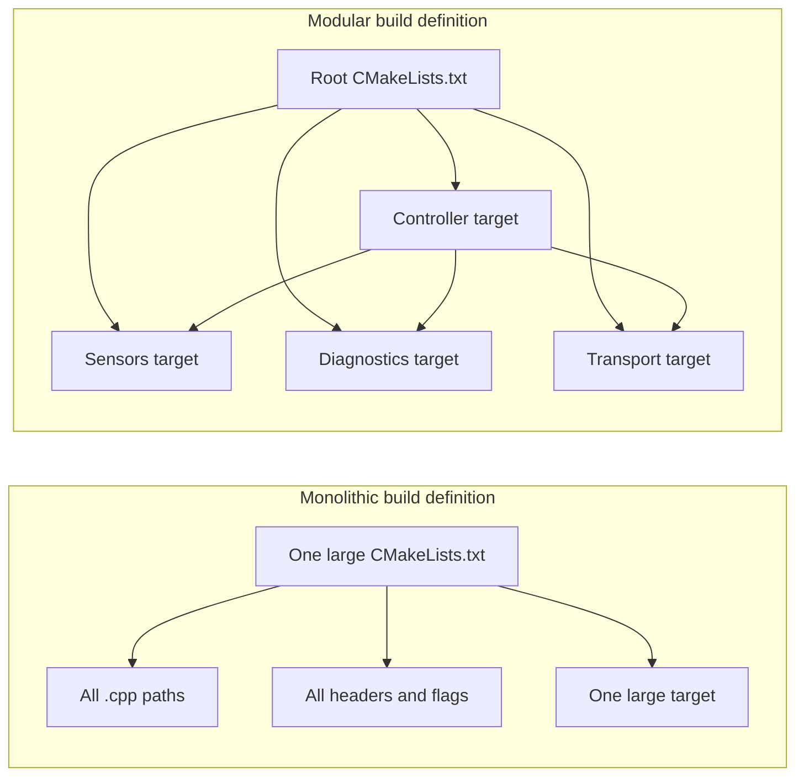
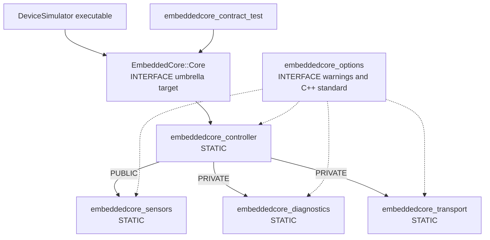

**Course navigation:** [Course home](../../README.md) · [← Chapter 09](../09-runtime-dependencies-and-deployment/README.md) · [Chapter 11 →](../11-third-party-dependencies-find-package-fetchcontent/README.md)

# Chapter 10 — Modular CMake Projects and `add_subdirectory()`

**Modern CMake University: From First Principles to Production CI/CD**  
**Module III: Engineering Maintainable C++ Systems · Chapter 10 of 16**  
**Course project:** EmbeddedCore library + DeviceSimulator application  
**Difficulty:** Intermediate → advanced · **Suggested study time:** 5–7 hours

> **Central question:** As a C++ application grows into dozens of components, how can we divide the source tree into maintainable CMake modules **without** creating a fragile collection of global flags, header paths, and cross-directory coupling?

## Learning objectives

After this chapter, you should be able to:

1. Organize a project into libraries, applications, and tests, each with its own `CMakeLists.txt`.
2. Trace exactly what `add_subdirectory()` does at configure time and how it differs from `include()`.
3. Represent an architectural dependency graph as target dependencies using `target_link_libraries()`.
4. Select `PRIVATE`, `PUBLIC`, and `INTERFACE` usage requirements based on actual C++ interfaces.
5. Design and debug `INTERFACE` umbrella/configuration targets and `ALIAS` target names.
6. Understand why directory scope is not the same thing as target visibility.
7. Avoid common scaling problems: global include paths, directory-wide flags, circular dependencies, ad-hoc target name conventions, and source globbing surprises.
8. Build the same modular code on Windows/MSVC and Linux/GCC using CMake and Ninja, and reason about architecture/ABI constraints.
9. Observe incremental recompilation and diagnose three deliberate module-boundary failures.
10. Explain how this structure prepares EmbeddedCore for third-party dependencies, install/export packaging, cross-compilation, and CI.

**Prerequisites:** Chapters 1–9, C++17, CMake 3.20+, a C++ compiler, and Ninja or another supported generator. No hardware is required.

---

## 1. Why one large `CMakeLists.txt` stops scaling

A small C++ demo can be described in a few lines:

```cmake
add_executable(DeviceSimulator main.cpp sensor.cpp diagnostics.cpp)
```

But what if an embedded device gains a sensor subsystem, diagnostics, a communications layer, a controller, multiple executable clients, unit tests, platform adapters, and independently versioned libraries? A monolithic build file might accumulate hundreds of paths and conditional branches. It becomes difficult to answer straightforward questions: Which module owns a header? What depends on the network transport? Can a test use the controller without the executable? Can the transport module be replaced for an offline simulator?

A **modular build** encodes architectural boundaries in CMake targets. Each component owns its source files, public headers, private headers, compile requirements, and direct dependencies. The root project assembles these pieces rather than knowing every implementation detail.

### 1.1 Monolith versus modular project



**Key distinction:** Adding more `CMakeLists.txt` files does not automatically give you good modularity. The architecture must also have meaningful targets and intentional dependencies.

### 1.2 What a *module* means in this chapter

Here, a *module* means a logical subsystem implemented as a separate CMake target and directory. It does **not** mean a C++20 language module. C++20 modules involve different compilation and dependency-scanning mechanisms and are outside this chapter's scope.

---

## 2. The Chapter 10 architecture

Our EmbeddedCore library evolves into four concrete static libraries, one umbrella target, an application, and tests.



**Why the edge from Controller to Sensors is `PUBLIC`:** The controller's public header explicitly includes `embeddedcore/sensors/sensor.hpp` and accepts a `sensors::Reading` value. Consumers compiling against that header therefore need the sensor module's public include directory.

**Why Diagnostics and Transport are `PRIVATE`:** Their headers are included only in the controller's `.cpp` implementation, so the controller's *compile* interface does not require those headers. The final linker can still require their static archives. CMake accounts for this when representing static link dependencies; `PRIVATE` does not mean “the final executable can never need it.”

**Why use an umbrella target:** Consumers can write `target_link_libraries(DeviceSimulator PRIVATE EmbeddedCore::Core)` instead of knowing the internal names of every subsystem. The alias in this chapter is a **build-tree API**; exporting a robust installed namespace is a later topic.

### 2.1 Repository layout

```text
modern-cmake-university/
├── chapters/
│   └── 10-modular-projects-and-add-subdirectory/
│       └── README.md
├── labs/
│   └── 10-modular-projects-and-add-subdirectory/
│       ├── README.md
│       ├── starter/
│       └── solution/
│           ├── CMakeLists.txt
│           ├── CMakePresets.json
│           ├── modules/
│           │   ├── sensors/
│           │   │   ├── CMakeLists.txt
│           │   │   ├── sensor.cpp
│           │   │   └── include/embeddedcore/sensors/sensor.hpp
│           │   ├── diagnostics/
│           │   │   ├── CMakeLists.txt
│           │   │   ├── diagnostics.cpp
│           │   │   └── include/embeddedcore/diagnostics/diagnostics.hpp
│           │   ├── transport/
│           │   │   ├── CMakeLists.txt
│           │   │   ├── transport.cpp
│           │   │   └── include/embeddedcore/transport/transport.hpp
│           │   └── controller/
│           │       ├── CMakeLists.txt
│           │       ├── controller.cpp
│           │       └── include/embeddedcore/controller/controller.hpp
│           ├── app/
│           │   ├── CMakeLists.txt
│           │   └── main.cpp
│           └── tests/
│               ├── CMakeLists.txt
│               └── contract_test.cpp
├── solutions/
│   └── 10-modular-projects-and-add-subdirectory/
│       └── quiz-answers.md
└── .github/workflows/chapter10-build.yml
```

Each subsystem now has a **cohesive responsibility**. Its own `CMakeLists.txt` is short enough to review and can be maintained without repeatedly editing the root file.

---

## 3. What `add_subdirectory()` actually does

The root file contains:

```cmake
add_subdirectory(modules/sensors)
add_subdirectory(modules/diagnostics)
add_subdirectory(modules/transport)
add_subdirectory(modules/controller)
add_subdirectory(app)
add_subdirectory(tests)
```

At **configure time**, CMake processes the `CMakeLists.txt` located in each listed child source directory. Each child receives its own **directory variable scope** and a corresponding build directory. The parent-to-child relationship creates a natural place to organize local settings, but targets created there are generally globally addressable within the configured project (subject to certain target kinds and visibility rules).

The order here is intentional for readability: dependencies are declared before consumers. CMake resolves many target dependencies during generation, but never use this flexibility to construct a confusing or cyclic architecture.

### 3.1 Source and binary directories

Inside `modules/sensors/CMakeLists.txt`:

- `CMAKE_CURRENT_SOURCE_DIR` points to the **sensors source directory**.
- `CMAKE_CURRENT_BINARY_DIR` points to the **sensors build directory** corresponding to the active build tree.
- `PROJECT_SOURCE_DIR` is the top-level directory of the most recent enclosing `project()` invocation; in this lab, it is the root.
- `CMAKE_SOURCE_DIR` refers to the top of the full source tree. This can differ from `PROJECT_SOURCE_DIR` when a project is embedded inside a larger superbuild.

To inspect these values temporarily:

```cmake
message(STATUS "module source: ${CMAKE_CURRENT_SOURCE_DIR}")
message(STATUS "module binary: ${CMAKE_CURRENT_BINARY_DIR}")
message(STATUS "project source: ${PROJECT_SOURCE_DIR}")
```

Notice that we can build in `build/ninja-debug` without writing a single output artifact into our `modules/` source directories.

### 3.2 `add_subdirectory()` vs `include()` vs `find_package()`

| Command | Typical purpose | What is processed |
|---|---|---|
| `add_subdirectory(path)` | Include source maintained within the same overall build | A child directory's `CMakeLists.txt` |
| `include(file.cmake)` | Reuse a configuration/helper script | The named script in the caller's variable scope (unless script constructs new scopes) |
| `find_package(Name ...)` | Discover a separately supplied dependency | Package configuration or find-module logic |

**Mental model:** `add_subdirectory()` is composition of source projects; `include()` is inclusion of CMake instructions; `find_package()` is dependency discovery. They are related but not interchangeable.

### 3.3 What `add_subdirectory()` is *not*

It does not automatically create a CMake target, set up a library, propagate all child variables into the parent, or make every header visible globally. Those are separate choices made in the child CMake files.

---

## 4. Root CMakeLists: composition rather than implementation

Our runnable root file begins:

```cmake
cmake_minimum_required(VERSION 3.20)
project(EmbeddedCoreChapter10 VERSION 1.0.0 LANGUAGES CXX)

option(EMBEDDEDCORE_BUILD_TESTS "Build EmbeddedCore tests" ON)
option(EMBEDDEDCORE_ENABLE_WARNINGS "Enable extra compiler warnings" ON)

add_library(embeddedcore_options INTERFACE)
target_compile_features(embeddedcore_options INTERFACE cxx_std_17)

if(EMBEDDEDCORE_ENABLE_WARNINGS)
  if(MSVC)
    target_compile_options(embeddedcore_options INTERFACE /W4)
  else()
    target_compile_options(embeddedcore_options INTERFACE -Wall -Wextra -Wpedantic)
  endif()
endif()
```

This defines a **configuration-only target**. An `INTERFACE` library creates no `.lib` or `.a` archive, but can carry requirements to any target that links it.

We use `/W4` with MSVC and `-Wall -Wextra -Wpedantic` with GCC/Clang-like compilers. These are educational warning defaults, not a guarantee that every compiler supports exactly the same flags. A production library can use compiler-ID generator expressions or feature checks for more complex policy.

Then the root registers the modules:

```cmake
add_subdirectory(modules/sensors)
add_subdirectory(modules/diagnostics)
add_subdirectory(modules/transport)
add_subdirectory(modules/controller)

add_library(embeddedcore INTERFACE)
add_library(EmbeddedCore::Core ALIAS embeddedcore)
target_link_libraries(embeddedcore INTERFACE embeddedcore_controller)

add_subdirectory(app)
```

The last part enables testing:

```cmake
if(EMBEDDEDCORE_BUILD_TESTS)
  include(CTest)
  if(BUILD_TESTING)
    add_subdirectory(tests)
  endif()
endif()
```

Here, the course option and the standard CTest `BUILD_TESTING` option are both required for the tests to be registered. For a library that is itself part of a much larger source tree, a more refined ownership policy might choose to register tests only when built standalone.

### 4.1 Why an `ALIAS` target?

`EmbeddedCore::Core` expresses the public-facing name and catches mistakes early: namespace-like names containing `::` are interpreted by CMake in ways that help diagnose an unknown imported/alias target instead of accidentally treating it like a raw linker flag.

**Limit:** `ALIAS` targets cannot themselves be installed or exported. In Chapter 15, we'll create installation export sets and a real imported package target for consumers.

---

## 5. Build a leaf module: Sensors

The sensors module owns one implementation and one public header.

`modules/sensors/include/embeddedcore/sensors/sensor.hpp`:

```cpp
#pragma once
namespace embeddedcore::sensors {
struct Reading { double celsius; };
Reading read_temperature();
}
```

`modules/sensors/sensor.cpp`:

```cpp
#include "embeddedcore/sensors/sensor.hpp"
namespace embeddedcore::sensors {
Reading read_temperature() { return {25.5}; }
}
```

`modules/sensors/CMakeLists.txt`:

```cmake
add_library(embeddedcore_sensors STATIC sensor.cpp)

target_include_directories(embeddedcore_sensors PUBLIC
  "$<BUILD_INTERFACE:${CMAKE_CURRENT_SOURCE_DIR}/include>")

target_link_libraries(embeddedcore_sensors PUBLIC embeddedcore_options)
```

### 5.1 Why `STATIC` here?

This chapter deliberately uses one library type so students can concentrate on modularization. Separate static archives make the link graph easy to inspect. Chapter 8 already covered how static and shared libraries differ; Chapter 9 covered deployment. The same module organization can later be adjusted for shared libraries, with attention to symbol visibility and runtime distribution.

### 5.2 Why `PUBLIC` include directories?

Consumers of the sensor target compile code that includes `embeddedcore/sensors/sensor.hpp`. They need the sensor target's include directory. `PUBLIC` applies to sensor itself and propagates to consumers.

### 5.3 Why `$<BUILD_INTERFACE:...>`?

The include directory is a **source-tree location**. It is appropriate while building from source, but not appropriate to bake unchanged into an installed package. We intentionally prepare for the later installation chapter while keeping Chapter 10 focused on build-tree composition. A fully installable target will also declare suitable `INSTALL_INTERFACE` paths and installation rules.

---

## 6. An intermediate module: Controller

The controller performs a more interesting job than the leaf modules: it **consumes** sensors, diagnostics, and transport.

`modules/controller/include/embeddedcore/controller/controller.hpp`:

```cpp
#pragma once
#include <string>
#include "embeddedcore/sensors/sensor.hpp"

namespace embeddedcore::controller {
struct Report {
  double temperature_celsius;
  std::string health;
  std::string connection;
};
Report evaluate(sensors::Reading reading);
}
```

This publicly exposes the `sensors::Reading` type; it is a deliberate API design choice. Now inspect the implementation:

```cpp
#include "embeddedcore/controller/controller.hpp"
#include "embeddedcore/diagnostics/diagnostics.hpp"
#include "embeddedcore/transport/transport.hpp"

namespace embeddedcore::controller {
Report evaluate(sensors::Reading reading) {
  const bool warning = reading.celsius > 40.0;
  return {reading.celsius,
          diagnostics::status(warning),
          transport::connection_status()};
}
}
```

The controller's CMake file captures these relationships:

```cmake
add_library(embeddedcore_controller STATIC controller.cpp)

target_include_directories(embeddedcore_controller PUBLIC
  "$<BUILD_INTERFACE:${CMAKE_CURRENT_SOURCE_DIR}/include>")

target_link_libraries(embeddedcore_controller
  PUBLIC embeddedcore_sensors embeddedcore_options
  PRIVATE embeddedcore_diagnostics embeddedcore_transport)
```

Here is the question to ask when choosing dependency scope: **Would a consumer of this target need the dependency to compile against its public headers?** If yes, the dependency is typically `PUBLIC`. If only the implementation needs it, `PRIVATE` is often appropriate, although certain link requirements for static libraries may still be carried to consumers.

### 6.1 A subtle point: static archives do not perform final symbol resolution

The controller archive contains references to code in diagnostics and transport. Making it a static library does not mean those functions are embedded into its archive. At the final executable link step, the linker must locate all necessary definitions. CMake's target graph captures the dependencies and can arrange the required libraries at link time. This is why `PRIVATE` on a static library dependency cannot be interpreted as “no downstream linking impact.”

### 6.2 An alternative API boundary

Imagine changing the controller header to avoid exposing `sensors::Reading`. For example:

```cpp
namespace embeddedcore::controller {
struct Report;
Report evaluate_temperature(double celsius);
}
```

The controller could then consume sensor types exclusively in its `.cpp` file. That may permit a different public/private dependency relationship. CMake scope should reflect real software interfaces; it should not be selected arbitrarily merely to make a build work.

---

## 7. Build the consumer and tests

The DeviceSimulator application has an intentionally tiny CMake file:

```cmake
add_executable(DeviceSimulator main.cpp)
target_link_libraries(DeviceSimulator PRIVATE EmbeddedCore::Core)
```

The application itself does not need to list four module include directories or library archives. CMake follows the target graph through the umbrella target, controller, and supporting modules.

The test directory follows the same pattern:

```cmake
add_executable(embeddedcore_contract_test contract_test.cpp)
target_link_libraries(embeddedcore_contract_test PRIVATE EmbeddedCore::Core)
add_test(NAME embeddedcore.contract COMMAND embeddedcore_contract_test)

add_test(NAME devicesimulator.smoke COMMAND DeviceSimulator)
set_tests_properties(devicesimulator.smoke PROPERTIES
  PASS_REGULAR_EXPRESSION "Device status: HEALTHY")
```

**Important:** The smoke test uses the executable **target name**, allowing CTest to resolve its built path. The contract test exercises both a healthy reading (25.5°C) and a warning reading (45°C). This gives us evidence that controller behavior works independently of the main application.

---

## 8. Laboratory A — Linux with GCC + Ninja

### Step A1 — Inspect your toolchain

```bash
g++ --version
cmake --version
ninja --version
```

### Step A2 — Configure

Open a terminal in `labs/10-modular-projects-and-add-subdirectory/solution` and run:

```bash
cmake -S . -B build/debug -G Ninja -DCMAKE_BUILD_TYPE=Debug
```

CMake locates the compiler, processes the root and each child `CMakeLists.txt`, constructs target relationships, and generates Ninja build instructions.

### Step A3 — Build with verbose output

```bash
cmake --build build/debug --parallel 4 --verbose
```

Watch for the separate compilation of `sensor.cpp`, `diagnostics.cpp`, `transport.cpp`, and `controller.cpp`. Observe the creation of multiple static archives and the final executable link. Compare the compiler flags for the different targets.

### Step A4 — Run the application and tests

```bash
./build/debug/app/DeviceSimulator
ctest --test-dir build/debug --output-on-failure
```

Expected application output:

```text
Embedded Device Simulator
Temperature: 25.5 C
Device status: HEALTHY
Communication: CONNECTED (simulated)
```

Expected test results: **2/2 passed**.

### Step A5 — Use the course presets

```bash
cmake --preset ninja-debug
cmake --build --preset debug
ctest --preset debug

cmake --preset ninja-release
cmake --build --preset release
ctest --preset release
```

The preset project writes build files below the `solution/build/` directory. The direct commands above use the same source but choose an independent build directory. Do not accidentally attempt to reuse one build tree with a different generator or compiler.

---

## 9. Laboratory B — Windows/MSVC

### Step B1 — Environment

Use **x64 Native Tools Command Prompt for VS 2019**, with CMake and Ninja available. Check:

```bat
cl
cmake --version
ninja --version
```

### Step B2 — Ninja generator

From the Chapter 10 solution directory:

```bat
cmake -S . -B build\msvc-debug -G Ninja -DCMAKE_BUILD_TYPE=Debug
cmake --build build\msvc-debug --parallel 4
ctest --test-dir build\msvc-debug --output-on-failure
build\msvc-debug\app\DeviceSimulator.exe
```

### Step B3 — Visual Studio generator alternative

On a Windows host with Visual Studio 2019 and the C++ toolchain installed:

```bat
cmake -S . -B build\vs2019 -G "Visual Studio 16 2019" -A x64
cmake --build build\vs2019 --config Debug
ctest --test-dir build\vs2019 -C Debug --output-on-failure
build\vs2019\app\Debug\DeviceSimulator.exe
```

Visual Studio is a **multi-config generator**, so `--config Debug` matters. Ordinary Ninja is a **single-config generator**, so `CMAKE_BUILD_TYPE=Debug` matters. The exact executable layout follows the chosen generator and configured runtime output directory properties; the paths above are the default for this lab.

### Step B4 — Inspect target-specific build commands

For Ninja, build verbosely:

```bat
cmake --build build\msvc-debug --verbose
```

You should see MSVC (`cl.exe`) compile commands and Microsoft library/link tools invoked as needed. Unlike a naive monolithic command, each target receives requirements through the target graph.

**Validation note:** The provided code has been validated here with GCC/Ninja on Linux; the Windows commands are documented and included in CI but are not claimed as locally executed.

---

## 10. Laboratory C — Investigate the target graph

### C1 — Ask Ninja what it can build

```bash
cmake --build build/debug --target help
```

Look for the module libraries, `DeviceSimulator`, and `embeddedcore_contract_test`.

### C2 — Inspect link commands

Use a verbose build after cleaning or touching a source file:

```bash
cmake --build build/debug --target DeviceSimulator --verbose
```

When Ninja reports no work, make an intentional source change or inspect the generated command database. Avoid editing generated Ninja files: CMake owns them.

### C3 — Generate a dependency graph

```bash
cmake --graphviz=build/debug/targets.dot build/debug
```

CMake writes a DOT graph for the targets it knows about. You can render it to SVG if Graphviz is installed:

```bash
dot -Tsvg build/debug/targets.dot -o build/debug/targets.svg
```

Inspect the arrows, but remember that the visual presentation is a representation of relationships, not a guarantee of exact link command order on every toolchain.

---

## 11. Laboratory D — Incremental compilation and isolation

**Experiment 1: Edit `modules/sensors/sensor.cpp`.** Change `25.5` to `26.0`; build again. The sensor target must rebuild. Dependent link steps may also run, while unrelated implementation compilation should generally remain untouched.

**Experiment 2: Edit `modules/controller/controller.cpp`.** Change the warning threshold from `40.0` to `38.0`; rebuild. Expect controller recompilation and downstream executable relinking, but not a forced recompile of unrelated source files.

**Experiment 3: Edit a public header.** Add a harmless comment to `sensor.hpp` and rebuild. Many dependent translation units that include the header may need recompilation, demonstrating why public API changes have a larger rebuild footprint than private implementation changes.

**Experiment 4: Disable tests at configure time.** Use a new build directory:

```bash
cmake -S . -B build/no-tests -G Ninja \
  -DEMBEDDEDCORE_BUILD_TESTS=OFF
cmake --build build/no-tests
```

Check that the app and libraries build without creating the test executable.

**Experiment 5: Disable optional warnings.** Compare verbose compile commands between configurations with `-DEMBEDDEDCORE_ENABLE_WARNINGS=ON` and `OFF`. This shows how requirements can be centralized on an `INTERFACE` configuration target rather than sprayed through global CMake commands.

---

## 12. Laboratory E — Three deliberate failures

Do these in a disposable copy of `solution/` or a temporary Git branch, and restore the original after each test.

### Failure 1 — Missing public header propagation

In `modules/controller/CMakeLists.txt`, change:

```cmake
target_link_libraries(embeddedcore_controller
  PUBLIC embeddedcore_sensors embeddedcore_options
  PRIVATE embeddedcore_diagnostics embeddedcore_transport)
```

into:

```cmake
target_link_libraries(embeddedcore_controller
  PRIVATE embeddedcore_sensors embeddedcore_options
  PRIVATE embeddedcore_diagnostics embeddedcore_transport)
```

Configure and build. Because the controller public header includes the sensor header, **consumers** may now fail compilation with a missing sensor header. The controller itself still knows about sensors. That is the distinction between implementation requirements and usage requirements.

Fix by restoring `PUBLIC embeddedcore_sensors`.

### Failure 2 — Missing implementation dependency

Remove `embeddedcore_transport` from the controller's `target_link_libraries()` line, but leave the `#include` and function call in `controller.cpp`.

Depending on the remaining include paths, the first failure may be a **compile-time missing-header error**. If the header is made available another way, the final link may instead fail due to an unresolved transport symbol. **Do not confuse the two errors**: adding an include directory is not equivalent to linking a library implementation.

Fix by restoring the target dependency, not by hardcoding the transport archive's file path.

### Failure 3 — A dependency cycle

Add a dependency from sensors back to controller, using `target_link_libraries(embeddedcore_sensors PRIVATE embeddedcore_controller)`. The target graph now contains a cycle between static libraries. Some static library cycles are supported in specific CMake/linker scenarios, so this change is **not guaranteed to produce a configure error**. Nevertheless, cycles signal a questionable modular architecture and can make link behavior fragile.

Fix by moving shared abstractions into a lower-level interface component or by inverting the dependency direction. The architectural goal is to keep the dependency graph acyclic when practical.

---

## 13. Understanding target scope versus variable scope

This is a common conceptual trap.

```cmake
# root CMakeLists.txt
set(ROOT_SETTING "root")
add_subdirectory(modules/sensors)
```

The child begins with a copy of the parent's visible normal-variable bindings at entry, but modifications in the child normally do not change the parent's normal variables. That is **variable/directory scope**.

A target created in the child with `add_library(embeddedcore_sensors ...)` can generally be referenced by another directory's `target_link_libraries()`. That is **target visibility/reference behavior**. They are two different systems.

| Item | Typical visibility behavior |
|---|---|
| Normal variable set in child | Remains in child directory scope unless explicitly propagated |
| Cache variable | Shared cache entry in the build tree; can be shadowed by normal variables |
| Target created by child `add_library()` | Generally referenced from other directories in the build |
| `ALIAS` target | Alternate name for an existing target; visibility varies with target type |
| `INTERFACE` library | Propagates usage requirements through target dependencies |

The distinction becomes important when debugging why `set(SOME_FLAG ON)` inside one module appears to have no effect in another: the correct answer might be *target properties*, not more variable propagation.

---

## 14. Designing public versus private headers

The public header boundary forms the API consumers are allowed to depend on. Suppose a module has:

```text
modules/controller/
├── include/embeddedcore/controller/controller.hpp
├── internal/controller_state.hpp
└── controller.cpp
```

A good target definition is:

```cmake
target_include_directories(embeddedcore_controller
  PUBLIC
    "$<BUILD_INTERFACE:${CMAKE_CURRENT_SOURCE_DIR}/include>"
  PRIVATE
    "${CMAKE_CURRENT_SOURCE_DIR}/internal")
```

Only the library itself needs the `internal/` directory. A consumer should not depend on the internal header, because that would undermine the module's ability to change implementation details independently.

**Architecture rule:** If a supposedly private header must be added to an application's include path just to compile, reconsider the public interface before applying a build-system workaround.

---

## 15. Common anti-patterns and their replacements

### Anti-pattern A — Global include directories

```cmake
include_directories(include modules/sensors/include modules/controller/include)
```

This can mask missing dependencies and makes ownership unclear. Prefer each module exporting its actual header requirements through `target_include_directories()` and consumer links.

### Anti-pattern B — Global compile definitions

```cmake
add_definitions(-DENABLE_DIAGNOSTICS)
```

A global setting may leak into unrelated targets. Prefer `target_compile_definitions()` with a scope reflecting the API.

### Anti-pattern C — Raw archive paths

```cmake
target_link_libraries(DeviceSimulator PRIVATE /tmp/build/libembeddedcore_sensors.a)
```

This is host-, configuration-, generator-, and architecture-specific. Link a CMake target instead.

### Anti-pattern D — Every module knows every other module

If `sensors.cpp` includes the controller public header and the controller includes sensors, there's a potential cycle and an ownership problem. Extract shared types into a leaf target or redesign the interface.

### Anti-pattern E — Treating `file(GLOB ...)` as a mandatory style

A glob can be convenient, and `CONFIGURE_DEPENDS` can help CMake notice changes on supported generators. For a public instructional repository, explicit source lists make ownership and diffs obvious. Neither approach is universally wrong, but do not assume every new source file will automatically be included unless your build rules actually support that.

### Anti-pattern F — Confusing umbrella targets with merged archives

`add_library(embeddedcore INTERFACE)` does **not** create a physical archive containing the four module archives. It is a usage-requirement and link-dependency entry point. If you need a single redistributable binary artifact, that is a separate packaging and linkage design problem.

---

## 16. Cross-platform and architecture matrix

The **CMake architecture** is designed to remain reusable, while compilers, runtime formats, and third-party binaries vary by target.

| Target | Typical toolchain | Static archive | Key design consideration |
|---|---|---|---|
| Windows x64 | MSVC | `.lib` | MSVC toolset/CRT/ABI compatibility |
| Linux x86-64 | GCC or Clang | `.a` | ELF, toolchain and C++ runtime ABI |
| Android ARMv7 | Android NDK Clang | `.a` | `armeabi-v7a`, 32-bit ARM ABI |
| Android ARM64 | Android NDK Clang | `.a` | `arm64-v8a`, 64-bit ARM ABI |
| Android x86-64 | Android NDK Clang | `.a` | Android `x86_64`, not Linux-host x86-64 |

CMake targets are **logical names**, not evidence that their produced binaries are interchangeable. The same `embeddedcore_sensors` target can produce different machine-code archives for each architecture.

### 16.1 Build-tree isolation

For single-config generators:

```text
build/
├── windows-x64-debug/
├── linux-x64-debug/
├── android-armeabi-v7a-debug/
├── android-arm64-v8a-debug/
└── android-x86_64-debug/
```

Or with Ninja Multi-Config, use one tree **per toolchain/ABI** and select Debug or Release within it:

```text
build/
├── android-armeabi-v7a/
│   ├── Debug/
│   └── Release/
├── android-arm64-v8a/
│   ├── Debug/
│   └── Release/
└── android-x86_64/
    ├── Debug/
    └── Release/
```

Paths above show the conceptual layout; the real generator may arrange outputs differently unless you set output directory properties.

### 16.2 Android example (conceptual; requires the NDK)

Assuming `ANDROID_NDK_HOME` points to a valid Android NDK installation, on a Unix-like host:

```bash
cmake -S . -B build/android-arm64 -G Ninja \
  -DCMAKE_TOOLCHAIN_FILE="$ANDROID_NDK_HOME/build/cmake/android.toolchain.cmake" \
  -DANDROID_ABI=arm64-v8a \
  -DANDROID_PLATFORM=android-24 \
  -DEMBEDDEDCORE_BUILD_TESTS=OFF
cmake --build build/android-arm64
```

This command cross-compiles the static libraries and application but **does not imply that the Android executable can run directly on the host**. Device execution or an emulator is needed for runtime tests, and practical minimum SDK/API considerations depend on the target and dependencies. We will explore these issues in depth in Chapter 13.

### 16.3 Why third-party dependencies are harder

The `transport` module currently returns a simulated connection message, so the lab can compile without a network library. In later chapters it might link OpenSSL or another external dependency. The module boundary lets us isolate that choice and keep it from leaking into every other target. However, even when a dependency is `PRIVATE` to a static library, the final link can still need its binary symbols.

---

## 17. CI/CD implications

A modular project creates useful opportunities for automation:

- Configure and compile only the intended target platform using a dedicated toolchain.
- Run unit tests against a library boundary, independent of application startup.
- Cache compiler artifacts and inspect incremental rebuild behavior.
- Surface missing include or link dependencies early, before deployment.
- Build Debug and Release separately or use a multi-config generator within each ABI tree.
- Add source-level checks and module-specific tests as ownership becomes clearer.

The package includes `.github/workflows/chapter10-build.yml` with Linux and Windows jobs using Ninja, build, and CTest steps. It is intentionally a **Chapter 10 teaching pipeline**, not a complete release or Android signing pipeline.

### Why not duplicate the entire five-ABI Jenkins matrix today?

Chapter 10 teaches composition of modules. Chapter 13 introduces toolchains and ABI selection; Chapter 14 introduces per-platform dependency resolution; Chapter 16 introduces production CI/CD. Mixing all of those into this chapter would obscure what `add_subdirectory()` itself teaches.

---

## 18. Troubleshooting reference

| Symptom | Likely cause | Recommended investigation |
|---|---|---|
| `add_subdirectory given source ... which is not an existing directory` | Wrong relative path | Check the path relative to the **calling** CMake source directory |
| `does not contain a CMakeLists.txt file` | Child directory lacks CMake configuration | Confirm exact filename and path |
| `Cannot specify link libraries for target ... which is not built by this project` | Target not defined or typo | Inspect `add_library()`, subdirectory registration and target names |
| `Target ... links to ... but the target was not found` | Missing alias/imported dependency or name mismatch | Check target creation and package discovery |
| Fatal error: header not found | Required include path not propagated | Inspect `PUBLIC` vs `PRIVATE` and direct target dependencies |
| Unresolved external / undefined reference | Implementation archive missing from final link | Verify `target_link_libraries()` and symbol definitions |
| Duplicate symbol / already defined | Non-inline definition in multiple translation units | Move definition to one `.cpp` or use appropriate `inline` semantics |
| Module builds by itself but app fails | Consumer usage requirements incomplete | Build a small standalone consumer against public headers |
| CMake config picks wrong compiler | Reused incompatible build directory/cache | Create a clean build tree per compiler/toolchain/ABI |
| Windows `LNK2038` mismatch | Incompatible compiler runtime/configuration choices | Align MSVC toolset and runtime selection |
| Link step fails only for Android | Host library or wrong ABI used | Inspect NDK toolchain, target ABI and dependency archive architecture |
| Changing header recompiles many files | Public header dependency fan-out | Reduce public header coupling when possible |

**Diagnostic habit:** Start with the *first* meaningful error message. Identify whether the failure occurred at configure, generate, compile, link, load, or runtime. Avoid randomly adding include directories or linker flags; the root cause is often an incorrectly modeled relationship.

---

## 19. Assignments

### Assignment 1 — Add a Battery module (beginner)

Create `modules/battery/` with its own `CMakeLists.txt`, header, and `.cpp`. Implement `battery_percentage()` returning a simulated number. Add a `BatteryStatus` field to the report and print it in DeviceSimulator. Identify whether the battery dependency should be `PUBLIC` or `PRIVATE` based on your API design.

**Deliverable:** New target, app output, one passing test.

### Assignment 2 — Private implementation header (intermediate)

Create `modules/controller/internal/controller_limits.hpp` with the warning threshold. Add its directory to the controller using `PRIVATE`, and verify that DeviceSimulator cannot include this header unless it violates the intended module boundary.

**Deliverable:** Target definition plus a short explanation of the private-header boundary.

### Assignment 3 — Alternative simulated transports (intermediate)

Create two implementations of a transport interface: `transport_loopback` and `transport_offline`. Select between them via a CMake option. Avoid global preprocessor definitions; create targets for the implementations and link the selected one to controller. Discuss the tradeoff between CMake-time selection and runtime polymorphism.

**Deliverable:** Two distinct configurations with tests.

### Assignment 4 — Public API refactor (intermediate)

Change the controller API so it accepts a primitive temperature value rather than `sensors::Reading`. Modify target scopes accordingly. Verify that controller consumers no longer need sensor public headers merely to include the controller header.

**Deliverable:** Before/after target graph and explanation.

### Assignment 5 — Incremental-build analysis (advanced)

Use verbose Ninja output to measure which compilation and linking steps run after three changes: sensor implementation, sensor header, controller implementation. Explain why each result follows from the graph and compiler dependency files.

**Deliverable:** A table with changed files, rebuilt targets, and explanations.

### Assignment 6 — Modular Android configuration (advanced)

Using an installed Android NDK, configure **three independent ABI build trees** for ARMv7, ARM64, and x86-64. Build static libraries only if you do not have an Android runtime target available. Inspect archive contents using target-compatible LLVM utilities.

**Deliverable:** Configure commands, build outputs, and an architecture correctness checklist. This is an optional cross-compilation challenge, not a Chapter 10 prerequisite.

---

## 20. Knowledge check — 12 questions

1. What does `add_subdirectory()` normally process? A) An installed package B) A child `CMakeLists.txt` C) A binary archive D) A shell script
2. Can a library target defined in one child directory be linked from another? A) Never B) Only with a global variable C) Generally yes D) Only after installation
3. Which include requirement is visible to both a library and consumers? A) `PUBLIC` B) `PRIVATE` C) `LOCAL` D) `HIDDEN`
4. What is true about an `INTERFACE` library? A) It always produces a DLL B) It automatically merges all dependencies C) It invokes the linker directly D) It can carry usage requirements without producing an archive
5. What is the main purpose of `target_link_libraries()` with CMake target names? A) Set arbitrary text flags B) Express link and usage relationships C) Copy source files D) Specify the compiler executable
6. Do `PRIVATE` compile requirements normally become consumers' compile requirements? A) No B) Always C) Only on Windows D) Only in Debug
7. Inside `modules/sensors/CMakeLists.txt`, what does `CMAKE_CURRENT_SOURCE_DIR` identify? A) The user's home directory B) The build root C) The sensors source directory D) The Git repository `.github` directory
8. Why keep sensors and diagnostics as independent library targets? A) They must be shared libraries B) To encode and inspect component boundaries C) So all flags become global D) To suppress all relinks
9. Which is the preferred way to propagate public include paths? A) Global environment `PATH` B) Hardcode executable compile flags C) Global `include_directories()` everywhere D) Target-scoped include usage requirements
10. Can the same CMake build tree safely be reused indiscriminately for Windows, Linux, and Android ABIs? A) Yes B) Only in Release C) No, use distinct toolchain/ABI trees D) Yes if source files match
11. Can a `PRIVATE` dependency of a *static* library still affect the final executable link? A) Yes B) Never C) Only if a DLL D) Only with Make
12. Which stages are distinct in a CMake workflow? A) Edit, email, upload B) Configure, generate, build C) Link, deploy, publish only D) Only compile and execute

Answers with explanations are in `solutions/10-modular-projects-and-add-subdirectory/quiz-answers.md`.

---

## 21. Checklist for successful completion

- [ ] Explain how root and child `CMakeLists.txt` files interact.
- [ ] Build all four modules independently as CMake targets.
- [ ] Link DeviceSimulator only against `EmbeddedCore::Core`.
- [ ] Show why the controller must expose the sensors dependency as `PUBLIC`.
- [ ] Distinguish `INTERFACE` target from a physical static archive.
- [ ] Run `ctest` and obtain two passing tests.
- [ ] Inspect a verbose incremental build after editing a public header.
- [ ] Diagnose at least one compile error and one link error.
- [ ] Explain why Android ABIs require separate build trees.

## 22. Chapter summary

**The conceptual shift:** A large C++ project is not a pile of source files linked by magic. It is a graph of components with explicit responsibilities and dependencies. Modern CMake lets us model that graph using targets, usage requirements, and directory composition.

**Remember these five rules:**

1. Use a target for each meaningful component, rather than one global pool of sources.
2. Place a module's source files and CMake rules together.
3. Make public API dependencies `PUBLIC` and implementation-only dependencies `PRIVATE` where appropriate.
4. Propagate build requirements through target relationships rather than global commands.
5. Keep toolchain/ABI-specific outputs in separate build trees.

This approach prepares us for the next major challenge: **dependencies that do not live in our own source tree**.

### Next chapter

**Chapter 11 — Third-Party Dependencies, `find_package()`, and `FetchContent()`**. We'll compare system packages, installed CMake package configs, imported targets, vendored dependencies, and controlled source fetching. We'll extend EmbeddedCore without compromising its modular boundaries.

## 23. Authoritative references

- [CMake — add_subdirectory](https://cmake.org/cmake/help/latest/command/add_subdirectory.html)
- [CMake — target_link_libraries](https://cmake.org/cmake/help/latest/command/target_link_libraries.html)
- [CMake — target_include_directories](https://cmake.org/cmake/help/latest/command/target_include_directories.html)
- [CMake — add_library](https://cmake.org/cmake/help/latest/command/add_library.html)
- [CMake — cmake-buildsystem(7)](https://cmake.org/cmake/help/latest/manual/cmake-buildsystem.7.html)
- [CMake — INTERFACE libraries](https://cmake.org/cmake/help/latest/command/add_library.html#interface-libraries)
- [CMake — cmake --graphviz](https://cmake.org/cmake/help/latest/manual/cmake.1.html#cmdoption-cmake-graphviz)
- [Android NDK — CMake](https://developer.android.com/ndk/guides/cmake)

---

**Course navigation:** [Course home](../../README.md) · [← Chapter 09](../09-runtime-dependencies-and-deployment/README.md) · [Chapter 11 →](../11-third-party-dependencies-find-package-fetchcontent/README.md)

