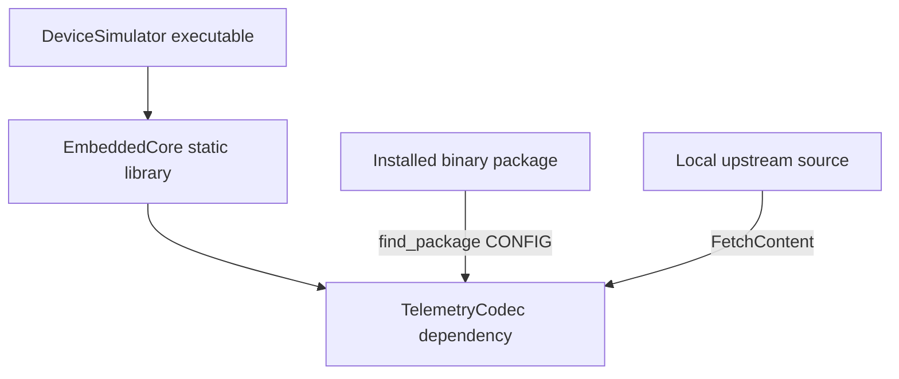
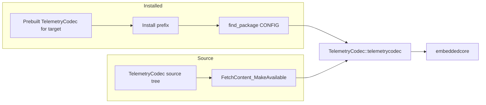
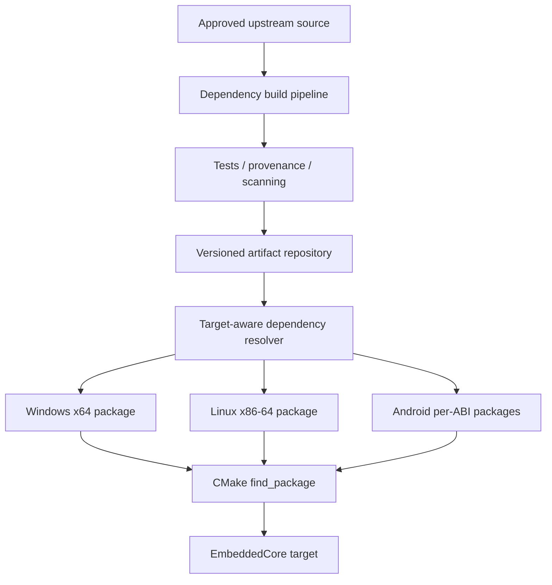

**Course navigation:** [Course home](../../README.md) · [← Chapter 10](../10-modular-projects-and-add-subdirectory/README.md) · [Chapter 12 →](../12-compiler-options-definitions-generator-expressions/README.md)

# Chapter 11 — Third-Party Dependencies: `find_package()`, Imported Targets, and `FetchContent`

> **Modern CMake University · Chapter 11 of 16 · Module IV: Dependency Management**  
> **Case study:** EmbeddedCore and DeviceSimulator  
> **Audience:** Intermediate C++ developers moving toward professional cross-platform builds  
> **Estimated time:** 5–7 hours (reading, labs, assignments)  
> **Prerequisites:** Chapters 1–10, CMake 3.20+, C++17 compiler, Ninja recommended

## Learning objectives

After completing this chapter, you should be able to:

1. Explain the difference between source-code dependencies, binary packages, headers, and runtime artifacts.
2. Differentiate CMake **Config mode** and **Module mode** package discovery.
3. Interpret `<Package>Config.cmake`, `<Package>ConfigVersion.cmake`, and `<Package>Targets.cmake`.
4. Consume a dependency through an **imported target** without hardcoding header/library paths.
5. Use `CMAKE_PREFIX_PATH`, `TelemetryCodec_DIR`, diagnostic flags, and cache inspection to troubleshoot discovery.
6. Integrate an upstream CMake project using `FetchContent` and understand its configure-time behavior.
7. Build and install a small external library, then consume it from EmbeddedCore.
8. Design an offline, reproducible build and discuss trust, version pinning, licensing, and artifact provenance.
9. Distinguish native Windows/Linux dependency selection from Android cross-compilation and multi-ABI packaging.
10. Choose an appropriate dependency approach for development, production, and CI/CD.

## Chapter roadmap

- **Part I:** Why dependency management is harder than adding a header
- **Part II:** Installed packages, Config mode, Module mode and imported targets
- **Part III:** `FetchContent`, source integration and reproducibility
- **Part IV:** A complete EmbeddedCore hands-on lab, two build methods
- **Part V:** Architecture-specific design, failure analysis, assignments and quiz

---

## 1. A realistic dependency problem

We have a modular C++ device application with Sensors, Diagnostics, Transport, a DeviceController, and DeviceSimulator. Now imagine the transport team wants every sensor reading encoded into a compact telemetry message. We could write all that code ourselves, but software engineering frequently depends on libraries maintained by other teams or projects.

For this lab, the fictional external library is **TelemetryCodec**, version **1.2.0**. It converts `25.5` into the message `TEMP:25.5`. It is deliberately small, portable, and does **not** depend on OpenSSL, hardware, a network account, or a proprietary binary repository. Small code lets us observe the build mechanisms clearly. It should not be mistaken for an industry-standard telemetry protocol.

### Conceptual architecture



The application code is identical in both builds. Only the means of supplying `TelemetryCodec::telemetrycodec` changes. This is a powerful design property: **the consumer should depend on a stable interface, not on the dependency-fetching mechanism.**

### Three different artifacts that are easy to confuse

| Item | Example | Why it exists |
|---|---|---|
| Header | `telemetrycodec/codec.hpp` | Declares functions/types to the compiler |
| Binary library | `telemetrycodec.lib`, `libtelemetrycodec.a` | Contains implementations for the linker |
| Package metadata | `TelemetryCodecConfig.cmake`, `TelemetryCodecTargets.cmake` | Tells CMake how to find and use the library |

If you copy only the header, compilation may work but linking can fail. If you copy only a binary, CMake may not know which include paths, compiler definitions, or other libraries to use. If you copy only metadata, it may refer to binary files that aren't present. A usable package coordinates all relevant artifacts.

### A library is not necessarily a package

A file named `libtelemetrycodec.a` is an archive. It is not, by itself, a portable CMake package. The package should communicate how to consume the archive and, if applicable, its dependencies and configuration-specific binary locations. In modern CMake, those details are commonly represented through imported targets.

---

## 2. The mental model: find an installed dependency or bring in its source

There are two main approaches in this chapter.

**Approach A: installed package.** Somebody has already built and installed TelemetryCodec for the intended platform. Our project runs `find_package(TelemetryCodec CONFIG REQUIRED)` and uses the imported target that its package defines. This is often a good fit for carefully controlled enterprise dependencies, binary distributions, SDKs, CI artifact repositories, and cryptographic libraries.

**Approach B: source integration.** Our project brings TelemetryCodec into the configure/build graph using `FetchContent`. The external source is compiled using the consumer's current compiler and toolchain. This can be convenient for open-source projects or libraries that are straightforward to build from source.



These are not mutually exclusive organization-wide. Some teams build binary packages from trusted source in a central pipeline, then use `find_package()` in consuming projects. Other projects use a package manager or dependency provider that supplies targets through one of these interfaces.

**Do not assume `FetchContent` downloads a compiled library.** Its usual pattern is to populate source at configuration time and incorporate it into the build. `ExternalProject_Add()` has a different lifecycle and typically builds an external project as a separate build-time step; we compare it later.

---

## 3. `find_package()` from first principles

The typical modern consumption pattern is:

```cmake
find_package(TelemetryCodec 1.2 CONFIG REQUIRED)
target_link_libraries(embeddedcore PRIVATE TelemetryCodec::telemetrycodec)
```

Examine every part:

- `find_package` asks CMake to locate a dependency.
- `TelemetryCodec` is the package name; it is not necessarily the C++ target name or binary filename.
- `1.2` requests a version compatible according to the installed package's version policy.
- `CONFIG` explicitly selects package Config mode.
- `REQUIRED` turns unsuccessful discovery into a configure-time error.
- `TelemetryCodec::telemetrycodec` is the imported or alias target supplied by the package/source.

The target encapsulates consumption requirements. We don't need a manually assembled `-I... -L... -l...` string in the top-level project.

### 3.1 Config mode

Config mode searches for package-provided files including names such as:

```text
TelemetryCodecConfig.cmake
telemetrycodec-config.cmake
```

Installed CMake packages commonly place these in a directory resembling:

```text
prefix/
├── include/telemetrycodec/codec.hpp
├── lib/libtelemetrycodec.a
└── lib/cmake/TelemetryCodec/
    ├── TelemetryCodecConfig.cmake
    ├── TelemetryCodecConfigVersion.cmake
    └── TelemetryCodecTargets.cmake
```

Locations vary by OS, library directory convention, package, and install configuration. On Windows, `lib/telemetrycodec.lib` is a likely static-library artifact, and its import/export paths can vary by generator/configuration.

Config files are CMake scripts. They are not executable application binaries and are not automatically generated by `find_package` itself; they must be supplied or generated by the package producer.

### 3.2 Module mode

Module mode searches for an appropriately named `FindTelemetryCodec.cmake` module, possibly provided by CMake itself or your project. A custom module can discover headers and binaries and define an imported target. Modules are helpful when the upstream library does not provide a CMake package config.

```cmake
list(APPEND CMAKE_MODULE_PATH "${CMAKE_CURRENT_SOURCE_DIR}/cmake/modules")
find_package(TelemetryCodec MODULE REQUIRED)
```

Never assume an official `FindTelemetryCodec.cmake` exists; our lab specifically exports a **Config package**, so we use `CONFIG`.

### 3.3 What if `CONFIG` is omitted?

With the basic `find_package(Package ...)` signature, CMake normally considers Module mode first, then Config mode, subject to configuration and options. `CMAKE_FIND_PACKAGE_PREFER_CONFIG` can prefer Config mode. Explicit `CONFIG` avoids that ambiguity when you deliberately require an upstream CMake package.

### 3.4 Prefix versus package directory

Suppose TelemetryCodec is installed to `/opt/course/deps`:

```bash
cmake -S . -B build -DCMAKE_PREFIX_PATH=/opt/course/deps
```

CMake searches appropriate subdirectories of that *prefix* to locate the package. On the other hand, `TelemetryCodec_DIR` typically points directly to the directory containing `TelemetryCodecConfig.cmake`:

```bash
cmake -S . -B build -DTelemetryCodec_DIR=/opt/course/deps/lib/cmake/TelemetryCodec
```

The exact case of the package-specific variable matches the package name. Avoid confusing the two settings. Both can be present in the CMake cache; stale values can become a subtle source of wrong-version or wrong-architecture discovery.

### 3.5 Imported targets are a dependency contract

Once CMake has found the package, `TelemetryCodec::telemetrycodec` may carry:

- `IMPORTED_LOCATION` (or configuration-specific locations);
- include directories required by consumers;
- transitive link dependencies;
- compile features, definitions, or options;
- Windows import-library locations and runtime DLL locations when appropriate.

You can query selected properties for diagnosis:

```cmake
get_target_property(_incs TelemetryCodec::telemetrycodec INTERFACE_INCLUDE_DIRECTORIES)
message(STATUS "TelemetryCodec includes: ${_incs}")
```

Don't hardcode `IMPORTED_LOCATION` unless you understand the platform and configuration: imported targets can have different artifacts for Debug, Release, and different toolchains. Some properties may be unset by design.

### 3.6 Why `PRIVATE` here?

Our public EmbeddedCore headers expose `std::string`, not any TelemetryCodec type. Only `src/telemetry.cpp` includes the external header, so the compile dependency is an implementation detail:

```cmake
target_link_libraries(embeddedcore PRIVATE TelemetryCodec::telemetrycodec)
```

**Important nuance for static archives:** CMake can still propagate a private static-library link dependency to the eventual link consumer in a link-only form, because object files in the static archive may contain unresolved external references. `PRIVATE` does not promise that the final executable never needs the dependency.

If a public EmbeddedCore header exposed a TelemetryCodec type, we would likely need to publish its relevant usage requirements and revisit the API contract.

---

## 4. The package producer's responsibility

So far we've viewed package discovery from the consumer. But where does the config package come from?

Our fictional TelemetryCodec is itself a CMake project with:

```cmake
cmake_minimum_required(VERSION 3.20)
project(TelemetryCodec VERSION 1.2.0 LANGUAGES CXX)
include(GNUInstallDirs)
include(CMakePackageConfigHelpers)

add_library(telemetrycodec STATIC src/codec.cpp)
add_library(TelemetryCodec::telemetrycodec ALIAS telemetrycodec)

target_include_directories(telemetrycodec PUBLIC
    $<BUILD_INTERFACE:${CMAKE_CURRENT_SOURCE_DIR}/include>
    $<INSTALL_INTERFACE:${CMAKE_INSTALL_INCLUDEDIR}>
)
```

The `BUILD_INTERFACE` is intended for use when the library is built as part of a source tree. The `INSTALL_INTERFACE` is intended for consumers of its installed package. Relative paths inside installation usage requirements support relocatable packages; embedding a developer's absolute source directory into installed metadata is a common mistake.

The complete runnable producer uses:

```cmake
install(TARGETS telemetrycodec EXPORT TelemetryCodecTargets
    ARCHIVE DESTINATION ${CMAKE_INSTALL_LIBDIR}
    LIBRARY DESTINATION ${CMAKE_INSTALL_LIBDIR}
    RUNTIME DESTINATION ${CMAKE_INSTALL_BINDIR}
)

install(EXPORT TelemetryCodecTargets
    NAMESPACE TelemetryCodec::
    DESTINATION ${CMAKE_INSTALL_LIBDIR}/cmake/TelemetryCodec
)
```

Here `install(EXPORT ...)` generates a `TelemetryCodecTargets.cmake` file. It describes the installed imported target, not an automatically compiled binary or another project to build.

The package additionally generates `TelemetryCodecConfig.cmake` and `TelemetryCodecConfigVersion.cmake` through `configure_package_config_file()` and `write_basic_package_version_file()`. The version file's compatibility policy determines how requests are evaluated; `1.2` alone does not guarantee that every version called `1.2.x` or `1.9.x` is ABI-compatible.

**Producer and consumer responsibilities are distinct:** the producer publishes correct target metadata; the consumer selects a compatible package and links it using the published target.

---

## 5. `FetchContent`: bring source into the project

Suppose the TelemetryCodec source is available locally:

```text
vendor/telemetrycodec/
├── CMakeLists.txt
├── include/
└── src/
```

The consumer can declare:

```cmake
include(FetchContent)
FetchContent_Declare(TelemetryCodec
    SOURCE_DIR "${CMAKE_CURRENT_SOURCE_DIR}/vendor/telemetrycodec"
)
FetchContent_MakeAvailable(TelemetryCodec)
```

Because the source project defines the alias target `TelemetryCodec::telemetrycodec`, the rest of the CMakeLists.txt can be identical to the package mode.

### 5.1 Why use a local source in a course?

A public tutorial should remain runnable years later. Remote Git tags may disappear, services may throttle requests, and security policies may block outbound network access. Using `SOURCE_DIR` for our lab makes both the code and the dependency integration deterministic. The student can explicitly inspect the upstream library's own CMakeLists.txt.

### 5.2 A real pinned remote source example

Production source integration may instead use a pinned commit:

```cmake
include(FetchContent)
FetchContent_Declare(ExampleDependency
    GIT_REPOSITORY https://example.invalid/example-dependency.git
    GIT_TAG 0123456789abcdef0123456789abcdef01234567
)
FetchContent_MakeAvailable(ExampleDependency)
```

The URL is **deliberately nonfunctional**: this fragment teaches the structure without relying on a real repository or inventing a valid commit. Replace it with a vetted upstream URL and an actual immutable commit ID. Avoid floating branch names such as `main` for reproducible production builds.

For release tarballs, a verified SHA-256 hash via `URL_HASH SHA256=...` is a common integrity measure. The hash must match the downloaded artifact; do not fabricate a checksum.

### 5.3 Configure time, not simply link time

`FetchContent_MakeAvailable` operates as part of project configuration. It can fetch/populate content and make an upstream CMake project available in the main build. That differs from linking a previously built static or shared binary found through `find_package`.

Bringing another source project into the same build means its options, targets, policies, and dependencies may interact with the enclosing project. Upstream CMake quality matters.

### 5.4 Offline behavior and reproducibility

`FETCHCONTENT_FULLY_DISCONNECTED` can be useful when sources are already available, but it is not a magical download cache. Do not assume enabling it will populate absent sources. In our example we specify an existing `SOURCE_DIR`, so network access is unnecessary regardless.

For a hermetic release pipeline, design how dependencies enter the build environment **before** configuration. Audit provenance and verify hashes and signatures where provided. If a dependency is mandatory and cannot be found or verified, fail clearly rather than silently changing library versions or security modes.

### 5.5 Relationship to providers and package managers

`FetchContent` and `find_package` can be coordinated by package managers, dependency providers, and newer CMake mechanisms. For this course, we deliberately keep two explicit modes so beginners can see exactly which path is active. When moving to vcpkg, Conan, enterprise artifact repositories, or dependency providers, define one controlled policy for how dependencies are resolved.

---

## 6. Complete lab architecture

The Chapter 11 solution has the following essential layout:

```text
solution/
├── CMakeLists.txt
├── CMakePresets.json
├── app/main.cpp
├── include/embeddedcore/
│   ├── sensor.hpp
│   └── telemetry.hpp
├── src/
│   ├── sensor.cpp
│   └── telemetry.cpp
├── tests/telemetry_test.cpp
└── vendor/telemetrycodec/
    ├── CMakeLists.txt
    ├── cmake/TelemetryCodecConfig.cmake.in
    ├── include/telemetrycodec/codec.hpp
    └── src/codec.cpp
```

The source dependency is *packaged with the lesson*. No secrets, internal Nexus endpoints, commercial binary distributions, proprietary source code, or live network requests are needed.

### 6.1 The external library

`vendor/telemetrycodec/include/telemetrycodec/codec.hpp` declares:

```cpp
#pragma once
#include <string>
namespace telemetrycodec {
std::string encode_temperature(double celsius);
}
```

`vendor/telemetrycodec/src/codec.cpp` implements the function:

```cpp
#include "telemetrycodec/codec.hpp"
#include <iomanip>
#include <sstream>

namespace telemetrycodec {
std::string encode_temperature(double celsius) {
    std::ostringstream stream;
    stream << "TEMP:" << std::fixed
           << std::setprecision(1) << celsius;
    return stream.str();
}
}
```

This is a compile-time library dependency rather than a remotely called service. It shows us where the C++ header and linker inputs enter the build.

### 6.2 EmbeddedCore adapts the external interface

Our public header stays independent of TelemetryCodec:

```cpp
#pragma once
#include <string>
namespace embeddedcore {
std::string make_telemetry();
}
```

The implementation uses the external header:

```cpp
#include "embeddedcore/telemetry.hpp"
#include "embeddedcore/sensor.hpp"
#include "telemetrycodec/codec.hpp"

namespace embeddedcore {
std::string make_telemetry() {
    return telemetrycodec::encode_temperature(read_temperature());
}
}
```

The application prints `Telemetry: TEMP:25.5`. If a future TelemetryCodec version changes implementation while preserving its API contract, our application is insulated by the EmbeddedCore facade.

### 6.3 Choose a dependency mode

The solution deliberately introduces a cache variable:

```cmake
set(EMBEDDEDCORE_DEPENDENCY_MODE "PACKAGE" CACHE STRING "PACKAGE or FETCH")

if(EMBEDDEDCORE_DEPENDENCY_MODE STREQUAL "PACKAGE")
    find_package(TelemetryCodec 1.2 CONFIG REQUIRED)
elseif(EMBEDDEDCORE_DEPENDENCY_MODE STREQUAL "FETCH")
    include(FetchContent)
    FetchContent_Declare(TelemetryCodec
        SOURCE_DIR "${CMAKE_CURRENT_SOURCE_DIR}/vendor/telemetrycodec"
    )
    FetchContent_MakeAvailable(TelemetryCodec)
else()
    message(FATAL_ERROR "Unknown dependency mode")
endif()
```

The common consumer code is independent of how the target was obtained:

```cmake
add_library(embeddedcore STATIC src/sensor.cpp src/telemetry.cpp)
target_include_directories(embeddedcore PUBLIC
    "${CMAKE_CURRENT_SOURCE_DIR}/include"
)
target_link_libraries(embeddedcore PRIVATE TelemetryCodec::telemetrycodec)
add_executable(DeviceSimulator app/main.cpp)
target_link_libraries(DeviceSimulator PRIVATE embeddedcore)
```

This is one reason target-based APIs are central to modern CMake.

---

## 7. Hands-on experiment A — Create and consume an installed package

Use a **new build tree** for this exercise. Execute all commands from `labs/11-third-party-dependencies-find-package-fetchcontent/solution`.

### Linux: build and install TelemetryCodec

```bash
cmake -S vendor/telemetrycodec -B build/codec -G Ninja \
  -DCMAKE_INSTALL_PREFIX="$PWD/build/prefix"
cmake --build build/codec
cmake --install build/codec
```

The installed prefix now contains the header, static archive, config file, generated targets file, and version file.

**Inspect the output:**

```bash
find build/prefix -type f | sort
```

Ask: Which files are used by the compiler? Which are consumed by the linker? Which are read by CMake at configuration time?

### Linux: locate the package

```bash
cmake -S . -B build/package -G Ninja \
  -DEMBEDDEDCORE_DEPENDENCY_MODE=PACKAGE \
  -DCMAKE_PREFIX_PATH="$PWD/build/prefix"
cmake --build build/package --verbose
ctest --test-dir build/package --output-on-failure
./build/package/DeviceSimulator
```

Expected application output:

```text
Embedded Device Simulator
Temperature: 25.5 C
Device status: HEALTHY
Telemetry: TEMP:25.5
```

### Windows: Visual Studio 2019 x64 Native Tools Command Prompt

```bat
cmake -S vendor/telemetrycodec -B build/codec -G Ninja -DCMAKE_INSTALL_PREFIX=%CD%/build/prefix
cmake --build build/codec
cmake --install build/codec
cmake -S . -B build/package -G Ninja -DEMBEDDEDCORE_DEPENDENCY_MODE=PACKAGE -DCMAKE_PREFIX_PATH=%CD%/build/prefix
cmake --build build/package --verbose
ctest --test-dir build/package --output-on-failure
build\package\DeviceSimulator.exe
```

If Ninja isn't installed in your MSVC environment, you can use Visual Studio's generator instead, keeping producer and consumer configurations compatible. For a multi-config generator, specify `--config Debug` or `--config Release` when building, installing and testing. The commands above intentionally use Ninja for a simpler single-config lesson.

### Explain the result

`find_package()` didn't build TelemetryCodec. It discovered the previously installed metadata and created or exposed `TelemetryCodec::telemetrycodec`. The executable was linked against the compatible library artifact.

Observe how a different prefix—or an incompatible library—could change the outcome. This is why CI artifact repository paths and toolchain parameters must be controlled.

---

## 8. Hands-on experiment B — Use `FetchContent` instead

On Linux:

```bash
cmake -S . -B build/fetch -G Ninja \
  -DEMBEDDEDCORE_DEPENDENCY_MODE=FETCH
cmake --build build/fetch --verbose
ctest --test-dir build/fetch --output-on-failure
./build/fetch/DeviceSimulator
```

On Windows:

```bat
cmake -S . -B build/fetch -G Ninja -DEMBEDDEDCORE_DEPENDENCY_MODE=FETCH
cmake --build build/fetch --verbose
ctest --test-dir build/fetch --output-on-failure
build\fetch\DeviceSimulator.exe
```

Here the external library source is part of the same generated build graph. The dependency is built with the current toolchain rather than selected as a prebuilt artifact from a prefix.

### Compare artifacts and build commands

Use:

```bash
cmake --build build/package --verbose
cmake --build build/fetch --verbose
```

For a stronger comparison, delete only the two **build directories** and rebuild fresh; incremental builds may print no compile commands if nothing changed. Observe that Fetch mode compiles TelemetryCodec source as part of the consumer build, while Package mode links to the previously installed archive.

### Experiment: change only TelemetryCodec

Change the prefix text in `vendor/telemetrycodec/src/codec.cpp` from `TEMP:` to `SENSOR:`. Rebuild Fetch mode and observe the changed output. Rebuild Package mode **without reinstalling** TelemetryCodec: it still uses the installed binary, so output should remain the same. Reinstalling a new producer package may require reconfiguring/rebuilding the consumer, depending on which metadata and artifacts changed.

This is a concrete demonstration of **source dependency versus installed binary dependency**.

---

## 9. Package diagnostics: learn to investigate rather than guess

### Error: could not find `TelemetryCodecConfig.cmake`

First confirm the package was installed, then inspect:

```bash
find build/prefix -name 'TelemetryCodecConfig.cmake' -print
```

Next inspect your consumer cache:

```bash
cmake -LAH -N build/package
```

Look for `CMAKE_PREFIX_PATH` and `TelemetryCodec_DIR`. Remove or reset stale cache entries instead of repeatedly changing random source files. For high-confidence diagnosis, configure a **clean** build directory with:

```bash
cmake -S . -B build/debug-find -G Ninja \
  -DEMBEDDEDCORE_DEPENDENCY_MODE=PACKAGE \
  -DCMAKE_PREFIX_PATH="$PWD/build/prefix" \
  -DCMAKE_FIND_DEBUG_MODE=ON
```

The debug log can be very long. Read the package search locations and the selected config path before concluding that the library was not built.

### Error: target exists but header cannot be found

Check whether the imported target publishes a suitable `INTERFACE_INCLUDE_DIRECTORIES` property. The producer must export its installed include path; manually adding include directories to every consumer masks a broken package and reduces portability.

### Error: unresolved external symbol or undefined reference

Headers are only declarations. Confirm that the correct prebuilt library is being linked, that the function signature matches, and that the binary is for the correct architecture/ABI. On Windows, verify that the library's runtime/toolset assumptions are compatible; on Linux, inspect `nm`, `readelf`, and linkage where applicable.

### Error: version rejected

Try requesting `find_package(TelemetryCodec 2.0 CONFIG REQUIRED)`. Our producer declares version 1.2.0 with a SameMajorVersion compatibility policy; requesting 2.0 should fail. The version file enforces the producer's declared compatibility mechanism, not an automatic guarantee that arbitrary API/ABI changes are safe.

### Error: fetched source cannot be configured

If the local `SOURCE_DIR` is absent, `FetchContent` cannot make an appropriate project available. If upstream source exists but its `CMakeLists.txt` has unsupported commands or inconsistent options, the problem is in dependency integration rather than the application source.

---

## 10. Platform and architecture matrix

This section distinguishes **host** (where CMake executes) from **target** (where compiled code will run). This distinction is vital for embedded development.

| Target | Example architecture | Typical binary package | Primary risk |
|---|---|---|---|
| Windows | x64 MSVC | `.lib`, `.dll`, CMake config | Wrong toolset/runtime/configuration |
| Linux | x86-64 | `.a`, `.so`, CMake config | Wrong architecture, libc, libstdc++ ABI, glibc baseline |
| Android | `armeabi-v7a` | NDK-built `.a` or `.so` | ABI/API-level/NDK mismatch |
| Android | `arm64-v8a` | NDK-built `.a` or `.so` | Wrong ABI, unsupported API level |
| Android | `x86_64` | NDK-built `.a` or `.so` | Wrong CPU architecture or toolchain |

**Each target needs a compatible artifact or a source build using the correct target toolchain.** Building on an x64 Linux host does not make a native Linux library appropriate for Android ARM64.

### Example: Android ARM64 source integration

With a valid Android NDK installation, the project can conceptually be configured using:

```bash
cmake -S . -B build/android-arm64-fetch -G Ninja \
  -DCMAKE_TOOLCHAIN_FILE="$ANDROID_NDK_HOME/build/cmake/android.toolchain.cmake" \
  -DANDROID_ABI=arm64-v8a \
  -DANDROID_PLATFORM=android-24 \
  -DEMBEDDEDCORE_DEPENDENCY_MODE=FETCH
```

`$ANDROID_NDK_HOME` must reference a real NDK directory. This lab doesn't deploy an Android app or run an Android executable. Its simple source dependency is portable by design, but the Android build requires a configured NDK and has **not** been validated here.

### Example: Android ARM64 installed package

For Package mode, the producer package must first be built and installed for **the same target architecture and compatible Android toolchain/API level**. Then configure the consumer using that Android toolchain and prefix. Do not point `CMAKE_PREFIX_PATH` at a Linux x86-64 package just because both installations include `TelemetryCodecConfig.cmake`.

### One target = one build tree

A multi-config generator can contain Debug and Release variants for one platform/ABI, but it does **not** turn an ARM64 target build tree into an x86-64 build tree. Keep independent configurations for:

```text
build/
├── windows-x64/
├── linux-x86_64/
├── android-armeabi-v7a/
├── android-arm64-v8a/
└── android-x86_64/
```

If using Ninja Multi-Config, Debug and Release can coexist inside each of those target-specific trees. For dependencies, the package manager or resolver must select the correct variant per target and configuration.

### How we will use this for OpenSSL later

In Chapter 14, we'll adapt these principles to OpenSSL. Some architectures may require a specifically approved cryptographic build, while others use different supplied packages. We must never silently substitute another provider when a required cryptographic variant is missing. A library name or a claimed FIPS label does not establish compliance: validation, configuration, approved module boundaries, operational controls, and platform context matter.

---

## 11. Reproducible builds and enterprise policy

A dependency is not reproducible merely because you wrote its version into a README. A build should have an explicit answer for:

- **Identity:** library name, authoritative source, version, immutable revision.
- **Integrity:** verified checksums, signatures, or trusted artifact metadata.
- **Compatibility:** target OS, processor, ABI, runtime, compiler, configuration, minimum OS/API version.
- **Provenance:** who produced the binary and using which toolchain/flags.
- **Licensing:** whether source, binary, and notices can be redistributed.
- **Security:** vulnerability monitoring, update process, scanning, and controlled exceptions.
- **Availability:** deterministic offline build, caching, mirror strategy, and failure policy.
- **Traceability:** recorded dependency selection in build logs and release manifest.

### Example architecture for an artifact repository



Keep package downloading separate from dependency consumption when doing so improves auditability. For example, CI can select and verify an artifact into a known staging prefix and then invoke CMake with `-DCMAKE_PREFIX_PATH=<verified-prefix>`.

An installed config file might be perfectly valid while referring to an inappropriate binary. **CMake discovery success is not proof of deployment compatibility or security approval.**

### Avoid hidden fallback behavior

Do not implement logic equivalent to "if approved cryptographic package is unavailable, use an arbitrary default system package". Such a fallback can produce a passing build with the wrong security properties. Explicit failure and clear diagnostics are preferable.

---

## 12. `FetchContent` versus `ExternalProject_Add()` versus package managers

| Mechanism | Typical entry point | When dependency becomes available | Common use |
|---|---|---|---|
| `find_package()` | Installed package config / Find module | Configure time discovery | Consuming prepared dependencies |
| `FetchContent` | Source/archive/revision | Configure-time population and integration | Source dependencies in same build |
| `ExternalProject_Add()` | External project specification | Separate build-time project steps | Tool/bootstrap builds and isolated projects |
| Package manager | vcpkg / Conan / enterprise mechanism | Varies by integration | Coordinated versioning, binary packages, toolchains |

This comparison isn't a claim that one method is universally best. A large project may use all of them at different boundaries. The key is to make the dependency contract explicit to downstream targets and to avoid accidental selection of incompatible artifacts.

---

## 13. Testing and CI validation

Both PACKAGE and FETCH modes build the **same** EmbeddedCore interface and run a small contract test asserting `TEMP:25.5`. The package includes a GitHub Actions workflow with a Windows/Linux matrix and both modes. The workflow is provided for your repository; running it on GitHub is separate from our local Linux validation.

A robust production matrix would additionally validate packaging, ABI compatibility, clean-environment consumption, licenses, tests, source provenance, and platform-specific deployment. Chapter 15 will extend CTest and installation validation, while Chapter 16 will build an explicit CI target matrix.

**Useful diagnostics:**

```bash
cmake --build build/fetch --verbose
ctest --test-dir build/fetch --output-on-failure
cmake -LAH -N build/package
```

On Linux, tools such as `file`, `nm`, `readelf`, and `ldd` can offer clues about binary format and linkage. `ldd` should not be executed casually on unknown/untrusted binaries. On Windows, MSVC tools such as `dumpbin /headers` and `dumpbin /dependents` can help identify architecture and dependencies.

---

## 14. Troubleshooting reference

| Failure | Likely root cause | Investigative action |
|---|---|---|
| Package config missing | Prefix omitted/wrong | Check install tree and `CMAKE_PREFIX_PATH` |
| Wrong package version | Stale cache or incompatible version | Inspect `<Package>_DIR` and version file |
| Imported target missing | Package config fails to import/export targets | Inspect generated targets file |
| Header not found | Missing `INTERFACE_INCLUDE_DIRECTORIES` | Query target property |
| Unresolved linker symbol | Missing definition, wrong binary, wrong link interface | Inspect link command and object symbols |
| `file format not recognized` | Wrong architecture/object format | Inspect binary with `file` or `dumpbin` |
| Wrong Debug/Release library | Incompatible config selection | Inspect imported configuration mappings |
| Android toolchain failure | Missing NDK, bad ABI or API setting | Validate NDK path and toolchain |
| FetchContent can't populate | Missing source/invalid URL | Verify source path, hash or revision |
| Different output in two modes | Installed archive differs from source | Record exact versions and rebuild inputs |
| Successful build, runtime failure | Missing shared-library deployment | Review Chapter 9 dynamic loading |
| Build succeeds with wrong crypto | Silent fallback | Require exact approved package and fail closed |

### An investigation sequence worth memorizing

1. Confirm **which dependency mode** is active.
2. Confirm **which package or source revision** was selected.
3. Confirm the **target OS, CPU architecture, ABI, runtime and configuration**.
4. Inspect CMake's **configuration cache and discovery diagnostics**.
5. Inspect the **target's usage requirements**, compile command, and link command.
6. Validate the **resulting binary** and run tests on the intended target environment.

---

## 15. Guided assignments

**Assignment 1 — Version negotiation (20 points).** Install version 1.2.0 of TelemetryCodec. Request minimum 1.2, then 2.0. Record errors and explain the package version policy. Optional extension: create 1.3.0 and compare compatibility under SameMajorVersion.

**Assignment 2 — Deliberate header failure (15 points).** Remove the installed include requirement from a temporary producer copy. Observe the consumer compilation error. Repair the target contract and reinstall the package. Do not solve it by hardcoding include paths in DeviceSimulator.

**Assignment 3 — Package/source divergence (15 points).** Modify the vendor source and compare outputs between FETCH and PACKAGE modes without reinstalling. Explain what is actually linked in each mode.

**Assignment 4 — Target graph and link interface (15 points).** Query `INTERFACE_LINK_LIBRARIES` on EmbeddedCore and inspect the executable's verbose link command. Explain why the library can be PRIVATE for compilation but needed by a static-library consumer's final link.

**Assignment 5 — Offline pipeline design (15 points).** Write a plan for building this lab on a CI runner with no internet access. Distinguish package staging from bundled source, include integrity checks, and identify the inputs that must be version-controlled or cached.

**Assignment 6 — Multi-platform package-selection design (20 points).** Draft a manifest schema mapping Windows x64, Linux x86-64, Android `armeabi-v7a`, Android `arm64-v8a`, and Android `x86_64` to exact package versions and hashes. State which variants can be reused across configurations and which must be separately built. No actual Android NDK is required for this design assignment.

**Total: 100 points.** Bonus challenge: implement a tiny `FindTelemetryCodec.cmake` using `find_path()`, `find_library()`, and `add_library(... IMPORTED)`, then contrast it with the installed Config package. Keep the Module-mode implementation in a separate experiment; don't accidentally mask the Config mode being tested.

---

## 16. Knowledge check (12 questions)

1. What is the difference between a library archive and a CMake package?
2. Which file does `find_package(TelemetryCodec CONFIG REQUIRED)` primarily look for?
3. How does Config mode differ from Module mode?
4. What is the difference between `CMAKE_PREFIX_PATH` and `TelemetryCodec_DIR`?
5. Why is `TelemetryCodec::telemetrycodec` preferable to a raw library filename?
6. Why might a PRIVATE static-library dependency still affect an executable's final link?
7. What does `FetchContent_MakeAvailable()` do, and when?
8. Why is a floating `GIT_TAG main` weak for reproducibility?
9. Why must Android ARM64 not consume a host Linux x86-64 static archive?
10. What does a package version file do, and what does it not guarantee?
11. When should a package config invoke `find_dependency()`?
12. Why is silently switching to a different cryptographic provider a dangerous fallback?

The answer key is provided separately under `solutions/11-third-party-dependencies-find-package-fetchcontent/quiz-answers.md`.

---

## 17. Chapter summary

- CMake dependency integration has **discovery**, **target contract**, **binary compatibility**, and **reproducibility** dimensions.
- `find_package(CONFIG)` consumes an installed package that publishes relevant CMake metadata and imported targets.
- `FetchContent` can make upstream source part of the configured build; our course example is fully local and network-free.
- The **same downstream target name** can abstract the upstream integration mechanism.
- `PRIVATE` / `PUBLIC` / `INTERFACE` describe usage requirements, not a promise that static archives swallow all dependency binaries.
- Target architecture, ABI, OS, toolchain, runtime and build configuration must be compatible.
- Correct package selection needs explicit versioning, provenance, integrity checks, licensing, and failure policies.

### How this builds toward the capstone

In Chapter 12 we'll control compiler flags, compile definitions, and generator expressions on a per-target basis. Chapter 13 introduces toolchain files and cross compilation. Chapter 14 applies dependency selection to architecture-specific OpenSSL packages without unsafe fallback. Chapters 15–16 make the result installable, testable, and repeatable in CI.

## Official references

- [CMake: Using Dependencies Guide](https://cmake.org/cmake/help/latest/guide/using-dependencies/index.html)
- [CMake: `find_package()`](https://cmake.org/cmake/help/latest/command/find_package.html)
- [CMake: FetchContent](https://cmake.org/cmake/help/latest/module/FetchContent.html)
- [CMake: CMakePackageConfigHelpers](https://cmake.org/cmake/help/latest/module/CMakePackageConfigHelpers.html)
- [CMake: install](https://cmake.org/cmake/help/latest/command/install.html)
- [CMake: Cross Compiling](https://cmake.org/cmake/help/latest/manual/cmake-toolchains.7.html#cross-compiling)

**Next chapter: Chapter 12 — Compiler Options, Compile Definitions, and Generator Expressions.**

---

**Course navigation:** [Course home](../../README.md) · [← Chapter 10](../10-modular-projects-and-add-subdirectory/README.md) · [Chapter 12 →](../12-compiler-options-definitions-generator-expressions/README.md)

