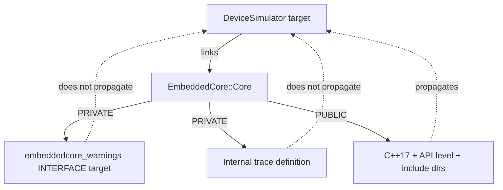
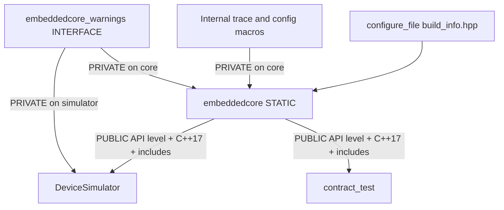

# Chapter 12 — Compiler Options, Compile Definitions, and Generator Expressions

> **Modern CMake University · Chapter 12 of 16 · Module IV: Professional Build Configuration**  
> **Case study:** EmbeddedCore + DeviceSimulator  
> **Level:** Intermediate to advanced  
> **Time:** 5–8 hours (theory, labs, exercises)  
> **Prerequisites:** Chapters 1–11; CMake 3.20+; a C++17 compiler; Ninja recommended

## Learning objectives

After completing this chapter, you should be able to:

1. Differentiate compilation flags, preprocessor definitions, language features, include paths, and link flags.
2. Implement target-local warning policy without contaminating other targets.
3. Use `target_compile_options()`, `target_compile_definitions()`, `target_compile_features()`, and `target_link_options()` appropriately.
4. Predict the propagation of `PRIVATE`, `PUBLIC`, and `INTERFACE` properties across a target graph.
5. Read and write `$<...>` generator expressions, including nested conditions and configuration-dependent options.
6. Distinguish configure-time `if()` statements from generate-time expressions—especially in multi-config builds.
7. Apply compiler-specific settings for MSVC, GCC, Clang, and clang-cl without assuming all compilers accept the same flags.
8. Identify host-versus-target mistakes in Windows/Linux/Android cross-compilation.
9. Inspect actual compile commands and generated target properties instead of trusting configuration intent alone.
10. Build, test, and diagnose the same library in Debug, Release, and Ninja Multi-Config modes.

---

## 1. Why this chapter matters

In Chapter 11 we learned to link EmbeddedCore to a stable external target, `TelemetryCodec::telemetrycodec`, no matter how that dependency was obtained. That approach creates a new responsibility: **each library must publish only the requirements that consumers genuinely need**.

Consider three policies:

- EmbeddedCore must use C++17 to build.
- Its public headers require a macro called `EMBEDDEDCORE_API_LEVEL=2`.
- Its own implementation wants strong compiler warnings and an optional diagnostic trace macro.

These are not interchangeable. C++17 is a language feature requirement. The API macro is a public preprocessor definition. Warning and tracing settings are normally implementation policy, not part of the public API. Misclassify them, and the build may be fragile or its behavior may change silently when dependencies are updated.

Imagine `DeviceSimulator` links `EmbeddedCore::Core`. The consumer should inherit C++17 and the public API-level definition. It should **not** inherit `EMBEDDEDCORE_INTERNAL_TRACE`, because that definition exists solely to build EmbeddedCore's implementation.



The purpose of modern CMake is not to find a clever set of global flags. It is to **describe precise requirements on the targets that need them**.

### Five distinct categories of build settings

| Category | CMake command | Example | What it changes |
|---|---|---|---|
| Compile options | `target_compile_options()` | `-Wall`, `/W4` | Compiler invocation |
| Compile definitions | `target_compile_definitions()` | `DEVICE_SIMULATOR_DEBUG=1` | Preprocessor macro environment |
| Compile features | `target_compile_features()` | `cxx_std_17` | Required language capability |
| Include directories | `target_include_directories()` | `include/` | Header lookup paths |
| Link options | `target_link_options()` | linker-specific switch | Linker invocation |

**Important:** Passing `-Wl,...` or `/link ...` through compile options is usually the wrong abstraction. Likewise, forcing `-std=c++17` or `/std:c++17` yourself is usually less portable than declaring `cxx_std_17`.

---

## 2. Target properties: CMake's underlying model

Most target commands edit CMake target properties. For example:

```cmake
add_library(embeddedcore STATIC src/sensor.cpp)

target_compile_definitions(embeddedcore PUBLIC
    EMBEDDEDCORE_API_LEVEL=2
)
```

CMake conceptually stores two categories of definitions:

- `COMPILE_DEFINITIONS`: definitions used to compile EmbeddedCore itself.
- `INTERFACE_COMPILE_DEFINITIONS`: definitions that consumers of EmbeddedCore should use.

`PUBLIC` populates both. `PRIVATE` populates only the target's own compilation requirement. `INTERFACE` populates only the consumer-facing requirement. The same model applies to include directories, compile options, and language features, with their corresponding properties.

| Keyword | Compiles target with it? | Consumers receive it? | Typical use |
|---|---:|---:|---|
| `PRIVATE` | Yes | No | Implementation warning flags or internal feature toggles |
| `PUBLIC` | Yes | Yes | A public header's required macro, public include path |
| `INTERFACE` | No | Yes | Header-only library or requirements-only target |

For static libraries, remember a nuance from Chapter 8: **link dependencies** can require special transitive handling at the final link stage. That is not a reason to publish all compile options. Compilation requirements and link implementation details are distinct.

### Why not use global flags?

```cmake
# Avoid as a default architecture for reusable projects:
set(CMAKE_CXX_FLAGS "${CMAKE_CXX_FLAGS} -Wall")
add_definitions(-DEMBEDDEDCORE_INTERNAL_TRACE)
include_directories(include)
```

These commands make the configuration harder to audit. Their effects are broader and less explicit than target-local declarations. They may also affect third-party code or tests that were never designed for your warning policy.

Prefer:

```cmake
target_compile_options(embeddedcore PRIVATE -Wall)
target_compile_definitions(embeddedcore PRIVATE EMBEDDEDCORE_INTERNAL_TRACE=1)
target_include_directories(embeddedcore PUBLIC "${CMAKE_CURRENT_SOURCE_DIR}/include")
```

This example intentionally uses a GCC-style flag. We'll make warning flags compiler-portable next.

---

## 3. Compile options across compiler families

A compiler flag is not standardized merely because C++ is standardized.

| Purpose | GCC / Clang (GNU-style driver) | MSVC / clang-cl (MSVC-style driver) |
|---|---|---|
| Common warnings | `-Wall -Wextra` | `/W4` |
| Pedantic language diagnostics | `-Wpedantic` | No exact one-to-one equivalent |
| Debug symbols | Commonly `-g` | Commonly `/Zi` |
| Optimization | Commonly `-O2` | Commonly `/O2` |
| Treat warnings as errors | `-Werror` | `/WX` |
| Include path | `-I...` | `/I...` |
| Macro definition | `-DNAME=value` | `/DNAME=value` |

This table is conceptual, not a promise that each pair produces identical behavior. Even optimization levels and debug-symbol formats involve ABI, runtime, toolchain, and configuration details.

### Choose a policy for the current toolchain

```cmake
add_library(embeddedcore_warnings INTERFACE)

if(MSVC)
    target_compile_options(embeddedcore_warnings INTERFACE /W4)
elseif(CMAKE_CXX_COMPILER_ID MATCHES "^(GNU|Clang|AppleClang)$")
    target_compile_options(embeddedcore_warnings INTERFACE
        -Wall -Wextra -Wpedantic
    )
endif()

target_link_libraries(embeddedcore PRIVATE embeddedcore_warnings)
```

`embeddedcore_warnings` is an `INTERFACE` library. It does not produce its own `.lib`, `.a`, `.dll`, or `.so`. It is a named container for usage requirements. Because it is linked `PRIVATE` to the real target, those warnings apply to EmbeddedCore without automatically becoming part of its public consumer contract.

**Why `if(MSVC)` rather than only `CMAKE_CXX_COMPILER_ID STREQUAL "MSVC"`?** `clang-cl` uses a Clang compiler frontend but commonly speaks MSVC-style command-line syntax. CMake exposes both compiler identity and toolchain/frontend behavior. A robust enterprise project may need to inspect `CMAKE_CXX_COMPILER_FRONTEND_VARIANT` in addition to the compiler ID, especially when supporting both `clang++` and `clang-cl`.

### Why not enable `-Werror` on every dependency?

Warnings-as-errors are valuable in the code you own, but passing the policy globally can cause third-party libraries to fail after unrelated toolchain updates. For this teaching lab, strict warnings mean *additional diagnostics*, not unconditional fatal warnings. If you later enable `/WX` or `-Werror`, do it deliberately on first-party targets or within a tested compiler matrix.

---

## 4. Compile definitions are preprocessor inputs

Suppose the temperature-monitoring device enables extra logging only when an option is ON.

```cmake
option(EMBEDDEDCORE_ENABLE_TRACE "Enable internal device diagnostics" OFF)

target_compile_definitions(embeddedcore PRIVATE
    "$<$<BOOL:${EMBEDDEDCORE_ENABLE_TRACE}>:EMBEDDEDCORE_INTERNAL_TRACE=1>"
)
```

In C++:

```cpp
bool internal_trace_enabled() {
#if defined(EMBEDDEDCORE_INTERNAL_TRACE)
    return true;
#else
    return false;
#endif
}
```

If you configure with `-DEMBEDDEDCORE_ENABLE_TRACE=ON`, that macro is supplied when compiling EmbeddedCore. The macro is **not a runtime switch**; turning it on changes how you compile the library.

### A public macro is different

Our public `sensor.hpp` has a contract:

```cpp
#ifndef EMBEDDEDCORE_API_LEVEL
#error "EmbeddedCore API version is missing from target usage requirements"
#endif
```

To compile a consumer correctly, its compiler must see `EMBEDDEDCORE_API_LEVEL=2`. Therefore:

```cmake
target_compile_definitions(embeddedcore PUBLIC
    EMBEDDEDCORE_API_LEVEL=2
)
```

In this specific toy project, the macro checks a public API contract. In production software, avoid exposing macros that change class layout or binary ABI unless the contract is precisely defined and every binary agrees on it.

### Do not include command-line prefixes in CMake definitions

Correct:

```cmake
target_compile_definitions(embeddedcore PRIVATE FEATURE_X=1)
```

Usually unnecessary:

```cmake
target_compile_definitions(embeddedcore PRIVATE -DFEATURE_X=1)
```

CMake's target command accepts definitions as names (or `name=value`) and handles command-line syntax for the actual compiler. Leading `-D` is stripped from items by `target_compile_definitions()`, but writing plain definitions is clearer and cross-platform.

### Avoid `#ifdef` when `0` should mean false

These two C++ tests do not mean the same thing:

```cpp
#ifdef FEATURE_X
// Compiled even if FEATURE_X is defined as 0.
#endif

#if defined(FEATURE_X) && FEATURE_X
// Compiled only when FEATURE_X expands to a nonzero numeric value.
#endif
```

Choose the test that matches your intended macro semantics.

---

## 5. Language standards with compile features

A common mistake is to assign raw flags such as `-std=c++17` and `/std:c++17` in every build script. CMake can ask the active toolchain for a suitable flag:

```cmake
target_compile_features(embeddedcore PUBLIC cxx_std_17)
```

This specifies that consumers of EmbeddedCore need at least the C++17 language level. CMake will add a compiler-standard option when necessary, but an individual compiler may already default to a sufficient language mode.

**Two nuances:**

1. The `cxx_std_17` meta-feature requests *at least* C++17; it does not mean “reject C++20.”
2. If your API requires exact language-mode behavior, consider the `CXX_STANDARD`, `CXX_STANDARD_REQUIRED`, and `CXX_EXTENSIONS` target properties as well. Be clear whether you need a minimum standard or a specific mode.

For example:

```cmake
set_target_properties(embeddedcore PROPERTIES
    CXX_STANDARD 17
    CXX_STANDARD_REQUIRED YES
    CXX_EXTENSIONS NO
)
```

These properties still require appropriate toolchain support. They don't make old C++ compilers support unavailable features.

---

## 6. Generator expressions: defer decisions until generation

CMake has two relevant kinds of conditional logic:

**Configure-time condition:**

```cmake
if(WIN32)
    message(STATUS "Configuring a Windows target")
endif()
```

**Generator expression:**

```cmake
target_compile_definitions(DeviceSimulator PRIVATE
    "$<$<CONFIG:Debug>:DEVICE_SIMULATOR_DEBUG=1>"
)
```

A generator expression is written `$<...>`. CMake stores it and evaluates it in a context where it knows properties such as **the build configuration**, **the consuming target**, or **the compile language**.

### Why not write this?

```cmake
if(CMAKE_BUILD_TYPE STREQUAL "Debug")
    target_compile_definitions(DeviceSimulator PRIVATE DEVICE_SIMULATOR_DEBUG=1)
endif()
```

It works for some single-config builds, but it fails as a general method for multi-config generators. Visual Studio and Ninja Multi-Config can generate Debug and Release from one build tree, and `CMAKE_BUILD_TYPE` does not select the active build configuration there.

The generator expression is evaluated correctly for each configuration:

```cmake
"$<$<CONFIG:Debug>:DEVICE_SIMULATOR_DEBUG=1>"
```

### How to read a nested expression

Consider:

```cmake
"$<$<AND:$<CONFIG:Debug>,$<CXX_COMPILER_ID:GNU>>:-Og>"
```

Read this from the inside out:

1. `$<CONFIG:Debug>` yields true for Debug.
2. `$<CXX_COMPILER_ID:GNU>` yields true for GNU C++ compilation.
3. `$<AND:...>` is true only if both are true.
4. The outer `$<condition:value>` emits `-Og` when the condition is true, otherwise an empty value.

We do **not** put this particular flag in the lab's main CMakeLists because CMake already sets conventional Debug optimization flags. This is an illustration of syntax and precedence, not a recommendation to override defaults casually.

### Useful expressions at a glance

| Expression | Example use |
|---|---|
| `$<CONFIG:Debug>` | Apply Debug-only macro |
| `$<CONFIG:Release>` | Apply Release-only option |
| `$<BOOL:...>` | Normalize truth-like values |
| `$<AND:...,...>` | Combine multiple conditions |
| `$<NOT:...>` | Negate a boolean expression |
| `$<CXX_COMPILER_ID:GNU>` | Restrict to GCC C++ compiler |
| `$<COMPILE_LANGUAGE:CXX>` | Restrict compile option to C++ source files |
| `$<PLATFORM_ID:Android>` | Restrict to Android target platform |
| `$<BUILD_INTERFACE:...>` | Apply usage requirement within build tree |
| `$<INSTALL_INTERFACE:...>` | Apply usage requirement after installation |
| `$<TARGET_PROPERTY:target,PROPERTY>` | Query target property in a supported context |
| `$<TARGET_FILE:target>` | Obtain a built target artifact's path |

`$<TARGET_FILE:...>` is very useful for copying built binaries, but it is a different operation from selecting a compiler flag. Generator expressions are **context sensitive**; the docs specify where each expression is legal.

### Semicolons, spaces, and quoted arguments

Generator expressions may contain `;`-separated CMake lists. If an expression contains spaces or list separators, quote the entire expression so it remains one command argument. For grouped compiler options, CMake's `SHELL:` option syntax can preserve grouping when it deduplicates options:

```cmake
target_compile_options(embeddedcore PRIVATE
    "SHELL:-Xclang -fcolor-diagnostics"
)
```

This illustrates token grouping; the option itself is Clang-specific and would need appropriate conditions. Use `SHELL:` **only** where grouped switches genuinely require it. The CMake documentation notes that ordinary compile-option deduplication can otherwise split some option groups.

---

## 7. Build configuration versus architecture versus compiler

These represent separate dimensions and must not be confused:

- **Configuration:** Debug, Release, RelWithDebInfo, MinSizeRel.
- **Target system:** Windows, Linux, Android.
- **Architecture/ABI:** x64, x86-64, ARMv7, ARM64.
- **Compiler/frontend:** MSVC, GCC, Clang/GNU driver, Clang/MSVC driver.
- **Dependency variant:** e.g., a prebuilt library compatible with all above settings.

A common cross-compile error is to use the host platform to select a target dependency. You might configure Android builds on a Linux host, but you're *not* producing a Linux library.

```cmake
message(STATUS "Host: ${CMAKE_HOST_SYSTEM_NAME}")
message(STATUS "Target: ${CMAKE_SYSTEM_NAME}")
message(STATUS "Target CPU: ${CMAKE_SYSTEM_PROCESSOR}")
```

With an Android toolchain, `CMAKE_SYSTEM_NAME` is expected to describe Android; the host will still be Linux, macOS, or Windows. `CMAKE_SYSTEM_PROCESSOR` is toolchain-dependent and isn't always the correct way to derive an Android ABI label. For the Android NDK, pay attention to `ANDROID_ABI`, and for CMake's Android variables also inspect relevant `CMAKE_ANDROID_ARCH_ABI` settings.

### Our five-platform course matrix

| Build tree | Target system | ABI | Typical toolchain | Debug and Release |
|---|---|---|---|---|
| `build/windows-x64` | Windows | x64 | MSVC | Both via Visual Studio or Ninja Multi-Config |
| `build/linux-x86_64` | Linux | x86-64 | GCC/Clang | Both via separate Ninja trees or Ninja Multi-Config |
| `build/android-armeabi-v7a` | Android | ARMv7 | Android NDK Clang | Both within one ABI-specific multi-config tree |
| `build/android-arm64-v8a` | Android | ARM64 | Android NDK Clang | Both within one ABI-specific multi-config tree |
| `build/android-x86_64` | Android | x86-64 | Android NDK Clang | Both within one ABI-specific multi-config tree |

**Do not share a CMake cache across target toolchains or ABIs.** The cache stores information about compilers, toolchains, discovered packages and platform assumptions. Switching ABI inside an already configured build tree is not a supported way to produce a reliable matrix.

### Example: Android-only definition

```cmake
target_compile_definitions(embeddedcore PRIVATE
    "$<$<PLATFORM_ID:Android>:EMBEDDEDCORE_ANDROID_TARGET=1>"
)
```

The expression selects the **target platform**, not the development workstation.

### Example: Android-specific ABI policy

For the Android NDK, some architecture decisions are best made during configure based on the selected toolchain's ABI:

```cmake
if(ANDROID)
    message(STATUS "Android ABI: ${ANDROID_ABI}")
endif()
```

One configure run corresponds to one ABI. This is fine for ABI selection because you're not changing architectures inside the same multi-config build tree. Reserve configuration-dependent expressions for Debug/Release selection.

**Safety note for future OpenSSL work:** No compiler macro can turn an arbitrary OpenSSL build into a validated FIPS configuration. Artifact selection, approved provider/module, runtime setup, integrity checks and the exact applicable validation boundary must be handled separately. Missing required artifacts should fail closed rather than silently downgrade the crypto policy.

---

## 8. Project architecture of the Chapter 12 lab

Our example intentionally stays dependency-free. The focus is the compilation contract, not package retrieval.

```text
solution/
├── CMakeLists.txt
├── CMakePresets.json
├── config/
│   └── build_info.hpp.in
├── include/embeddedcore/
│   ├── sensor.hpp
│   └── diagnostics.hpp
├── src/
│   ├── sensor.cpp
│   └── diagnostics.cpp
├── app/
│   └── main.cpp
└── tests/
    └── contract_test.cpp
```

### Module and policy graph



The lab has two separate ways to observe visibility. The consumer's public header checks for the API macro. The app and test source intentionally fail compilation if they receive the internal macro. This creates executable evidence that the `PRIVATE` / `PUBLIC` boundaries behave as expected.

### Full root CMakeLists.txt, explained

The downloadable project contains a runnable `CMakeLists.txt` with these core sections:

```cmake
cmake_minimum_required(VERSION 3.20)
project(EmbeddedCoreChapter12 VERSION 1.0 LANGUAGES CXX)

option(EMBEDDEDCORE_STRICT_WARNINGS "Enable strong compiler warnings" ON)
option(EMBEDDEDCORE_ENABLE_TRACE "Enable internal device diagnostics" OFF)

add_library(embeddedcore_warnings INTERFACE)
if(EMBEDDEDCORE_STRICT_WARNINGS)
    if(MSVC)
        target_compile_options(embeddedcore_warnings INTERFACE /W4)
    elseif(CMAKE_CXX_COMPILER_ID MATCHES "^(GNU|Clang|AppleClang)$")
        target_compile_options(embeddedcore_warnings INTERFACE -Wall -Wextra -Wpedantic)
    endif()
endif()
```

We create an independent warnings target so the policy can be reused without copying switch lists. Its `INTERFACE` compile options are applied when another target links to it.

```cmake
add_library(embeddedcore STATIC src/sensor.cpp src/diagnostics.cpp)
add_library(EmbeddedCore::Core ALIAS embeddedcore)

target_compile_features(embeddedcore PUBLIC cxx_std_17)
target_compile_definitions(embeddedcore PUBLIC EMBEDDEDCORE_API_LEVEL=2)

target_compile_definitions(embeddedcore PRIVATE
    "$<$<BOOL:${EMBEDDEDCORE_ENABLE_TRACE}>:EMBEDDEDCORE_INTERNAL_TRACE=1>"
    "$<$<CONFIG:Debug>:EMBEDDEDCORE_DEBUG_BUILD=1>"
    "$<$<CONFIG:Release>:EMBEDDEDCORE_RELEASE_BUILD=1>"
)
```

The target alias gives consumers a consistent, namespaced target name. It does not itself create a separately installed package; we'll learn true package exports in Chapter 15.

The core library always needs its API-level macro; consumers inherit it. The trace macro is internal and the configuration labels are used only while compiling EmbeddedCore's implementation.

```cmake
add_executable(DeviceSimulator app/main.cpp)
target_link_libraries(DeviceSimulator PRIVATE EmbeddedCore::Core)

target_compile_definitions(DeviceSimulator PRIVATE
    "$<$<CONFIG:Debug>:DEVICE_SIMULATOR_DEBUG=1>"
)
```

Only the executable receives `DEVICE_SIMULATOR_DEBUG=1`, and only in Debug. Linking to EmbeddedCore also gives it the public headers, API-level macro and C++17 requirement.

### Expected output

```text
Embedded Device Simulator
Temperature: 25.5 C
Device status: HEALTHY
Core configuration: Debug
Target system: Linux
Internal trace: OFF
```

On Windows, `Target system` is `Windows`. On Android, it is `Android`. The exact configuration line is `Debug`, `Release`, or `Other` because this lab defines custom labels for only those two configurations.

---

## 9. Lab 1: Build and inspect Debug using Ninja

On Linux, in the completed project directory:

```bash
cmake --preset ninja-debug
cmake --build --preset debug --verbose
ctest --preset debug
./build/debug/DeviceSimulator
```

On Windows, start an initialized x64 Native Tools Command Prompt and either use the same Ninja preset if Ninja is available, or use the Visual Studio generator:

```bat
cmake -S . -B build\vs2019 -G "Visual Studio 16 2019" -A x64
cmake --build build\vs2019 --config Debug
ctest --test-dir build\vs2019 -C Debug --output-on-failure
build\vs2019\Debug\DeviceSimulator.exe
```

The first configured step writes `CMakeCache.txt`, and CMake generates build instructions. The build step invokes the compiler. CTest then runs two checks: an API/behavior contract test and a simulator smoke test.

### Investigation questions

1. Does the core compile command include `EMBEDDEDCORE_API_LEVEL=2`?
2. Does the application's compile command include that same public definition?
3. Does the application's compile command include `EMBEDDEDCORE_INTERNAL_TRACE`? It should **not**.
4. Are warning options correctly selected for your compiler?
5. What is different in the Release build?

Do not infer answers solely from CMake source. Inspect actual generated compile commands.

---

## 10. Lab 2: Inspect the real compiler command

### Ninja and Unix Makefiles

When supported by the generator, turn on the compilation database:

```bash
cmake -S . -B build/debug -G Ninja \
  -DCMAKE_BUILD_TYPE=Debug \
  -DCMAKE_EXPORT_COMPILE_COMMANDS=ON
cmake --build build/debug --verbose
```

Open `build/debug/compile_commands.json`. Search for `sensor.cpp`, `diagnostics.cpp`, and `main.cpp`. You'll see commands containing actual include paths, definitions, and warning options. This is often the fastest way to diagnose a surprising C++ macro or missing include directory.

**Limit:** CMake's compilation database support is associated with Makefile and Ninja generators; do not assume a Visual Studio generator creates the same `compile_commands.json` file. On MSVC, use verbose build output, native project properties, or a Ninja generator with the MSVC toolchain initialized.

### Optional command-line exercise

On Linux with `jq` installed:

```bash
jq -r '.[] | select(.file | endswith("main.cpp")) | .command' \
  build/debug/compile_commands.json
```

This should show the app's public API macro. It should not contain `EMBEDDEDCORE_INTERNAL_TRACE`.

---

## 11. Lab 3: Compare Debug and Release

```bash
cmake --preset ninja-release
cmake --build --preset release --verbose
ctest --preset release
./build/release/DeviceSimulator
```

Compare the `sensor.cpp` compile commands in the Debug and Release build trees. Typical GCC output changes from debug-oriented flags such as `-g` and `-O0` (depending on defaults) to optimization flags such as `-O3` with `-DNDEBUG` under CMake's conventional Release flags. Exact defaults are toolchain-dependent, and custom toolchain files can change them.

**Do not infer that `NDEBUG` automatically disables every assertion framework or custom validation mechanism.** The standard `assert()` macro observes `NDEBUG`, but other checks are independent.

Record the configuration label reported by DeviceSimulator. If it says `Other`, check whether you actually built a configuration other than Debug or Release.

---

## 12. Lab 4: Ninja Multi-Config

```bash
cmake --preset ninja-multi
cmake --build --preset multi-debug
cmake --build --preset multi-release
ctest --preset multi-debug
ctest --preset multi-release
```

Multi-Config uses one configured build tree to generate configuration-specific outputs. Both builds should pass, and the core's configuration label should reflect whichever variant you execute.

### Why this lab matters

If you had written the configuration policy as a configure-time `if(CMAKE_BUILD_TYPE ...)` check, it would not provide the intended selection with the multi-config generator. The `$<CONFIG:...>` expression correctly defers that choice.

### Inspect generated target summaries

The completed lab includes:

```cmake
file(GENERATE
    OUTPUT "${CMAKE_CURRENT_BINARY_DIR}/target-summary-$<CONFIG>.txt"
    CONTENT "config=$<CONFIG>\ncore-api=$<TARGET_PROPERTY:embeddedcore,INTERFACE_COMPILE_DEFINITIONS>\n"
)
```

Examine `target-summary-Debug.txt` and `target-summary-Release.txt`. This is a compact demonstration of generator expressions used outside compiler options. The evaluation is performed during CMake's generation process, with a file for each configuration.

---

## 13. Lab 5: Turn on internal tracing, without leaking its macro

Configure a new build:

```bash
cmake -S . -B build/tracing -G Ninja \
  -DCMAKE_BUILD_TYPE=Debug \
  -DEMBEDDEDCORE_ENABLE_TRACE=ON
cmake --build build/tracing --verbose
ctest --test-dir build/tracing --output-on-failure
./build/tracing/DeviceSimulator
```

Expected final line:

```text
Internal trace: ON
```

The `main.cpp` and test files contain an explicit compile-time guard:

```cpp
#ifdef EMBEDDEDCORE_INTERNAL_TRACE
#error "An implementation-only definition leaked into DeviceSimulator"
#endif
```

This guard should **not** fire. It demonstrates a useful test strategy: don't merely inspect the intended CMake scopes—create a consumer that fails when private implementation details leak.

### A deliberate failure experiment

Replace `PRIVATE` with `PUBLIC` on EmbeddedCore's trace definition, reconfigure the trace-enabled build, and observe the compilation failure in the consumer. Then revert to `PRIVATE`.

**Interpretation:** A CMake definition's scope is part of the software architecture, not just a formatting preference.

---

## 14. Lab 6: Cross-platform compiler differences

### Visual Studio / MSVC

From the x64 Native Tools Command Prompt:

```bat
cmake -S . -B build\vs2019 -G "Visual Studio 16 2019" -A x64 -DEMBEDDEDCORE_STRICT_WARNINGS=ON
cmake --build build\vs2019 --config Debug --verbose
ctest --test-dir build\vs2019 -C Debug --output-on-failure
```

Inspect for `/W4` and `/D`-style definitions, and verify that the actual compile command does not accidentally contain GNU `-Wall -Wextra` flags. Visual Studio may wrap compiler invocation in a project build log rather than emitting a Ninja-like command database.

### Linux / GCC and Clang

For GCC:

```bash
cmake -S . -B build/gcc-debug -G Ninja -DCMAKE_BUILD_TYPE=Debug \
  -DCMAKE_CXX_COMPILER=g++
cmake --build build/gcc-debug --verbose
```

For Clang, if installed:

```bash
cmake -S . -B build/clang-debug -G Ninja -DCMAKE_BUILD_TYPE=Debug \
  -DCMAKE_CXX_COMPILER=clang++
cmake --build build/clang-debug --verbose
```

These are **different build directories** because switching compilers in an existing configured tree is a common source of cache and toolchain inconsistencies.

### Android ABI examples

With a valid `ANDROID_NDK_HOME` environment variable:

```bash
cmake -S . -B build/android-arm64 -G Ninja \
  -DCMAKE_TOOLCHAIN_FILE="$ANDROID_NDK_HOME/build/cmake/android.toolchain.cmake" \
  -DANDROID_ABI=arm64-v8a \
  -DANDROID_PLATFORM=android-24 \
  -DCMAKE_BUILD_TYPE=Release \
  -DEMBEDDEDCORE_BUILD_TESTS=OFF
cmake --build build/android-arm64
```

For ARMv7 change *both* `ANDROID_ABI` and the build directory:

```bash
cmake -S . -B build/android-armv7 -G Ninja \
  -DCMAKE_TOOLCHAIN_FILE="$ANDROID_NDK_HOME/build/cmake/android.toolchain.cmake" \
  -DANDROID_ABI=armeabi-v7a \
  -DANDROID_PLATFORM=android-24 \
  -DCMAKE_BUILD_TYPE=Release \
  -DEMBEDDEDCORE_BUILD_TESTS=OFF
cmake --build build/android-armv7
```

For Android x86-64, use `ANDROID_ABI=x86_64` and a separate `build/android-x86_64` directory. These commands build Android-targeted binaries; they don't automatically execute or test them on the host. Actual Android runtime validation requires a device, emulator, or suitable execution environment.

---

## 15. Configure-time, generation-time, build-time, runtime

Build problems are easier to classify when you know **when** a setting takes effect.


| Action | Stage | Reconfiguration required? |
|---|---|---|
| `option(ENABLE_TRACE ON)` | Configure | Yes, after changing cache value |
| `if(MSVC)` | Configure | Generally yes if toolchain changes; use separate tree |
| `$<CONFIG:Debug>` | Generate per configuration | Not for switching existing multi-config builds |
| `target_compile_definitions()` | Configure target graph | CMake regeneration when CMakeLists changes |
| Changing `sensor.cpp` | Build | Usually no configure needed |
| Changing a runtime environment variable read by the app | Runtime | No rebuild if truly read at runtime |

A generated header from `configure_file()` is different from a runtime environment variable. It is created/configured before compilation, then compiled into the program.

---

## 16. Debugging a build: a systematic approach

When a macro, warning flag or feature setting behaves unexpectedly, use this sequence.

1. **Identify the failing target and source file.** A core-library source and an app source may intentionally receive different flags.
2. **Identify configuration and generator.** `CMAKE_BUILD_TYPE` is not the selection mechanism for a multi-config build.
3. **Check compiler frontend.** MSVC, `clang-cl`, and `clang++` can behave differently even when targeting Windows.
4. **Check target relationships.** `PRIVATE` / `PUBLIC` / `INTERFACE` are attached to the target graph.
5. **Inspect generated commands.** Use `--verbose`, `compile_commands.json`, or native tool logs.
6. **Inspect cache values.** Read `CMakeCache.txt`; distinguish normal variables from cached options.
7. **Verify host versus target.** Cross-compiling for Android on Linux is still an Android build.
8. **Use a clean, separate build tree** if a toolchain, ABI, or generator changed.

### Troubleshooting table

| Symptom | Common cause | Practical check |
|---|---|---|
| GCC reports unrecognized `/W4` | Wrong compiler-specific branch | Inspect `MSVC`, `CMAKE_CXX_COMPILER_ID` and actual compile command |
| MSVC receives `-Wextra` | GNU-style flag leaked | Inspect warning-target conditions |
| Consumer cannot find API macro | Definition was `PRIVATE` | Make true public API requirements `PUBLIC`/`INTERFACE` |
| Consumer receives internal trace macro | Internal definition was `PUBLIC` | Restore `PRIVATE`; add compile-time leakage test |
| Release still reports Debug | Wrong binary or build tree executed | Check paths, active configuration, `--config` |
| `CMAKE_BUILD_TYPE` appears empty | Multi-config generator | Use `$<CONFIG:...>` and `--config` |
| `compile_commands.json` missing | Unsupported generator or export disabled | Use Ninja/Makefiles, enable export, or inspect native build logs |
| Android build discovers Linux library | Host-based package selection | Check target platform, toolchain paths, and package prefixes |
| `if()` cannot see a generator expression value | Expression not evaluated at configure time | Use generator expression in supported target property |
| Unexpected `-Werror` failure in third-party code | Global warning policy | Move warning policy to first-party targets |
| Clang on Windows rejects unexpected option | clang-cl versus clang++ frontend syntax | Inspect frontend variant and use matching flags |
| Different ABIs overwrite each other's files | Shared build tree/cache | Create one target-specific build tree per ABI |

### A note on raw link options

`target_link_options()` is intended for link-stage flags. CMake accepts portable linker-driver prefixes such as `LINKER:` in supported versions, but the correct options depend on the toolchain. Don't transfer `-fPIC`, visibility flags, or linker scripts between OS targets without validating compiler support and the actual binary requirements. PIC, visibility, ABI, and export policy are distinct topics; see Chapters 8–9 for runtime linking and Chapter 13 for cross-compilation.

---

## 17. Assignments

### Assignment A — Build policies as reusable targets (medium)

Add a second `INTERFACE` target named `embeddedcore_sanitizer_options` that applies AddressSanitizer to GCC/Clang Debug builds on supported host platforms. Link it to the app **and** its participating libraries. Explain why instrumenting only one component can be insufficient, and why the runtime may require corresponding link options. Don't assume sanitizers work on every Android or MSVC configuration.

**Deliverable:** CMake changes, compiler logs, and a short platform support note.

### Assignment B — API and implementation boundaries (medium)

Add `EMBEDDEDCORE_PROTOCOL_LEVEL=3` as a public definition and a test that checks it in a consumer. Add `EMBEDDEDCORE_SENSOR_DIAGNOSTICS=1` as a private macro and a guard that fails if it leaks to DeviceSimulator.

**Deliverable:** Source files, compile command evidence, and test result.

### Assignment C — Two compilers, one source tree (medium)

Build the lab separately with GCC and Clang on Linux, or MSVC and clang-cl on Windows, if both toolchains are available. Compare warnings and compiled artifact format. Explain why `CMAKE_CXX_COMPILER_ID` does not by itself imply which command-line syntax every compiler frontend accepts.

**Deliverable:** Two clean build directories, selected compiler commands, observations.

### Assignment D — Multi-Config correctness (advanced)

Replace the Debug/Release generator expressions with a configure-time `if(CMAKE_BUILD_TYPE)` condition in a temporary branch. Build Debug and Release from one Ninja Multi-Config directory. Record what breaks, then restore the correct expression.

**Deliverable:** Short analysis showing the timing mistake.

### Assignment E — Android architecture matrix (advanced)

Design build presets or an equivalent script for Android ARMv7, ARM64 and x86-64. Use unique binary directories, correct NDK ABI settings, and Debug/Release within each tree. If an Android NDK is available, produce archives and inspect architectures; otherwise submit valid configure/build commands and a verification plan. Do not claim to have executed targets without a device or emulator.

**Deliverable:** ABI matrix, toolchain arguments, and artifact verification method.

### Assignment F — Diagnostic playbook (advanced)

Create an intentional missing-definition bug and an incorrect compiler-flag bug. For each, document failing stage, error symptoms, targeted command inspection, root cause and minimal fix. Avoid fixing a target-local problem by applying more global flags.

**Deliverable:** Two incident reports with concise root-cause evidence.

---

## 18. Knowledge check (12 questions)

1. Which command is intended to specify extra compiler warning flags for one target?
2. Which command is intended to publish a macro required by consumers of a public header?
3. What is the distinction between `PRIVATE`, `PUBLIC`, and `INTERFACE` compile requirements?
4. Why is `$<CONFIG:Debug>` more robust than `if(CMAKE_BUILD_TYPE STREQUAL "Debug")`?
5. Does `cxx_std_17` necessarily enforce that the compiler rejects C++20?
6. What is the difference between `CMAKE_SYSTEM_NAME` and `CMAKE_HOST_SYSTEM_NAME`?
7. Why can clang-cl require MSVC-style options even though its compiler ID is Clang?
8. Does `EMBEDDEDCORE_INTERNAL_TRACE=0` make `#ifdef EMBEDDEDCORE_INTERNAL_TRACE` false?
9. What is the purpose of an `INTERFACE` warnings target?
10. Which generators support CMake's `compile_commands.json` export in the usual workflow?
11. Can one CMake cache safely be reused when switching from Android ARMv7 to ARM64?
12. Why should compiler flags and link flags be modeled separately?

Answers are in `solutions/12-compiler-options-definitions-generator-expressions/quiz-answers.md` in the package. Try the questions first, then verify them using the lab output and the official documentation.

---

## 19. Chapter summary

- A CMake **target** owns its compile options, compile definitions, include paths, features, and link requirements.
- **Usage requirements** express what other targets genuinely need to consume the target.
- `PRIVATE`, `PUBLIC`, and `INTERFACE` are architectural choices that can be tested.
- Compiler flags are **not universal** across MSVC, GCC, Clang, and clang-cl.
- Generator expressions make decisions in the correct context, particularly for multi-config builds.
- Configure-time conditions are appropriate for some toolchain/ABI decisions; configuration-sensitive choices are better handled by generator expressions.
- A platform-specific build directory is a practical isolation boundary for target system, compiler, ABI, and dependencies.
- When in doubt, **inspect actual generated commands** and test a real consumer.

## 20. Further reading

- [CMake: `target_compile_options()`](https://cmake.org/cmake/help/latest/command/target_compile_options.html)
- [CMake: `target_compile_definitions()`](https://cmake.org/cmake/help/latest/command/target_compile_definitions.html)
- [CMake: `target_compile_features()`](https://cmake.org/cmake/help/latest/command/target_compile_features.html)
- [CMake: `target_link_options()`](https://cmake.org/cmake/help/latest/command/target_link_options.html)
- [CMake: Generator Expressions](https://cmake.org/cmake/help/latest/manual/cmake-generator-expressions.7.html)
- [CMake: Build System Manual](https://cmake.org/cmake/help/latest/manual/cmake-buildsystem.7.html)
- [CMake: CMake Presets](https://cmake.org/cmake/help/latest/manual/cmake-presets.7.html)
- [Android NDK: CMake](https://developer.android.com/ndk/guides/cmake)

---

## Next chapter — 13: Cross-Compilation, Toolchains, Architectures, and ABIs

We'll turn our configuration policies into actual cross-platform builds. The next chapter explains what toolchain files configure, how host and target triples differ, why compilers and libraries must match the target ABI, and how to create separate Windows x64, Linux x86-64, and Android ARMv7 / ARM64 / x86-64 builds. We'll also learn to inspect real binary formats and architecture metadata rather than trusting filenames.

**Course sequence:** [Chapter 11](../11-third-party-dependencies-find-package-fetchcontent/README.md) ← **Chapter 12** → Chapter 13 (coming next).
