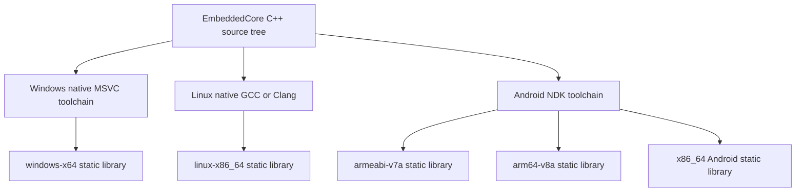
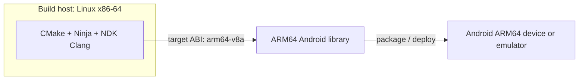
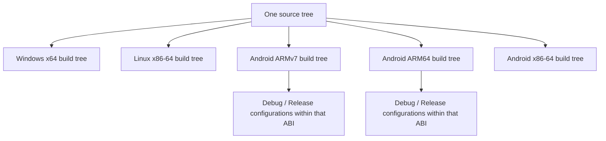
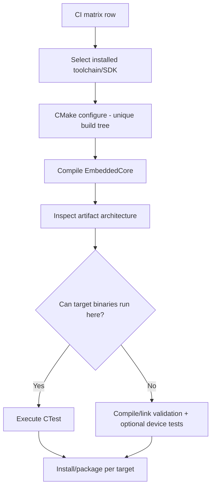

# Chapter 13 — Cross-Compilation, Toolchains, Architectures, and ABIs

> **Modern CMake University — From First Principles to Production CI/CD**  
> **Module V: Multi-Platform Build Engineering · Chapter 13 of 16 · Advanced fundamentals**  
> **Course project:** EmbeddedCore static library and DeviceSimulator executable  
> **Estimated study time:** 6–9 hours (reading, labs, investigations and assessments)

**Navigation:** [Course home](../../README.md) · [Chapter 12](../12-compiler-options-definitions-generator-expressions/README.md) · Next: Chapter 14 — Multi-Platform Dependencies and OpenSSL

## Learning outcomes

By the end of this chapter, you should be able to:

1. Separate build machine, host tools, execution environment, and target architecture.
2. Distinguish an instruction set architecture (ISA), CPU microarchitecture, calling convention, operating-system ABI and binary format.
3. Explain why an x86-64 Windows `.lib` cannot replace an Android x86-64 `.a` despite their common processor family.
4. Explain the initialization role of a CMake toolchain file, sysroot, target triple, and compiler driver.
5. Read and verify `CMAKE_HOST_SYSTEM_NAME`, `CMAKE_SYSTEM_NAME`, `CMAKE_SYSTEM_PROCESSOR`, `CMAKE_CROSSCOMPILING`, and `ANDROID_ABI` without confusing their meanings.
6. Configure Debug/Release and target-specific build directories safely.
7. Cross-compile EmbeddedCore using the official Android NDK toolchain for `armeabi-v7a`, `arm64-v8a`, and `x86_64`.
8. Inspect `.a`, `.obj`, `.o`, `.so`, and executable files to verify they really target the intended platform.
9. Explain limitations of `try_run()`, `try_compile()`, CTest and target executable execution when cross-compiling.
10. Design a five-target CI matrix with reproducibility and explicit fail-fast checks.

## Prerequisites and boundaries

You should have completed Chapters 1–12, especially target-based CMake, static libraries, generator expressions, and CMake Presets. The runnable core uses C++17 only, with no third-party runtime libraries. Requirements: CMake 3.20+, Ninja, a native C++17 compiler, and (for the Android exercises) an installed Android NDK. For Windows, use **x64 Native Tools Command Prompt for VS 2019** (or a correctly initialized MSVC environment). For Linux, use GCC or Clang. No actual embedded board is needed.

**What this chapter does and does not promise:** The native Linux lab is executable and testable on Linux, and the native Windows lab is designed for MSVC. Android library outputs can be cross-compiled on a development machine with the NDK; you cannot run Android executables directly on ordinary desktop Linux/Windows merely because the CPU architecture matches. Android device/emulator execution is optional and requires a compatible runtime. No FIPS or crypto certification is inferred from completing this chapter.

---

## 1. The problem: one source tree, five different targets

Our EmbeddedCore library should serve:

| Target ID | Target operating system | Architecture/ABI label | Typical library output | Typical compiler environment |
|---|---|---|---|---|
| `windows-x64` | Windows | x64 (AMD64) | `embeddedcore.lib` | MSVC x64 |
| `linux-x86_64` | Linux | x86-64 | `libembeddedcore.a` | Native Linux GCC/Clang |
| `android-armeabi-v7a` | Android | `armeabi-v7a` | `libembeddedcore.a` | Android NDK Clang |
| `android-arm64-v8a` | Android | `arm64-v8a` | `libembeddedcore.a` | Android NDK Clang |
| `android-x86_64` | Android | `x86_64` | `libembeddedcore.a` | Android NDK Clang |

The C++ source may be identical. The compiled output is **not interchangeable**.



A development machine with an x86-64 processor cannot automatically execute ARM64 code. More subtly, a Linux x86-64 machine generally cannot execute an **Android** x86-64 binary directly: both may use x86-64 instructions, but their system libraries, dynamic linker, environment and operating-system interfaces differ.

### A useful mental model

**Source compatibility** asks whether source can be compiled in a given environment. **Binary compatibility** asks whether the produced machine code, calling conventions, linked libraries, runtime requirements, and binary container work together on the target.

Avoid describing a library as merely “ARM-compatible.” Identify at minimum the **OS + ABI + architecture + relevant toolchain/runtime constraints**.

---

## 2. ISA, architecture, ABI, and operating system — different concepts

### Instruction set architecture (ISA)

An ISA defines machine instructions and programmer-visible aspects of a processor: registers, instruction encodings, and related behavior. Examples include x86-64 and AArch64. Different ISAs generally require different machine code.

### Microarchitecture

A microarchitecture is a particular hardware implementation of an ISA. Two x86-64 CPUs may differ in cache design, supported instruction extensions or performance without requiring separate base-ISA binaries.

### ABI (application binary interface)

An ABI governs binary-level interoperability: how arguments are passed, where return values live, how stacks are aligned, symbol conventions, data layout, exception interoperability and other toolchain-specific rules. ABI details are affected by OS and compiler environments, not merely the CPU.

For example, Windows x64 and System V AMD64 platforms use different argument-passing conventions even though both target x86-64. C++ ABI differences also include name mangling and standard-library types. Avoid exporting arbitrary C++ classes as a stable universal ABI without considering compilers and runtimes.

### OS and runtime

The target's OS supplies system calls, loader conventions, libraries, and deployment assumptions. Android NDK targets Android's Bionic libc, not a generic GNU/Linux glibc runtime. An Android `.so` is not a drop-in Linux `.so`.

### Binary formats

| Environment | Common object/executable format | Typical inspection tool |
|---|---|---|
| Windows/MSVC | COFF objects; PE executable/DLL | `dumpbin /headers`, `dumpbin /symbols` |
| Linux | ELF | `file`, `readelf`, `objdump` |
| Android NDK | ELF (Android-specific target and ABI) | NDK `llvm-readelf`, `llvm-objdump`, `llvm-nm` |

**Key lesson:** An archive ending in `.a` is a container. Its extension alone cannot certify what architecture or OS its member objects target.

---

## 3. Native compilation vs cross-compilation

**Native compile:** Build on Linux x86-64 and produce a program for the same Linux x86-64 environment.

**Cross-compile:** Build on Linux x86-64 or Windows x64 and produce a binary intended for Android ARM64 (or another different target environment).



### Three roles easily confused

1. **Build host:** Machine executing CMake, Ninja, the compiler and linker.
2. **Build-time tools:** Programs that run *on the host* to generate code or files. A code generator compiled only for Android ARM64 cannot run on an x86-64 build host without a suitable emulator.
3. **Target system:** Environment where the final application/library is intended to execute.

Sometimes “host” means a different role in Autotools' build/host/target terminology; always define terms when sharing build documentation across ecosystems. In this course, **CMake host** means the machine running CMake.

---

## 4. How a cross-toolchain works

A toolchain is more than a compiler executable. It may include:

- Compiler frontend and backend (`clang++`, `g++`, MSVC `cl.exe`).
- Assembler, linker, archiver, symbol inspection tools.
- A **target sysroot** containing target headers and libraries.
- Built-in or passed target triple (for example, distinguishing target CPU/OS/environment).
- Runtime and standard-library choices, deployment constraints and linker conventions.
- Target-specific flags and platform defaults.

### Understanding a target triple

An illustrative Clang target might contain architecture, vendor, OS and ABI/environment components. Clang drivers can also accept OS- or toolchain-specific suffixes, including Android API information. **Do not guess a triple or force it into the NDK toolchain**; let the supported NDK CMake toolchain select the correct target and compiler flags for `ANDROID_ABI` and `ANDROID_PLATFORM`.

### What a sysroot solves

Compiling for a different platform is not just a question of emitting different CPU instructions. The compiler also needs **target** headers and libraries. A sysroot supplies an organized target filesystem view so the toolchain does not accidentally pick up incompatible host headers or libraries.

Consider a dangerous situation: you are compiling Android ARM64 on Linux x86-64, but a `find_library()` accidentally chooses `/usr/lib/x86_64-linux-gnu/libcrypto.so`. The discovered library may exist, and configuration can even appear successful, but the final link is incompatible. In Chapter 14 we will enforce architecture-qualified dependency selection and fail closed.

---

## 5. The timing of a CMake toolchain file

CMake needs a working compiler and target identity **early** in project configuration. Pass a toolchain file before the first language-enabling `project()` or `enable_language()` call. The normal command-line form is:

```bash
cmake -S . -B build/target-name -G Ninja \
  -DCMAKE_TOOLCHAIN_FILE=/path/to/the/toolchain.cmake
```

The file is processed early and may be read more than once, including in nested compiler-detection checks. It should be robust against such re-entry and avoid side effects such as downloading dependencies.

### Critical path variables inside toolchain files

Use `CMAKE_CURRENT_LIST_DIR` rather than assuming `CMAKE_SOURCE_DIR` points to your source root. Toolchain files can be evaluated in nested `try_compile()` projects with different source/build directories.

### Example: *optional* Linux AArch64 cross-toolchain

The downloadable solution includes `toolchains/linux-aarch64-gcc.cmake`:

```cmake
set(CMAKE_SYSTEM_NAME Linux)
set(CMAKE_SYSTEM_PROCESSOR aarch64)
set(CMAKE_C_COMPILER aarch64-linux-gnu-gcc)
set(CMAKE_CXX_COMPILER aarch64-linux-gnu-g++)

set(CMAKE_FIND_ROOT_PATH_MODE_PROGRAM NEVER)
set(CMAKE_FIND_ROOT_PATH_MODE_LIBRARY ONLY)
set(CMAKE_FIND_ROOT_PATH_MODE_INCLUDE ONLY)
set(CMAKE_FIND_ROOT_PATH_MODE_PACKAGE ONLY)
```

This file **is not** an Android toolchain. It requires an installed Linux AArch64 cross-compiler and an appropriate target runtime/sysroot where needed. It is illustrative, not a claim of universal compatibility with every ARM64 Linux board.

For this specific course project (`LANGUAGES CXX`), `CMAKE_CXX_COMPILER` is required; setting `CMAKE_C_COMPILER` is harmless and anticipates mixed-language projects.

### `CMAKE_FIND_ROOT_PATH_MODE_*`

| Mode | Typical purpose in a cross-compile toolchain |
|---|---|
| `PROGRAM NEVER` | Find runnable host-side programs without target root redirection |
| `LIBRARY ONLY` | Prefer libraries rooted in target filesystem |
| `INCLUDE ONLY` | Prefer target headers |
| `PACKAGE ONLY` | Prefer target package configuration metadata |

These are policy choices, not magic validation. You must also inspect actual resolved paths and artifacts. More nuanced combinations can be correct for particular SDKs.

---

## 6. The CMake variables you must not confuse

| Variable | Meaning | Important caution |
|---|---|---|
| `CMAKE_HOST_SYSTEM_NAME` | OS running CMake | On Windows, commonly `Windows`, even when targeting Android |
| `CMAKE_HOST_SYSTEM_PROCESSOR` | Host processor identifier | Not necessarily same spelling as target labels |
| `CMAKE_SYSTEM_NAME` | Target OS according to CMake | Often `Android`, `Linux`, or `Windows` |
| `CMAKE_SYSTEM_PROCESSOR` | Target processor identifier | Spellings can vary across toolchains |
| `CMAKE_CROSSCOMPILING` | CMake's cross-compilation indicator | Not a guarantee that the output cannot run locally, nor a universal semantic equality test |
| `CMAKE_CXX_COMPILER` | Chosen C++ compiler | A path/name alone doesn't verify all target options |
| `CMAKE_SIZEOF_VOID_P` | Pointer size detected for target | Distinguishes many 32-bit/64-bit builds but not OS/ABI |
| `ANDROID_ABI` | Android NDK ABI selection | Use exact NDK-supported labels |
| `ANDROID_PLATFORM` | Target minimum Android API level | A higher value may exclude older Android devices |

Inspect values by adding `message(STATUS ...)` diagnostics or reading the CMake cache/configuration logs. **Never treat `CMAKE_SYSTEM_PROCESSOR` as an exact portable synonym for `ANDROID_ABI`**. Use `ANDROID_ABI` where Android package layout requires that label.

`CMAKE_CROSSCOMPILING` can be true merely because `CMAKE_SYSTEM_NAME` was manually set, even if it equals the host. On Apple platforms it has additional caveats. Use concrete platform and runtime capabilities to decide whether a test may execute. See the CMake variable documentation in Further Reading.

---

## 7. Five targets, five build trees

Use a single source repository but isolate each toolchain/ABI configuration:

```text
EmbeddedCore source/
├── CMakeLists.txt
├── include/
├── src/
├── app/
├── tests/
└── build/                       # ignored by Git
    ├── windows-x64/
    ├── linux-x86_64/
    └── android/
        ├── armeabi-v7a/
        ├── arm64-v8a/
        └── x86_64/
```

CMake's cache contains compiler paths, generator choice, ABI choices, installation options, and other assumptions. **Do not reuse a configured build directory for a different OS or ABI**. Start with a fresh build tree when switching target compilers, platforms or architecture families.

Configurations are a separate dimension. For single-config Ninja, use separate Debug and Release trees for each target. For Ninja Multi-Config you may keep Debug and Release in a single **target-specific** tree. You cannot combine Windows and Android binaries into one Multi-Config build directory simply by switching `--config`.



### Presets do not automatically install SDKs

CMake Presets are reusable configuration descriptions, not a package manager. An Android preset requires an actual NDK path. Keeping absolute machine-specific SDK paths out of public source control is preferable; use environment variables or local user presets where appropriate. We include native Linux/Windows presets and portable Android wrapper scripts rather than claiming `CMakePresets.json` can discover every user's NDK automatically.

---

## 8. Hands-on project: EmbeddedCore that reports its target

The solution project consists of:

```text
solution/
├── CMakeLists.txt
├── CMakePresets.json
├── config/target_config.hpp.in
├── include/embeddedcore/
│   ├── sensor.hpp
│   └── platform_report.hpp
├── src/
│   ├── sensor.cpp
│   └── platform_report.cpp
├── app/main.cpp
├── tests/contract_test.cpp
├── toolchains/linux-aarch64-gcc.cmake
└── scripts/
    ├── build-android.sh
    └── build-android.ps1
```

### 8.1 One target description

The core target remains modern target-based CMake:

```cmake
add_library(embeddedcore STATIC
    src/sensor.cpp
    src/platform_report.cpp
)

add_library(EmbeddedCore::Core ALIAS embeddedcore)
target_compile_features(embeddedcore PUBLIC cxx_std_17)
```

`add_library(... STATIC ...)` is intentional: the three Android outputs will be static archives and can later be integrated into other native targets. A static library does **not** mean its code is automatically executable, and it does not merge external libraries into the archive.

### 8.2 Generate target metadata

We use `configure_file()` to create `embeddedcore/target_config.hpp` in each build tree. Its contents include the CMake target OS and target ABI label. This illustrates why generated headers should live in the *build tree* rather than being checked into the source repository with a specific target baked in.

`config/target_config.hpp.in`:

```cpp
#pragma once
#define EMBEDDEDCORE_TARGET_SYSTEM "@CMAKE_SYSTEM_NAME@"
#define EMBEDDEDCORE_TARGET_PROCESSOR "@CMAKE_SYSTEM_PROCESSOR@"
#define EMBEDDEDCORE_TARGET_ABI "@EMBEDDEDCORE_TARGET_ABI@"
```

In `CMakeLists.txt`:

```cmake
if(ANDROID)
    set(EMBEDDEDCORE_TARGET_ABI "${ANDROID_ABI}")
else()
    set(EMBEDDEDCORE_TARGET_ABI "${CMAKE_SYSTEM_PROCESSOR}")
endif()

configure_file(
    "${CMAKE_CURRENT_SOURCE_DIR}/config/target_config.hpp.in"
    "${CMAKE_CURRENT_BINARY_DIR}/generated/embeddedcore/target_config.hpp"
    @ONLY
)
```

For Android, the explicit ABI is the packaging label. For other platforms, the processor name is a useful diagnostic, but the release manifest should still use your validated canonical ID (`windows-x64`, `linux-x86_64`, etc.). Do not infer release IDs from arbitrary processor strings alone.

### 8.3 Platform-neutral application code

`main.cpp` calls the same library functions regardless of host OS. The native app can print its target metadata, while Android cross-builds produce the static library without attempting to run an Android binary on the host.

---

## 9. Lab A — Linux x86-64 native build

### Preconditions

From a Linux terminal check:

```bash
cmake --version
ninja --version
g++ --version
```

Navigate to `labs/13-cross-compilation-toolchains-architectures-abis/solution`.

### Debug configure, build and test

```bash
cmake --preset linux-debug
cmake --build --preset linux-debug
ctest --preset linux-debug
./build/linux-debug/DeviceSimulator
```

Expected DeviceSimulator output on a typical x86-64 Linux host:

```text
Embedded Device Simulator
Temperature: 25.5 C
Device status: HEALTHY
Target system: Linux
Target processor: x86_64
Target ABI label: x86_64
```

Target processor spelling is toolchain-dependent; if your environment prints `amd64` or another correct value, inspect it instead of blindly assuming it must equal the table's label.

### Release and installation

```bash
cmake --preset linux-release
cmake --build --preset linux-release
ctest --preset linux-release
cmake --install build/linux-release --prefix stage/linux-x86_64
```

Inspect generated files:

```bash
find stage/linux-x86_64 -type f
file stage/linux-x86_64/lib/libembeddedcore.a
ar t stage/linux-x86_64/lib/libembeddedcore.a
```

Some distributions use `lib64` for `${CMAKE_INSTALL_LIBDIR}`. Inspect the actual installed path rather than assuming it is always `lib`.

---

## 10. Lab B — Windows x64 native MSVC build

Open **x64 Native Tools Command Prompt for VS 2019**. Confirm:

```bat
cl
cmake --version
ninja --version
```

Then navigate to the solution directory and configure:

```bat
cmake --preset windows-msvc-debug
cmake --build --preset windows-msvc-debug
ctest --preset windows-msvc-debug
build\windows-msvc-debug\DeviceSimulator.exe
```

Inspect the library and executable:

```bat
dumpbin /headers build\windows-msvc-debug\embeddedcore.lib
dumpbin /headers build\windows-msvc-debug\DeviceSimulator.exe
```

Look for x64/AMD64 machine information. An object archive and executable are different products, and the import-library behavior discussed in Chapter 8 does not apply to this **static** library output.

### Windows on ARM, x86 and clang-cl?

This lab intentionally uses x64 MSVC. A Windows ARM64 or x86 toolchain would require different target settings and an appropriate development environment. **The generator name alone does not determine target CPU for every generator.** Visual Studio generators can have platform architecture selection (for example `-A x64`); with Ninja, initialize the intended compiler environment instead.

---

## 11. Lab C — Android NDK builds for three ABIs

### 11.1 Install prerequisites and choose a real NDK

Install the official Android NDK and CMake/Ninja. Do not put an NDK installation inside the Git repository. Locate:

```text
<NDK>/build/cmake/android.toolchain.cmake
```

Android's documented command-line CMake flow uses this toolchain file, `ANDROID_ABI` and `ANDROID_PLATFORM`. Using the official toolchain is preferable to setting `CMAKE_CXX_COMPILER` manually and trying to reconstruct NDK include directories, target flags and linker behavior yourself.

Set `ANDROID_NDK_HOME` to your installed NDK directory (actual path varies by machine). The provided shell and PowerShell scripts fail immediately if this environment variable is missing or the toolchain file is not found.

### 11.2 Linux/macOS shell

From the solution directory, with `ANDROID_NDK_HOME` configured:

```bash
bash scripts/build-android.sh
```

The script performs **three independent** configure/build/install cycles, one for each ABI, and defaults to Android API 24 for the exercises. To override it:

```bash
ANDROID_API_LEVEL=26 bash scripts/build-android.sh
```

### 11.3 Windows PowerShell

From the solution directory after setting `ANDROID_NDK_HOME` in the environment:

```powershell
.\scripts\build-android.ps1
```

### 11.4 The underlying command explained

The ARM64 iteration is equivalent to:

```bash
cmake -S . -B build/android/arm64-v8a -G Ninja \
  -DCMAKE_TOOLCHAIN_FILE="$ANDROID_NDK_HOME/build/cmake/android.toolchain.cmake" \
  -DANDROID_ABI=arm64-v8a \
  -DANDROID_PLATFORM=android-24 \
  -DCMAKE_BUILD_TYPE=Release \
  -DBUILD_TESTING=OFF
cmake --build build/android/arm64-v8a --parallel
cmake --install build/android/arm64-v8a --prefix stage/android/arm64-v8a
```

Repeat for `armeabi-v7a` and `x86_64` in their *own* directories. `ANDROID_PLATFORM` is the chosen minimum Android API level; support and minimums differ by ABI and NDK version, so verify your installed NDK and product requirements. The NDK will not automatically make an app run on devices with an API level below your selected minimum.

### 11.5 Why we build only a library for Android

Our desktop `DeviceSimulator` is a hosted command-line app. The real Android application or JNI packaging integration arrives later. This chapter intentionally avoids running Android-generated executables on the build host. The static archive is an input for a future Android native build; it is not an APK and cannot be launched by tapping it on a phone.

### 11.6 Verify outputs independently

You should now have a layout resembling:

```text
stage/android/
├── armeabi-v7a/lib/libembeddedcore.a
├── arm64-v8a/lib/libembeddedcore.a
└── x86_64/lib/libembeddedcore.a
```

Include headers may also be installed in each ABI prefix. Inspect each archive member with the NDK's LLVM tools. Do not conclude compatibility from folder names or archive filenames alone.

---

## 12. Inspecting the actual binary architecture

This is perhaps the most important production skill in this chapter.

### Linux ELF inspection

```bash
file build/linux-release/DeviceSimulator
readelf -h build/linux-release/DeviceSimulator
ar t build/linux-release/libembeddedcore.a
nm -C build/linux-release/libembeddedcore.a
```

`file` gives a summary. `readelf -h` reports ELF class, architecture, endianness and related metadata. `nm -C` can expose C++ symbol names for troubleshooting.

### Windows inspection

```bat
dumpbin /headers build\windows-msvc-debug\DeviceSimulator.exe
dumpbin /symbols build\windows-msvc-debug\embeddedcore.lib
```

### Android inspection

Android NDK tool locations depend on the NDK and host. Locate `llvm-ar` and `llvm-readelf` in the installed LLVM prebuilt toolchain. First list archive members using `llvm-ar t`, then extract *one sample object into a temporary directory* and run `llvm-readelf -h` on it. The three ABIs should report different target machines (ARM for ARMv7, AArch64 for ARM64, x86-64 for x86-64).

Example after locating your NDK tools:

```bash
llvm-ar t stage/android/arm64-v8a/lib/libembeddedcore.a
```

The command above assumes `llvm-ar` from the intended NDK is on your PATH. For a fully reproducible script, use its resolved absolute path. **A static archive is not itself an ELF executable**; inspect an object *inside* the archive, not just its `.a` wrapper.

### What inspection does not prove

An ELF machine ID alone cannot prove Android versus glibc Linux compatibility, Android API constraints, a vendor-specific crypto configuration, or ABI-safe standard-library interactions. It is necessary evidence, not complete validation. CI should additionally capture target platform, compiler configuration, API level, dependency metadata, and test outcomes.

---

## 13. Configuring builds: a matrix instead of a giant `if()` block

### Avoid one giant cross-platform script that guesses everything

The CMake project should describe **targets and their build requirements**. A wrapper or CI pipeline should choose **the toolchain, ABI, API level, configuration and artifact destination**. The dependency resolver introduced in Chapter 14 will choose exact third-party artifacts.



### Example matrix

| Row | Runner | Compiler/toolchain | Build tree | Test policy |
|---|---|---|---|---|
| Windows x64 | Windows x64 | MSVC x64 | `build/windows-x64` | Build + run native tests |
| Linux x86-64 | Linux x86-64 | GCC/Clang | `build/linux-x86_64` | Build + run native tests |
| Android ARMv7 | Linux or Windows | NDK / `armeabi-v7a` | `build/android/armeabi-v7a` | Build and inspect; device tests separately |
| Android ARM64 | Linux or Windows | NDK / `arm64-v8a` | `build/android/arm64-v8a` | Build and inspect; device tests separately |
| Android x86-64 | Linux or Windows | NDK / `x86_64` | `build/android/x86_64` | Build and inspect; emulator/device separately |

A GitHub Actions starter workflow in the downloadable package validates Linux and Windows natively. Android NDK builds remain opt-in: reproducible automation requires explicitly provisioning/pinning an NDK version and the actual API requirements rather than pretending every CI runner provides the same installed SDK.

---

## 14. `try_compile()`, `try_run()`, and CTest under cross-compilation

### `try_compile()`

CMake can test whether sample code compiles with the target toolchain. This is useful when validating language, compiler or linker capabilities. It does not require that the target program execute on your build host. Some bare-metal toolchains cannot link an ordinary test executable; `CMAKE_TRY_COMPILE_TARGET_TYPE=STATIC_LIBRARY` is sometimes needed, but only when appropriate to that platform and check.

### `try_run()`

This attempts to compile **and run** a test program. Under cross-compilation, target binaries generally cannot run on the host, so `try_run()` may require manually supplied results or an emulator. Treat this as a configuration-design problem, not an invitation to fake test results.

### `CMAKE_CROSSCOMPILING_EMULATOR`

For some target platforms, you can configure an emulator able to execute the target binary. This is a capability requirement: having QEMU installed does not automatically make every Android executable or linked library run correctly in an arbitrary emulated environment. Device-dependent features still need device integration tests.

### CTest

CTest registers tests; it does not magically make the host compatible with every target binary. For Chapter 13, native platforms execute unit tests; Android builds compile the library only. In a later production workflow, an Android test stage can deploy a compatible executable or JNI test harness to a device/emulator and collect results.

**Distinguish:** “build passed” ≠ “library loaded” ≠ “application works” ≠ “device behavior verified.”

---

## 15. Debug and Release in a multi-target project

Remember Chapter 7: configuration (`Debug`, `Release`) is independent of target platform. An Android ARM64 Debug archive and Android ARM64 Release archive have the same high-level ABI target but different build options and may have different compatibility and size considerations.

For single-config Ninja:

```text
build/android/arm64-v8a/debug/
build/android/arm64-v8a/release/
```

For Ninja Multi-Config, one Android ARM64 build tree may contain both configurations, depending on toolchain support and your project's design. It still cannot be reused for ARMv7 or Windows.

For Windows MSVC, other potential compatibility dimensions include runtime library model (`/MD`, `/MT` and debug variants), compiler version, exception handling, and C++ standard library expectations. On Linux, minimum glibc and C++ standard-library requirements can matter even between two x86-64 machines. On Android, match NDK/ABI/API/runtime configuration and externally supplied library requirements.

---

## 16. Troubleshooting guide

| Symptom | Likely cause | Investigation / correction |
|---|---|---|
| CMake reports compiler unavailable | Toolchain path or environment wrong | Check `CMAKE_CXX_COMPILER`; initialize MSVC tools or install NDK |
| `ANDROID_ABI` ignored or wrong output | Reused build directory or wrong toolchain | Delete only the target build tree and configure afresh with NDK toolchain |
| Wrong target system in message output | Native compiler selected accidentally | Inspect `CMAKE_SYSTEM_NAME`, `CMAKE_TOOLCHAIN_FILE`, actual compiler command |
| `file` shows x86-64 when expecting ARM64 | Wrong compiler/ABI or inspected wrong file | Inspect member object and actual command line |
| `ld` rejects library as incompatible | Library built for different architecture/OS | Inspect each archive member, target triple, dependency paths |
| Compiler finds Linux headers while building Android | Host include paths leaked | Use NDK sysroot and imported target include requirements; avoid global `-I/usr/include` |
| `try_run()` fails during configure | Target program cannot run on host | Replace with compile-only test or proper emulator/device strategy |
| Android app fails on older device | `ANDROID_PLATFORM` above device API | Match intended minimum supported API and verify dependency minimums |
| Same ABI works in Debug but fails in Release | Optimization, undefined behavior or different link/runtime choices | Inspect flags, symbols, sanitizers, package selection, and tests |
| `ANDROID_NDK_HOME` undefined | SDK not installed/configured | Install NDK and export correct path; fail early |
| Artifacts overwrite each other | One staging directory for multiple targets | Use ABI-qualified stage directories and build identifiers |
| Compile succeeds but installed package later fails to link | Exported usage requirements or dependencies missing | Chapter 15 covers installed package exports and consumer smoke tests |

### Failure investigation sequence

1. Confirm intended **target ID**, OS, ABI and minimum runtime/API.
2. Confirm actual **compiler and toolchain** selected at initial configuration.
3. Inspect CMake cache and generated compiler command (where supported).
4. Inspect the exact artifact's binary format and machine architecture.
5. Check resolved target libraries and sysroot search results.
6. Separate compile-time, link-time, load-time and run-time failures.
7. Reproduce with a clean target-specific build tree before changing flags at random.

---

## 17. Architecture case studies

### Case A — Windows x64 build consumes a Linux static archive

Even if both CPUs implement x86-64, COFF/MSVC object conventions and ELF/Linux objects differ. A Windows `.lib` and Linux `.a` are not interchangeable formats or ABI families. Rebuild the dependency for the intended platform; renaming files cannot convert them.

### Case B — Android x86-64 archive accidentally selected for Linux x86-64

The CPU ISA family may match, but platform ABI, libc, and OS interfaces do not. You need platform-qualified package coordinates—not a broad `x86_64` directory shared by every OS. The linker may catch incompatibilities; if not, do not assume the result is safe.

### Case C — Android ARMv7 vs ARM64

`armeabi-v7a` is the 32-bit ARM ABI; `arm64-v8a` is the 64-bit AArch64 ABI. They need independent object files, compiler target configuration and library artifacts. Pointer width, instructions and ABI all differ. A package published under a single vague `android-arm` ID is ambiguous.

### Case D — CMake reports `CMAKE_CROSSCOMPILING=FALSE` for native Windows x64

This is expected when CMake runs on Windows x64 and builds for that environment. But don't infer “all binaries execute anywhere” from it: CRT deployment and machine requirements still matter.

### Case E — ARM64 Linux board versus Android ARM64 phone

Both can use AArch64 instructions, but Android's Bionic system and Linux distro libc/runtime are distinct. The NDK toolchain targets Android; a generic Linux AArch64 cross-compiler usually targets Linux userspace. Build with the correct sysroot and toolchain.

### Case F — Build-time code generator in a cross-build

If the project generates headers from a custom tool, that tool needs to run on the build machine. Compile it natively or use a host-provided tool; do not accidentally build the generator with Android target flags and then try to execute it on the Windows/Linux host. Large projects often use a separate host-tools build.

---

## 18. Guided experiments

**Experiment 1 — Identify host and target.** Configure the solution natively; record CMake host OS, target OS, host processor, target processor, selected compiler, `CMAKE_CROSSCOMPILING`, and output format. Explain why these fields agree or differ.

**Experiment 2 — Prove clean ABI isolation.** Build Linux Debug and Release in two directories. Identify two caches and explain why copying cache files between machines is unsafe.

**Experiment 3 — Inspect a static archive.** Use `ar t` and `nm -C` on Linux or `dumpbin` on Windows. Find `read_temperature()` and explain why there is no `main()` in the library.

**Experiment 4 — Architecture metadata.** Compare `target_config.hpp` files generated for at least two build trees (native and Android if the NDK is installed). Explain why the header cannot be shared between targets.

**Experiment 5 — Android three-ABI matrix.** Build all three ABIs using the included script. Inspect at least one member object per archive with NDK LLVM tools, noting machine/architecture differences.

**Experiment 6 — Intentional wrong-toolchain experiment.** In a disposable build directory, omit the NDK toolchain while specifying an Android-themed output folder. Observe that directory names do not select the target. Do not publish the mislabeled artifact.

**Experiment 7 — Optional Linux AArch64.** If the appropriate GCC cross-compiler and target sysroot are installed, configure using `toolchains/linux-aarch64-gcc.cmake`, build only the library, and inspect its architecture. This is a Linux ARM64 exercise, not an Android one.

**Experiment 8 — Build-vs-run test policy.** Explain which tests can run on a native CI runner and which require target hardware/emulator. Draft a test evidence table that distinguishes built, linked, loaded and integration-tested.

---

## 19. Independent assignments

### Assignment 13.1 — Add a canonical target identifier (easy)

Create an explicit mapping for Windows x64, Linux x86-64 and the three Android ABIs. Make it reject unknown target combinations instead of guessing. Explain the risks of relying only on `CMAKE_SYSTEM_PROCESSOR` string comparisons.

### Assignment 13.2 — Artifact manifest (intermediate)

Write a build-time or packaging script that records: target ID, OS, ABI, build configuration, compiler name/version, CMake version, NDK version where relevant, API level, archive SHA-256 and test status. Do not include secrets or local machine paths in the published manifest.

### Assignment 13.3 — Missing-NDK fail-fast behavior (intermediate)

Confirm the provided Android build scripts fail with a clear error when `ANDROID_NDK_HOME` is missing and when the toolchain file doesn't exist. Explain why silently switching to the desktop compiler is unacceptable.

### Assignment 13.4 — Cross-platform root-path policy (intermediate)

Explain which dependency should come from the build host (a runnable code generator) and which should come from the target root (e.g. a target cryptography library), using the `CMAKE_FIND_ROOT_PATH_MODE_*` concepts.

### Assignment 13.5 — Add CI artifact inspection (advanced)

Extend the supplied workflow to inspect ELF/COFF metadata and publish a per-target artifact manifest. Fail CI if a build labeled `windows-x64` or `linux-x86_64` does not match the expected machine/platform.

### Assignment 13.6 — Design an Android device test lane (advanced)

Propose a flow that packages a target test executable, deploys it to a compatible emulator or device, runs it, collects logs/results and reports failures. Clearly separate NDK compilation from runtime validation.

---

## 20. Knowledge check (12 questions)

1. What is the difference between target ISA and ABI?
2. Why might a Linux x86-64 `.a` be incompatible with Android x86-64?
3. What is the purpose of a sysroot?
4. Why is a toolchain file passed at the first CMake configuration?
5. What does `CMAKE_HOST_SYSTEM_NAME` report during an Android cross-build on Windows?
6. Why is `CMAKE_CROSSCOMPILING` not a complete runtime-compatibility test?
7. Which Android NDK setting selects `arm64-v8a`?
8. What does `ANDROID_PLATFORM=android-24` mean in a typical NDK command?
9. Why must ARMv7 and ARM64 use different build trees?
10. Can CTest run an Android executable on desktop Linux by itself? Why or why not?
11. Why should you inspect archive *members* rather than infer their CPU from a `.a` name?
12. How is a Ninja Multi-Config Debug/Release build different from building multiple target ABIs?

Full suggested answers are available separately at `solutions/13-cross-compilation-toolchains-architectures-abis/quiz-answers.md`.

---

## 21. Chapter summary — production design rules

**Keep these ten rules:**

1. Describe an artifact by target **OS + ABI + architecture + toolchain/runtime requirements**.
2. Treat CMake **host** and **target** variables separately.
3. Select a toolchain before first compiler detection; do not swap toolchains inside one cache.
4. Use **official Android NDK toolchain** for Android builds.
5. Make one dedicated build tree per OS/ABI/toolchain combination.
6. Allow Debug and Release to share a tree only where the generator supports it and the *target* is unchanged.
7. Never let host-side libraries or headers leak into target dependency discovery.
8. Inspect actual binary contents, not just filenames or published folder labels.
9. Build success is not runtime success; keep device/emulator testing distinct.
10. Publish architecture-qualified artifacts with provenance and explicit validation evidence.

---

## 22. Further reading (official primary documentation)

- [CMake Toolchains Manual](https://cmake.org/cmake/help/latest/manual/cmake-toolchains.7.html) — toolchain configuration and cross-compiling concepts.
- [CMake `CMAKE_CROSSCOMPILING`](https://cmake.org/cmake/help/latest/variable/CMAKE_CROSSCOMPILING.html) — exact semantics and caveats.
- [CMake `CMAKE_SYSTEM_NAME`](https://cmake.org/cmake/help/latest/variable/CMAKE_SYSTEM_NAME.html) — target system identification.
- [Android NDK CMake Guide](https://developer.android.com/ndk/guides/cmake) — official NDK toolchain, ABI and Android API examples.
- [CMake `try_run`](https://cmake.org/cmake/help/latest/command/try_run.html) — cross-compile execution caveats.
- [CMake `CMAKE_TRY_COMPILE_TARGET_TYPE`](https://cmake.org/cmake/help/latest/variable/CMAKE_TRY_COMPILE_TARGET_TYPE.html) — compile-only probes for special toolchains.
- [CMake Presets](https://cmake.org/cmake/help/latest/manual/cmake-presets.7.html) — project and CI configuration portability.

## Next chapter: 14 — Multi-Platform Dependencies: OpenSSL, Android, and Artifact Repositories

Now that EmbeddedCore can select the *correct target toolchain*, we will design a **fail-closed dependency resolver**. We'll distinguish Windows/Linux/Android binary variants; integrate `find_package(OpenSSL)` and imported targets; select exact artifacts from an internal-style repository; verify architecture and checksums; explain why static archives don't absorb dependent libraries; and demonstrate safe behavior when a required compliance-specific package is unavailable.

**Chapter 14 will use fictional dependency coordinates and downloadable public-source examples only—never real internal repository URLs, credentials, or proprietary cryptography distributions.**
