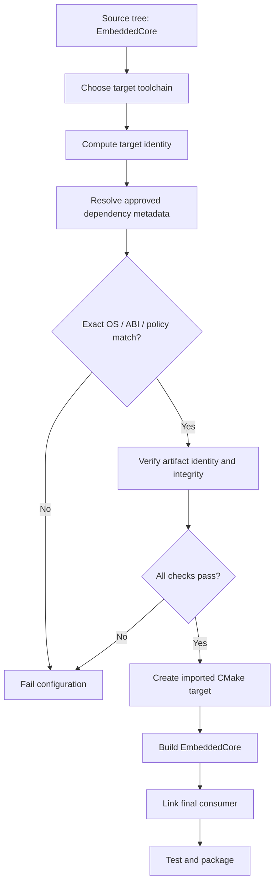
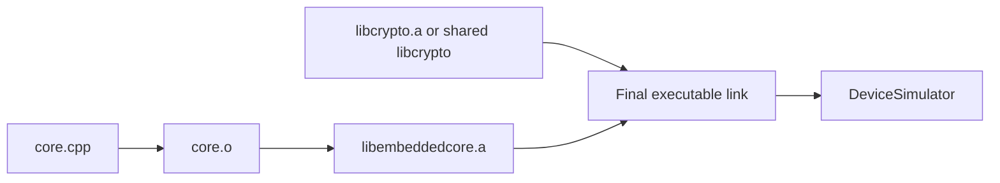
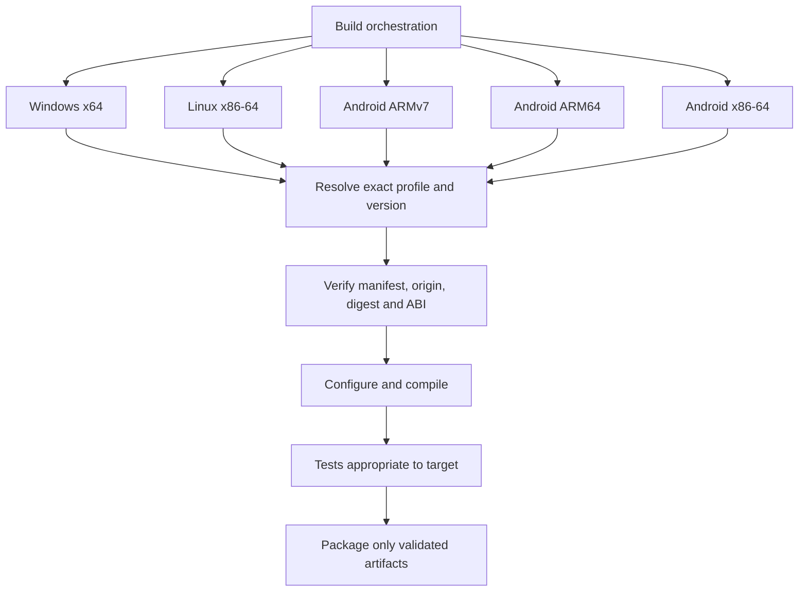

**Course navigation:** [Course home](../../README.md) · [← Chapter 13](../13-cross-compilation-toolchains-architectures-abis/README.md) · [Chapter 15 →](../15-presets-ctest-install-package-exports/README.md)

# Chapter 14 — Multi-Platform Dependencies: OpenSSL, Android, Package Integrity, and Artifact Repositories

> **Modern CMake University · Module V: Multi-Platform Build Engineering · Chapter 14 of 16**  
> **Level:** Advanced · **Suggested study time:** 8–12 hours  
> **Course project:** EmbeddedCore (static library) + DeviceSimulator (executable)  
> **Last reviewed:** November 2026

**Previous:** [Chapter 13 — Cross-Compilation](../13-cross-compilation-toolchains-architectures-abis/README.md)  
**Next:** Chapter 15 — Presets, CTest, Installation and Package Exports

## How to use this chapter

This is a textbook, not simply a collection of snippets. Read Sections 1–10 before the lab, reproduce the positive and *negative* tests, and then complete the assignments without looking at the solutions. All shell commands assume the `labs/14-multiplatform-dependencies-openssl-artifacts/solution` directory unless stated otherwise. Windows commands assume an **x64 Native Tools Command Prompt for Visual Studio 2019** or a suitably initialized PowerShell terminal.

**Important boundary:** The public lab never supplies actual regulated, FIPS-validated cryptographic modules, private package repositories, company credentials, or proprietary product code. Its *teaching fixture* models artifact selection and integrity with a harmless telemetry-formatting library. Its OpenSSL mode demonstrates real library discovery and linking but makes **no FIPS-validation claim**.

---

## Learning outcomes

After completing this chapter, you will be able to:

1. Distinguish a **dependency declaration**, a **package-resolution policy**, an **artifact**, and a **link-time target**.
2. Construct a five-platform OS/ABI matrix for Windows, Linux, and three Android ABIs.
3. Explain why processor architecture alone does not establish library compatibility.
4. Use `find_package(OpenSSL REQUIRED COMPONENTS Crypto)` with the imported `OpenSSL::Crypto` target.
5. Identify the practical meaning and limitations of `OPENSSL_ROOT_DIR` and `CMAKE_PREFIX_PATH`.
6. Stage and verify a prebuilt static library using a target ID and a SHA-256 digest.
7. Wrap a verified prebuilt library in a CMake **IMPORTED** target.
8. Diagnose a missing archive, wrong architecture, incompatible build mode, missing symbol, incorrect library prefix, or mismatched hash.
9. Differentiate **artifact integrity**, **package authenticity**, **runtime provider configuration**, and **cryptographic compliance**.
10. Reject unavailable compliance-specific dependencies rather than silently switching to a different package.
11. Explain why `target_link_libraries()` with a static library **does not automatically combine two static archives**.
12. Outline an authenticated private repository download-and-cache workflow suitable for Jenkins without embedding company URLs or credentials.

## Prerequisites and tooling

You should have completed Chapters 1–13, especially Chapters 5, 8, 11, 12, and 13. The native lab needs CMake **3.21+**, Ninja, and a C++17 compiler. OpenSSL mode requires development headers and libcrypto for the **native target**. On Debian-derived Linux distributions, those commonly come from the OpenSSL development package; on Windows, install a build compatible with your chosen compiler and runtime. Cross-building the three Android architectures additionally requires an Android NDK and a separate OpenSSL build for each intended ABI.

Check the installed tools:

```bash
cmake --version
ninja --version
c++ --version
openssl version
```

On Windows:

```bat
cmake --version
ninja --version
cl
```

A command-line `openssl` executable does *not* prove that the development headers and linkable Crypto library have been installed. A successful `find_package(OpenSSL)` also does not prove that the package is from the vendor you intended.

---

# Part I — Dependency Architecture from First Principles

## 1. Why Chapter 13 is not sufficient

In Chapter 13, we isolated build trees for five targets. That correctly selects the compiler, headers, and system runtime, but it does **not** automatically select compatible third-party libraries.

Suppose the compiler is configured for Android ARM64, but the dependency resolver supplies an x86-64 Linux `libcrypto.a`. At best, linking fails with an incompatible-file or wrong-architecture error. At worst, errors appear much later because the wrong headers, ABI flags, or library version were selected. Similar failures occur between MSVC and MinGW libraries on Windows, across C++ standard library ABIs on Linux, or when a static package was compiled with incompatible runtime flags.

A robust build therefore has at least **two independently correct decisions**:

- **Toolchain selection:** What compiler, target runtime, sysroot, architecture, and API level are we building for?
- **Dependency selection:** Which exact library artifacts, built for that target, are permitted to enter the link graph?



The phrase **fail closed** means that the project refuses to proceed when a required dependency policy cannot be satisfied. It does not mean retrying with an easier or less restricted dependency.

## 2. Four different things we often call a “dependency”

| Layer | Example | Question it answers |
|---|---|---|
| Logical requirement | “EmbeddedCore uses OpenSSL Crypto” | What capability is needed? |
| Policy | “Android ARMv7 requires a particular approved vendor build” | Which packages are permitted? |
| Physical artifact | `libcrypto.a`, `crypto.lib`, headers, provider module | Which actual bytes will we consume? |
| CMake target | `OpenSSL::Crypto` | How are includes and link requirements represented? |

These are not interchangeable. A target named `OpenSSL::Crypto` can point to an incorrect artifact if discovery has been misconfigured. Conversely, a correctly downloaded archive is not usable until includes, transitive dependencies, architecture, and linkage have been modeled.

### The intended five-target build matrix

| Target identity | OS | CPU / ABI | Example output | Minimum dependency checks |
|---|---|---|---|---|
| `windows-x64` | Windows | x64 | `embeddedcore.lib` | MSVC toolset/runtime, x64, config |
| `linux-x86_64` | Linux | x86-64 | `libembeddedcore.a` | ELF x86-64, libc/libstdc++ ABI |
| `android-armeabi-v7a` | Android | 32-bit ARMv7 | `libembeddedcore.a` | NDK ABI, API floor, ARM features |
| `android-arm64-v8a` | Android | AArch64 | `libembeddedcore.a` | NDK ABI, API floor, C++ runtime |
| `android-x86_64` | Android | x86-64 | `libembeddedcore.a` | Android ABI, **not Linux x86-64** |

**Do not use `CMAKE_HOST_SYSTEM_PROCESSOR` to choose target binaries.** In a cross-build, that variable describes the machine performing the build. The target should be determined using `CMAKE_SYSTEM_NAME`, `CMAKE_SYSTEM_PROCESSOR`, and, for Android, `ANDROID_ABI`.

### Why an ABI is more than a CPU name

An ABI encompasses more than instruction set selection: object format, name mangling, calling conventions, structure layout, exception and runtime behavior, and library compatibility may all matter. Compile flags and the standard library can add further constraints. Thus, even matching `x86_64` labels are insufficient when one library is for Linux and the other is for Android.

## 3. Draw the boundary between CMake and the artifact repository

A helpful production architecture separates dependency policy from build mechanics:


Why not download ad hoc from the top-level `CMakeLists.txt`? It *can* be done, but credentials, retries, TLS policy, version pinning, cache ownership, provenance verification, offline CI, and network errors become intertwined with CMake configuration. A standalone resolver is easier to test and audit. CMake should usually consume **already staged, immutable, verified packages**, and validate that they match the selected target.

The public lab follows this boundary: a local fixture builder plays the role of an artifact producer; its staged output plays the role of a downloaded package; and the consumer's CMake resolver verifies and imports it.

---

# Part II — Discovering OpenSSL Correctly

## 4. Understanding OpenSSL’s major components

OpenSSL is not one undifferentiated library. For typical native development:

- **libcrypto** supplies cryptographic primitives and support APIs.
- **libssl** supplies TLS/SSL protocol functionality and depends on libcrypto.
- In OpenSSL 3, **providers** supply algorithm implementations. A provider module and its configuration may be deployment-time requirements separate from the ordinary import library.

The CMake `FindOpenSSL` module provides imported targets, including `OpenSSL::Crypto` and `OpenSSL::SSL`. A project needing only Crypto should request only Crypto:

```cmake
find_package(OpenSSL REQUIRED COMPONENTS Crypto)
target_link_libraries(embeddedcore PRIVATE OpenSSL::Crypto)
```

A project implementing TLS would typically need the SSL component:

```cmake
find_package(OpenSSL REQUIRED COMPONENTS SSL)
target_link_libraries(network_transport PRIVATE OpenSSL::SSL)
```

The second line is not a substitute for TLS certificate validation, secure transport configuration, or runtime provider behavior.

### Prefer imported targets over raw filenames

Avoid:

```cmake
link_directories("${SOME_DIRECTORY}")
target_link_libraries(embeddedcore PRIVATE crypto)
```

Also avoid hardcoding a file name into portable target definitions:

```cmake
target_link_libraries(embeddedcore PRIVATE /some/path/libcrypto.a)
```

A proper imported target represents path, include directories, and additional usage requirements through CMake properties:

```cmake
target_link_libraries(embeddedcore PRIVATE OpenSSL::Crypto)
```

**Imported targets do not magically guarantee authenticity or ABI correctness.** They encode what the package-discovery system found; the discovery process must still be constrained and verified.

## 5. `OPENSSL_ROOT_DIR`, `CMAKE_PREFIX_PATH`, and package discovery

`OPENSSL_ROOT_DIR` is a documented hint for the `FindOpenSSL` module. `CMAKE_PREFIX_PATH` is a broader CMake package-search input. Neither should be mistaken for an immutable security boundary. When policy requires a specific installation, verify the **resolved** include directory and libraries against the expected package prefix and package identity.

```bash
cmake -S . -B build/openssl -G Ninja \
  -DEMBEDDEDCORE_PROVIDER=openssl \
  -DEMBEDDEDCORE_OPENSSL_ROOT=/opt/dependencies/openssl/linux-x86_64
```

The lab implements an optional pinned-root verification step with `file(REAL_PATH)` and `cmake_path(IS_PREFIX ...)`. **This is a demonstration of local path confinement, not of binary authenticity.** Root ownership, manifest signatures, compiler ABI, dynamic dependencies, and the provenance of the staged library remain separate concerns.

For debugging, examine:

```bash
cmake -S . -B build/discovery -G Ninja \
  -DEMBEDDEDCORE_PROVIDER=openssl --debug-find
```

Then inspect the cache:

```bash
cmake -LAH -N build/discovery
```

Keep logs private when they might expose internal file layouts or credentials.

### `CONFIG` mode versus module mode

The pattern:

```cmake
find_package(TelemetryCodec CONFIG REQUIRED)
```

looks for package-provided configuration metadata such as `TelemetryCodecConfig.cmake`, as Chapter 11 demonstrated. Without `CONFIG`, `find_package(OpenSSL ...)` commonly uses CMake’s built-in `FindOpenSSL` **module**. In either case, use imported targets rather than copied include and library variables whenever possible.

## 6. Static OpenSSL does not automatically become part of EmbeddedCore.a

Consider:

```cmake
add_library(embeddedcore STATIC src/core.cpp)
target_link_libraries(embeddedcore PRIVATE OpenSSL::Crypto)
```

For typical static archives, CMake archives EmbeddedCore's own object files; it does **not** flatten the whole OpenSSL archive into `libembeddedcore.a`. The final executable/shared library link can still require OpenSSL. Some `PRIVATE` static-library dependencies are propagated as link-only requirements by CMake so the final link resolves their symbols.



A static build of OpenSSL also does not necessarily create a standalone binary: other system or runtime libraries might be required. ABI and license considerations apply as well. Do not rename or concatenate archives to “fix” missing dependencies.

---

# Part III — Designing a Deterministic Artifact Resolver

## 7. What a package must record

A production package usually needs enough metadata to answer:

| Field | Example | Purpose |
|---|---|---|
| Product | `OpenSSL` | Identify component |
| Version/build | Exact upstream and vendor release | Reproducibility |
| Target | `android-arm64-v8a` | Platform/ABI selection |
| Toolchain | NDK revision, compiler and flags | Binary compatibility |
| Configuration | Debug/Release, PIC, linkage | Link/runtime compatibility |
| Crypto policy | standard vs approved profile | Enforce mandatory policy |
| Checksum | SHA-256 digest per archive | Detect unexpected modifications |
| Provenance | Trusted signed manifest/attestation | Establish origin, not just integrity |
| Runtime payload | Provider modules/configuration when needed | Correct deployed behavior |
| License/SBOM | Components and notices | Compliance/auditing |

The *teaching fixture* only contains `include/`, a static library, `metadata/target-id.txt`, and `metadata/libsha256.txt`. It intentionally omits signed provenance and certification evidence; that makes its limits observable rather than pretending it is production-ready.

### Example artifact-repository coordinate (illustrative only)

```text
packages/openssl/3.x/<vendor-build>/android-arm64-v8a/<release-profile>/openssl-package.tar.gz
```

Do not use an unqualified “latest” package in a reproducible CI build. Pinned versions and digests are preferable to mutable tags. An artifact repository may retain approved packages for all five target identities even when some are downloaded only on certain build agents.

## 8. Exact-match selection: never infer from host names

The lab’s `cmake/TargetIdentity.cmake` computes a target key using target properties:

```cmake
if(CMAKE_SYSTEM_NAME STREQUAL "Android")
  if(NOT ANDROID_ABI MATCHES "^(armeabi-v7a|arm64-v8a|x86_64)$")
    message(FATAL_ERROR "Unsupported Android ABI: ${ANDROID_ABI}")
  endif()
  set(EMBEDDEDCORE_TARGET_ID "android-${ANDROID_ABI}")
elseif(CMAKE_SYSTEM_NAME STREQUAL "Windows")
  set(EMBEDDEDCORE_TARGET_ID "windows-x64")
elseif(CMAKE_SYSTEM_NAME STREQUAL "Linux")
  set(EMBEDDEDCORE_TARGET_ID "linux-x86_64")
endif()
```

The *full implementation* also validates 64-bit target details and rejects unsupported platforms. The example is deliberately restricted to the five-course matrix. A real multi-architecture project would need a richer identity including, for example, MinGW/MSVC, Android API level, shared/static linkage, and runtime mode.

**Build tree rule:** one `CMakeCache.txt` per toolchain/ABI. With Ninja Multi-Config, Debug and Release may coexist in one ABI-specific tree, but only if the staged dependencies really support both configurations and applicable runtime rules.

## 9. Verify locally before importing

The fixture package is staged as:

```text
artifacts/linux-x86_64/
├── include/
│   └── telemetrycodec/codec.hpp
├── lib/
│   └── libtelemetrycodec.a
└── metadata/
    ├── target-id.txt
    └── libsha256.txt
```

`ResolveFixture.cmake` performs the following steps **during configuration**:

1. Require a package root explicitly.
2. Compute its canonical filesystem location.
3. Require the expected header, library, target ID, and checksum metadata.
4. Compare the package’s recorded target ID to the **current target**.
5. Compute SHA-256 of the library and compare it with the recorded digest.
6. Only then declare an imported target.

Representative CMake:

```cmake
file(READ "${_id_file}" _recorded_id)
string(STRIP "${_recorded_id}" _recorded_id)
if(NOT _recorded_id STREQUAL EMBEDDEDCORE_TARGET_ID)
  message(FATAL_ERROR "ABI/OS mismatch")
endif()

file(SHA256 "${_lib}" _actual)
if(NOT _actual STREQUAL _expected)
  message(FATAL_ERROR "Artifact integrity failure")
endif()

add_library(TelemetryCodec::TelemetryCodec STATIC IMPORTED GLOBAL)
set_target_properties(TelemetryCodec::TelemetryCodec PROPERTIES
  IMPORTED_LOCATION "${_lib}"
  INTERFACE_INCLUDE_DIRECTORIES "${_inc}")
```

**Threat-model caveat:** A hash stored beside the artifact detects accidental changes but not an attacker who can replace *both* artifact and hash. Production provenance needs a trusted independently authenticated manifest or digest (e.g., signed release metadata, controlled repository metadata, or an independently pinned digest), plus access controls and audit logs.

### Why not place fake vendor names into a public lab?

To teach package selection, our fixture is named **TelemetryCodec** and only formats data. It does not simulate an approved cryptographic implementation or imply one. Real cryptographic packaging requires vendor-specific documentation, precise version validation, and operational controls unavailable in this course repository.

---

# Part IV — FIPS and Cryptographic Policy Without Misleading Shortcuts

## 10. What “FIPS-enabled” actually requires

It is unsafe to infer regulatory approval from a filename such as `fips-crypto.a` or from a CMake option named `ENABLE_FIPS`. In OpenSSL 3, an OpenSSL **FIPS provider**, its configuration, its approved operational environment and usage requirements are distinct from ordinary `libcrypto` linkage. The appropriate validated-module information and security policy must be checked for the exact vendor/module version and operating environment.

At minimum, distinguish:

- **Module availability:** Is the expected provider or vendor module supplied?
- **Module authenticity and approved version:** Is it the exact validated module, obtained from a trusted source?
- **Runtime configuration:** Is the correct provider/configuration loaded and verified where required?
- **Algorithm selection:** Are the intended operations performed through the right provider/properties and in a permitted way?
- **Operational boundary:** Is the deployment within the validated module’s security policy and approved environment?
- **Audit evidence:** Is the approved identity, runtime status, and test evidence recorded?

See the official OpenSSL documentation on [FIPS module](https://docs.openssl.org/3.0/man7/fips_module/) and [FIPS provider](https://docs.openssl.org/3.0/man7/OSSL_PROVIDER-FIPS/). These references explain the concepts but **do not certify our project or a random precompiled dependency**.

### Mandatory policy: fail when approved mode cannot be satisfied

The public lab includes this intentional rule:

```cmake
if(NOT EMBEDDEDCORE_CRYPTO_PROFILE STREQUAL "standard")
  message(FATAL_ERROR
    "CRYPTO PROFILE REJECTED: this demo has no approved provider, provenance, "
    "module configuration, or compliance evidence. Do not fall back to standard.")
endif()
```

That failure is **a successful security-policy test**, not a broken feature. It teaches the right behavior until an approved provider integration and complete evidence have been implemented and reviewed.

### The “silent fallback” anti-pattern

Incorrect idea:

```cmake
if(APPROVED_ARCHIVE_EXISTS)
  use_approved_provider()
else()
  use_standard_provider()
endif()
```

Safer policy:

```cmake
if(REQUIRE_APPROVED_PROFILE AND NOT APPROVED_PACKAGE_VERIFIED)
  message(FATAL_ERROR "Required approved package is unavailable")
endif()
```

These examples are conceptual. `use_approved_provider()` is not an actual CMake command; it represents application-specific resolver logic. Never add fictitious vendor integrations to a public sample simply to make the build succeed.

---

# Part V — Hands-On Laboratory (Linux and Windows)

## Lab structure and architecture

```text
solution/
├── CMakeLists.txt
├── CMakePresets.json
├── cmake/
│   ├── TargetIdentity.cmake
│   ├── ResolveFixture.cmake
│   └── ResolveOpenSSL.cmake
├── fixture/
│   ├── CMakeLists.txt
│   ├── include/telemetrycodec/codec.hpp
│   └── src/codec.cpp
├── include/embeddedcore/core.hpp
├── src/core.cpp
├── app/main.cpp
├── tests/core_test.cpp
└── scripts/
    ├── build-fixture.sh
    ├── build-fixture.ps1
    ├── write-manifest.cmake
    └── test-failures.sh
```

**Why is the fixture its own project?** To imitate the real separation between a dependency's producer and its consumer. We compile and stage TelemetryCodec first; EmbeddedCore consumes a prebuilt archive through an imported target rather than adding the fixture source with `add_subdirectory()`.

## Lab 1 — Build and stage the Linux fixture

From the solution directory:

```bash
bash scripts/build-fixture.sh
```

The script configures the independent fixture project, compiles `libtelemetrycodec.a`, installs headers/archive under `artifacts/linux-x86_64/`, and writes target identity and SHA-256 metadata.

Inspect the result:

```bash
find artifacts/linux-x86_64 -type f -print
cat artifacts/linux-x86_64/metadata/target-id.txt
cat artifacts/linux-x86_64/metadata/libsha256.txt
sha256sum artifacts/linux-x86_64/lib/libtelemetrycodec.a
```

The recorded checksum and actual checksum should match. A changed compiler, archive tool, or build mode can change the archive's digest; don't paste a hash from another build.

## Lab 2 — Consume the verified package

```bash
cmake --preset linux-fixture
cmake --build --preset linux-fixture
ctest --preset linux-fixture
./build/linux-fixture/DeviceSimulator
```

Expected output:

```text
Embedded Device Simulator
Temperature: 25.5 C
Device status: HEALTHY
Provider: fixture
Telemetry: TEMP:25.5
```

The static library `embeddedcore` links `TelemetryCodec::TelemetryCodec` privately. During the final executable link, CMake has enough information to include the dependency library when needed.

## Lab 3 — Inspect the target and final link command

```bash
cmake --build build/linux-fixture --verbose
```

If everything is up-to-date, make a reversible change to a source file or clean/rebuild:

```bash
cmake --build build/linux-fixture --clean-first --verbose
```

Examine the link line for the imported fixture archive. Notice that the installed library is not built as part of the consumer project: it is an **input** to the consumer build.

## Lab 4 — Link the actual OpenSSL Crypto library

Requires OpenSSL headers and libcrypto for your native compiler:

```bash
cmake --preset linux-openssl
cmake --build --preset linux-openssl
ctest --preset linux-openssl
./build/linux-openssl/DeviceSimulator
```

Expected output includes `Provider: openssl` and a short SHA-256 hex prefix. The code calls OpenSSL `SHA256` **only to demonstrate a link dependency**, not to implement authentication, password storage, or an approved cryptographic workflow.

Use a separately configured build tree for the OpenSSL provider. The provider choice is a CMake configuration decision, not a runtime hot swap.

### Why the `PRIVATE` link still matters

Even though the EmbeddedCore library target uses:

```cmake
target_link_libraries(embeddedcore PRIVATE OpenSSL::Crypto)
```

its static archive can still contain unresolved references to OpenSSL functions. The final DeviceSimulator executable needs the Crypto implementation, and CMake will generally carry the link-only requirement to that consumer. This is different from exposing OpenSSL’s headers or types in EmbeddedCore's public API. An application that independently links a raw archive without using the exported CMake target must handle its dependencies itself.

## Lab 5 — Reject a wrong-ABI package

Edit `artifacts/linux-x86_64/metadata/target-id.txt` temporarily to contain:

```text
android-arm64-v8a
```

Attempt a *new* configure:

```bash
cmake -S . -B build/negative-wrong-abi -G Ninja \
  -DEMBEDDEDCORE_PROVIDER=fixture \
  -DEMBEDDEDCORE_ARTIFACT_ROOT="$PWD/artifacts/linux-x86_64"
```

**Expected result:** configuration fails with a package/target mismatch. Restore the original metadata before continuing. The included script `bash scripts/test-failures.sh` performs this and the following negative cases automatically, restoring the fixture afterward.

## Lab 6 — Reject a damaged archive

Temporarily change the archive bytes without updating the metadata. Run a new configure. CMake must report a SHA-256 mismatch and stop before creating its imported target. The automated negative-test script uses a harmless append and restores the archive from a temporary copy.

A checksum mismatch does not tell you *why* bytes differ; it tells you **not to trust this package as the pinned artifact**.

## Lab 7 — Reject an unavailable compliance profile

```bash
cmake -S . -B build/negative-approved -G Ninja \
  -DEMBEDDEDCORE_CRYPTO_PROFILE=approved
```

**Expected result:** CMake exits with an explicit policy error. Do not “fix” the exercise by switching back to standard when the real requirement is approved cryptography.

Run all three negative tests:

```bash
bash scripts/test-failures.sh
```

They should each report `PASS ... rejected`, because a failed configure is the expected outcome.

## Lab 8 — Build on Windows x64 (MSVC + Ninja)

Open **x64 Native Tools Command Prompt for VS 2019**. Ensure `cmake`, `ninja`, and `cl` are on PATH. From the solution directory in PowerShell:

```powershell
.\scripts\build-fixture.ps1
cmake --preset windows-fixture
cmake --build --preset windows-fixture
ctest --preset windows-fixture
.\build\windows-fixture\DeviceSimulator.exe
```

The fixture builder uses `telemetrycodec.lib` and stages it under `artifacts/windows-x64`. Use an appropriately matching MSVC compiler, configuration, runtime, and toolset for producer and consumer. The provided script stages a Debug fixture for the preset’s Debug consumer. **Do not mix a Debug `/MDd` producer with an incompatible Release `/MD` consumer and assume compatibility.**

If you prefer `cmd.exe`, invoke the build steps individually after using the same initial toolchain environment.

## Lab 9 — Inspect platform binaries

On Linux:

```bash
file artifacts/linux-x86_64/lib/libtelemetrycodec.a
ar t artifacts/linux-x86_64/lib/libtelemetrycodec.a
nm -C artifacts/linux-x86_64/lib/libtelemetrycodec.a
file build/linux-fixture/DeviceSimulator
```

On Windows:

```bat
dumpbin /headers artifacts\windows-x64\lib\telemetrycodec.lib
dumpbin /linkermember:1 artifacts\windows-x64\lib\telemetrycodec.lib
```

These commands offer independent clues about object members, machine architecture, and symbol resolution. They complement package metadata; they do not replace a trusted signature or origin check.

## Lab 10 — Inspect a missing-package failure

Create a new build directory and point the resolver to a nonexistent package. Observe that the error occurs at **configure time** rather than as a noisy, late-stage compiler or linker failure. A good resolver fails at the earliest reliable stage with a message naming the missing requirement.

---

# Part VI — Android and the Five-Target Production Matrix

## 11. Official Android NDK configuration

The Android NDK supplies an official CMake toolchain file. For Android ARM64:

```bash
cmake -S . -B build/android/arm64-v8a -G Ninja \
  -DCMAKE_TOOLCHAIN_FILE="$ANDROID_NDK_HOME/build/cmake/android.toolchain.cmake" \
  -DANDROID_ABI=arm64-v8a \
  -DANDROID_PLATFORM=android-24 \
  -DCMAKE_BUILD_TYPE=Release \
  -DEMBEDDEDCORE_PROVIDER=fixture \
  -DEMBEDDEDCORE_ARTIFACT_ROOT=/verified/cache/android-arm64-v8a
```

This command is **illustrative**: you must first supply a genuine Android ARM64 fixture or OpenSSL package with correct headers, binary format, runtime compatibility, and checksum metadata. The native Linux fixture bundled in this lesson will not link to an Android program and will be rejected by the identity check.

Repeat with separate trees for `armeabi-v7a` and `x86_64`. Use the correct minimum `ANDROID_PLATFORM` for your application and library build. The NDK official guide documents the toolchain and ABI arguments: <https://developer.android.com/ndk/guides/cmake>.

### Why the Android OpenSSL package must also be Android-specific

Linux and Android both use ELF, but Android uses different platform libraries, runtime linking conventions, and ABI constraints. Do not reuse the Linux OpenSSL archive merely because both targets say `x86_64`. A valid Android OpenSSL package needs to be compiled for its Android target and consistent NDK/API choices.

### For Android production builds, what extra fields matter?

Record NDK version, API level, STL selection, exception/RTTI flags when relevant, static/shared OpenSSL selection, position-independent code needs, symbols and runtime payloads. If C++ headers appear in an external package’s API, ABI management becomes even more critical; keep third-party types out of your stable public interface when practical.

## 12. A matrix that can fail safely



A build matrix does not mean “one binary fits all.” It means **one policy-driven process** repeats the correct toolchain/dependency/build/test/package stages for each target.

A host CI runner can generally compile cross-platform artifacts, but it cannot automatically execute an Android binary as if it were native Linux. Use emulator/device testing, cross-build compile/link checks, or a verified test runner appropriate to each target. Report what was actually executed.

---

# Part VII — Artifact Repositories, CI/CD, and Security

## 13. Example offline-first resolver design

A production resolver could accept this conceptual configuration:

```yaml
product: openssl
version: "3.x-vendor-pinned"
profile: approved
platform: android
abi: arm64-v8a
linkage: static
expected_sha256: "<independently-trusted-digest>"
```

The above is a **schema example**, not a real approved artifact record. A robust implementation would:

1. Load a version-controlled dependency lock or trusted policy file.
2. Select the exact target tuple and required crypto profile.
3. Fail if no matching coordinate exists.
4. Check the content-addressed local cache.
5. If absent, download over an authenticated channel using agent-provided credentials.
6. Verify the trusted release metadata/signature and each archive digest.
7. Inspect target and package metadata, then unpack to an immutable staging directory.
8. Configure CMake using a canonical local path to the verified package.
9. Record resolved dependency IDs/digests in the build manifest.
10. Publish only if compile, link, required runtime checks, and policy gates pass.

CMake's `file(DOWNLOAD ... EXPECTED_HASH SHA256=...)` supports checksum checking, and TLS certificate validation must be enforced for actual downloads. In many enterprises, however, authentication, retries, secrets, proxy controls, and caching are better handled by a CI-aware package resolver rather than scattered `file(DOWNLOAD)` calls. See <https://cmake.org/cmake/help/latest/command/file.html>.

### What belongs where?

| Concern | Appropriate owner |
|---|---|
| Platform matrix and parallel job orchestration | Jenkins / GitHub Actions |
| Credentials and repository permissions | CI secret manager / repository access layer |
| Version pinning, selection, downloading, provenance verification | Artifact resolver |
| Verify local paths, check target metadata, create imported targets | CMake |
| Produce machine code and link references | Compiler / linker |
| Runtime provider configuration and health checks | Application packaging / runtime validation |
| Evidence and SBOM retention | Release pipeline |

Avoid embedding passwords, API tokens, internal Nexus coordinates, or actual proprietary artifacts in this public GitHub course. Use placeholders and explain where the real CI system would inject them.

## 14. Failure taxonomy: Where did the build break?

| Symptom | Stage | Probable cause | Investigation |
|---|---|---|---|
| Missing approved package | Resolution | Required tuple unavailable | Check lockfile/repository policy |
| Wrong ABI/package target ID | Configure | Incorrect package selection | Compare `CMAKE_SYSTEM_NAME`, `ANDROID_ABI`, package metadata |
| Checksum mismatch | Configure | Artifact changed/corrupted | Stop, re-fetch from trusted source; verify provenance |
| `openssl/sha.h` not found | Compile | Wrong/missing include tree | Inspect imported target includes |
| `file in wrong format` | Link | Wrong OS/CPU/archive format | Use `file`, `readelf`, `dumpbin`, NDK tools |
| Unresolved OpenSSL symbols | Link | Incorrect Crypto library or missing transitive link | Inspect final link command |
| Missing `.dll` / `.so` | Runtime load | Runtime dependency not deployed | Inspect loader search/installed payload |
| Provider cannot load | Runtime | Missing provider/config or invalid setup | Validate provider modules/config and logs |
| Crypto profile rejected | Configure | Required approval evidence absent | Obtain approved integration, **do not fall back** |
| Works in Debug but not Release | Build/link/runtime | Different flags/runtime ABI/dependencies | Compare both toolchains, configurations and packages |
| Dependency appears in wrong CI job | Pipeline | Shared mutable build/cache path | Separate by complete target identity |

### Special warning: build-system “fallbacks” can be bugs

A permissive fallback may make a pipeline turn green while violating a product’s required profile. Prefer explicit, documented profiles, exact package identity, and a failing build over a silently changed security posture.

---

# Part VIII — Assignments

## Assignment A — Target identity audit (beginner–intermediate)

List all five targets with OS name, processor/ABI label, static library suffix, output format, and the CMake variables that determine the target. Explain why `CMAKE_HOST_SYSTEM_PROCESSOR` is unsuitable for selecting a cross-compiled dependency.

**Deliverable:** One table and a 200-word explanation.

## Assignment B — Add a second fixture version (intermediate)

Extend fixture metadata to include a version string. Refuse any package except the version selected by `EMBEDDEDCORE_FIXTURE_VERSION`. Verify that a version mismatch fails before compilation.

**Acceptance:** One passing configuration, one intentional version-failure log.

## Assignment C — Validate a header file too (intermediate)

Currently, the fixture records the archive’s SHA-256. Add a second digest for `include/telemetrycodec/codec.hpp`. Demonstrate failure after mutating the header only.

**Acceptance:** The configure must fail with a message that identifies the modified file.

## Assignment D — Build two native configurations safely (intermediate–advanced)

Produce and consume Debug and Release fixture archives without mixing MSVC runtime modes. Extend metadata to include `configuration` and, on Windows, a runtime library choice. Explain whether you will use separate package roots or imported per-configuration locations.

**Acceptance:** Build/test both configurations; show why an incompatible selection is rejected.

## Assignment E — Imported target inspection (advanced)

Write a CMake diagnostic function that prints `IMPORTED_LOCATION`, `INTERFACE_INCLUDE_DIRECTORIES`, and selected relevant properties of your fixture target. Compare with OpenSSL’s imported target properties. Do not assume all imported targets expose the same location property or layout.

**Acceptance:** Document key target properties for each provider and distinguish configuration-specific imported locations.

## Assignment F — Supply-chain policy proposal (advanced)

Design an internal, *implementation-independent* dependency resolver for all five platform variants. Include coordinate naming, lockfile design, trusted-signature verification, cache isolation, credential boundaries, retry behavior, offline mode, provenance, provider deployment, and no-fallback enforcement.

**Acceptance:** An architecture diagram and test matrix with success/failure cases, including Android ARMv7/ARM64 differences.

## Assignment G — Optional Android cross-build (advanced)

With a properly compiled, non-proprietary Android fixture, configure one Android ABI and inspect its static archive using NDK tools. Verify that a Linux-x86-64 fixture is rejected when given to an Android x86-64 build.

**Acceptance:** Configure/link log, archive architecture evidence, and recorded rejection for the mismatched package. Runtime claims require actual emulator/device execution.

---

# Part IX — Knowledge Check

Attempt before reading `solutions/14-multiplatform-dependencies-openssl-artifacts/quiz-answers.md`.

1. What is the difference between the host architecture and the target architecture?
2. Why cannot a Linux x86-64 archive automatically be used for Android x86-64?
3. What does `find_package(OpenSSL REQUIRED COMPONENTS Crypto)` establish, and what does it *not* establish?
4. Why is `OpenSSL::Crypto` preferable to directly writing `crypto` in `target_link_libraries()`?
5. What is a CMake imported target?
6. Why does `target_link_libraries(embeddedcore PRIVATE OpenSSL::Crypto)` not imply that `libcrypto.a` was merged into `libembeddedcore.a`?
7. Why should package checksums be compared against an independently trusted reference?
8. What happens if a required approved cryptographic package is missing?
9. Which CMake variables are relevant to Android NDK ABI selection?
10. How would you prove that an Android ARM64 archive is not Linux x86-64?
11. What is the difference between artifact authenticity and FIPS-approved runtime operation?
12. Why should CI avoid sharing the same configured CMake build tree across different Android ABIs?
13. Why might a Windows Debug static library be incompatible with a Release consumer?
14. At what stage should an invalid dependency package ideally be rejected?
15. What evidence is required before claiming an Android binary was runtime-tested?

## Chapter summary

- Toolchain configuration and dependency selection are **separate** correctness requirements.
- Imported CMake targets are the right abstraction for compiler include and linking requirements, but they are only as trustworthy as the package behind them.
- A stable target identity includes **OS plus ABI**, and production identity should also encode relevant compiler/runtime/configuration differences.
- Checksums detect mutation **relative to a trusted expected value**. A mutable hash beside a mutable archive is not proof of origin.
- `OpenSSL::Crypto` links Crypto; it does not prove FIPS compliance or bundle OpenSSL into a static EmbeddedCore archive.
- An approved-profile requirement must fail when the approved package and its required evidence are unavailable.
- Artifact downloading, credentials, and repository provenance are usually best handled upstream of ordinary CMake target construction.
- Android ARMv7, ARM64, and x86-64 builds should each consume their own compatible dependencies and isolated CMake cache.

## Further reading (primary sources)

1. [CMake FindOpenSSL module](https://cmake.org/cmake/help/latest/module/FindOpenSSL.html) — imported targets and root hints.
2. [CMake `add_library` IMPORTED](https://cmake.org/cmake/help/latest/command/add_library.html#imported-libraries) — representing external libraries.
3. [CMake `target_link_libraries`](https://cmake.org/cmake/help/latest/command/target_link_libraries.html) — transitive linking and link-only behavior.
4. [CMake `file(DOWNLOAD)`](https://cmake.org/cmake/help/latest/command/file.html) — hash checking and download behaviors.
5. [Android NDK CMake guide](https://developer.android.com/ndk/guides/cmake) — official toolchain and ABI settings.
6. [Android NDK ABI guide](https://developer.android.com/ndk/guides/abis) — supported ABI definitions.
7. [OpenSSL FIPS module](https://docs.openssl.org/3.0/man7/fips_module/) — module and operational considerations.
8. [OpenSSL FIPS provider](https://docs.openssl.org/3.0/man7/OSSL_PROVIDER-FIPS/) — provider behavior.

---

## Next chapter — Chapter 15: CMake Presets, CTest, Installation, and Package Exports

We now know how to **consume** libraries for the correct target. Next, we will learn to **publish EmbeddedCore as a real CMake package**: install headers and binaries, produce `EmbeddedCoreConfig.cmake` and `EmbeddedCoreTargets.cmake`, export imported targets, define package dependencies, validate a clean external consumer, and organize presets and tests for CI. This is the bridge from cross-platform dependency management to a reusable SDK.

---

**Course navigation:** [Course home](../../README.md) · [← Chapter 13](../13-cross-compilation-toolchains-architectures-abis/README.md) · [Chapter 15 →](../15-presets-ctest-install-package-exports/README.md)

