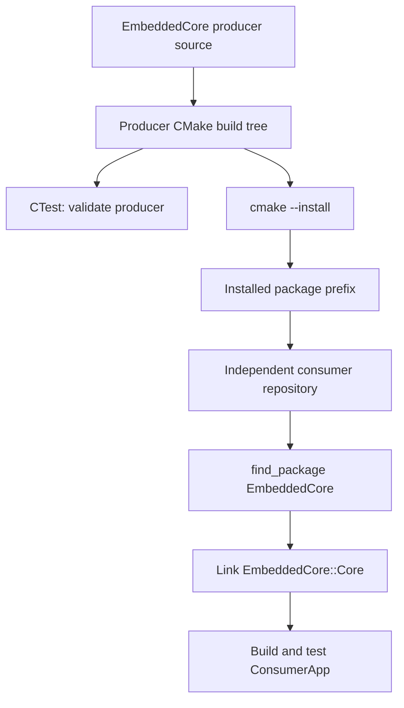
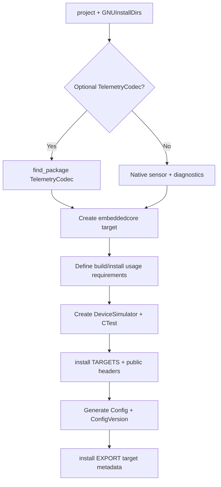
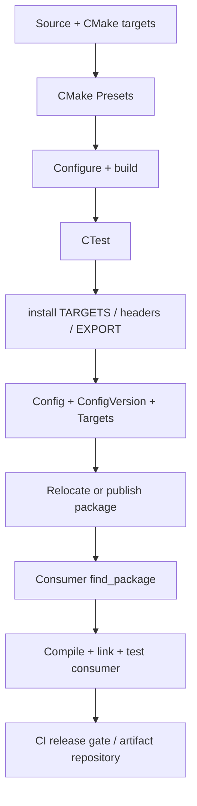

# Chapter 15 — CMake Presets, CTest, Installation, Package Exports, and Independent Consumers

> **Modern CMake University — Module VI: Production-Ready Build Artifacts**  
> **Level:** Advanced | **Estimated study time:** 8–12 hours including exercises  
> **Project:** EmbeddedCore static library + DeviceSimulator + independent ConsumerApp  
> **Prerequisites:** Chapters 1–14, CMake 3.23+, Ninja, a C++17 compiler. The primary native targets are Windows x64 (MSVC) and Linux x86-64 (GCC/Clang). The Android cases are design exercises unless an NDK is installed.

## Learning contract

By completing this chapter, you should be able to:

1. Explain why building a library is not equivalent to publishing a consumable library.
2. Design reusable CMake configure, build and test presets, including multi-configuration behavior.
3. Register meaningful tests with CTest, execute and filter them, and use failing tests in CI.
4. Install headers, static/shared binaries and generated CMake package metadata to an explicit staging prefix.
5. Distinguish the target being **exported**, its **export set**, the **generated targets file**, and the user-authored **package config template**.
6. Create `EmbeddedCoreConfig.cmake` and `EmbeddedCoreConfigVersion.cmake` correctly.
7. Make `find_package(EmbeddedCore CONFIG REQUIRED)` work from a completely independent source tree.
8. Understand `BUILD_INTERFACE`, `INSTALL_INTERFACE`, relocatability, version compatibility and transitive dependencies.
9. Verify a moved installation and troubleshoot incorrectly exported paths and missing packages.
10. Design a five-platform package layout that preserves OS, ABI, compiler and configuration identity.

## 1. The production problem: “It builds on my machine” is not a package

We have spent fourteen chapters making EmbeddedCore compile and link. In the earlier projects, DeviceSimulator normally lived in the same source tree as the library; CMake could directly reference the library target created by `add_library()`.

That is convenient for development but does **not** prove that another team can consume the library. Consider the following delivery scenario:

- A platform team builds EmbeddedCore on a Windows/MSVC build agent.
- A separate application team receives only an install directory or compressed artifact.
- Their repository contains neither EmbeddedCore source code nor its original CMake build tree.
- They run `find_package(EmbeddedCore 1.4 CONFIG REQUIRED)` and expect an imported target.
- Their compiler needs headers, while the linker needs the right library binary and any required dependent libraries.

A deliverable is usable only if the package provides all the information necessary for this workflow. A `.lib` or `.a` file alone cannot describe include paths, language requirements, public compile definitions, or transitive dependencies.

### 1.1 The three distinct projects



**Producer:** the project that compiles EmbeddedCore and owns its install rules.  
**Installed package:** the headers, binary archives and generated metadata delivered to another project.  
**Consumer:** an independently configured project importing that package.

> **Core rule:** A passing producer test is not a substitute for a passing **installed-package consumer test**.

## 2. Vocabulary: understand these before writing CMake

| Term | Precise meaning | Example |
|---|---|---|
| Target | CMake model of a binary or usage requirements | `embeddedcore` |
| Build-tree alias | Second name within the same build | `EmbeddedCore::Core` |
| Export name | Public name stored for the installed target | `Core` |
| Export set | Named group of installed targets | `EmbeddedCoreTargets` |
| Targets export file | Auto-generated CMake code defining imported targets | `EmbeddedCoreTargets.cmake` |
| Package configuration | Discovery entry point, generally author-templated | `EmbeddedCoreConfig.cmake` |
| Version configuration | Version compatibility decision logic | `EmbeddedCoreConfigVersion.cmake` |
| Installation prefix | Root of the staged install tree | `stage/linux-x86_64/Debug` |
| Imported target | Target describing a binary provided externally | `EmbeddedCore::Core` in consumer |
| Transitive usage requirement | Include, compile or link requirement inherited by consumers | C++17, public includes, linked libraries |

A particularly common error is confusing the **user-authored** `EmbeddedCoreConfig.cmake.in` with **CMake-generated** `EmbeddedCoreTargets.cmake`. Do not hand-edit a generated Targets file; maintain the producing target and install/export rules instead.

## 3. A realistic installation structure

Our producer emits this conceptual prefix on Linux:

```text
stage/linux-x86_64/Release/
├── include/
│   └── embeddedcore/
│       ├── sensor.hpp
│       └── diagnostics.hpp
├── lib/
│   ├── libembeddedcore.a
│   └── cmake/
│       └── EmbeddedCore/
│           ├── EmbeddedCoreConfig.cmake
│           ├── EmbeddedCoreConfigVersion.cmake
│           ├── EmbeddedCoreTargets.cmake
│           └── EmbeddedCoreTargets-release.cmake
```

The exact install lib directory may be `lib`, `lib64`, or another platform-appropriate path. We use `GNUInstallDirs` rather than guessing. The release-specific export fragment is an implementation detail; its exact name and capitalization can vary by generator/platform.

Windows with an MSVC static library commonly looks like:

```text
stage/windows-x64/Release/
├── include/embeddedcore/
├── lib/
│   ├── embeddedcore.lib
│   └── cmake/EmbeddedCore/
│       ├── EmbeddedCoreConfig.cmake
│       ├── EmbeddedCoreConfigVersion.cmake
│       └── EmbeddedCoreTargets*.cmake
```

A shared library build adds runtime deployment questions: on Windows the DLL is generally installed to `bin` while its import `.lib` goes to `lib`; Linux places the `.so` under the selected library directory. Chapter 9 covers runtime discovery in depth.

## 4. The completed lab layout

```text
labs/15-presets-ctest-install-package-exports/
├── README.md
├── starter/
├── solution/
│   ├── CMakeLists.txt
│   ├── CMakePresets.json
│   ├── cmake/EmbeddedCoreConfig.cmake.in
│   ├── include/embeddedcore/sensor.hpp
│   ├── include/embeddedcore/diagnostics.hpp
│   ├── src/sensor.cpp
│   ├── src/diagnostics.cpp
│   ├── app/main.cpp
│   └── tests/contract.cpp
├── independent-consumer/
│   ├── CMakeLists.txt
│   └── main.cpp
└── telemetrycodec/
    ├── CMakeLists.txt
    ├── cmake/TelemetryCodecConfig.cmake.in
    ├── include/telemetrycodec/codec.hpp
    └── src/codec.cpp
```

The lab includes a harmless TelemetryCodec producer to demonstrate the real failure mode where a package depends on a second installed package. It does not ship proprietary cryptographic binaries.

## 5. Begin with the CMake target, not installation commands

The producing project creates a static library with a clear public identity:

```cmake
add_library(embeddedcore STATIC
    src/sensor.cpp
    src/diagnostics.cpp
)

add_library(EmbeddedCore::Core ALIAS embeddedcore)

set_target_properties(embeddedcore PROPERTIES
    EXPORT_NAME Core
)

target_compile_features(embeddedcore PUBLIC cxx_std_17)

target_include_directories(embeddedcore PUBLIC
    "$<BUILD_INTERFACE:${CMAKE_CURRENT_SOURCE_DIR}/include>"
    "$<INSTALL_INTERFACE:${CMAKE_INSTALL_INCLUDEDIR}>"
)
```

### 5.1 Why the ALIAS and EXPORT_NAME serve different jobs

`EmbeddedCore::Core` can be used by in-repository targets because it is an `ALIAS` to `embeddedcore`. ALIAS targets are not themselves installed or exported. Instead, the real target is exported with `EXPORT_NAME Core`, and `install(EXPORT ... NAMESPACE EmbeddedCore::)` causes the consumer to see the **same spelling**: `EmbeddedCore::Core`.

This consistency lets you use the same modern target name inside and outside the repository.

### 5.2 `BUILD_INTERFACE` versus `INSTALL_INTERFACE`

During the source-tree build, the compiler needs headers inside the producer source directory. After installation, the headers live under the installation prefix. One absolute path cannot describe both environments safely.

`$<BUILD_INTERFACE:...>` applies when building from the producer tree; `$<INSTALL_INTERFACE:...>` describes the installed package's usage requirement. Here, the relative `include` directory is interpreted relative to the package prefix as part of the exported target. Do **not** bake in paths such as `C:/Users/Developer/.../include` or `/home/builder/.../include` for published packages.

Keep external dependency paths out of your installed interface. The dependency must instead publish its **own imported target** with its own usage requirements. [CMake `target_include_directories()` reference](https://cmake.org/cmake/help/latest/command/target_include_directories.html).

## 6. `GNUInstallDirs`: platform-aware destinations

```cmake
include(GNUInstallDirs)
```

This provides standard install directory variables such as:

| Variable | Typical role |
|---|---|
| `CMAKE_INSTALL_BINDIR` | Executables and Windows DLLs |
| `CMAKE_INSTALL_LIBDIR` | Libraries and package metadata |
| `CMAKE_INSTALL_INCLUDEDIR` | Public headers |
| `CMAKE_INSTALL_DATADIR` | Architecture-independent data |

Hardcoding `lib/` is sometimes adequate for a simple demonstration, but not necessarily for every Linux distribution or cross-compilation environment. Avoid assuming these variables are always identical on every platform.

## 7. `install(TARGETS ...)`: install the binary

```cmake
install(TARGETS embeddedcore
    EXPORT EmbeddedCoreTargets
    ARCHIVE DESTINATION ${CMAKE_INSTALL_LIBDIR}
    LIBRARY DESTINATION ${CMAKE_INSTALL_LIBDIR}
    RUNTIME DESTINATION ${CMAKE_INSTALL_BINDIR}
    INCLUDES DESTINATION ${CMAKE_INSTALL_INCLUDEDIR}
)

install(DIRECTORY include/
    DESTINATION ${CMAKE_INSTALL_INCLUDEDIR}
)
```

This installs our static archive and public headers. The `EXPORT EmbeddedCoreTargets` argument attaches the target to a named export set; it does **not** immediately write an `EmbeddedCoreTargets.cmake` file by itself.

The archive destination is important for static `.a` and MSVC `.lib` outputs. `LIBRARY` is used for shared-library binaries on applicable platforms, and `RUNTIME` for executables and Windows DLLs. `INCLUDES DESTINATION` contributes a public include directory usage requirement to the exported target.

The two include-related declarations are deliberate: `target_include_directories` controls build/install consumer usage requirements; `install(DIRECTORY ...)` actually copies the header bytes. One does not automatically replace the other.

## 8. `install(EXPORT ...)`: generate the targets file

```cmake
set(EMBEDDEDCORE_INSTALL_CMAKEDIR
    "${CMAKE_INSTALL_LIBDIR}/cmake/EmbeddedCore"
)

install(EXPORT EmbeddedCoreTargets
    FILE EmbeddedCoreTargets.cmake
    NAMESPACE EmbeddedCore::
    DESTINATION "${EMBEDDEDCORE_INSTALL_CMAKEDIR}"
)
```

This tells CMake to generate an importable targets file for every member of the export set. In a consumer build, the generated file defines `EmbeddedCore::Core` as an imported target, including its include directories, link location, and usage requirements.

**Never manually map the installed library filename for each consumer** if an exported target can do that work. The export can encode configuration-specific imported locations, including Debug and Release, where the relevant configurations are installed.

### 8.1 Common confusion: `export()` versus `install(EXPORT)`

`export()` can generate metadata referring to a **build tree**; `install(EXPORT)` produces the install-tree export. They serve different use cases. A build-tree export is not a substitute for a relocatable installed package, because it can legitimately contain paths into the producer's build directory.

## 9. The package config entry point

Our user-authored template `cmake/EmbeddedCoreConfig.cmake.in` is intentionally small:

```cmake
@PACKAGE_INIT@

include(CMakeFindDependencyMacro)

if(@EMBEDDEDCORE_WITH_TELEMETRY@)
    find_dependency(TelemetryCodec 1.2 CONFIG)
endif()

include("${CMAKE_CURRENT_LIST_DIR}/EmbeddedCoreTargets.cmake")

check_required_components(EmbeddedCore)
```

`@PACKAGE_INIT@` is expanded by `configure_package_config_file()` into helper code designed for install-tree packages. The `EmbeddedCoreTargets.cmake` file is then loaded using a path relative to the config file itself, not the producer's original source directory.

The dependency check occurs **before** including imported targets. If an exported target references `TelemetryCodec::TelemetryCodec`, consumers must be able to discover that target before the imported EmbeddedCore target is evaluated.

### 9.1 Why use `find_dependency()` rather than just `find_package()`?

`find_dependency()` is intended for dependencies of CMake Config packages and propagates relevant `REQUIRED` / `QUIET` semantics from the outer request. Use it in the installed package config when the package needs another package.

For a real optional feature, capture the selection at package build time. The consumer should not unknowingly inherit a different dependency graph from the producer. Our generated file bakes in whether telemetry was enabled.

### 9.2 Generate a relocatable config

```cmake
include(CMakePackageConfigHelpers)

configure_package_config_file(
    cmake/EmbeddedCoreConfig.cmake.in
    "${CMAKE_CURRENT_BINARY_DIR}/EmbeddedCoreConfig.cmake"
    INSTALL_DESTINATION "${EMBEDDEDCORE_INSTALL_CMAKEDIR}"
)
```

Using plain `configure_file()` is tempting, but the `CMakePackageConfigHelpers` version provides facilities intended for relocatable package configurations. You still have to avoid injecting absolute, build-machine-specific paths yourself.

[CMake `CMakePackageConfigHelpers` reference](https://cmake.org/cmake/help/latest/module/CMakePackageConfigHelpers.html).

## 10. Package versions and compatibility policy

A package's project version and version-compatibility policy are two separate concerns:

```cmake
project(EmbeddedCore VERSION 1.4.0 LANGUAGES CXX)

write_basic_package_version_file(
    "${CMAKE_CURRENT_BINARY_DIR}/EmbeddedCoreConfigVersion.cmake"
    VERSION "${PROJECT_VERSION}"
    COMPATIBILITY SameMajorVersion
)
```

With this policy, requests in the `1.x` major family can be eligible when the installed version is not older than the requested version. Exact and range requests add further constraints; always test the policy you actually intend to ship. `SameMajorVersion` is a **policy decision**, not proof of ABI compatibility: your team must maintain the ABI or document breaking changes and update the version policy accordingly.

Finally install the generated metadata:

```cmake
install(FILES
    "${CMAKE_CURRENT_BINARY_DIR}/EmbeddedCoreConfig.cmake"
    "${CMAKE_CURRENT_BINARY_DIR}/EmbeddedCoreConfigVersion.cmake"
    DESTINATION "${EMBEDDEDCORE_INSTALL_CMAKEDIR}"
)
```

The finished installation now has three independent pieces of CMake metadata: package config, version config, and target export(s).

## 11. Complete producer CMake configuration

The runnable `solution/CMakeLists.txt` is the authoritative complete sample in the ZIP. Its architecture, in order, is:



The library uses a single public facade: `EmbeddedCore::Core`. DeviceSimulator uses the build-tree alias; ConsumerApp uses the exported imported target. Both names match, but they are instantiated in different projects.

## 12. CMake Presets: codify how a team builds

Presets prevent every engineer or CI job from inventing slightly different configure commands. A project-owned `CMakePresets.json` can describe reusable configure, build, and test choices, while machine-specific paths belong in `CMakeUserPresets.json` or environment settings (the user file should not be committed with personal paths).

Our `solution/CMakePresets.json` contains:

| Configure preset | Generator | Binary directory | Configuration selection |
|---|---|---|---|
| `ninja-debug` | Ninja | `build/debug` | `CMAKE_BUILD_TYPE=Debug` |
| `ninja-release` | Ninja | `build/release` | `CMAKE_BUILD_TYPE=Release` |
| `ninja-multi` | Ninja Multi-Config | `build/multi` | `--config` at build/test time |

There are corresponding build presets (`debug`, `release`, `multi-debug`, `multi-release`) and test presets with the same names.

### 12.1 Run a Debug preset

Execute these commands from `solution/`:

```bash
cmake --preset ninja-debug
cmake --build --preset debug
ctest --preset debug
cmake --install build/debug --prefix stage/debug
```

### 12.2 Run a Release preset

```bash
cmake --preset ninja-release
cmake --build --preset release
ctest --preset release
cmake --install build/release --prefix stage/release
```

### 12.3 Run Ninja Multi-Config

```bash
cmake --preset ninja-multi
cmake --build --preset multi-debug
cmake --build --preset multi-release
ctest --preset multi-debug
ctest --preset multi-release
cmake --install build/multi --config Release --prefix stage/multi-release
```

The `--config Release` on the **install** command matters. A multi-configuration build tree can contain several configurations; do not expect `CMAKE_BUILD_TYPE` to select one there.

### 12.4 Important packaging caveat

Debug and Release packages may require separate destinations or correctly installed per-config export fragments. On Windows, MSVC runtime choices (`/MD`, `/MDd`, etc.) and Debug library variants can affect binary compatibility. Don't silently combine architectures, compiler runtime models, or incompatible build configurations under one unqualified artifact coordinate.

On Linux, Debug and Release may have identical output archive names and overwrite one another if installed to the same prefix; separate install prefixes or explicitly designed configuration-specific layouts avoid confusion.

[CMake Presets reference](https://cmake.org/cmake/help/latest/manual/cmake-presets.7.html).

## 13. CTest: make the build verifiable

The producer uses:

```cmake
include(CTest)

if(BUILD_TESTING)
    add_executable(embeddedcore_contract tests/contract.cpp)
    target_link_libraries(embeddedcore_contract PRIVATE EmbeddedCore::Core)
    add_test(NAME embeddedcore_contract COMMAND embeddedcore_contract)
    add_test(NAME simulator_smoke COMMAND DeviceSimulator)
    set_tests_properties(simulator_smoke PROPERTIES
        PASS_REGULAR_EXPRESSION "Device status: HEALTHY")
endif()
```

`include(CTest)` provides standard test integration and a `BUILD_TESTING` option. Registering tests doesn't execute them: after building, run CTest. The contract test returns nonzero on failure; the smoke test additionally verifies expected output.

Useful commands:

```bash
ctest --test-dir build/debug -N
ctest --test-dir build/debug --output-on-failure
ctest --test-dir build/debug -R embeddedcore_contract --output-on-failure
ctest --test-dir build/debug -j 2 --output-on-failure
```

On a multi-config build, include the configuration:

```bash
ctest --test-dir build/multi -C Release --output-on-failure
```

### 13.1 Producer tests do not validate exports

The producer test links against a target created in the producer's CMake project. It **cannot** detect all mistakes in installed metadata. This is why we test an independent consumer after installation.

### 13.2 Tests during cross-compilation

A compiler that can build Android ARM64 code on Linux does not imply Linux can execute the produced Android binary. For target-specific jobs, use compile-only checks, an emulator, or actual target hardware. Never mark a cross-platform runtime check “passed” merely because compilation succeeded.

## 14. The decisive test: completely independent consumer

The `independent-consumer/CMakeLists.txt` contains:

```cmake
cmake_minimum_required(VERSION 3.23)
project(IndependentConsumer LANGUAGES CXX)

find_package(EmbeddedCore 1.4 CONFIG REQUIRED)

add_executable(ConsumerApp main.cpp)
target_link_libraries(ConsumerApp PRIVATE EmbeddedCore::Core)

include(CTest)
if(BUILD_TESTING)
    add_test(NAME consumer_contract COMMAND ConsumerApp)
endif()
```

It does not call `add_subdirectory()` on EmbeddedCore. It doesn't include headers from the producer's source tree. It obtains the public library through the installed package and `find_package()`.

### 14.1 Configure and install the producer on Linux

From `labs/15-presets-ctest-install-package-exports`:

```bash
cmake -S solution -B solution/build/debug -G Ninja -DCMAKE_BUILD_TYPE=Debug
cmake --build solution/build/debug
ctest --test-dir solution/build/debug --output-on-failure
cmake --install solution/build/debug --prefix "$PWD/solution/stage/debug"
```

### 14.2 Configure and test the consumer on Linux

```bash
cmake -S independent-consumer -B independent-consumer/build/debug -G Ninja \
  -DCMAKE_BUILD_TYPE=Debug \
  -DCMAKE_PREFIX_PATH="$PWD/solution/stage/debug"
cmake --build independent-consumer/build/debug
ctest --test-dir independent-consumer/build/debug --output-on-failure
```

Expected consumer output:

```text
Independent consumer OK: TEMP:25.500000
```

### 14.3 Windows / Visual Studio 2019 Native Tools Command Prompt

From the lab directory in an **x64 Native Tools Command Prompt for VS 2019**, run:

```bat
cmake -S solution -B solution\build\win -G "Ninja Multi-Config"
cmake --build solution\build\win --config Release
ctest --test-dir solution\build\win -C Release --output-on-failure
cmake --install solution\build\win --config Release --prefix "%CD%\solution\stage\win-release"
cmake -S independent-consumer -B independent-consumer\build\win -G "Ninja Multi-Config" "-DCMAKE_PREFIX_PATH=%CD%\solution\stage\win-release"
cmake --build independent-consumer\build\win --config Release
ctest --test-dir independent-consumer\build\win -C Release --output-on-failure
```

Ensure Ninja is on `PATH`. If MSVC's toolchain is not initialized, the configuration may pick a different compiler or fail. Avoid configuring the same build tree first with GCC and then with MSVC.

## 15. How package discovery works

CMake's Config-mode `find_package()` searches known prefixes and locations for package configuration files. A common installed location is `lib/cmake/EmbeddedCore/EmbeddedCoreConfig.cmake` underneath the prefix.

Three useful ways to direct lookup:

```bash
cmake -S independent-consumer -B build/consumer \
  -DCMAKE_PREFIX_PATH=/absolute/path/to/stage
```

```bash
cmake -S independent-consumer -B build/consumer \
  -DEmbeddedCore_DIR=/absolute/path/to/stage/lib/cmake/EmbeddedCore
```

```bash
cmake -S independent-consumer -B build/consumer --debug-find-pkg=EmbeddedCore
```

`CMAKE_PREFIX_PATH` supplies prefixes searched for all packages; `EmbeddedCore_DIR` points at the directory holding this package's config file. The latter is often useful for debugging but hardcoding it into portable project source is undesirable.

### 15.1 CMake cache staleness

After a successful discovery, CMake may cache paths. When testing relocation, use a **fresh consumer build directory**, or explicitly clear the appropriate cache entries. Otherwise, a previously discovered location can make the outcome misleading.

## 16. Relocatability: verify it, don't assume it

An installed package is relocatable when you can move the install prefix to a different directory and still find and use it without rebuilding EmbeddedCore.


Test this with a clean destination. If you leave the original prefix in place, a stale absolute path may accidentally continue working.

### 16.1 The typical path leak

Bad:

```cmake
set_target_properties(embeddedcore PROPERTIES
    INTERFACE_INCLUDE_DIRECTORIES "/home/ci/agent/workspace/embeddedcore/include"
)
```

Better:

```cmake
target_include_directories(embeddedcore PUBLIC
    "$<BUILD_INTERFACE:${CMAKE_CURRENT_SOURCE_DIR}/include>"
    "$<INSTALL_INTERFACE:${CMAKE_INSTALL_INCLUDEDIR}>"
)
```

Other ways to break relocation include embedding an absolute external dependency path, forgetting a required binary/header, using a generated config that refers to the original build tree, or failing to package runtime libraries when shared libraries are used.

**Important:** A relocatable CMake package is not automatically an application that runs on any operating system. It still must match the target OS, CPU architecture, ABI, compiler/runtime constraints, and dynamic loader requirements.

## 17. External dependencies: why `find_dependency()` is essential

Chapter 14 taught us to select correct dependencies. This chapter teaches us to **publish** the resulting dependency relationships.

Consider the optional TelemetryCodec build:

```cmake
option(EMBEDDEDCORE_WITH_TELEMETRY "Use installed TelemetryCodec package" OFF)

if(EMBEDDEDCORE_WITH_TELEMETRY)
    find_package(TelemetryCodec 1.2 CONFIG REQUIRED)
endif()

if(EMBEDDEDCORE_WITH_TELEMETRY)
    target_link_libraries(embeddedcore PUBLIC
        TelemetryCodec::TelemetryCodec)
endif()
```

Because this is a **public** dependency, `EmbeddedCore::Core` exports its requirement for the `TelemetryCodec::TelemetryCodec` target. Even if your own public headers don't expose TelemetryCodec types, a static library may need the dependency at final link time. In larger codebases, decide `PUBLIC` versus `PRIVATE` according to the actual API and link relationships; static `PRIVATE` dependencies may still appear in export metadata as link-only usage requirements.

### 17.1 Build and install the dependency first

From the Chapter 15 lab directory on Linux:

```bash
cmake -S telemetrycodec -B telemetrycodec/build -G Ninja
cmake --build telemetrycodec/build
cmake --install telemetrycodec/build --prefix "$PWD/shared-stage"
```

### 17.2 Build and install EmbeddedCore into the same prefix

```bash
cmake -S solution -B solution/build/telemetry -G Ninja \
  -DEMBEDDEDCORE_WITH_TELEMETRY=ON \
  -DCMAKE_PREFIX_PATH="$PWD/shared-stage"
cmake --build solution/build/telemetry
ctest --test-dir solution/build/telemetry --output-on-failure
cmake --install solution/build/telemetry --prefix "$PWD/shared-stage"
```

### 17.3 The independent consumer discovers both packages

```bash
cmake -S independent-consumer -B independent-consumer/build/telemetry -G Ninja \
  -DCMAKE_PREFIX_PATH="$PWD/shared-stage"
cmake --build independent-consumer/build/telemetry
ctest --test-dir independent-consumer/build/telemetry --output-on-failure
```

Expected output:

```text
Independent consumer OK: TELEMETRY:TEMP=25.5
```

The installed EmbeddedCoreConfig invokes `find_dependency(TelemetryCodec ...)`. If TelemetryCodec is absent, the consumer should **fail at configure time** rather than quietly dropping the dependency.

### 17.4 OpenSSL in a real package

Replace the educational TelemetryCodec with your carefully selected OpenSSL package only when ready:

```cmake
find_package(OpenSSL REQUIRED COMPONENTS Crypto)
target_link_libraries(embeddedcore PRIVATE OpenSSL::Crypto)
```

If an installed EmbeddedCore static archive requires OpenSSL at the final link stage, its exported package must make the appropriate OpenSSL targets discoverable in the consumer project, for example with `find_dependency(OpenSSL ...)`. This still **does not merge OpenSSL binaries into the EmbeddedCore static archive**. Real FIPS/compliance-specific requirements need additional artifact identity and operational validation beyond package discovery; see Chapter 14.

## 18. Version compatibility, configuration variants, and ABIs

### 18.1 Version test matrix

Given an installed `EmbeddedCore` version `1.4.0` with `SameMajorVersion`:

| Consumer request | Expected policy outcome |
|---|---|
| `find_package(EmbeddedCore 1.4 CONFIG REQUIRED)` | Eligible |
| `find_package(EmbeddedCore 1.2 CONFIG REQUIRED)` | Eligible if no other constraint excludes it |
| `find_package(EmbeddedCore 2.0 CONFIG REQUIRED)` | Rejected |
| `find_package(EmbeddedCore 1.4.0 EXACT CONFIG REQUIRED)` | Exact match |

CMake's version policy knows nothing about your true ABI compatibility. If your release breaks binary compatibility while retaining a major version, the `SameMajorVersion` policy alone cannot protect consumers.

### 18.2 Five-target artifact layout

In our capstone pipeline, prefer a separate artifact for each target identity:

```text
artifacts/
├── windows-x64-msvc/
│   ├── Debug/embeddedcore-package.zip
│   └── Release/embeddedcore-package.zip
├── linux-x86_64-gcc/
│   ├── Debug/embeddedcore-package.tar.gz
│   └── Release/embeddedcore-package.tar.gz
└── android-ndk/
    ├── armeabi-v7a/Release/embeddedcore-package.tar.gz
    ├── arm64-v8a/Release/embeddedcore-package.tar.gz
    └── x86_64/Release/embeddedcore-package.tar.gz
```

It is possible to design a combined artifact containing multiple ABIs and configurations, but that requires deliberate imported-target mappings, selection rules, and versioned artifact metadata. A simple starting point is **one platform/ABI/configuration per archive**.

### 18.3 Do not assume cross-compiled consumers can run on the build host

A cross-compiled install tree can be verified by configuring and linking a consumer with the **same target toolchain**. Runtime tests must execute where the target binary is supported. An Android static library built for `arm64-v8a` cannot be executed directly on ordinary Linux x86-64.

### 18.4 Avoid host dependency leakage

During Android builds, point discovery toward target-compatible packages and configure the NDK toolchain and ABI explicitly. Do not let a package search accidentally select `/usr/lib` from the Linux host for a target Android build. Verify the actual archive format and architecture with binary inspection tools, not merely the package directory name.

## 19. A deliberately broken package: diagnosis table

| Symptom | Likely cause | Correct investigation |
|---|---|---|
| `Could not find EmbeddedCoreConfig.cmake` | Prefix not provided, package not installed | Inspect installation, `CMAKE_PREFIX_PATH`, `--debug-find-pkg` |
| Export set missing target | Installed target not attached to the export set | Check `install(TARGETS ... EXPORT ...)` and `install(EXPORT ...)` |
| Includes resolve inside producer but not consumer | Missing public header install or wrong `INSTALL_INTERFACE` | Inspect installed `include/` and target properties |
| Imported target names don't match | `EXPORT_NAME`/`NAMESPACE` mismatch | Check generated Targets file |
| Cannot find TelemetryCodec target | Missing `find_dependency()` or missing installed dependency | Inspect Config and package prefix |
| Link fails only for static builds | Transitive static dependency unresolved | Inspect exported link interface and dependent packages |
| Release binary links, Debug fails on Windows | Configuration/CRT/library variant mismatch | Inspect imported configuration, runtime mode and MSVC toolset |
| Relocated package fails | Absolute original path embedded | Inspect installed config/target metadata and clean consumer cache |
| Wrong processor architecture | Incorrect artifact selection | Inspect archive machine type and toolchain/sysroot |
| `ctest` shows no tests | Tests not enabled/registered | Check `include(CTest)`, `BUILD_TESTING`, `add_test()` |

### 19.1 Error lab: “Some targets in this export set were not installed”

If you install an exporting target that publicly references another in-tree target that is **neither exported nor represented by an external imported package**, CMake may report an export-set dependency issue. Fix the package boundary: export the needed in-tree target or represent the external dependency using `find_package` and its imported target. Avoid replacing the dependency with an absolute hardcoded archive path as a workaround.

## 20. Hands-on laboratory plan

The downloadable project supports the following independent experiments:

1. **Build Debug using presets.** Configure, build and run CTest; inspect the cache and build directory.
2. **Build Release.** Compare produced archives and note that build configuration is not an architecture switch.
3. **Build with Ninja Multi-Config.** Compile Debug and Release from one configured build directory; install an explicitly selected configuration.
4. **Inspect installed metadata.** Identify `EmbeddedCoreConfig.cmake`, version config, exported target file and per-configuration files.
5. **Compile an independent consumer.** Configure another repository solely through the installation prefix.
6. **Relocate the package.** Move the prefix and rebuild with a clean consumer cache.
7. **Validate package versions.** Demand 2.0 and observe the configure-time rejection.
8. **Enable external TelemetryCodec.** Install both producers, then independently consume EmbeddedCore.
9. **Create an intentional missing dependency.** Hide the TelemetryCodec package config in a *copy* of the install tree and confirm a clean consumer configure fails.
10. **Test missing headers.** Remove public headers from a *copy* of the prefix and observe the consumer compile failure.
11. **Turn off BUILD_TESTING.** Confirm the producer still builds but tests are not registered.
12. **Inspect installation for absolute paths.** Look for leaked build-root paths; avoid mistaking benign comments or metadata for required library locations.
13. **Read the Windows CI job.** Explain why it uses `-C` with CTest and `--config` for the install.
14. **Design Android consumers.** Describe how you would validate imported archive architecture for all three ABIs before linking.

## 21. CI/CD: the independent consumer is a release gate

The provided `.github/workflows/chapter15-build.yml` demonstrates a Linux/Windows × Debug/Release matrix. Every job:


The CI job does **not** assume that building the producer proves publishability. It uses a new consumer project and an installed prefix. This is a much stronger contract test.

A production pipeline should additionally collect and publish immutable artifacts with checksums, attach version/target metadata, sign or attest provenance as required, scan dependencies, and promote only packages that passed policy gates. Artifacts compiled by one job should not be silently mixed with those from other OS/ABI configurations.

### 21.1 What about Jenkins and Nexus?

A Jenkins pipeline can use the same commands. The artifact repository is a **publication location**, not a replacement for local verification. A robust sequence is build → unit tests → install → independent consumer test → archive and checksum → approved publication. The actual Jenkins/Nexus workflow will be built in Chapter 16.

## 22. Exercises — student submissions

### Assignment A — Add a new public header (beginner)

Add `include/embeddedcore/version.hpp` with a function declaration and implementation returning the package version. Install the header; update the independent consumer to print it. A successful in-tree build is not enough—show the installed consumer works.

**Evidence:** compiler output, install tree listing, consumer output.

### Assignment B — Split configuration packages (intermediate)

Generate Debug and Release installations into distinct prefixes. Describe under what conditions two configurations can legitimately share one installation and what breaks if identically named `.lib`/`.a` files overwrite one another.

**Evidence:** artifact tree and target import configuration.

### Assignment C — Introduce an intentional relocatability defect (intermediate)

In a disposable branch, replace a correct install interface with an absolute source include path. Observe export validation or relocation failures. Repair it using `BUILD_INTERFACE` and `INSTALL_INTERFACE`.

**Evidence:** a failing configuration log and corrected rebuilt consumer.

### Assignment D — Depend on a second package (advanced)

Enable TelemetryCodec as an imported package and install both into one prefix. Prove that removing the dependency package causes a useful configure-time error in an independent consumer.

**Evidence:** successful and negative consumer results.

### Assignment E — Build a package validator script (advanced)

Write a shell or Python script that verifies the presence of public headers, archive, config, version file and exported target metadata for a given prefix. Avoid embedding absolute developer paths. Explain why checking files is still insufficient to prove ABI compatibility.

**Evidence:** script and sample results.

### Assignment F — Five-platform artifact manifest (advanced)

For Windows x64, Linux x86-64, Android ARMv7, Android ARM64 and Android x86-64, design a manifest with version, OS, ABI, toolchain, build configuration, dependency profile, file checksum and compatible runtime constraints. Explain how consumers choose a package deterministically.

**Evidence:** sample manifest and selection rules; never claim these targets were executed unless they were actually built.

## 23. Self-assessment: 15 questions

1. Why can't a consumer normally use a library merely because `libembeddedcore.a` exists?
2. What is the difference between an `ALIAS` and an exported imported target?
3. Which install command associates a target with an export set?
4. Which install command creates the file that defines imported targets?
5. Should you hand-edit `EmbeddedCoreTargets.cmake`? Explain.
6. What does `@PACKAGE_INIT@` do in a package config template?
7. Why do we use `configure_package_config_file()` instead of plain `configure_file()` here?
8. What is the difference between `CMAKE_PREFIX_PATH` and `EmbeddedCore_DIR`?
9. Why should a consumer use `EmbeddedCore::Core` instead of absolute archive paths?
10. How do `BUILD_INTERFACE` and `INSTALL_INTERFACE` prevent path leakage?
11. Why can a static library still need link dependencies in the final executable?
12. Which CTest argument selects Release for Ninja Multi-Config?
13. What does `SameMajorVersion` guarantee, and what does it **not** guarantee?
14. How do you test relocation without being fooled by a stale CMake cache?
15. Why is a successful native Linux producer build insufficient proof that an Android ARM64 package will work?

The separate `solutions/` directory contains a concise answer key.

## 24. Chapter completion rubric

| Evidence | Minimum acceptance |
|---|---|
| Producer | Build succeeds in a clean build directory |
| Producer tests | CTest tests run and pass |
| Staged installation | Headers, archive, Config, Version, Targets files exist |
| Independent consumer | `find_package` resolves installed prefix; build and tests pass |
| Relocation | Copied prefix works after original is unavailable and cache is fresh |
| Dependencies | Required external package is discovered or configuration fails clearly |
| Architecture | Artifact identity rules explained; no cross-ABI binary mixing |
| Documentation | Commands are reproducible without proprietary environment variables |

## 25. Summary: the complete CMake package lifecycle

The point of this chapter is not memorizing CMake commands—it is designing a **stable contract between the library producer and consumer**.



Your public library now has the tools to be tested, installed, versioned, exported and independently consumed. The **last** step in the course is to turn this verified lifecycle into a repeatable build-and-release pipeline for all five platform targets.

## 26. Official further reading

- [CMake Importing and Exporting Guide](https://cmake.org/cmake/help/latest/guide/importing-exporting/index.html)
- [CMake `install()` command](https://cmake.org/cmake/help/latest/command/install.html)
- [CMake `CMakePackageConfigHelpers`](https://cmake.org/cmake/help/latest/module/CMakePackageConfigHelpers.html)
- [CMake Presets](https://cmake.org/cmake/help/latest/manual/cmake-presets.7.html)
- [CMake `target_include_directories()`](https://cmake.org/cmake/help/latest/command/target_include_directories.html)
- [CMake Using Dependencies Guide](https://cmake.org/cmake/help/latest/guide/using-dependencies/index.html)
- [CTest documentation](https://cmake.org/cmake/help/latest/manual/ctest.1.html)

---

**Next chapter — Chapter 16:** Jenkins, GitHub Actions, build matrices, artifact repositories, traceability and production CI/CD for Windows x64, Linux x86-64 and three Android ABIs.
