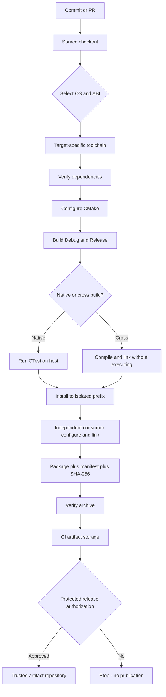
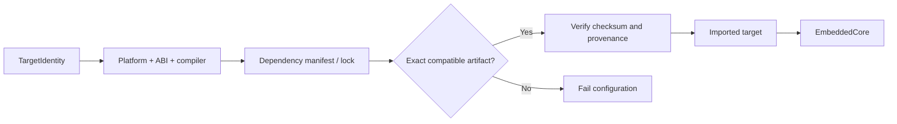
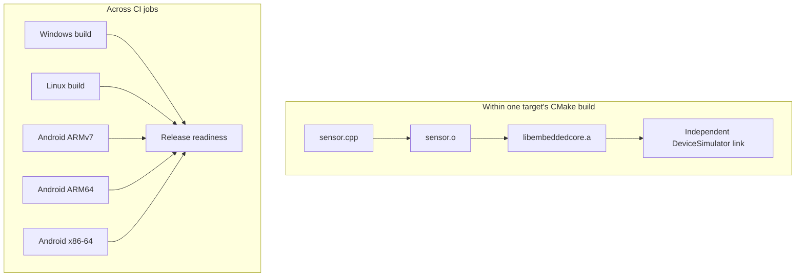
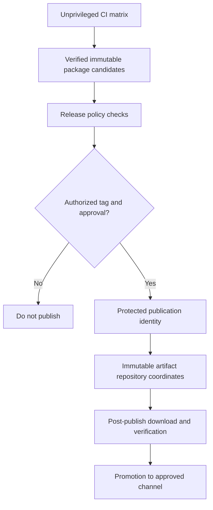

**Course navigation:** [Course home](../../README.md) · [← Chapter 15](../15-presets-ctest-install-package-exports/README.md) · End of core curriculum

# Chapter 16 — Production CI/CD for C++: Jenkins, GitHub Actions, and Five-Platform Release Engineering

> **Modern CMake University · Module VI · Chapter 16 of 16**  
> Level: Advanced · Estimated study time: 8–12 hours, plus optional CI account setup  
> Teaching project: **EmbeddedCore** (static C++ library) and **DeviceSimulator** (independent consumer)

**Essential question:** How do you turn a cross-platform CMake project into a verified, reusable, traceable release artifact without confusing compilation, testing, installation, package verification, and publication?

This chapter is designed as a self-contained university-style capstone. It assumes you have completed the concepts of the previous 15 chapters, but includes command explanations for each lab. Our public example uses no proprietary source code, package URLs, or credentials. The five target environments are Windows x64, Linux x86-64, Android ARMv7, Android ARM64, and Android x86-64. We build **Debug and Release** for each target.

## Learning outcomes

At the end, you should be able to:

1. Design a CI build graph with explicit platform, architecture, configuration, toolchain, and dependency identity.
2. Explain how an execution host differs from the target of the compiled artifact.
3. Create identical core build semantics across Jenkins and GitHub Actions by sharing repository scripts.
4. Configure CMake with isolated build trees and package install prefixes.
5. Run native unit tests, cross-compile checks, and independent package-consumer tests without misrepresenting what was validated.
6. Produce a package containing library binaries, public headers, CMake exports, manifests, and checksums.
7. Verify package contents and detect negative cases, such as incompatible toolchains or missing approved dependencies.
8. Explain trust boundaries: untrusted pull requests, credentials, provenance, signing, promotion, and immutable repository storage.
9. Diagnose build, test, package, deploy, and publishing failures separately.
10. Propose a CI release policy for a product with a multi-platform native C++ dependency tree.

## Prerequisites and scope

**Linux:** CMake 3.23+, Ninja, GCC or Clang, Python 3.11+ and Bash. **Windows:** Visual Studio 2019 or newer C++ build tools with the x64 developer environment, CMake 3.23+, Ninja, Python, and PowerShell. **Android:** a known NDK version and enough SDK installation to configure its CMake toolchain. A real Android device or emulator is required to *execute* Android test programs; cross-linking a consumer alone does not constitute Android runtime testing.

Native GNU/Linux sample code is validated as part of preparing this chapter. GitHub-hosted and Jenkins runners depend on your service configuration, installed toolchains, platform images and credentials. The scripts are educational production-oriented examples, **not** a certification of security, binary reproducibility, FIPS compliance, or software supply-chain provenance.

---

## 1. What changed since Chapter 15?

In Chapter 15, we made EmbeddedCore installable, exported `EmbeddedCore::Core`, and proved that an independent consumer could find and link it. That was the *producer–consumer contract*. Chapter 16 scales that contract across multiple toolchains and automates it in CI.

A developer might run `cmake --build build` and see `Build succeeded`. That alone does not answer: Was the compiler configured for Android ARM64 or host Linux? Were the headers the consumer will see actually installed? Did the binary link against the intended third-party dependencies? Were Debug and Release accidentally combined into the same archive? Does the package still resolve from an entirely separate directory? Did any checksum change after packaging? Is the uploaded result eligible for release or merely a temporary PR artifact?

**Design rule:** A CI job must produce both an artifact and evidence about how it was produced and validated.



Mermaid renders natively on GitHub. The arrow from cross build to install does **not** mean Android unit tests ran; it means compile/link validation was completed.

## 2. Define the build identity before building

The phrase “Android build” is incomplete. A precise artifact identity includes at least target OS, ABI, toolchain/NDK, build configuration, project version, dependency-set identity, and source revision.

| Target key | OS | ABI | Compiler context | Native execution in this lab? |
|---|---|---|---|---|
| `windows-x64` | Windows | x86-64 | MSVC developer tools | Yes, on Windows runner |
| `linux-x86_64` | Linux | x86-64 | GCC or Clang | Yes, on Linux runner |
| `android-armeabi-v7a` | Android | ARMv7 | NDK Clang + Android sysroot | No |
| `android-arm64-v8a` | Android | AArch64 | NDK Clang + Android sysroot | No |
| `android-x86_64` | Android | x86-64 | NDK Clang + Android sysroot | No |

The target key is a convenient build-system identifier, **not** a replacement for validating actual compiler and binary metadata. For Windows MSVC builds, details such as MSVC toolset, CRT selection, and architecture matter. For Android builds, include the NDK version and `ANDROID_PLATFORM` API level in your release policy. For Linux, consider minimum supported glibc/libstdc++ versions and compiler ABI expectations.

In this reference project, two build configurations for each target produce ten target/configuration combinations:

```text
build/
  windows-x64/Debug/
  windows-x64/Release/
  linux-x86_64/Debug/
  linux-x86_64/Release/
  android-armeabi-v7a/Debug/
  android-armeabi-v7a/Release/
  android-arm64-v8a/Debug/
  android-arm64-v8a/Release/
  android-x86_64/Debug/
  android-x86_64/Release/
```

This example uses separate single-configuration Ninja trees. With **Ninja Multi-Config**, Debug and Release may share one configured tree *for the same OS, ABI and toolchain*. Switching from ARM64 to ARMv7 is not a configuration switch. Changing `CMAKE_TOOLCHAIN_FILE` or `ANDROID_ABI` in an already-configured cache is unsafe; use a distinct build tree.

### Architecture-level dependency policy



The lesson from Chapter 14 still holds: an imported target that resolves to the wrong binary is worse than one that fails early. Never silently substitute generic OpenSSL for a dependency that is explicitly required to be a validated cryptographic module. FIPS validation depends on approved module identity, usage and operational requirements, not on a filename or a `-DFIPS=ON` switch. The public capstone deliberately fails if `EMBEDDEDCORE_REQUIRE_APPROVED_CRYPTO=ON`; it does not claim approved cryptography.

---

## 3. Choose a CI system, but keep one build contract

It is tempting to put all compilation logic inside a 500-line Jenkinsfile, then rewrite it in GitHub Actions YAML. This causes two independent implementations of build semantics to drift.

A better division of responsibilities is:

| Responsibility | CMake / repository scripts | CI orchestrator |
|---|---|---|
| Build target definitions | Yes | No |
| Toolchain and ABI flags | Yes | Supplies selected target/environment |
| Source-to-library compilation | Yes | Invokes |
| Producer/consumer tests | Yes | Records reports |
| Install tree and manifest | Yes | Archives outputs |
| Credentials and permissions | No | Yes, tightly scoped |
| Parallel agents, retries, scheduling | No | Yes |
| Release approval and promotion | Separate trusted script/service | Controls authorization |

Our two reusable entry points are `scripts/ci-build.sh` for Linux/Android and `scripts/ci-build.ps1` for Windows. Both follow the same contract: **configure → build → test when runnable → install → independently consume → test when runnable → package**.

For production, factor the common logic further if needed, but keep platform-specific shell quoting and compiler environment setup explicit rather than hiding them under an untested abstraction.

## 4. Revisit the producer CMake project

The lab's producer uses a portable CMake target:

```cmake
add_library(embeddedcore STATIC src/sensor.cpp)
add_library(EmbeddedCore::Core ALIAS embeddedcore)
set_target_properties(embeddedcore PROPERTIES EXPORT_NAME Core)

target_compile_features(embeddedcore PUBLIC cxx_std_17)
target_include_directories(embeddedcore PUBLIC
    "$<BUILD_INTERFACE:${CMAKE_CURRENT_SOURCE_DIR}/include>"
    "$<INSTALL_INTERFACE:${CMAKE_INSTALL_INCLUDEDIR}>")
```

**Why `EXPORT_NAME Core`?** The in-tree target is `embeddedcore`, but a consumer sees the exported namespace target `EmbeddedCore::Core`. **Why `PUBLIC` includes?** Any consumer including `embeddedcore/sensor.hpp` needs the public header directory. **Why `BUILD_INTERFACE` and `INSTALL_INTERFACE`?** Development paths and installed-package paths differ. An export containing the original developer's absolute source path is not truly relocatable.

The install rules register a target export set, install headers, generate `EmbeddedCoreConfig.cmake`, generate `EmbeddedCoreConfigVersion.cmake`, and install `EmbeddedCoreTargets.cmake`. A complete CMake package contains more than a `.a` or `.lib` file.

```cmake
install(TARGETS embeddedcore EXPORT EmbeddedCoreTargets
    ARCHIVE DESTINATION ${CMAKE_INSTALL_LIBDIR}
    LIBRARY DESTINATION ${CMAKE_INSTALL_LIBDIR}
    RUNTIME DESTINATION ${CMAKE_INSTALL_BINDIR}
    INCLUDES DESTINATION ${CMAKE_INSTALL_INCLUDEDIR})

install(EXPORT EmbeddedCoreTargets
    FILE EmbeddedCoreTargets.cmake
    NAMESPACE EmbeddedCore::
    DESTINATION "${CMAKE_INSTALL_LIBDIR}/cmake/EmbeddedCore")
```

Inspect the real `CMakeLists.txt` in the solution for package config and version-file generation. The official [CMake Importing and Exporting Guide](https://cmake.org/cmake/help/latest/guide/importing-exporting/index.html) describes this workflow.

## 5. CMake build graph versus CI dependency graph

These are related but different graphs. CMake tracks target build dependencies; your CI orchestrator tracks jobs and release gates.



CMake can successfully compile a single target while unrelated matrix jobs fail. A release gate must require the desired full matrix and validation policy, not whichever job happened to finish first. For example, a release policy may require all three Android configurations to cross-link and one or more Android ABIs to pass device tests in a dedicated device farm. These are distinct requirements.

---

## 6. Lab A — Linux native Debug and Release

Start in the reference solution directory:

```bash
cd labs/16-production-cicd-five-platforms/solution
bash scripts/ci-build.sh linux-x86_64 Debug
bash scripts/ci-build.sh linux-x86_64 Release
```

The Bash script accepts only known platform identities and `Debug` or `Release`. It verifies the host is Linux x86-64 before using the native toolchain. It intentionally rejects Windows targets and an Android target with no explicit NDK. The script uses `set -euo pipefail` so failed commands stop the pipeline.

The critical configure/build commands are:

```bash
cmake -S "$ROOT" -B "$BUILD" -G Ninja -DCMAKE_BUILD_TYPE="$CONFIG"
cmake --build "$BUILD" --parallel
```

`-S` identifies the source tree, `-B` isolates generated files, `-G Ninja` chooses the generator, and `CMAKE_BUILD_TYPE` selects flags for the single-configuration Ninja generator. `--parallel` enables independent compile tasks to run concurrently; it does not cross-build platforms in one invocation.

After the build, native CTest runs:

```bash
ctest --test-dir "$BUILD" \
  --output-on-failure \
  --output-junit "$BUILD/producer-junit.xml"
```

CTest's JUnit output can be ingested by Jenkins and other test-report systems. This file reports only tests *actually executed*. For Android builds, the reference script disables runtime tests and does not manufacture green results.

### What constitutes a passing producer test?

The example checks that the simulated sensor reads 25.5°C, that 25.5°C is healthy, and that 45°C is not healthy. This is a small functional test, useful for verifying the CI pipeline but not an adequate test suite for real embedded firmware. Production tests should cover module APIs, boundary values, compiler options, error paths, concurrency, exception behavior (if enabled), and appropriate integration/device scenarios.

## 7. Lab B — Install and independently consume the package

After unit tests, the script installs the producer into a target- and configuration-specific prefix:

```bash
cmake --install "$BUILD" --prefix "$STAGE"
```

For Linux, the reference tree resembles:

```text
out/stage/linux-x86_64/Release/
  include/embeddedcore/sensor.hpp
  lib/libembeddedcore.a
  lib/cmake/EmbeddedCore/
    EmbeddedCoreConfig.cmake
    EmbeddedCoreConfigVersion.cmake
    EmbeddedCoreTargets.cmake
    EmbeddedCoreTargets-release.cmake
```

The independent consumer has its own directory, `consumer/CMakeLists.txt`:

```cmake
find_package(EmbeddedCore 2 CONFIG REQUIRED)
add_executable(DeviceSimulator main.cpp)
target_link_libraries(DeviceSimulator PRIVATE EmbeddedCore::Core)
```

It deliberately does not use `add_subdirectory()` on EmbeddedCore and does not compile `sensor.cpp` itself. CMake must discover the installed exported target and its associated public include directories and static library.

Configure the consumer with the installed prefix:

```bash
cmake -S "$ROOT/consumer" -B "$CONSUMER" -G Ninja \
  -DCMAKE_BUILD_TYPE="$CONFIG" \
  -DCMAKE_PREFIX_PATH="$STAGE"
cmake --build "$CONSUMER" --parallel
```

For a native target, `ctest --test-dir "$CONSUMER" --output-on-failure` runs the consumer executable. A failure here may indicate exported target errors, missing public headers, unresolved dependencies, incorrect install locations or ABI mismatch—even if the producer's unit tests were all green.

**Production strengthening:** Repeat this test from a clean workspace in which the original source and build directories are unavailable. For relocatability, move the install prefix to a new directory and reconfigure a fresh consumer there. Chapter 15 developed the full relocation experiment.

---

## 8. Lab C — Build Android ABIs without running foreign executables

The NDK supplies an official CMake toolchain:

```bash
cmake -S . -B build/android-arm64-v8a/Release -G Ninja \
  -DCMAKE_TOOLCHAIN_FILE="$ANDROID_NDK_HOME/build/cmake/android.toolchain.cmake" \
  -DANDROID_ABI=arm64-v8a \
  -DANDROID_PLATFORM=android-24 \
  -DCMAKE_BUILD_TYPE=Release \
  -DBUILD_TESTING=OFF
```

Our script maps these target IDs to NDK ABIs:

| Target ID | `ANDROID_ABI` | Instruction architecture |
|---|---|---|
| `android-armeabi-v7a` | `armeabi-v7a` | ARMv7 |
| `android-arm64-v8a` | `arm64-v8a` | AArch64 |
| `android-x86_64` | `x86_64` | x86-64 |

Run one target at a time:

```bash
export ANDROID_NDK_HOME=/path/to/android-ndk
bash scripts/ci-build.sh android-armeabi-v7a Release
bash scripts/ci-build.sh android-arm64-v8a Release
bash scripts/ci-build.sh android-x86_64 Release
```

Each build produces an Android-targeted `libembeddedcore.a`, installs target headers and package metadata, then cross-compiles and **links** the independent `DeviceSimulator` consumer. The artifact is not run on the CI host. Since `BUILD_TESTING=OFF`, the absence of test execution is explicit rather than concealed.

The Linux runner's x86-64 processor cannot natively run an Android x86-64 executable either: the target operating-system ABI differs. To validate actual Android behavior, run the executable in an Android emulator or deploy it to a physical device of the appropriate ABI, with the necessary runtime dependencies.

### Why not use `try_run()` unconditionally?

CMake may need to execute a test binary to answer a configuration question. A cross-compiler can build an executable but often cannot run it on its host. The robust choices are to avoid unneeded `try_run()` checks, supply known target facts explicitly, or configure an emulator when available. Setting `CMAKE_TRY_COMPILE_TARGET_TYPE=STATIC_LIBRARY` can avoid executable linking during certain toolchain probes, but it is **not** proof that a final consumer executable can link; our sample explicitly cross-links the independent consumer.

### Inspect what was built

Use target-aware binary inspection tools. On Linux an ELF archive can be inspected using `ar t` and individual objects with `readelf -h`. On Windows, use `dumpbin /headers`, `dumpbin /symbols` and `lib /list`; note that the Windows `.lib` archive format is not interchangeable with Android `.a`. Android NDK LLVM tools can inspect the ELF object members. The actual artifact identity should match your manifest, toolchain record, and intended target.

---

## 9. Lab D — Windows MSVC native build

A Windows build is not simply the same Linux command with `.exe` appended. It needs an initialized MSVC toolchain environment, compatible runtime libraries and appropriate build configuration handling.

Open **x64 Native Tools Command Prompt for VS 2019** with CMake, Ninja, Python and PowerShell available, then run:

```powershell
./scripts/ci-build.ps1 -Target windows-x64 -Config Debug
./scripts/ci-build.ps1 -Target windows-x64 -Config Release
```

The PowerShell script uses checked exit codes after every external command. This matters because merely continuing after a failed `cmake --install` could produce a misleadingly successful pipeline. CMake's Ninja generator here is single-configuration, so Debug and Release use independent trees. In a more advanced version you can use Ninja Multi-Config and `cmake --build build --config Release`, but never share one configured tree across incompatible architecture/toolchain selections.

**MSVC Debug/Release caution:** Different runtime selections (`/MD`, `/MDd`, `/MT`, `/MTd`), incompatible compiler toolsets, and `_ITERATOR_DEBUG_LEVEL` differences can make separately compiled C++ libraries incompatible. A package release needs a documented consumer ABI contract—not merely matching `x64` labels.

## 10. Lab E — Release artifact naming and isolation

A good artifact name identifies what you can reasonably infer before downloading it. Our reference naming scheme is:

```text
embeddedcore-2.0.0-linux-x86_64-debug.tar.gz
embeddedcore-2.0.0-linux-x86_64-release.tar.gz
embeddedcore-2.0.0-windows-x64-release.tar.gz
embeddedcore-2.0.0-android-arm64-v8a-release.tar.gz
```

It deliberately does not use names like `foundation-final.zip`, `latest.a`, or `openssl-fips-good.zip`. The first problem is ambiguity; the second is lack of release provenance; the third would make an unsupported compliance claim.

A real production naming policy should also record toolchain version, source commit, dependency-lock revision, and build timestamp or immutable build ID. Put high-cardinality details in a machine-readable manifest if filenames become unwieldy. Avoid assigning the same immutable release version to two different sets of bytes without a deliberate versioning/promotion policy.

### Why stage first?

`cmake --install` creates a clean install tree. The packaging script archives only that tree, not objects, caches, compiler probes, build logs, internal credentials or generated temporary files. This is the key separation between a build workspace and a consumable SDK package.

## 11. Lab F — Artifact manifests and SHA-256

The supplied `scripts/package.py` creates three files for each target and configuration:

```text
embeddedcore-2.0.0-linux-x86_64-release.tar.gz
embeddedcore-2.0.0-linux-x86_64-release.json
embeddedcore-2.0.0-linux-x86_64-release.sha256
```

The JSON manifest records the project name, package version, target ID, configuration, and for each installed file its relative path, byte length, and SHA-256. The `.sha256` sidecar records the digest of the entire `.tar.gz`.

You can validate them with:

```bash
python3 scripts/verify-package.py \
  out/artifacts/embeddedcore-2.0.0-linux-x86_64-release.tar.gz \
  out/artifacts/embeddedcore-2.0.0-linux-x86_64-release.json \
  out/artifacts/embeddedcore-2.0.0-linux-x86_64-release.sha256
```

The verifier compares the archive digest, complete file inventory, file sizes, and per-file hashes. Change one byte in the archive and verification fails.

**Critical trust distinction:** Hashing only detects changes relative to the recorded hash. If an attacker can replace the archive *and* its adjacent checksum, they can create a self-consistent malicious pair. A production supply chain needs protected origin information and, depending on your threat model, signed attestations, checks in a protected artifact registry, SBOMs, release approval, and independent verification of build provenance. This educational script does not yet normalize tar timestamps or gzip metadata, so it should not be described as a fully reproducible byte-for-byte build.

---

## 12. GitHub Actions — A five-target matrix

The supplied `.github/workflows/chapter16-build.yml` uses five explicit matrix entries and executes both Debug and Release on each runner. Two targets are native; three use the Android NDK. An explicit matrix is easier to audit than composing OS/ABI combinations and excluding invalid values after the fact.

The central idea is:

```yaml
strategy:
  fail-fast: false
  matrix:
    include:
      - {target: windows-x64, runner: windows-latest}
      - {target: linux-x86_64, runner: ubuntu-latest}
      - {target: android-armeabi-v7a, runner: ubuntu-latest}
      - {target: android-arm64-v8a, runner: ubuntu-latest}
      - {target: android-x86_64, runner: ubuntu-latest}
```

`fail-fast: false` means one failed matrix cell doesn't automatically cancel other jobs; this is useful for collecting complete failure information. It does **not** mean the workflow's aggregate status will be successful when a cell fails.

Each matrix job checks out source, configures its compiler environment, invokes the same repository scripts used locally, verifies the two archive manifests, then uploads its artifacts. GitHub Actions' artifact upload v4 requires avoiding concurrent uploads to the same artifact name, so each matrix cell uses `embeddedcore-${{ matrix.target }}`. The GitHub workflow requires only read access to repository contents; it does not grant package-publishing permissions. See [GitHub's matrix documentation](https://docs.github.com/en/actions/how-tos/write-workflows/choose-what-workflows-do/run-job-variations) and [artifact upload documentation](https://github.com/actions/upload-artifact).

### Avoid a false sense of reproducibility

This public workflow uses `windows-latest` and `ubuntu-latest` labels to demonstrate broad compatibility. Production release builds should pin and review runner images, compiler/NDK versions, CMake version, third-party package coordinates, repository actions (preferably to trusted immutable commit SHAs), and release metadata. Hosted images change. A `latest` runner label is not an immutable build environment.

The Android example installs NDK `27.2.12479018`. CI services evolve, and SDK package availability should be validated in your own environment; pinning a version is useful only if it is reliably provisioned and supported by the project.

### PR security boundary

Pull requests can contain arbitrary modified build scripts. Do not make write-scoped package credentials available to jobs that execute untrusted PR source. Do not automatically publish a release package just because an uploaded CI artifact exists. Use protected environments, approvals and a dedicated promotion workflow with minimal privileges.

## 13. Jenkins — Agent labels and parallel branches

The reference `Jenkinsfile` uses Scripted Pipeline because it makes the mapping between target identity and Jenkins agent label explicit:

```groovy
def targets = [
  [id: 'windows-x64', label: 'windows-cmake'],
  [id: 'linux-x86_64', label: 'linux-cmake'],
  [id: 'android-armeabi-v7a', label: 'android-ndk'],
  [id: 'android-arm64-v8a', label: 'android-ndk'],
  [id: 'android-x86_64', label: 'android-ndk']
]
```

Each branch allocates a suitable node, checks out the same revision, runs both configurations, archives artifacts, and records any native JUnit test results. Jenkins supports Declarative `matrix` as well; see [Pipeline Syntax](https://www.jenkins.io/doc/book/pipeline/syntax/) and [Recording tests and artifacts](https://www.jenkins.io/doc/pipeline/tour/tests-and-artifacts/). The supplied Scripted example is intentionally easy to adapt to specific agent labels rather than assuming every Jenkins controller has an Android toolchain installed.

### Agent prerequisites

A Windows node needs an initialized MSVC environment—not just `cl.exe` somewhere on `PATH`. A Linux node requires host-native GCC/Clang and development tooling. An Android node needs a pinned NDK and `ANDROID_NDK_HOME`. Each agent must have CMake, Ninja and Python. The sample Jenkinsfile assumes that preparation is done by administrators or persistent agent images; it does not install or certify those environments.

### Jenkins result collection

`junit` consumes existing test-report XML files. `archiveArtifacts` retains the package and its manifest/checksum in Jenkins storage. A package published by Jenkins artifact storage is not automatically an approved release artifact in Nexus or any other long-lived package repository. Design separate retention policies: temporary CI artifacts can expire; approved releases may require immutability and long-term retention.

### Failure visibility

The Jenkinsfile wraps its per-target build stages in `try/finally`, allowing report collection even when build commands fail. A real organization will also want log retention, agent cleanup, per-stage timeouts, build cancellation rules, and explicit behavior when an agent goes offline. Reports should identify which ABI/configuration failed, not merely say “Android failed.”

---

## 14. Add a secure artifact-repository promotion stage

The reference labs deliberately stop at CI storage. A safe release architecture commonly separates **build-and-verify** from **publish-and-promote**:



A production artifact coordinate might be modeled as `group/project/version/platform/configuration/build-id`. The exact syntax depends on the repository format supported by your artifact manager. For Nexus or an equivalent repository, make publishing idempotent only when digests match, reject overwriting immutable releases, and verify that the uploaded object can be downloaded and consumed.

### Dependency-management trust checks

Before release, verify dependency provenance and integrity, including CMake `find_package()` resolution against the intended toolchain and ABI. Ensure no project code silently falls back from mandatory approved crypto to ordinary OpenSSL. Never embed registry tokens or internal URLs in this public tutorial. Store credentials in a managed secret mechanism and expose them only to protected release jobs; avoid echoing them in shell commands or logs.

### Release rollback

Rolling back an SDK package typically means promoting or pinning a previously approved immutable version. It does not mean silently replacing the bytes under the same version number. Consumers should depend on explicit versions or version ranges governed by compatibility policy.

## 15. Binary compatibility is part of release engineering

Passing unit tests doesn't prove binary compatibility across all clients. A C++ static library is generally sensitive to compiler, standard library, runtime, target ABI and build settings. A shared library additionally raises SONAME/DLL ABI questions and runtime deployment requirements. Compatibility checks may inspect exported symbols, compiler runtime requirements and public API changes.

Our `EmbeddedCore::Core` public target communicates the include directory and C++17 requirement to consumers. In a richer example it would also communicate required public third-party targets. If EmbeddedCore's public headers contain OpenSSL or another external type, its exported package must supply the appropriate dependency discovery, for example via `find_dependency()` in the package config and correct imported CMake target metadata.

**Never assume** that because an OpenSSL static archive is linked as a dependency of EmbeddedCore, the binary implementation has been merged into `libembeddedcore.a`. A consuming final link may still need the external library. This was established in Chapters 8, 11, 14 and 15.

## 16. Verification policy matrix

| Validation | Windows | Linux | Android ARMv7 | Android ARM64 | Android x86-64 |
|---|---|---|---|---|---|
| Configure CMake | Required | Required | Required | Required | Required |
| Compile core | Required | Required | Required | Required | Required |
| Producer runtime tests | Native | Native | Device/emulator needed | Device/emulator needed | Device/emulator needed |
| Install + exports | Required | Required | Required | Required | Required |
| Independent consumer link | Required | Required | Required | Required | Required |
| Independent consumer run | Native | Native | Device/emulator needed | Device/emulator needed | Device/emulator needed |
| Hash/manifest verification | Required | Required | Required | Required | Required |
| Release publication | Protected gate | Protected gate | Protected gate | Protected gate | Protected gate |

The reference package implements the native run and cross-build/link cells, not the Android device/emulator cells. A company can add farm-based Android smoke tests or instrumented tests as a separate matrix without changing the meaning of existing test results.

## 17. Troubleshooting: identify the failure stage

| Symptom | Stage | Likely cause | Investigation |
|---|---|---|---|
| `cl` not found | Toolchain | MSVC environment not initialized | Run developer prompt; check agent image |
| NDK toolchain missing | Configure | Wrong or absent `ANDROID_NDK_HOME` | Check pinned installation path |
| Wrong Android ABI | Configure | Stale build cache or wrong `ANDROID_ABI` | Use a new ABI-specific build tree |
| Header not found | Compile | Missing `INTERFACE_INCLUDE_DIRECTORIES` | Inspect exported target properties |
| Undefined reference | Link | Missing object or third-party link dependency | Inspect link command and archive symbols |
| Producer CTest fails | Test | Regression, configuration mismatch | Read JUnit/logs and reproduce locally |
| No Android CTest result | Test policy | Cross binaries not executed | Add device/emulator testing; don't mark passed |
| Consumer cannot find package | Consumer configure | Wrong `CMAKE_PREFIX_PATH` or missing Config | Inspect install tree |
| Consumer finds wrong dependency | Consumer link | Host library selected for target | Verify imported target path and target ABI |
| Manifest mismatch | Package | Corruption or unstaged content changed | Recompute and compare hashes |
| GitHub upload collision | CI upload | Multiple jobs share artifact name | Include target key in name |
| Jenkins artifact missing | CI archive | Wrong workspace relative path | Inspect script output and agent workspace |
| `401`/`403` publication | Release | Unauthorized/expired credentials | Inspect protected identity and permissions |
| Approved crypto unavailable | Policy | Required artifact missing | Fail closed; never silently downgrade |

### A reproducible debugging order

Start with the smallest failing layer: record target ID, generator, compiler and cache. Reproduce the repository script locally or on a matching CI agent. Inspect `CMakeCache.txt` and verbose build commands. Check installed export metadata before adjusting consumer code. Verify checksums before upload. Only after all expected platform cells pass should you investigate publication. Preserve logs, manifest and toolchain identity for incident follow-up.

---

## 18. Advanced design choices

### Make dependency retrieval a separate concern

A stable enterprise workflow can pre-stage exact dependency packages before invoking CMake. The resolver then verifies package metadata and checksums before setting paths for imported targets. That isolates credentialed downloads from CMake target definitions and permits offline, reproducible builds. If FetchContent is appropriate, pin exact commits and preserve an offline-friendly dependency cache; avoid pulling floating branches during release builds.

### Use one consistent toolchain per artifact

A static library built with one C++ toolchain and then linked into a consumer using an incompatible toolchain may fail at link time or misbehave at runtime. Include compiler and runtime ABI in the release metadata. Do not make the ABI decision solely from `CMAKE_SYSTEM_PROCESSOR`; that is not enough to distinguish Android x86-64 from Linux x86-64.

### Multi-configuration versus per-config trees

A Windows MSVC project may use Visual Studio or Ninja Multi-Config. There, Debug/Release can exist in the same tree, but `cmake --build ... --config Debug` and `--config Release` must be used intentionally. A single-config Ninja build fixes a configuration per tree. Both designs are valid if the artifact naming and install staging are isolated by configuration.

### Consider separate CI layers

An efficient pipeline might use a fast PR gate for native Debug, a full multi-platform matrix on protected branches, and a slower release qualification stage with device farms, ABI tests, packaging and signed publication. The minimum acceptable gates depend on software criticality and organizational risk. Avoid using “passed compile-only” as a synonym for “fully tested.”

## 19. Hands-on experiments

**Experiment 1 — Native CI cycle.** Run Debug and Release on Linux. Compare object files, archives, JUnit files and staging prefixes. Explain why the two configurations cannot share one single-config Ninja cache.

**Experiment 2 — Independent consumer.** Temporarily remove `install(EXPORT ...)`, reinstall into a fresh prefix and observe consumer failure. Restore the export and explain which installed file restored the importable target.

**Experiment 3 — Corruption detection.** Copy a `.tar.gz`, alter one byte, and execute the verifier against the original `.sha256`. Record the verification failure. Don't modify the trusted original.

**Experiment 4 — Manifest coverage.** Remove a public header from a copied package and compare its inventory against the manifest. Why is a whole-archive checksum not enough to describe *which* file is missing?

**Experiment 5 — Fail-closed dependency.** Configure with `-DEMBEDDEDCORE_REQUIRE_APPROVED_CRYPTO=ON`. Confirm the configuration rejects the build. Explain what compliance evidence would be required in a real implementation.

**Experiment 6 — Wrong target.** Attempt to invoke `ci-build.sh windows-x64 Release` on Linux. Explain why explicit rejection is better than emitting a Linux binary labeled Windows.

**Experiment 7 — Cross-compile without execution.** If you have an NDK, build Android ARM64 Release and inspect the produced archive. Verify the independent Android consumer *links*, and note that device execution has not occurred.

**Experiment 8 — GitHub workflow failure isolation.** Intentionally break one matrix target on a feature branch. Observe what `fail-fast: false` changes and what it does not. Check the overall workflow result.

**Experiment 9 — Jenkins agent requirements.** Replace the sample label `android-ndk` with the label used by your Jenkins environment and document what toolchains, NDK version, caches, and credentials are installed there.

**Experiment 10 — Consumer relocation.** Move an installed prefix to a different directory and build a fresh consumer. Confirm no exported path refers back to the original source tree.

**Experiment 11 — Package metadata.** Add compiler version, NDK revision where relevant, and source commit to the manifest. Determine how to obtain each from trustworthy CI inputs without allowing arbitrary untrusted values to change package authority.

**Experiment 12 — Release gating.** Write a policy that forbids publication when any required architecture fails, any checksum differs, a mandatory security dependency is missing, or release authorization is absent.

## 20. Assessments and assignments

**Assignment A (architecture):** Design a six-target matrix adding Linux AArch64. Specify a suitable runner/cross-compiler, independent install prefix, compatibility rules, tests, and artifact naming. Include whether a target execution runner exists.

**Assignment B (CMake):** Add a second EmbeddedCore static library target for diagnostics. Make DeviceSimulator depend on the published top-level target only. Install and export all required targets, then prove a fresh consumer can link them.

**Assignment C (dependency governance):** Design a mock package catalog for Windows x64, Linux x86-64, and three Android ABIs. Include required checksums, minimum API levels, dependency versions, and strict profile rules. Demonstrate rejection of one missing package.

**Assignment D (CI quality):** Add a cross-platform warning policy and identify exactly where warnings are supplied by CMake rather than Jenkins/GitHub Actions. Explain why adding GCC flags directly to Windows compile commands is wrong.

**Assignment E (release promotion):** Document a secure promotion process with immutable coordinates, manual approval or protected rules, read-back verification, an SBOM/provenance approach, retention, and rollback procedure. No real tokens or private registry URLs should be committed.

**Assignment F (incident analysis):** Simulate a consumer link failure that only appears on Android ARM64. Produce an incident report listing evidence, a minimal reproduction, a hypothesis tree, resolution, and prevention measures.

### Capstone grading rubric

| Dimension | Weight |
|---|---:|
| Correct toolchain/OS/ABI isolation | 20% |
| Package export and independent consumer contract | 20% |
| Native tests and honest cross-compilation validation | 15% |
| Artifact manifest and verification | 15% |
| Jenkins and GitHub Actions architecture | 15% |
| Supply-chain security and controlled release design | 15% |

## 21. Knowledge check (15 questions)

1. A CI matrix exists primarily to: **A** remove compilers, **B** vary target/configuration environments, **C** merge binaries, **D** eliminate tests.
2. An Android target compiler must be chosen: **A** during release upload, **B** after package creation, **C** at CMake configuration, **D** only at runtime.
3. Why test an installed package with an independent consumer? **A** to validate exported interfaces, **B** to make a smaller binary, **C** to skip compilation, **D** to create an APK.
4. Android cross-compiled unit tests require which condition to execute? **A** Linux GCC alone, **B** only `ctest -V`, **C** a copied `.so`, **D** an Android-compatible runtime environment.
5. `cmake --build ... --config Release` changes: **A** CPU ABI, **B** configuration in a multi-config build, **C** host OS, **D** Android NDK version.
6. SHA-256 alone proves: **A** publisher identity, **B** FIPS compliance, **C** integrity relative to a trusted digest, **D** malicious code absence.
7. Which command generates importable target metadata? **A** `add_custom_target`, **B** `install(EXPORT)`, **C** `find_library`, **D** `execute_process`.
8. The safest PR publication practice is: **A** do not grant untrusted PR code release credentials, **B** print tokens in logs, **C** publish all PRs, **D** use one shared admin secret.
9. A dependency chosen for Android x86-64 should be validated for: **A** only file extension, **B** only CPU frequency, **C** only path length, **D** target OS/ABI and toolchain compatibility.
10. Which belongs in a separately privileged phase? **A** compilation, **B** unit-test execution, **C** approved release promotion, **D** header generation.
11. Why include the target ID in an uploaded CI artifact name? **A** avoid parallel artifact-name conflicts, **B** improve CPU speed, **C** choose compiler flags, **D** generate symbols.
12. Producer and consumer tests: **A** are redundant, **B** validate different contracts, **C** require the same source tree, **D** always test Android runtime behavior.
13. A required approved cryptographic package is absent. What is the correct action? **A** use any OpenSSL, **B** suppress errors, **C** rename another library, **D** fail configuration.
14. Compiling an Android executable on Linux establishes: **A** device battery health, **B** runtime equivalence, **C** compilation/linking only, **D** UI correctness.
15. Release incident diagnosis benefits most from: **A** one generic filename, **B** target identity and preserved manifests/logs, **C** suppressing checksums, **D** rebuilding everything without logs.

Solutions are stored separately in `solutions/16-production-cicd-five-platforms/quiz-answers.md`.

---

## 22. Chapter completion checklist

- [ ] I can distinguish the execution host from the binary target.
- [ ] I understand why there are ten target/configuration combinations.
- [ ] I can build, test and install the native library with the repository scripts.
- [ ] I can configure an independent consumer against the installed package.
- [ ] I understand why Android cross-linking is not Android runtime testing.
- [ ] I can inspect a manifest, archive and checksum sidecar.
- [ ] I know how Jenkins and GitHub Actions delegate to shared build scripts.
- [ ] I can identify trust boundaries between PR builds and privileged releases.
- [ ] I know when a mandatory crypto dependency must cause a hard failure.
- [ ] I can explain release rollback using immutable versioned artifacts.

## 23. Reflection: From one source file to a release system

Chapter 1 began with a tiny `main.cpp`. We learned how compilers create objects, how linkers resolve symbols, how Make and Ninja build dependency graphs, and how CMake defines targets with transitive requirements. We added reusable libraries, modular directories, external dependencies, compiler options, target toolchains, Android ABIs, imported packages, and independent consumer exports. Chapter 16 transforms all of these into a systematic, verifiable production workflow.

The enduring engineering principle is this: **a release is not a binary alone; it is a binary plus its compatibility contract, its validation evidence, and its controlled distribution path.**

## References

- [CMake: User Interaction Guide](https://cmake.org/cmake/help/latest/guide/user-interaction/)
- [CMake: Importing and Exporting Guide](https://cmake.org/cmake/help/latest/guide/importing-exporting/index.html)
- [CTest manual](https://cmake.org/cmake/help/latest/manual/ctest.1.html)
- [Android NDK with CMake](https://developer.android.com/ndk/guides/cmake)
- [GitHub Actions matrix jobs](https://docs.github.com/en/actions/how-tos/write-workflows/choose-what-workflows-do/run-job-variations)
- [GitHub Actions upload-artifact](https://github.com/actions/upload-artifact)
- [Jenkins Pipeline Syntax](https://www.jenkins.io/doc/book/pipeline/syntax/)
- [Jenkins: Recording tests and artifacts](https://www.jenkins.io/doc/pipeline/tour/tests-and-artifacts/)

**Course completion:** Chapters 1–16 now form a progressive curriculum. Possible next modules include `CPack`, code signing, SBOM/provenance generation, FIPS operational requirements, hermetic build containers, Android device farms, or compiler ABI regression testing.

---

**Course navigation:** [Course home](../../README.md) · [← Chapter 15](../15-presets-ctest-install-package-exports/README.md) · End of core curriculum

